<div class="chapter-head">
<div class="chapter-kicker"><b>Chapter 1</b>Mobile Application Feature Development</div>

# Flutter, Dart and Native Development

</div>

> **The skill:** Build and maintain cross-platform apps with **Flutter (Dart)**, and know enough native **Android (Kotlin/Java)** and **iOS (Swift)** to work with the platform underneath.

Sections 1–7 cover Flutter and Dart. Sections 8–10 (platform channels, native Android, native iOS) are where many Flutter developers are weakest, and where interviews and written exams like to probe. Spend extra time there.

---

## 1. Ways to build a mobile app

<div class="box def">

**Definition.** A **native** app is written in the platform's own language: Kotlin or Java for Android, Swift for iOS. A **cross-platform** app is written once and runs on both platforms. A **hybrid** app is a website shown inside an app.

</div>

<div class="box story">

**Example scenario.** Imagine the NGO wants one field app that works on Android phones and on iPhones.

1. **The native way:** one team writes the app in Kotlin. A second team writes the same app again in Swift. Two codebases, two sets of bugs.
2. **The Flutter way:** one team writes the app once in Dart. The same code runs on both phones.
3. **The hybrid way:** the team builds a web page and shows it inside a WebView. Cheap, but slow on old phones.

**What happens in practice?** A small team with one codebase delivers faster. So cross-platform wins, unless the app needs something very special from the operating system.

</div>

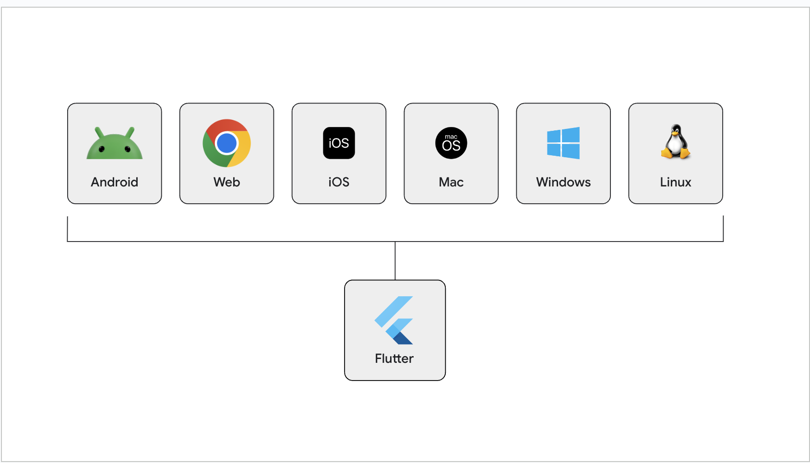<br>*One Flutter codebase builds apps for Android, iOS, web, macOS, Windows and Linux. Source: Flutter documentation.*

<p class="label">Exam notes</p>

| | **Native** | **Cross-platform (compiled)** | **Hybrid (WebView)** |
|---|---|---|---|
| Examples | Kotlin/Java (Android), Swift (iOS) | **Flutter**, React Native, Kotlin Multiplatform | Ionic, Cordova |
| Codebase | One per platform | One for both | One for both |
| UI | Platform's own widgets | Flutter draws its own; React Native maps to native widgets | HTML/CSS inside a WebView |
| Performance | Best | Near native | Lower |
| Device features | Full, first day | Through plugins or platform channels | Through plugins |
| Cost and speed | Two teams, slower | One team, faster | Cheapest |

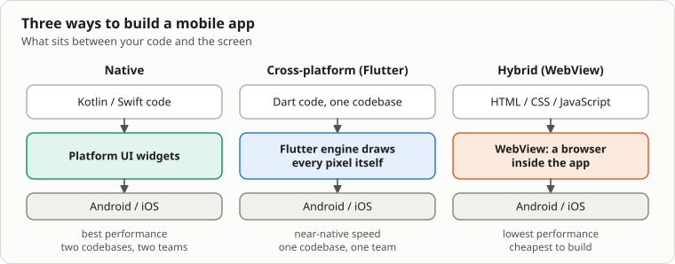

**When to choose native:** heavy use of new OS features, very small app size, widgets, watch apps, or an existing native codebase.
**When to choose Flutter:** the same app on Android and iOS, one small team, custom UI, fast delivery. This is the case for most business and field apps.

<div class="box q">

**Does Flutter remove the need for native knowledge?**

No. A Flutter app still lives inside a normal Android project and a normal iOS project. Signing, permissions, push notification setup and some SDKs need native files (`AndroidManifest.xml`, `Info.plist`) and sometimes native code. That is why job adverts ask for Flutter **and** Kotlin/Java **and** Swift.

</div>

<div class="box rule">

**Remember.** Native = two codebases, best performance. Flutter = one codebase, near-native speed. Hybrid = a website inside a WebView.

</div>

<div class="box check">

**Quick check**

1. Which approach draws the UI with its own rendering engine, not with the platform's widgets? (a) Native (b) Flutter (c) Hybrid
2. A team must use a brand-new iOS feature on the day Apple releases it. Which approach is safest?

<details>
<summary>Show answers</summary>

1. **(b) Flutter.** It paints every pixel itself.
2. **Native (Swift).** New OS features reach native code first. Flutter gets them later, through plugins.

</details>

</div>

## 2. How Flutter works

<div class="box def">

**Definition.** Flutter is Google's UI toolkit. You write the app in **Dart**. A C++ **engine** inside the app draws every pixel on the screen. A thin **embedder** connects the engine to Android or iOS.

</div>

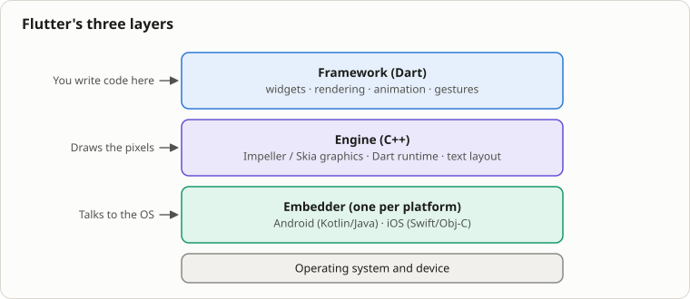

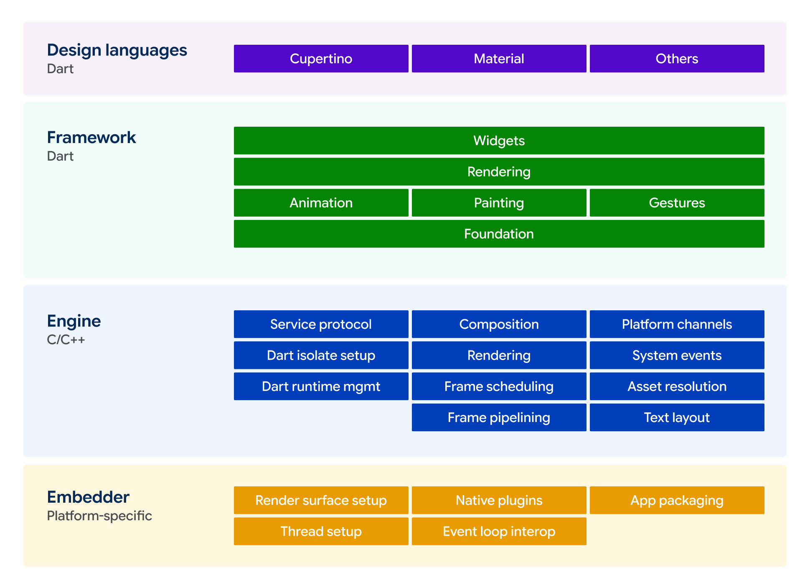<br>*The same three layers in the official picture. Each layer only talks to the layer below it. Source: Flutter documentation.*

<div class="box story">

**Example scenario.** Imagine you are building a login screen.

1. You change the button colour and press save.
2. In less than a second the running app shows the new colour. The text you typed in the email box is still there.

**What happened?** This is **hot reload**. In debug mode Dart uses **JIT** (Just-In-Time) compilation, so new code can be pushed into the running app while the state is kept.

3. Later you build the app for the Play Store. Now hot reload is gone, but the app starts fast and scrolls smoothly.

**What happened?** A release build uses **AOT** (Ahead-Of-Time) compilation. Your Dart code becomes native ARM machine code before it reaches the user.

</div>

<p class="label">Exam notes</p>

- <mark>Flutter **draws every pixel itself** on a canvas</mark>. It does not use the platform's buttons or lists. This gives the same look on every device.
- <mark>**Impeller** is the current rendering engine</mark> (it replaced Skia on iOS and modern Android). It prepares shaders at build time, which removes first-run animation jank.
- **Debug mode** uses <mark>**JIT** (Just-In-Time)</mark> compilation, which makes **hot reload** possible. **Release mode** uses <mark>**AOT** (Ahead-Of-Time)</mark> compilation to native ARM code, which makes the app fast.
- <mark>**Hot reload** injects changed code and keeps state. **Hot restart** restarts the app and loses state.</mark>

| Build mode | Compilation | Use |
|---|---|---|
| Debug | JIT, asserts on, slow | Development |
| Profile | AOT, with profiling tools | Measuring performance |
| Release | AOT, optimised, no debugging | Store builds |

<div class="box q">

**If Flutter does not use native buttons, how does a Flutter button look like an Android button?**

Flutter draws a picture of the button itself, following the Material Design rules. It is a copy, drawn pixel by pixel. That is why a Flutter app looks the same on a new phone and on an old phone.

</div>

<div class="box rule">

**Remember.** Debug = JIT = hot reload. Release = AOT = speed. Hot reload keeps state, hot restart loses it.

</div>

## 3. Dart essentials

<div class="box def">

**In simple words.** Dart is the language of Flutter. Three ideas matter most for the exam: **null safety** (the compiler stops you using a value that may be null), **`final` vs `const`**, and **asynchronous code** (next heading).

</div>

Dart is <mark>**object-oriented**, **statically typed**, has **sound null safety**, and is **single-threaded with an event loop**</mark>.

**Null safety**
```dart
String? name;                    // nullable: may hold null
int len = name?.length ?? 0;     // ?. safe call, ?? default value
String sure = name!;             // ! "I promise it is not null" (throws if it is)
late final Database db;          // set later, before first use
```

| Keyword | Meaning |
|---|---|
| `var` | Type is inferred, then fixed |
| `dynamic` | Any type, checked at run time (avoid) |
| `final` | <mark>Set **once**, at run time</mark> |
| `const` | <mark>**Compile-time** constant, deeply immutable</mark> |
| `late` | Non-nullable, initialised later |

**Other features asked in short questions:** named and optional parameters; `mixin` (reuse code across class hierarchies with `with`); `extension` (add methods to an existing type); generics (`List<T>`); `abstract class` and `interface` (every class is an implicit interface, use `implements`); `sealed` classes with `switch` pattern matching; `enum`; cascade operator `..`; spread operator `...`.

### Asynchronous Dart (very likely question)

<div class="box def">

**Definition.** Dart runs your code on **one thread**, inside an **event loop**. The loop takes one job at a time from a queue: draw the screen, handle a tap, handle a network reply. If one job takes too long, everything behind it waits.

</div>

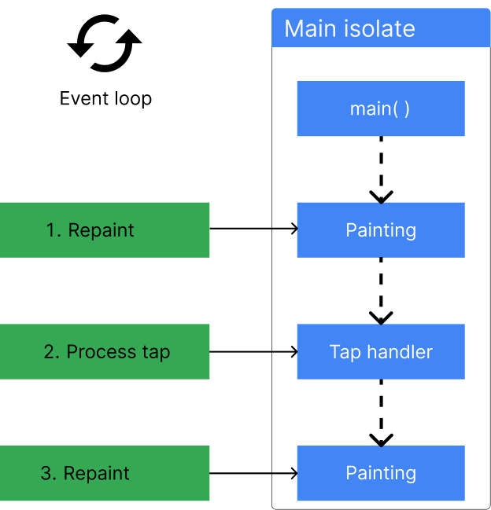<br>*The main isolate works through its events in order: repaint, handle the tap, repaint. Source: Dart documentation.*

<div class="box story">

**Example scenario.** Imagine a tea stall with **one** worker.

1. A customer orders tea. The worker puts the kettle on. He does **not** stand and stare at the kettle. He serves the next customer.
2. When the kettle whistles, he comes back and pours the tea.

This is **`await`**. Waiting for the network is like waiting for the kettle: the worker is free, so the screen keeps moving.

3. Now a customer asks him to count 10,000 coins by hand. He cannot serve anyone until he finishes. The queue grows.

This is **heavy CPU work on the main isolate**: parsing a huge JSON, compressing a photo. The screen freezes.

</div>

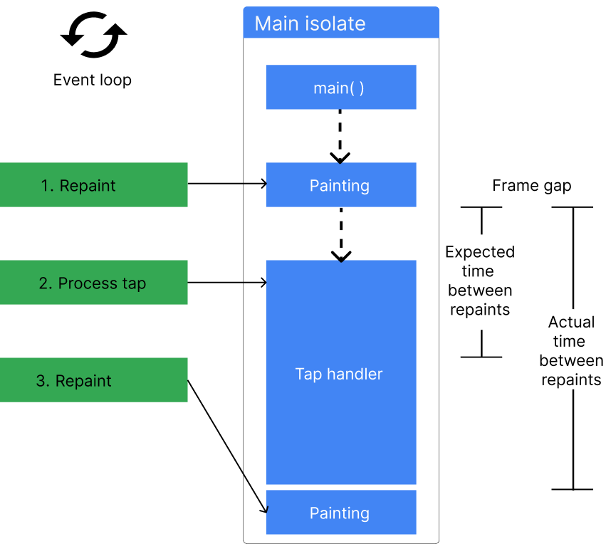<br>*When the tap handler runs too long, the next repaint is late. The user sees the screen freeze. Source: Dart documentation.*

<div class="box q">

**So how do I do heavy work without freezing the screen?**

Hire a second worker: an **isolate**. An isolate has its own memory and its own event loop. You send it a message with the work, and it sends back a message with the result. In code: `Isolate.run()` or `compute()`.

</div>

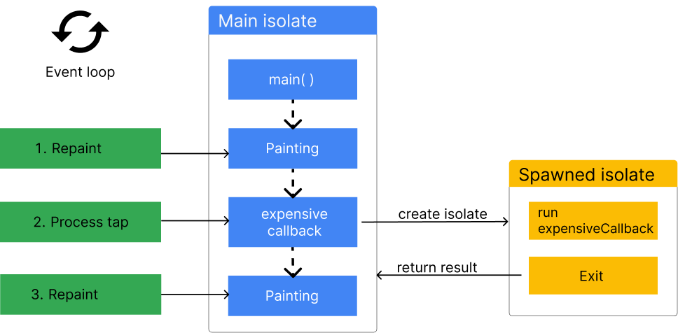<br>*The main isolate hands the expensive job to a spawned isolate and stays free to paint. Source: Dart documentation.*

<p class="label">Exam notes</p>

- <mark>**Future**: one value that arrives later</mark> (an API call). Use `async`/`await` or `.then()`.
- <mark>**Stream**: many values over time</mark> (location updates, DB changes). **Single-subscription** (one listener) or **broadcast** (many listeners).
- **Event loop**: Dart runs one thing at a time. It takes work from two queues. <mark>The **microtask queue** always empties first, then the **event queue**</mark> (I/O, timers, taps).
- <mark>**Isolate**: a separate worker with its **own memory**</mark>. Isolates share nothing and talk by **message passing** (`SendPort`/`ReceivePort`). Use `Isolate.run()` or `compute()` for heavy CPU work such as parsing a large JSON or processing an image. *(This is in your Mistakes Log: <mark>an isolate is like a process, not a thread</mark>.)*

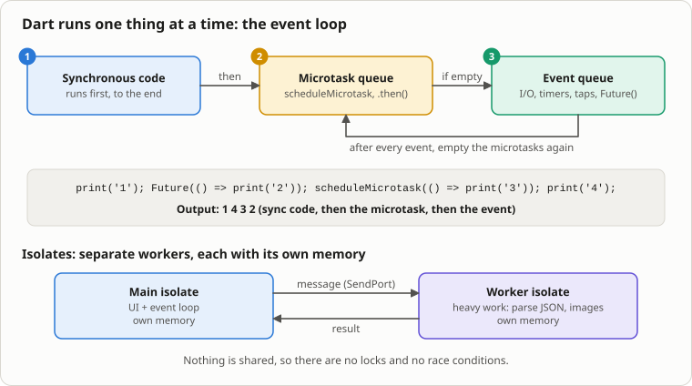

```dart
void main() {
  print('1');
  Future(() => print('2'));              // event queue
  scheduleMicrotask(() => print('3'));   // microtask queue
  print('4');
}
// Output: 1 4 3 2   (sync code, then microtasks, then events)
```

`await` <mark>does **not** block the UI</mark>. It pauses that function and lets the event loop continue. A long `for` loop of pure calculation **does** block the UI, so move it to an isolate.

```dart
Future<List<Visit>> fetchVisits() async {
  try {
    final res = await dio.get('/visits');
    return (res.data as List).map((j) => Visit.fromJson(j)).toList();
  } on DioException catch (e) {
    throw ServerFailure(e.message ?? 'Network error');
  }
}
```

<div class="box rule">

**Remember.** `await` waits without blocking. A long calculation blocks. Heavy work goes to an isolate. Order of running: sync code → microtasks → events.

</div>

<div class="box check">

**Quick check**

1. What does this print? `print('A'); Future(() => print('B')); scheduleMicrotask(() => print('C')); print('D');`
2. Your app freezes for two seconds while it parses a 5 MB JSON file. What is the fix? (a) add `await` (b) move the parsing to an isolate (c) use a Stream
3. True or false: two isolates can read the same variable.

<details>
<summary>Show answers</summary>

1. **A D C B.** Sync code first, then the microtask, then the event.
2. **(b).** `await` does not help, because parsing is CPU work, not waiting.
3. **False.** Isolates share no memory. They only send messages.

</details>

</div>

## 4. Widgets

<div class="box def">

**Definition.** A **widget** is a small, unchangeable description of one piece of the screen: a text, a button, a row. Flutter reads the description and builds the real screen from it. When data changes, you do not edit the screen. You give Flutter a **new description**.

</div>

<div class="box story">

**Example scenario.** Imagine a "Field Visit" form.

1. The screen opens. Flutter calls **`initState`** once. Here you create the text controller.
2. Flutter calls **`build`** and the form appears.
3. The officer ticks a checkbox. Your code calls **`setState`**. Flutter calls `build` again and draws the tick.
4. The officer goes back. Flutter calls **`dispose`** once. Here you close the controller.

**What happens if you forget step 4?** The controller stays in memory for ever. This is a **memory leak**.

</div>

<p class="label">Exam notes</p>

"Everything is a widget." <mark>A widget is an **immutable description** of a part of the UI.</mark>

| | StatelessWidget | StatefulWidget |
|---|---|---|
| State | None of its own | Has a `State` object that can change |
| Rebuilds when | The parent gives new data | `setState()` is called, or the parent gives new data |
| Examples | `Text`, `Icon`, a label | `Checkbox`, `TextField`, a form |

**The three trees**
| Tree | What it is | Lifetime |
|---|---|---|
| **Widget** tree | Configuration (cheap, immutable) | Rebuilt often |
| **Element** tree | The live instance that links a widget to its render object; holds state | Long-lived |
| **RenderObject** tree | Does layout and painting | Long-lived |

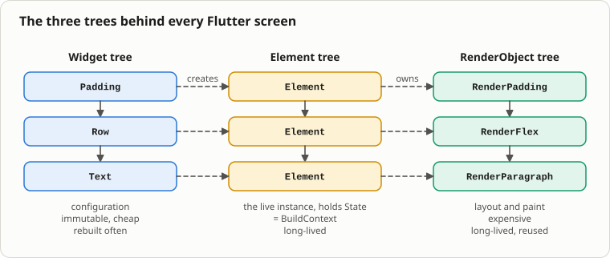

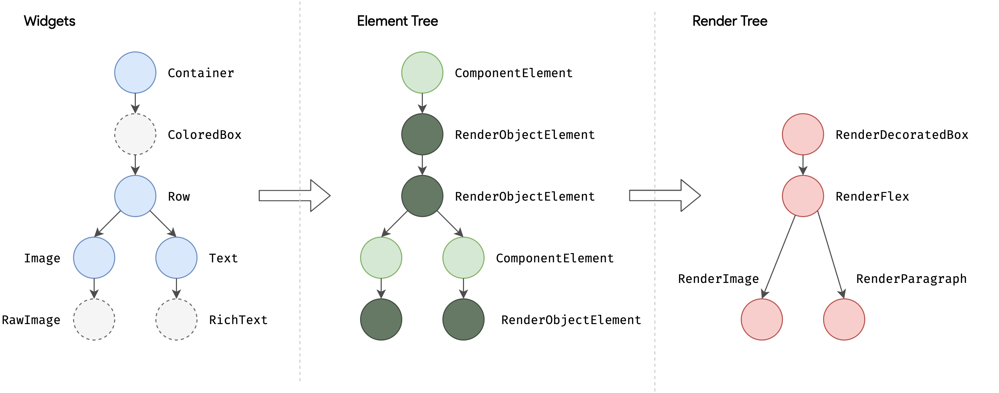<br>*The official picture of the three trees for a small screen. Source: Flutter documentation.*

<div class="box q">

**If widgets are rebuilt all the time, why is Flutter not slow?**

Because a widget is only a cheap description. The expensive objects, the **elements** and **render objects**, are kept and reused. Flutter compares the new description with the old one and changes only what is different.

</div>

<mark>**BuildContext** is the widget's **Element**</mark>: its position in the tree. `Theme.of(context)` walks **up** the tree from that position.

**State lifecycle** (memorise in order):

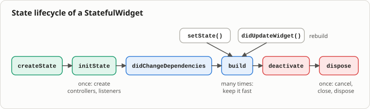

- `initState`: runs once. Create controllers, start listeners.
- `didChangeDependencies`: after `initState`, and when an inherited widget changes.
- `build`: returns the UI. Must be fast and free of side effects.
- `didUpdateWidget`: the parent rebuilt with new configuration.
- `dispose`: runs once. Cancel timers, close streams, dispose controllers. <mark>Skipping this causes memory leaks.</mark>

**Keys** tell Flutter which element belongs to which widget when widgets of the same type move, for example reordering a list of stateful items. `ValueKey` (by value), `ObjectKey`, `UniqueKey`, `GlobalKey` (access state from outside, for example `GlobalKey<FormState>`).

<mark>**InheritedWidget** passes data down the tree efficiently</mark>. `Theme`, `MediaQuery` and Provider are built on it.

<div class="box rule">

**Remember.** Widget = description (cheap, rebuilt). Element = the live instance (holds State). RenderObject = layout and paint. `initState` and `dispose` run once, `build` runs many times.

</div>

## 5. App lifecycle (Flutter)

<div class="box def">

**In simple words.** The app itself also has a life: it is on screen, it is behind another app, or it is being closed. Flutter tells you each change, so you can save a draft, lock the screen or refresh data at the right moment.

</div>

`AppLifecycleState`, observed with `WidgetsBindingObserver` or `AppLifecycleListener`:

| State | Meaning |
|---|---|
| `resumed` | Visible and receiving input |
| `inactive` | Visible but not receiving input (phone call, app switcher) |
| `hidden` | Not visible, about to pause |
| `paused` | In the background |
| `detached` | Engine running with no view; about to be destroyed |

Use: lock the app or clear sensitive screens on `paused`, refresh data or check session timeout on `resumed`.

## 6. State management (overview; BLoC in depth is in Ch 10)

<div class="box def">

**In simple words.** *State* is any data that can change while the app runs. *State management* is the answer to one question: **when the data changes, which part of the screen must rebuild, and how does it find out?**

</div>

| Tool | Idea | Good for | Weak point |
|---|---|---|---|
| `setState` | Local state in one widget | Small, local UI state | Does not scale across screens |
| **Provider** | `ChangeNotifier` + `notifyListeners()` over InheritedWidget | Small to medium apps | Easy to rebuild too much |
| **Riverpod** | Provider redesigned: compile-safe, no `BuildContext` needed | Medium to large apps | Learning curve |
| **BLoC / Cubit** | Events in, States out, through Streams | Large apps, strict separation, easy testing | More boilerplate |
| **GetX** | Reactive `Rx` values + routing + dependency injection | Fast development | Tight coupling, hidden global state, harder to test |

<mark>**Ephemeral state**</mark> (one widget: current tab, text being typed) vs **app state** (shared: logged-in user, cart, sync status).

## 7. Navigation

<div class="box def">

**In simple words.** Screens sit on a **stack**, like a pile of plates. `push` puts a new screen on top. `pop` removes the top screen and shows the one below.

</div>

- **Navigator 1.0 (imperative):** `Navigator.push(context, MaterialPageRoute(...))`, `pop`, named routes. A **stack** of routes.
- **Router / Navigator 2.0 (declarative):** usually through **go_router**. Supports **deep links**, web URLs and redirect guards (for example, send to login if there is no token).

## 8. Platform channels: how Flutter talks to native code

<div class="box def">

**Definition.** A **platform channel** is a named pipe between your Dart code and the native code (Kotlin or Swift) in the same app. Dart sends a message through the pipe, native code does the work, and the answer comes back.

**Its purpose** is to use something that Flutter has no plugin for.

</div>

<div class="box story">

**Example scenario.** Imagine the NGO buys a fingerprint scanner. The vendor gives only an Android SDK written in Java. There is no Flutter plugin.

1. In Dart you call `channel.invokeMethod('scanFinger')`.
2. The message crosses the channel to Kotlin.
3. Kotlin calls the vendor SDK and waits for the scan.
4. Kotlin answers with `result.success(data)`.
5. Your Dart `await` finishes with the data.

**What must match?** The channel **name** on both sides. If the names differ, Dart gets a `MissingPluginException`.

</div>

<p class="label">Exam notes</p>

Used when no plugin exists, or to reuse existing native code or a vendor's native SDK.

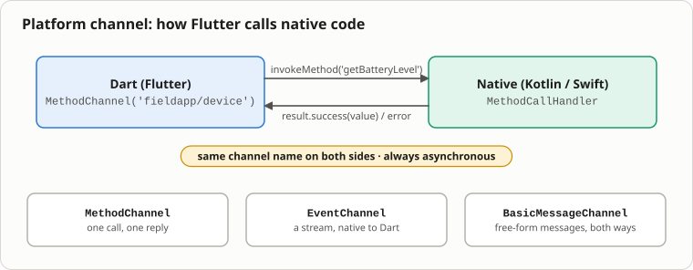

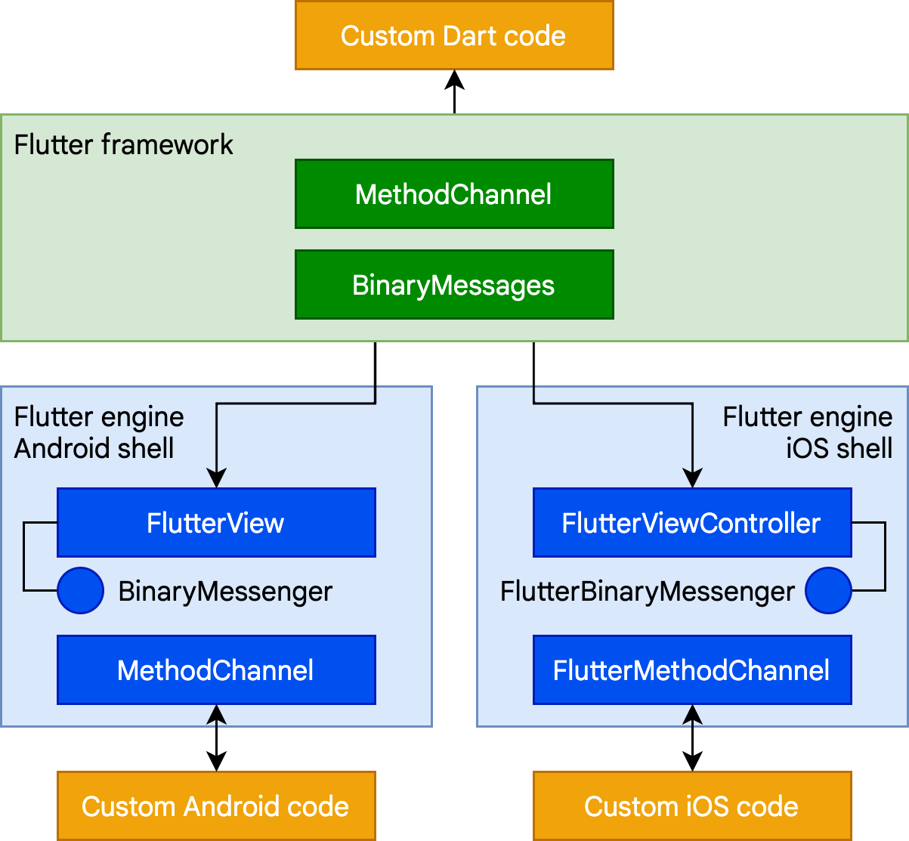<br>*The same idea in the official picture: the message goes from your Dart code, through the engine, to your Android or iOS code. Source: Flutter documentation.*

| Channel | Use |
|---|---|
| **MethodChannel** | <mark>One call, one reply</mark> (get battery level, open a native screen) |
| **EventChannel** | <mark>A **stream** from native to Dart</mark> (sensor data, Bluetooth events) |
| **BasicMessageChannel** | Free-form messages both ways |

Related: <mark>**Pigeon** generates type-safe channel code</mark>. **FFI** (`dart:ffi`) <mark>calls C/C++ libraries directly without a channel</mark>.

```dart
// Dart
const channel = MethodChannel('fieldapp/device');
final level = await channel.invokeMethod<int>('getBatteryLevel');
```
```kotlin
// Kotlin (MainActivity)
MethodChannel(flutterEngine.dartExecutor.binaryMessenger, "fieldapp/device")
  .setMethodCallHandler { call, result ->
    if (call.method == "getBatteryLevel") result.success(readBattery())
    else result.notImplemented()
  }
```
Rules: <mark>the channel **name must match** on both sides</mark>; calls are **asynchronous**; data is encoded by a **codec** (numbers, strings, lists, maps); native handlers run on the platform's **main thread**.

<div class="box rule">

**Remember.** MethodChannel = one call, one reply. EventChannel = a stream from native. Same channel name on both sides. Always asynchronous.

</div>

<div class="box check">

**Quick check**

1. You need live step-count updates from a native sensor. Which channel? (a) MethodChannel (b) EventChannel (c) BasicMessageChannel
2. Which tool generates type-safe channel code for you?

<details>
<summary>Show answers</summary>

1. **(b) EventChannel.** It gives a stream of values from native to Dart.
2. **Pigeon.**

</details>

</div>

## 9. Native Android basics

<div class="box def">

**In simple words.** An Android app is made of four kinds of building blocks. The most important is the **Activity**: one screen. Android creates, pauses and destroys an Activity as the user moves around, and it calls a method on your Activity at each step. Those methods are the **Activity lifecycle**.

</div>

<div class="box story">

**Example scenario.** Imagine a field officer filling a form in your app.

1. She opens the app → `onCreate`, `onStart`, `onResume`. The screen is ready.
2. A phone call arrives and covers the screen → `onPause`, then `onStop`.
3. She ends the call and returns → `onRestart`, `onStart`, `onResume`.
4. She presses Back and leaves → `onPause`, `onStop`, `onDestroy`.
5. Different case: she **rotates** the phone → the Activity is destroyed and created again.

**What does this mean for your code?** Save the draft in `onPause` or `onStop`, because the user may never come back. Keep screen data in a `ViewModel`, because rotation destroys the Activity.

</div>

**Languages:** <mark>**Kotlin** (Google's preferred language since 2019)</mark> and **Java**. Both compile to JVM bytecode and work together in one project.

| | Java | Kotlin |
|---|---|---|
| Null safety | No (NullPointerException is common) | Built in (`String?`) |
| Code length | Verbose | Concise (`data class`, type inference) |
| Async | Threads, callbacks, Executors | **Coroutines** (`suspend`, `launch`) |
| Extras | — | Extension functions, default arguments, smart casts |

<mark>**The four app components**</mark> (declared in `AndroidManifest.xml`):
1. **Activity**: one screen with a UI.
2. **Service**: long-running work with no UI (music, upload). A *foreground service* shows a notification.
3. **BroadcastReceiver**: reacts to system or app events (boot completed, network changed).
4. **ContentProvider**: shares data between apps (contacts).

**Intent**: a message that starts a component. <mark>**Explicit** (names the class) or **implicit** (names an action</mark>, such as "share" or "open URL").

**Activity lifecycle** (classic exam question; draw it):

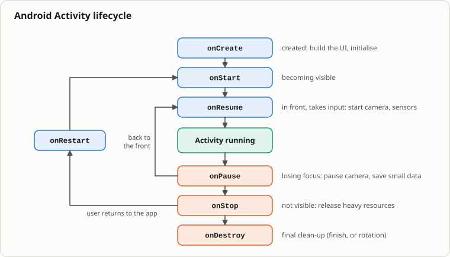

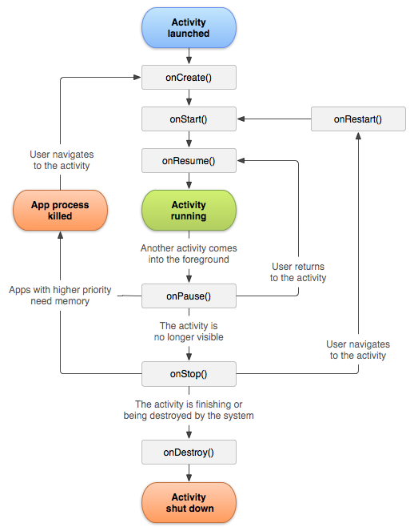<br>*The official diagram. Examiners usually expect this shape. Source: Android Developers.*

| Callback | When | Typical work |
|---|---|---|
| `onCreate` | Created | Inflate UI, initialise |
| `onStart` | Becoming visible | — |
| `onResume` | In front, interactive | Start camera, sensors |
| `onPause` | Losing focus | Pause camera, save small data |
| `onStop` | No longer visible | Release heavy resources |
| `onDestroy` | Being destroyed (finish, or rotation) | Final clean-up |

<mark>On screen **rotation** the Activity is destroyed and recreated, so UI state is kept in a **ViewModel**.</mark>

**Jetpack libraries to name:**
| Library | Job |
|---|---|
| **ViewModel** | Holds UI state across rotation |
| **LiveData / StateFlow** | Observable data for the UI |
| **Room** | SQLite with compile-time checked queries (see Ch 3) |
| **WorkManager** | Guaranteed background work (sync) |
| **Jetpack Compose** | Modern **declarative** UI in Kotlin (older style: XML layouts, imperative) |
| **DataStore** | Key-value storage (replaces SharedPreferences) |
| **Hilt** | Dependency injection |

**Build system:** Gradle (`build.gradle`). Key settings: `applicationId`, `minSdk` <mark>(oldest supported Android)</mark>, `targetSdk` <mark>(version the app is tested against)</mark>, `versionCode`, `versionName`.

```kotlin
data class Visit(val id: String, val memberName: String, val note: String? = null)

class VisitViewModel(private val repo: VisitRepository) : ViewModel() {
    private val _visits = MutableStateFlow<List<Visit>>(emptyList())
    val visits: StateFlow<List<Visit>> = _visits

    fun load() = viewModelScope.launch {     // coroutine, cancelled with the ViewModel
        _visits.value = repo.getVisits()      // suspend function, does not block the UI
    }
}
```

<div class="box q">

**What is the difference between `onPause` and `onStop`?**

`onPause`: the Activity is still **partly visible** but has lost focus (a dialog or a call screen is on top). `onStop`: the Activity is **not visible at all**. Do light work in `onPause`, because the next screen waits for it to finish.

</div>

<div class="box rule">

**Remember.** onCreate → onStart → onResume → *running* → onPause → onStop → onDestroy. Rotation destroys the Activity, so state lives in a ViewModel.

</div>

<div class="box check">

**Quick check**

1. Which callback runs when the Activity comes back from the background? (a) onCreate (b) onRestart (c) onDestroy
2. Name the four Android app components.
3. Which Intent names the exact class to start?

<details>
<summary>Show answers</summary>

1. **(b) onRestart**, then onStart and onResume.
2. Activity, Service, BroadcastReceiver, ContentProvider.
3. An **explicit** Intent.

</details>

</div>

## 10. Native iOS basics

<div class="box def">

**In simple words.** iOS apps are written in **Swift** with Xcode on a Mac. Two Swift ideas are asked most often: **value types and reference types**, and **ARC**, the way Swift frees memory.

</div>

<div class="box story">

**Example scenario 1: struct or class.** Imagine you give a friend your notes.

- A **struct** is a **photocopy**. He writes on his copy. Your notes do not change.
- A **class** is a **shared Google Doc**. He edits it, and you see the change, because both of you hold the same document.

**Example scenario 2: ARC.** Imagine a room where the light stays on while at least one person is inside. ARC counts the people (references). When the count reaches zero, the light goes off (the memory is freed).

**What is a retain cycle?** Two people each say "I will leave after you leave." Nobody leaves, so the light stays on for ever. The fix is to make one of them `weak`: he does not count as a person in the room.

</div>

<p class="label">Exam notes</p>

**Language:** **Swift** (replaced Objective-C). Safe, fast, uses **optionals** for null safety.

| Swift idea | Meaning |
|---|---|
| **Optional** (`String?`) | May be `nil`. Unwrap with `if let`, `guard let`, `??`, or force `!` |
| **struct vs class** | `struct` <mark>is a **value type** (copied)</mark>. `class` <mark>is a **reference type** (shared)</mark> |
| **protocol** | Like an interface |
| **closure** | Anonymous function (like a Dart lambda) |
| **ARC** | <mark>Automatic Reference Counting: memory is freed when the reference count reaches 0. Not a garbage collector</mark> |
| **Retain cycle** | <mark>Two objects hold strong references to each other, so neither is freed (a leak)</mark>. Fix with `weak` or `unowned` |
| `async`/`await`, **GCD** | Concurrency. `DispatchQueue.main` is the UI thread |

**UI frameworks:**
| | UIKit | SwiftUI |
|---|---|---|
| Style | <mark>**Imperative** (you change views step by step)</mark> | <mark>**Declarative** (UI is a function of state, like Flutter)</mark> |
| Building block | `UIViewController`, Storyboard/XIB | `View` structs, `@State`, `@Binding`, `@ObservedObject` |
| Age | 2008, most mature | 2019, modern |

**UIViewController lifecycle:** `viewDidLoad` → `viewWillAppear` → `viewDidAppear` → `viewWillDisappear` → `viewDidDisappear`.

**iOS app states:** <mark>Not Running → **Inactive** → **Active** → **Background** → **Suspended**</mark>.

**Tools and files:** Xcode (IDE, needs a Mac), `Info.plist` (app settings and permission texts such as `NSCameraUsageDescription`), **CocoaPods** / **Swift Package Manager** (dependencies), **Core Data** (local persistence, see Ch 3), Bundle Identifier.

```swift
struct Visit: Codable { let id: String; let memberName: String; var note: String? }

func loadVisits() async throws -> [Visit] {
    let (data, _) = try await URLSession.shared.data(from: url)
    return try JSONDecoder().decode([Visit].self, from: data)
}

if let note = visit.note { print(note) }        // optional binding
guard let user = currentUser else { return }    // early exit
```

<div class="box rule">

**Remember.** struct = value type (copy). class = reference type (shared). ARC counts references, it is not a garbage collector. A retain cycle is fixed with `weak`.

</div>

## 11. One table to connect all three

<div class="box def">

**How to use this table.** You already know the Flutter column. For each row, learn the Android word and the iOS word that do the same job. When the exam asks about Room or Keychain, you can explain it by its Flutter twin.

</div>

| Concept | Flutter | Android | iOS |
|---|---|---|---|
| Language | Dart | Kotlin / Java | Swift |
| Declarative UI | Widgets | Jetpack Compose | SwiftUI |
| Screen | Route / page widget | Activity / Fragment | UIViewController / View |
| Local SQL database | Drift, sqflite | **Room** | **Core Data**, SwiftData |
| Key-value store | shared_preferences, Hive | SharedPreferences, DataStore | UserDefaults |
| Secrets | flutter_secure_storage | <mark>**Keystore**</mark> | <mark>**Keychain**</mark> |
| Background work | workmanager plugin | **WorkManager** | <mark>**BGTaskScheduler**</mark> |
| Async | Future, Stream, Isolate | Coroutines, Flow | async/await, Combine, GCD |
| HTTP client | http, Dio | Retrofit + OkHttp | URLSession, Alamofire |
| Packages | pub.dev (`pubspec.yaml`) | Gradle (Maven) | SPM, CocoaPods |
| App config | `pubspec.yaml` | `AndroidManifest.xml`, `build.gradle` | `Info.plist` |
| Memory | Garbage collector | Garbage collector | ARC |
| IDE | VS Code, Android Studio | Android Studio | Xcode |

## 12. "Per technical specifications and coding standards"

<div class="box def">

**In simple words.** Building "per specifications and coding standards" means two things: build **what the documents say**, and write code **the way the team has agreed**.

</div>

- **Technical specification** = the SRS, API contract and design files. Build what is specified; raise gaps early.
- **Coding standards:** <mark>*Effective Dart* style guide</mark>; `flutter_lints` and `flutter analyze`; `dart format`; naming (`UpperCamelCase` classes, `lowerCamelCase` variables, `snake_case` files); small functions; no hard-coded strings or secrets; meaningful commit messages; code review before merge.

## Link it to your own projects

Interviews and written exams reward answers that use **your own work** as the example. Before you move on, answer these for yourself:

<div class="box you">

- Which Flutter apps have you built, and which state management did they use? Be ready to say **why**.
- Have you called native code (camera, sensors, a native SDK)? Describe it as a platform channel: the channel name, the method and the result.
- If you have not written Kotlin or Swift in production, say so honestly, and show that you understand the native lifecycle and how Flutter sits on top of it.

</div>

---

## Practice questions

**Short (2–3 marks each)**
1. What is the difference between hot reload and hot restart?
2. `final` vs `const` in Dart.
3. What is an isolate? How is it different from a thread?
4. What is the output, and why? `print('A'); Future(() => print('B')); scheduleMicrotask(() => print('C')); print('D');`
5. StatelessWidget vs StatefulWidget.
6. List the State lifecycle methods in order.
7. What are the four Android app components?
8. `struct` vs `class` in Swift.
9. What is ARC? What is a retain cycle?
10. Give three advantages of Kotlin over Java.

**Long (8–10 marks each)**

11. Compare native, cross-platform and hybrid app development. Why is Flutter a suitable choice for the NGO's field apps?
12. Draw and explain the Android Activity lifecycle.
13. What are platform channels? Explain with a diagram and a short code example how a Flutter app calls native code.
14. Explain Flutter's architecture and its three trees. Why is Flutter fast in release mode?

---

## Model answers

<div class="box exam">

**How to read these answers.** They are written for **learning**, so they are fuller than what you would write in the exam hall. Every answer has the same parts:

- **In short** (green): the direct answer. In the exam, write this part first.
- **Table or points:** the details, laid out so you can compare and remember them.
- **Example** (yellow): a real situation, usually from a field app or from your own projects.
- Long answers end with **In the exam** (brown): how to shorten the answer on paper.

Write your own answer first. Then open the model answer and compare.

</div>

<details>
<summary>1. What is the difference between hot reload and hot restart?</summary>

<div class="box def">

**In short.** **Hot reload** puts your changed code into the running app and rebuilds the screen, <mark>keeping the state</mark>. **Hot restart** starts the app again from `main()`, so <mark>the state is lost</mark>.

</div>

| Point | Hot reload | Hot restart | Full restart (stop and run) |
|---|---|---|---|
| **What it does** | Injects changed Dart code into the Dart VM and rebuilds the widget tree | Destroys the app state and runs `main()` again | Rebuilds and reinstalls the whole app |
| **State** | Kept | Lost | Lost |
| **Runs `main()` and `initState()` again** | No | Yes | Yes |
| **Time** | About 1 second | A few seconds | Longest |
| **Use it for** | UI and logic changes inside `build` | Changes to `main()`, `initState`, global or static variables, enums | Native code, new plugins, `pubspec.yaml`, assets, app icon |

**Two facts that are often asked**

- Both work only in **debug mode**, because debug mode uses the **JIT** compiler.
- Release builds use **AOT** compilation, so there is nothing to reload.

<div class="box story">

**Example.** You are on step 3 of a long loan form and you change the colour of the Save button. With hot reload you see the new colour and stay on step 3 with all the typed text. With hot restart you are back on the login screen.

</div>

<div class="ref">

**From the book:** [2. How Flutter works](#2-how-flutter-works)

</div>

</details>

<details>
<summary>2. <code>final</code> vs <code>const</code> in Dart.</summary>

<div class="box def">

**In short.** Both mean "cannot be assigned again". A `final` value is set **once at run time**. A `const` value must be known **at compile time**.

</div>

| Point | `final` | `const` |
|---|---|---|
| **When the value is fixed** | At run time, the first time it is set | At compile time |
| **Can use a run-time value** | Yes: `final now = DateTime.now();` | No: `const now = DateTime.now();` is an error |
| **The object inside** | Can still change (you can add to a `final` list) | Deeply immutable (a `const` list cannot change) |
| **Memory** | A new object each time | Identical `const` objects are shared (one copy) |
| **Class fields** | `final String name;` | Must be `static const` |
| **In widgets** | Fields of a widget | `const Text('Save')` is created once and <mark>skipped on rebuild</mark> |

```dart
final a = [1, 2];   a.add(3);     // allowed: the list can change
const b = [1, 2];   // b.add(3);  // run-time error: a const list cannot change

final time = DateTime.now();      // fine
const pi = 3.14159;               // fine, known at compile time
```

<div class="box story">

**Example.** The logged-in user's name comes from the server, so it is `final`. The padding value `16.0` and the label `Text('Save')` never change, so they are `const`. Marking widgets `const` is one of the cheapest ways to reduce rebuilds.

</div>

<div class="ref">

**From the book:** [3. Dart essentials](#3-dart-essentials)

</div>

</details>

<details>
<summary>3. What is an isolate? How is it different from a thread?</summary>

<div class="box def">

**In short.** An isolate is an independent Dart worker with its **own memory and its own event loop**. <mark>Threads share memory and need locks. Isolates share nothing and talk only by sending messages.</mark>

</div>

| Point | Thread (Java, Kotlin, Swift) | Isolate (Dart) |
|---|---|---|
| **Memory** | Shared between threads | Each isolate has its own heap |
| **Communication** | Read and write the same variables | Messages through ports (data is copied or transferred) |
| **Race conditions and deadlocks** | Possible, so you need locks | Not possible for shared data, because nothing is shared |
| **Garbage collection** | One pause affects all threads | Each isolate collects its own garbage |
| **Cost to start** | Small | A little higher |

**When to use an isolate.** Dart runs your code on **one main isolate**. Network calls and file reads are fine there, because they wait without blocking (`async`/`await`). But **CPU-heavy work** blocks the UI. Move that work to another isolate:

- Parsing a very large JSON file.
- Compressing or resizing images.
- Encryption, or heavy calculations.

```dart
final visits = await Isolate.run(() => parseVisits(bigJsonString));
// older style: await compute(parseVisits, bigJsonString);
```

<br>*The main isolate stays free for the UI while the worker isolate does the heavy job and sends back the result. Source: dart.dev.*

<div class="box story">

**Example.** After login, a field app downloads the full list of 20,000 borrowers as JSON. Parsing it on the main isolate freezes the screen for two seconds. With `Isolate.run`, the loading animation keeps moving.

</div>

<div class="ref">

**From the book:** [Asynchronous Dart (very likely question)](#asynchronous-dart-very-likely-question)

</div>

</details>

<details>
<summary>4. What is the output, and why? <code>print('A'); Future(() =&gt; print('B')); scheduleMicrotask(() =&gt; print('C')); print('D');</code></summary>

<div class="box def">

**In short.** The output is **`A D C B`**. <mark>Synchronous code runs first, then the microtask queue, then the event queue.</mark>

</div>


**Follow the code line by line**

| Line | What Dart does | Printed so far |
|---|---|---|
| `print('A')` | Runs now | A |
| `Future(() => print('B'))` | Puts the task in the **event queue** | A |
| `scheduleMicrotask(() => print('C'))` | Puts the task in the **microtask queue** | A |
| `print('D')` | Runs now | A D |
| Synchronous code is finished | The loop empties the **microtask queue** first | A D C |
| Microtasks are finished | The loop takes the next **event** | A D C B |

**The three rules**

1. Synchronous code always finishes first.
2. The microtask queue is emptied **completely** before any event.
3. Then one event runs, and the loop checks the microtasks again.

| Goes to the microtask queue | Goes to the event queue |
|---|---|
| `scheduleMicrotask()` | `Future(() {...})`, `Future.delayed()` |
| `Future.microtask()` | Timers |
| `.then()` on a future that is already complete | Taps, network replies, file I/O |

<div class="box story">

**A harder version to try.** `Future.delayed(Duration.zero, () => print('B'))` still prints B last. A zero delay does not mean "now". It means "at the back of the event queue".

</div>

<div class="ref">

**From the book:** [Asynchronous Dart (very likely question)](#asynchronous-dart-very-likely-question)

</div>

</details>

<details>
<summary>5. StatelessWidget vs StatefulWidget.</summary>

<div class="box def">

**In short.** A **StatelessWidget** has no data that changes after it is built. A **StatefulWidget** has a `State` object that holds changing data and rebuilds the UI when you call `setState()`.

</div>

| Point | StatelessWidget | StatefulWidget |
|---|---|---|
| **Mutable state** | None | Kept in a separate `State` object |
| **Rebuilds when** | Its parent rebuilds with new inputs | `setState()` is called, or its inputs change |
| **Classes** | One | Two: the widget and its `State` |
| **Lifecycle methods** | Only `build()` | `initState`, `build`, `didUpdateWidget`, `dispose` and more |
| **Cost** | Lighter | A little heavier |
| **Examples** | `Text`, `Icon`, a logo, a label | `TextField`, `Checkbox`, a form, an animation |

```dart
class Counter extends StatefulWidget {
  const Counter({super.key});
  @override
  State<Counter> createState() => _CounterState();
}

class _CounterState extends State<Counter> {
  int count = 0;                                   // the state

  @override
  Widget build(BuildContext context) => TextButton(
        onPressed: () => setState(() => count++),  // change it and rebuild
        child: Text('$count'),
      );
}
```

**A point that is easy to miss.** The widget itself is always immutable, even a StatefulWidget. The changing data lives in the `State` object, which stays alive while the widget is rebuilt again and again.

<div class="box story">

**Example.** On a visit screen, the header "Field Visit Entry" never changes: stateless. The "Photo taken ✓" indicator changes when the officer takes a photo: stateful (or driven by a BLoC or Provider).

</div>

<div class="ref">

**From the book:** [4. Widgets](#4-widgets)

</div>

</details>

<details>
<summary>6. List the State lifecycle methods in order.</summary>

<div class="box def">

**In short.** `createState` → `initState` → `didChangeDependencies` → `build` → (`didUpdateWidget` or `setState` → `build` again) → `deactivate` → `dispose`.

</div>


| Order | Method | Called | What you do there |
|---|---|---|---|
| 1 | `createState()` | Once, when the widget is created | Return the `State` object |
| 2 | `initState()` | <mark>Once</mark>, before the first build | Create controllers, start listeners, load data |
| 3 | `didChangeDependencies()` | After `initState`, and when an inherited widget changes | Read `Theme.of(context)`, `MediaQuery` |
| 4 | `build()` | <mark>Many times</mark> | Return the UI. Keep it fast and free of side effects |
| 5 | `didUpdateWidget()` | When the parent sends a new configuration | Compare old and new values |
| 6 | `setState()` | When you call it | Mark the widget dirty, so `build` runs again |
| 7 | `deactivate()` | When removed from the tree | Rarely used |
| 8 | `dispose()` | <mark>Once</mark>, at the end | Dispose controllers, cancel timers and stream subscriptions |

**Common mistakes**

- Forgetting `dispose()` → memory leak.
- Calling `setState()` after `dispose()` → error. Check `if (mounted)` after an `await`.
- Using `context` for inherited widgets inside `initState` → do it in `didChangeDependencies`.

<div class="box story">

**Example.** A camera screen creates the `CameraController` in `initState`, shows the preview in `build`, and releases the camera in `dispose`. If `dispose` is forgotten, the camera stays locked and the battery drains.

</div>

<div class="ref">

**From the book:** [4. Widgets](#4-widgets)

</div>

</details>

<details>
<summary>7. What are the four Android app components?</summary>

<div class="box def">

**In short.** **Activity**, **Service**, **BroadcastReceiver** and **ContentProvider**. All four are declared in `AndroidManifest.xml`.

</div>

| Component | What it is | Has a UI? | Everyday example | In a field app |
|---|---|---|---|---|
| **Activity** | One screen the user sees | Yes | The login screen | A Flutter app normally has one: `MainActivity` hosts all Flutter screens |
| **Service** | Work that runs without a screen | No | Music playing in the background | Uploading photos with a foreground service |
| **BroadcastReceiver** | Listens for system or app events | No | "Battery low", "boot completed" | Start sync when the network returns |
| **ContentProvider** | Shares data between apps | No | The Contacts app gives contacts to WhatsApp | Sharing a report file through `FileProvider` |

**How they are started**

- Activities, services and broadcast receivers are started by an <mark>**Intent**</mark> (a message that says "do this").
- A content provider is reached through a `ContentResolver`.

<div class="box story">

**Example.** When a push notification arrives, a **Service** from the Firebase SDK receives it. Tapping it sends an **Intent** that opens the **Activity**. Each plugin you add to a Flutter app quietly adds these components to the merged manifest.

</div>

<div class="ref">

**From the book:** [9. Native Android basics](#9-native-android-basics)

</div>

</details>

<details>
<summary>8. <code>struct</code> vs <code>class</code> in Swift.</summary>

<div class="box def">

**In short.** A `struct` is a **value type**: assigning it makes a copy. A `class` is a **reference type**: assigning it shares the same object.

</div>

| Point | `struct` | `class` |
|---|---|---|
| **Type** | Value type | Reference type |
| **On assignment** | Copied | Both names point to one object |
| **Inheritance** | No | Yes |
| **Memory** | Usually on the stack; no reference counting | On the heap; managed by **ARC** |
| **Free initialiser** | Yes (memberwise) | No, you write it |
| **`deinit`** | No | Yes |
| **Use for** | Simple data: models, coordinates. SwiftUI views are structs | Shared, long-lived objects: managers, view models |

```swift
struct Point { var x: Int }
var a = Point(x: 1)
var b = a          // a copy
b.x = 9            // a.x is still 1

class Box { var x = 1 }
let c = Box()
let d = c          // the same object
d.x = 9            // c.x is now 9
```

<div class="box story">

**Example.** A `Visit` model read from JSON is a `struct`: passing it to another screen cannot change the original by accident. The `SyncManager` that every screen shares is a `class`. Apple's advice is to start with a struct and use a class only when you need sharing or inheritance.

</div>

<div class="ref">

**From the book:** [10. Native iOS basics](#10-native-ios-basics)

</div>

</details>

<details>
<summary>9. What is ARC? What is a retain cycle?</summary>

<div class="box def">

**In short.** <mark>**ARC (Automatic Reference Counting)**</mark> is how Swift frees memory: it counts the strong references to each object and frees the object when the count reaches zero. A **retain cycle** is two objects holding strong references to each other, so neither count reaches zero and the memory is never freed.

</div>

**How ARC counts**

1. `let a = Visit()` → count is 1.
2. `let b = a` → count is 2.
3. Both go out of scope → count is 0 → the object is freed at once.

**How a retain cycle happens**

```swift
class Screen {
    var onDone: (() -> Void)?
    func load() {
        onDone = { self.refresh() }          // the closure holds self strongly
    }                                        // and self holds the closure: a cycle
}

onDone = { [weak self] in self?.refresh() }  // the fix
```

| Kind of reference | Adds to the count? | If the object is freed | Use when |
|---|---|---|---|
| **strong** (default) | Yes | It cannot be freed while this exists | Normal ownership |
| **weak** | No | Becomes `nil` (it is an optional) | The other object may go away first: delegates, closures |
| **unowned** | No | Crashes if you use it | The other object surely lives longer |

| | ARC (Swift) | Garbage collector (Dart, Java, Kotlin) |
|---|---|---|
| **When memory is freed** | Immediately, when the count is zero | Later, when the collector runs |
| **Handles cycles alone** | No, you must use `weak` | Yes |
| **Pauses** | None | Short pauses possible |

<div class="box story">

**Example.** A view controller starts a network call and passes a closure that uses `self`. The user leaves the screen. Without `[weak self]`, the screen stays in memory until the call ends, or forever if the two hold each other. In Xcode you find this with the **Memory Graph** or the **Leaks** instrument.

</div>

<div class="ref">

**From the book:** [10. Native iOS basics](#10-native-ios-basics)

</div>

</details>

<details>
<summary>10. Give three advantages of Kotlin over Java.</summary>

<div class="box def">

**In short.** (1) **Null safety** in the type system, (2) **much less code** (data classes, type inference), and (3) **coroutines** for simple asynchronous code. Kotlin is also fully interoperable with Java, and it is Google's preferred language for Android.

</div>

| Feature | Java | Kotlin |
|---|---|---|
| **Null safety** | Any object can be `null`; errors appear at run time (`NullPointerException`) | `String` cannot be null; `String?` can. Checked at compile time |
| **Data class** | Write fields, constructor, getters, `equals`, `hashCode`, `toString` by hand | `data class Visit(val id: String, val note: String)` |
| **Async code** | Threads, callbacks, executors | Coroutines: `suspend` functions that read like normal code |
| **Extension functions** | Not available | Add a function to an existing class: `fun String.isPhone()` |
| **Type inference** | Limited (`var` only for locals) | `val x = 5` |
| **Smart casts** | Manual cast after `instanceof` | Automatic after an `is` check |
| **Checked exceptions** | Yes | No |

```kotlin
val name: String? = user?.name          // may be null, and the compiler knows it
val length = name?.length ?: 0          // safe call and a default value

suspend fun loadVisits(): List<Visit> = api.getVisits()   // a coroutine
```

<div class="box story">

**Example.** When you write the Android side of a platform channel in a Flutter app (`MainActivity.kt`), Kotlin is the default. A mistake like calling a method on a null result is caught while you type, not on a field officer's phone.

</div>

<div class="ref">

**From the book:** [9. Native Android basics](#9-native-android-basics) [11. One table to connect all three](#11-one-table-to-connect-all-three)

</div>

</details>

<details>
<summary>11. Compare native, cross-platform and hybrid app development. Why is Flutter a suitable choice for the NGO's field apps?</summary>

<div class="box def">

**In short.** **Native** means one app per platform in the platform's own language. **Cross-platform** means one codebase compiled to run on both. **Hybrid** means a web app wrapped inside a native shell. Flutter is cross-platform. It suits the NGO because one small team can maintain all the apps, with near-native speed and strong offline support.

</div>


#### 1. The three approaches

| Point | Native | Cross-platform | Hybrid |
|---|---|---|---|
| **Language** | Kotlin/Java for Android, Swift for iOS | Dart (Flutter), JavaScript (React Native) | HTML, CSS, JavaScript |
| **Codebases** | Two | One | One |
| **How the UI is drawn** | The platform's own widgets | Flutter draws its own pixels; React Native maps to native widgets | Inside a WebView (a browser without the bar) |
| **Performance** | Best | Near native | Lowest |
| **Access to device features** | Full and immediate | Through plugins and platform channels | Through plugins, limited |
| **Cost and team** | Highest: two teams | Lower: one team | Lowest |
| **Examples** | Android Studio, Xcode | Flutter, React Native, Kotlin Multiplatform | Ionic, Cordova |

#### 2. Why Flutter fits the NGO's field apps

| Reason | What it means for the NGO |
|---|---|
| **One codebase for Android and iOS** | A small team can build and maintain all of the NGO's apps |
| **Near-native performance** | AOT compilation to machine code and its own rendering engine keep it smooth, even on low-cost field phones |
| **Strong offline support** | SQLite/Drift, Hive and background sync packages suit field offices with weak network |
| **Same UI on every device** | Flutter draws every pixel itself, so a form looks the same on an old Android phone and a new iPhone |
| **Fast development** | Hot reload shortens the design and feedback loop |
| **Native features stay available** | Camera, GPS, biometrics and vendor SDKs through plugins and platform channels |
| **The job market asks for it** | Most mobile job adverts in Bangladesh name Flutter |

#### 3. The limits (always add one honest line)

- The app is larger than a native app.
- A brand-new OS feature can arrive in Flutter a little later.
- Some jobs still need native code. So **Kotlin and Swift knowledge is still required**, which is why job adverts list them too.

<div class="box story">

**Link to your own work.** Close with one true sentence about your own projects, for example: "I have published Flutter apps on both the Play Store and the App Store, from one codebase, and they run well on low-cost Android phones."

</div>

<div class="box exam">

**In the exam.** One line for each approach, then the table with four or five rows, then five reasons for Flutter with words from the question's scenario in them (field officers, weak network, small team), then one limit.

</div>

<div class="ref">

**From the book:** [1. Ways to build a mobile app](#1-ways-to-build-a-mobile-app) [2. How Flutter works](#2-how-flutter-works)

</div>

</details>

<details>
<summary>12. Draw and explain the Android Activity lifecycle.</summary>

<div class="box def">

**In short.** An Activity moves through fixed states from creation to destruction. Android tells the app about each change through **callbacks**: `onCreate` → `onStart` → `onResume` → (running) → `onPause` → `onStop` → `onDestroy`, with `onRestart` when a stopped activity comes back.

</div>


#### 1. The callbacks

| Callback | When it is called | The activity is | Typical work |
|---|---|---|---|
| `onCreate()` | Once, when created | Not visible yet | Set up the UI, create objects, restore saved state |
| `onStart()` | Becoming visible | Visible | Start things the user can see |
| `onResume()` | Comes to the front | Visible and **interactive** | Start the camera, animations, sensors |
| `onPause()` | Losing focus (a dialog, another app opening) | Partly visible | Pause the camera and animations. Keep it short |
| `onStop()` | Fully hidden | Not visible | Save drafts, release heavy resources |
| `onRestart()` | Coming back after `onStop` | About to be visible | Then `onStart` runs again |
| `onDestroy()` | Finished, or killed by the system | Gone | Final clean-up |

#### 2. Three pairs that are easy to remember

| Pair | Lifetime | Meaning |
|---|---|---|
| `onCreate` ↔ `onDestroy` | Entire lifetime | The activity exists |
| `onStart` ↔ `onStop` | Visible lifetime | The user can see it |
| `onResume` ↔ `onPause` | Foreground lifetime | The user can touch it |

#### 3. Common situations

| The user... | Callbacks |
|---|---|
| Opens the app | `onCreate` → `onStart` → `onResume` |
| Presses Home | `onPause` → `onStop` |
| Returns to the app | `onRestart` → `onStart` → `onResume` |
| Presses Back to leave | `onPause` → `onStop` → `onDestroy` |
| Rotates the phone | The activity is **destroyed and created again** |

- On rotation, keep data in a **ViewModel** or `onSaveInstanceState`, so it is not lost.
- When memory is low, Android can kill a stopped app without calling `onDestroy`. So save important data in `onPause` or `onStop`.

#### 4. The same idea in Flutter

Flutter reports it through `AppLifecycleState`: `resumed`, `inactive`, `hidden`, `paused`, `detached`. You listen with `WidgetsBindingObserver` or `AppLifecycleListener`.

<div class="box story">

**Example.** A field officer is filling in a visit form and a phone call comes in. `onPause` and then `onStop` run. The app saves the draft locally there. If Android kills the app during the call, the draft is still on the phone when she comes back.

</div>

<div class="box exam">

**In the exam.** Draw the diagram first (it carries half the marks). Then the callback table with one line each. Then the three pairs. End with one example: pause the camera in `onPause`, save the draft in `onStop`.

</div>

<div class="ref">

**From the book:** [9. Native Android basics](#9-native-android-basics) [5. App lifecycle (Flutter)](#5-app-lifecycle-flutter)

</div>

</details>

<details>
<summary>13. What are platform channels? Explain with a diagram and a short code example how a Flutter app calls native code.</summary>

<div class="box def">

**In short.** A platform channel is a **named bridge that carries asynchronous messages** between Dart code and the native code of the host platform (Kotlin/Java on Android, Swift/Objective-C on iOS). Flutter uses it for anything Dart cannot do alone.

</div>


#### 1. When you need one

- No plugin exists for the feature.
- A vendor gives only a native SDK (a fingerprint device, a POS printer, a payment SDK).
- You want to reuse existing native code.

#### 2. The three channel types

| Channel | Direction | Use it for | Example |
|---|---|---|---|
| **MethodChannel** | Dart calls a method, native replies once | One request, one answer | "Get the battery level", "print this receipt" |
| **EventChannel** | Native sends a **stream** of events to Dart | Continuous data | Sensor values, Bluetooth scan results |
| **BasicMessageChannel** | Free messages both ways | Custom message formats | Sending strings or JSON back and forth |

#### 3. The code

**Dart side**

```dart
const channel = MethodChannel('fieldapp/device');

Future<int?> batteryLevel() async {
  try {
    return await channel.invokeMethod<int>('getBatteryLevel');
  } on PlatformException catch (e) {
    debugPrint('Failed: ${e.message}');
    return null;
  }
}
```

**Android side (Kotlin, in `MainActivity`)**

```kotlin
override fun configureFlutterEngine(flutterEngine: FlutterEngine) {
    super.configureFlutterEngine(flutterEngine)
    MethodChannel(flutterEngine.dartExecutor.binaryMessenger, "fieldapp/device")
        .setMethodCallHandler { call, result ->
            when (call.method) {
                "getBatteryLevel" -> result.success(readBattery())
                else -> result.notImplemented()
            }
        }
}
```

#### 4. What happens, step by step

1. Dart calls `invokeMethod('getBatteryLevel')`.
2. The method name and arguments are turned into bytes by the **standard message codec**.
3. The bytes cross to the native side through the engine.
4. The Kotlin handler runs and calls `result.success(value)`.
5. The value comes back as a `Future` in Dart.

#### 5. Rules

- The **channel name must be the same** on both sides.
- Calls are **asynchronous**, so always `await`.
- Only simple types pass through: null, bool, numbers, String, bytes, List, Map.
- Handle `PlatformException` and `notImplemented`.
- The native handler runs on the platform's main thread. Move heavy work to a background thread.

**Two related tools:** **Pigeon** generates type-safe channel code, so method names are not typed by hand. **FFI** (`dart:ffi`) calls C libraries directly, without a channel.

<div class="box story">

**Link to your own work.** A custom camera, an on-device AI model or a Bluetooth printer SDK all sit on this native boundary. Every plugin from pub.dev (camera, geolocator, local_auth) is built on platform channels in the same way. Name one you have used.

</div>

<div class="box exam">

**In the exam.** Definition, the diagram (Dart → channel → native → back), the three types in a small table, six to eight lines of Dart, four lines of Kotlin, and two rules.

</div>

<div class="ref">

**From the book:** [8. Platform channels: how Flutter talks to native code](#8-platform-channels-how-flutter-talks-to-native-code)

</div>

</details>

<details>
<summary>14. Explain Flutter's architecture and its three trees. Why is Flutter fast in release mode?</summary>

<div class="box def">

**In short.** Flutter has **three layers**: the **Framework** (Dart), the **Engine** (C++) and the **Embedder** (platform code). It builds the UI with **three trees**: Widget, Element and RenderObject. It is fast in release mode because Dart is compiled **ahead of time to native machine code** and Flutter **draws its own pixels**.

</div>


#### 1. The three layers

| Layer | Written in | What is inside | Your contact with it |
|---|---|---|---|
| **Framework** | Dart | Widgets (Material, Cupertino), rendering, animation, gestures | You write your app here |
| **Engine** | C++ | The rendering engine (**Impeller**, earlier Skia), the Dart runtime, text layout | You do not touch it |
| **Embedder** | Kotlin/Java, Swift/Objective-C | Creates the window and surface, passes in touch input, runs the event loop, hosts plugins | `MainActivity`, `AppDelegate` |

Flutter does **not** use the platform's own buttons and text fields. It paints every pixel on a canvas, like a game engine.

#### 2. The three trees


| Tree | What it is | Lifetime | Cost |
|---|---|---|---|
| **Widget** | An immutable description: "a blue button with this text" | Rebuilt very often | Very cheap |
| **Element** | The living instance that links a widget to its render object and holds the `State` | Long-lived, reused | Medium |
| **RenderObject** | Does layout, painting and hit testing | Long-lived, reused | Expensive |

**Why three trees?** When `setState` runs, Flutter builds new widgets (cheap). Each element compares the new widget with the old one. If the **type and key** are the same, the element and render object are **reused** and only the changed properties are updated. So only the changed parts are laid out and painted again.

#### 3. Why it is fast in release mode

| | Debug mode | Release mode |
|---|---|---|
| **Compiler** | JIT (Just-In-Time) | <mark>AOT (Ahead-Of-Time)</mark> |
| **Code that runs** | Compiled while the app runs | Native ARM machine code |
| **Hot reload** | Yes | No |
| **Speed and start-up** | Slower | Fast |

- **AOT:** no interpreter and no compile step at run time.
- **Its own rendering:** drawn directly with the GPU; no translation to native widgets.
- **Impeller** compiles shaders at build time, so there is no shader jank on first use.
- **The three trees** keep the work per frame small.
- Target: **60 fps** (16.67 ms per frame), or 120 fps on newer screens.

<div class="box story">

**Example.** A list of 500 visits is on screen and one item changes from "Pending" to "Synced". New widgets are created for the visible rows, but the elements and render objects are reused. Only that one label is painted again.

</div>

<div class="box exam">

**In the exam.** Draw the three layers as three stacked boxes and the three trees side by side. Give each tree one line. Finish with three reasons for speed: AOT, its own rendering engine, and reuse of elements and render objects.

</div>

<div class="ref">

**From the book:** [2. How Flutter works](#2-how-flutter-works) [4. Widgets](#4-widgets)

</div>

</details>

<div class="book-nav"><span>← <a href="00%20-%20Contents%20and%20How%20to%20Use.md">Contents</a></span><span><a href="00%20-%20Contents%20and%20How%20to%20Use.md">Contents</a></span><span><a href="02%20-%20UI-UX%20Implementation.md">02 - UI-UX Implementation</a> →</span></div>
