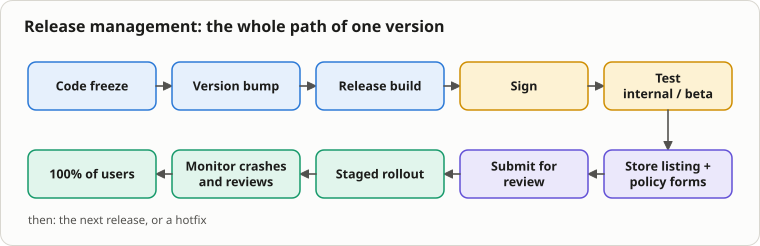
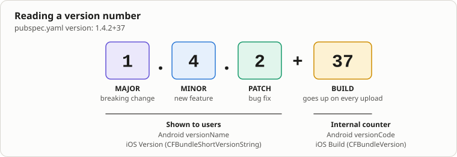
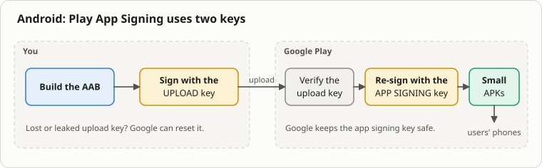
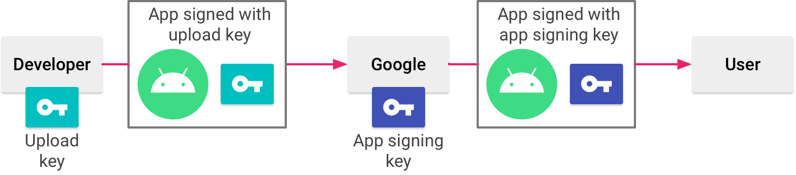
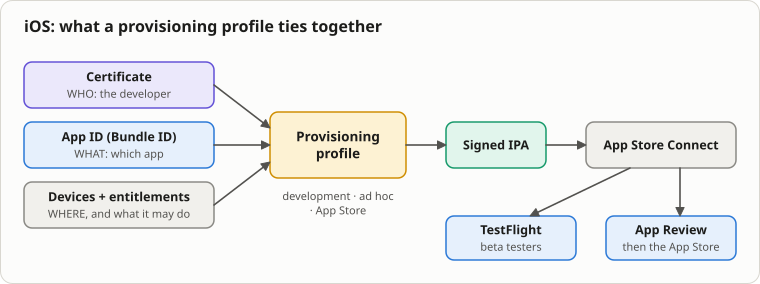
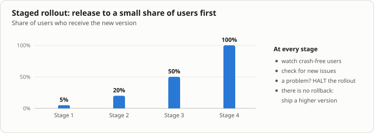

<div class="chapter-head">
<div class="chapter-kicker"><b>Chapter 8</b>App Store Deployment and DevOps</div>

# Store Publishing and Code Signing

</div>

> **The skill:** Take an app from a release build to the **Google Play Store** and **Apple App Store**: versions, code signing, store policies, the store listing (ASO) and release workflows.

Publishing is mostly clicks in Play Console and App Store Connect, but interviews and exams test the **vocabulary**: keystore, upload key, provisioning profile, versionCode, tracks, staged rollout, ASO. Learn the two signing diagrams.

---

## 1. Release management: the whole path

<div class="box def">

**Definition.** **Release management** is the controlled way of taking a finished version of the app from the developer's computer to the users' phones: build it, sign it, test it, publish it and watch it.

</div>



**Release management** means planning, building, testing, approving, publishing and monitoring each version in a controlled, repeatable way, with a record of what changed (release notes, Git tag).

## 2. Version configuration

<div class="box def">

**Definition.** Every app version has **two numbers**. One is for **people**, such as `1.4.2`. The other is for the **store's computer**, such as `37`, and it must go up with every upload.

</div>

<div class="box story">

**Example scenario.** Imagine you publish version `1.4.2` and then find a spelling mistake.

1. You fix the spelling and build again. You think: "It is still 1.4.2."
2. You upload it. The Play Console refuses: *"Version code 37 has already been used."*
3. You change the build number to `38` and upload again. It works. Users still see `1.4.2`.

**What happened?** The store does not read `1.4.2`. It only compares the build number, to know which file is newer.

</div>

<p class="label">Exam notes</p>

<mark>**Semantic versioning: `MAJOR.MINOR.PATCH`**</mark>
| Part | Increase when | Example |
|---|---|---|
| MAJOR | <mark>Breaking or very large change</mark> | 1.4.2 → **2**.0.0 |
| MINOR | <mark>New feature, backward compatible</mark> | 1.4.2 → 1.**5**.0 |
| PATCH | Bug fix | 1.4.2 → 1.4.**3** |

Every app has **two** version values:



| | Shown to users | <mark>Internal counter (**must increase on every upload**)</mark> |
|---|---|---|
| Flutter `pubspec.yaml` | `version: 1.4.2+37` → `1.4.2` | `37` |
| Android | <mark>**`versionName`**</mark> | <mark>**`versionCode`** (integer)</mark> |
| iOS | <mark>**`CFBundleShortVersionString`** (Version)</mark> | <mark>**`CFBundleVersion`** (Build)</mark> |

The store rejects an upload whose build number is not higher than the last one. CI usually sets it automatically (`--build-number=$RUN_NUMBER`).

Other identity settings: **`applicationId`** (Android) and **Bundle Identifier** (iOS), for example `org.example.fieldapp`. It is unique and <mark>**can never change** after publishing</mark>. `minSdk` / `targetSdk` / iOS deployment target set which OS versions are supported.

<div class="box rule">

**Remember.** `versionName` (Android) / Version (iOS) = shown to users. `versionCode` (Android) / Build (iOS) = an integer that must increase on every upload. MAJOR.MINOR.PATCH = breaking, feature, fix.

</div>

## 3. Code signing: why

<div class="box def">

**Definition.** **Code signing** is putting the developer's digital signature on the app file. The phone and the store check this signature before they install the app.

</div>

<div class="box story">

**Example scenario.** Imagine an official letter from the NGO with a **wax seal**.

1. The seal shows the letter really comes from the NGO. *(authenticity)*
2. If someone opens the letter and changes a number, the seal breaks. *(integrity)*
3. Next month a second letter arrives. You accept it only if it carries the **same seal**. *(an update must be signed with the same key)*

**What happens without it?** Anyone could take your app, add spyware and offer it as an "update". The phone would have no way to tell the difference.

</div>

A **digital signature** made with the developer's **private key** is attached to the app. It proves:
1. <mark>**Authenticity:** the app really comes from this developer.</mark>
2. <mark>**Integrity:** the app was not modified after signing.</mark>
3. **Update trust:** <mark>an update installs only if it is signed with the **same key** as the installed app</mark>.

Unsigned apps cannot be installed from the stores.

<div class="box rule">

**Remember.** Signing proves three things: who made the app, that it was not changed, and that an update comes from the same developer.

</div>

## 4. Android signing and publishing

<div class="box def">

**In simple words.** On Android, the signature is made with a private key that lives in a file called a **keystore**. With **Play App Signing** there are two keys: you sign with an **upload key**, and Google signs the final app with the **app signing key**.

</div>

<div class="box story">

**Example scenario.** Imagine a developer keeps the only copy of the signing key on his laptop, and the laptop is stolen.

- **In the old days:** the app could never be updated again. A new key means a "different developer" to Android. He would have to publish a new app and lose all his users.
- **With Play App Signing:** the stolen key is only the **upload key**. He asks Google to cancel it and register a new one. The real **app signing key** was never on his laptop. It is safe with Google.

</div>

<p class="label">Exam notes</p>

**Key terms**
| Term | Meaning |
|---|---|
| **Keystore** (`.jks` / `.keystore`) | <mark>A password-protected file holding the private key and its certificate</mark>. Created with `keytool` |
| **Key alias, store password, key password** | Needed to use the key; kept in `key.properties`, <mark>**never committed to Git**</mark> |
| **App signing key** | Signs the APKs users receive. <mark>With **Play App Signing**, Google stores and protects it</mark> |
| **Upload key** | You sign the bundle with this before uploading. <mark>If it is lost or leaked, Google can **reset** it</mark> |
| **APK** | Installable Android package |
| <mark>**AAB** (Android App Bundle)</mark> | <mark>**Publishing format required by Google Play for new apps.**</mark> Google generates small, device-specific APKs from it |
| **R8 / ProGuard** | Shrinks and obfuscates code in release builds |



<br>*The official picture: the developer signs with the upload key, Google signs again with the app signing key, and the user receives that version. Source: Android Developers.*

**Steps**
1. Create the keystore: `keytool -genkey -v -keystore upload.jks -keyalg RSA -keysize 2048 -validity 10000 -alias upload`.
2. Reference it from `android/key.properties` and the `signingConfigs` block in `build.gradle`.
3. Set the version; build: `flutter build appbundle --release`.
4. **Play Console:** create the app → **store listing** (title, descriptions, icon, screenshots, feature graphic) → **App content** forms: privacy policy URL, **Data safety**, content rating, target audience, ads declaration, app access (test login for reviewers).
5. Upload to a **track** and roll out.

**Testing tracks**
| Track | Who gets it |
|---|---|
| **Internal testing** | <mark>Up to 100 testers, available in minutes</mark> |
| **Closed testing** | Invited groups (alpha) |
| **Open testing** | Anyone can join (public beta) |
| **Production** | All users; <mark>supports **staged rollout** by percentage</mark> |

**Facts:** <mark>one-time **USD 25** registration fee</mark>. New **personal** developer accounts must run a closed test with at least <mark>**12 testers for 14 days**</mark> before applying for production. Apps must target a **recent Android API level** (Google raises the minimum `targetSdk` every year). Review usually takes hours to a few days.

<div class="box q">

**APK or AAB: which one do I upload?**

An **AAB** (Android App Bundle). It is a publishing package, not an installable file. Google opens it and builds a small APK for each kind of phone, with only the code and images that phone needs. An **APK** is the file that is actually installed.

</div>

<div class="box rule">

**Remember.** Keystore = file with your private key, never in Git. Upload key = yours, can be reset. App signing key = kept by Google. AAB = upload format. Tracks: internal → closed → open → production.

</div>

<div class="box check">

**Quick check**

1. Which key can be reset if it is lost? (a) app signing key (b) upload key
2. Which track gives a build to up to 100 testers within minutes?
3. Which file do you upload to Google Play for a new app? (a) APK (b) AAB (c) IPA

<details>
<summary>Show answers</summary>

1. **(b) the upload key.**
2. The **internal testing** track.
3. **(b) AAB.**

</details>

</div>

## 5. iOS signing and publishing

<div class="box def">

**In simple words.** Apple asks three questions before an app may run on an iPhone: **who** built it, **which app** is it, and **where** may it run. A **provisioning profile** is one file that answers all three.

</div>

<div class="box story">

**Example scenario.** Imagine a driver entering a guarded compound.

1. The guard checks the **driving licence**: who are you? *(the certificate)*
2. He checks the **number plate**: which vehicle is this? *(the App ID, also called the Bundle ID)*
3. He checks his **list of vehicles allowed inside**: may this one enter here? *(the registered devices and entitlements)*
4. A **gate pass** is one paper that puts all three together. *(the provisioning profile)*

**What happens if one part is wrong?** The build fails with the famous error "No matching provisioning profile found".

</div>

<p class="label">Exam notes</p>

**Key terms**
| Term | Meaning |
|---|---|
| **Apple Developer Program** | Paid membership, <mark>**USD 99 per year**</mark>. Required to publish |
| **Certificate** (Development / Distribution) | <mark>Proves **who** you are.</mark> Made from a CSR; the private key stays in the Mac's Keychain. Exported as `.p12` |
| **App ID / Bundle ID** | <mark>Identifies **which app**</mark>, with its capabilities (push, Sign in with Apple) |
| **Provisioning profile** | <mark>Ties together **certificate + App ID + allowed devices + entitlements**</mark>. Says "this developer may run this app on these devices" |
| **Entitlements / capabilities** | Permissions for system features (push, iCloud, Keychain groups) |
| **App Store Connect** | Apple's website for app records, builds, TestFlight, review and analytics |
| **TestFlight** | Apple's beta testing: <mark>up to 100 **internal** testers; up to 10,000 **external** testers</mark> (first build needs Beta App Review); <mark>builds expire after 90 days</mark> |
| **IPA** | The iOS app package |



**Steps**
1. In the Apple Developer portal: register the Bundle ID, create a distribution certificate and an App Store provisioning profile (or let Xcode's **automatic signing** do it).
2. Set version and build; build on a **Mac**: `flutter build ipa --release` (or Xcode → Archive).
3. Upload with Xcode or **Transporter**.
4. **App Store Connect:** app record → name, subtitle, keywords, description, screenshots for required screen sizes → **App Privacy** ("nutrition labels") → age rating → review notes with a **demo account**.
5. Test in **TestFlight** → **Submit for Review** → release manually, automatically, or by <mark>**phased release** (to a growing share of users over 7 days)</mark>.

**Facts:** every app is checked by **App Review** against the App Store Review Guidelines (typically one to two days). Each permission needs a purpose string in `Info.plist` (`NSCameraUsageDescription`, `NSLocationWhenInUseUsageDescription`). Tracking users across apps needs the App Tracking Transparency prompt.

<div class="box rule">

**Remember.** Certificate = who. App ID = which app. Provisioning profile = certificate + App ID + devices + entitlements. TestFlight = Apple's beta testing. iOS builds need a Mac.

</div>

## 6. Side-by-side

<div class="box def">

**How to use this table.** "Compare publishing on the Play Store and the App Store" is a ready 5-mark question. Learn the two columns as pairs.

</div>

| | Google Play | Apple App Store |
|---|---|---|
| Console | Play Console | App Store Connect |
| Fee | USD 25 once | USD 99 per year |
| Upload format | AAB | IPA |
| Signing identity | Keystore: upload key + app signing key | Certificate + provisioning profile |
| Build machine | Any OS | <mark>**macOS + Xcode**</mark> |
| Beta testing | Internal / closed / open tracks | TestFlight |
| Gradual release | Staged rollout (you choose the %) | Phased release (7 days) |
| Review | Mostly automated, faster | Stricter human review |
| Privacy form | Data safety | App Privacy labels |
| Version fields | versionName, versionCode | Version, Build |

## 7. Store policies and common rejections

<div class="box def">

**In simple words.** Both stores check an app before they publish it. Most rejections have simple causes: the reviewer cannot log in, the privacy answers do not match what the app does, or the app asks for a permission it does not need.

</div>

| Reason | Avoid by |
|---|---|
| Crashes, bugs, broken links, placeholder content | Test the release build on real devices |
| Reviewer cannot log in | <mark>Provide a working **demo account** and notes</mark> |
| No privacy policy, or privacy form does not match real behaviour | Accurate Data safety / App Privacy answers; public policy URL |
| Permissions without clear need (background location, SMS, all files) | Request the minimum, explain the purpose, ask at the time of use |
| Misleading name, screenshots or description | Honest metadata |
| Wrong payment method for digital goods | Use the store's in-app purchase where required |
| Minimal functionality (an app that is only a website wrapper) | Offer real app value |
| No way to delete an account that was created in the app | Provide account deletion |
| Old target API level (Play) | Update `targetSdk` yearly |
| Copyright or impersonation | Own or license all content and names |

## 8. Distributing internal apps (useful for organisations)

<div class="box def">

**In simple words.** An app for an organisation's staff does not have to be public. Both stores have private ways to give an app only to chosen people or to one organisation.

</div>

Many of an organisation's apps are for its own staff, not the public.

| Method | Use |
|---|---|
| **Firebase App Distribution** | Quick test builds to QA and pilot users, Android and iOS |
| **Play internal / closed testing; managed Google Play private apps** | Limit an Android app to chosen accounts or an organisation |
| **TestFlight; unlisted App Store apps; Apple Business Manager custom apps** | Limit an iOS app to an organisation |
| <mark>**MDM** (Mobile Device Management)</mark> | Install and control apps on organisation-owned devices |

## 9. App Store Optimization (ASO)

<div class="box def">

**Definition.** **App Store Optimization (ASO)** is the work of making an app easier to **find** in the store and more likely to be **installed** once it is found.

</div>

<div class="box story">

**Example scenario.** Imagine a borrower searches the Play Store for "loan installment".

1. The store looks at app **titles** and **descriptions** for these words. Your app has them, so it appears in the list. *(visibility)*
2. She sees your **icon**, your **rating** of 4.5 and your **screenshots** in Bangla. She trusts it and taps Install. *(conversion)*
3. Another app has a rating of 2.1 and blurry screenshots. She skips it.

**So ASO has two halves:** be found, then be chosen.

</div>

<p class="label">Exam notes</p>

<mark>**ASO is the process of improving an app's visibility and conversion rate inside the app stores**</mark>, so more people find it in search and install it. It is <mark>"SEO for app stores"</mark>.

| Factor | Notes |
|---|---|
| **App name / title** | <mark>Strongest keyword signal. 30 characters on both stores</mark> |
| **Subtitle** (iOS, 30) / **Short description** (Play, 80) | Second strongest text |
| <mark>**Keyword field** (iOS only, 100 characters, hidden)</mark> | Comma-separated, no repeats |
| **Long description** | Indexed for search on Google Play (up to 4,000 characters); not indexed on iOS |
| **Icon, screenshots, preview video** | Decide whether a viewer taps Install (**conversion**) |
| **Ratings and reviews** | Affect rank and trust. Reply to reviews; ask for ratings at a good moment with the in-app review API |
| **Downloads, retention, uninstall rate** | Stores promote apps that people keep |
| **App quality** | Low crash and ANR rates (Android vitals), small size, fast start |
| **Localisation** | Bangla listing for Bangladeshi users |
| **Regular updates** | Signal an active, maintained app |
| **Category** | Choose the correct one |

Two groups: <mark>**on-metadata** factors you control directly (text, icon, screenshots) and **off-metadata** factors you influence (ratings, downloads, retention)</mark>. Measure impressions → page views → installs in the consoles, and A/B test listings (Play **store listing experiments**, Apple **product page optimisation**).

<div class="box rule">

**Remember.** ASO = visibility + conversion. On-metadata (you control): title, keywords, description, icon, screenshots. Off-metadata (you influence): ratings, downloads, retention.

</div>

## 10. After release

<div class="box story">

**Example scenario.** Imagine version 1.5.0 has a bug that crashes the app on Android 9.

- **Released to everyone at once:** 10,000 users crash on the same morning.
- **Staged rollout:** only 5% get it first. Crashlytics shows the crash within an hour. You press **Halt**. 500 users were affected, not 10,000. You fix it and release 1.5.1.

</div>



- **Staged rollout:** <mark>5% → 20% → 50% → 100%</mark>, watching crash-free users. **Halt** the rollout if there is a problem.
- <mark>**There is no true rollback on the stores.**</mark> You stop the rollout and publish a fixed build with <mark>a **higher version code**</mark>.
- **Hotfix:** branch from the release tag → fix → bump PATCH → fast release.
- <mark>**Force update:**</mark> the app checks a minimum supported version from the server or Remote Config and blocks old versions when a change is breaking or security-critical. Android also has the **In-App Updates API** (flexible or immediate).
- <mark>**Feature flags / Remote Config:** turn a risky feature off without a new release.</mark>
- **Flavors / environments:** separate `dev`, `staging` and `prod` builds with different API URLs and app IDs.
- Keep **release notes**, a **changelog** and a **Git tag** for every release.

<div class="box q">

**Can I roll back to the old version?**

No. The stores have no rollback button. A phone will not install a lower version code over a higher one. You stop the rollout and publish a **new** build with a **higher** number that contains the fix.

</div>

<div class="box rule">

**Remember.** Staged rollout: 5% → 20% → 50% → 100%. Problem? Halt. No rollback, so ship a higher version. Feature flags switch off a risky feature without a release.

</div>

## Link it to your own projects

Interviews and written exams reward answers that use **your own work** as the example. Before you move on, answer these for yourself:

<div class="box you">

- Which stores have you published to? Walk through your last release: version bump, signing, track, rollout.
- Have you dealt with a store rejection or a policy form (Data safety, privacy policy)?
- Where are your keystore and its passwords kept?

</div>

---

## Practice questions

**Short (2–3 marks each)**
1. Why must apps be code-signed?
2. `versionCode` vs `versionName`.
3. APK vs AAB.
4. Upload key vs app signing key.
5. What is a provisioning profile? What does it combine?
6. What is TestFlight?
7. What is a staged rollout and why use it?
8. What is semantic versioning? What does 2.3.1 mean?
9. What is ASO? Name four factors.
10. Give four common reasons for store rejection.

**Long (8–10 marks each)**

11. Describe the end-to-end process of publishing a Flutter app to the Google Play Store, including version configuration and code signing.
12. Describe the iOS code-signing system (certificates, App IDs, provisioning profiles) and the steps to release an app on the App Store.
13. What is App Store Optimization? Explain the factors that affect it and how you would improve a field app's visibility and rating.
14. A new version released yesterday is crashing for many users. What do you do? Explain release management practices that reduce this risk.

---

## Model answers

<div class="box exam">

**How to read these answers.** They are written for **learning**, so they are fuller than what you would write in the exam hall. Every answer has the same parts:

- **In short** (green): the direct answer. In the exam, write this part first.
- **Table or points:** the details, laid out so you can compare and remember them.
- **Example** (yellow): a real situation, usually from a field app or from your own projects.
- Long answers end with **In the exam** (brown): how to shorten the answer on paper.

Write your own answer first. Then open the model answer and compare.

</div>

<details>
<summary>1. Why must apps be code-signed?</summary>

<div class="box def">

**In short.** Code signing attaches a **digital signature**, made with the developer's **private key**, to the app. It proves **who made the app**, that the app **was not changed** after signing, and that an **update comes from the same developer**. Phones and stores refuse unsigned apps.

</div>

| What signing proves | Meaning | Without it |
|---|---|---|
| **Authenticity** | The app really comes from this developer | Anyone could publish a fake "NGO app" |
| **Integrity** | Not one byte changed after signing | Malware could be added to a copied APK |
| **Update trust** | A new version is accepted only if it is signed with the **same key** | Someone else could replace your app on the user's phone |

**How it works**

1. The build tool makes a hash of the app's contents.
2. The hash is encrypted with the developer's **private key**. That is the signature.
3. The phone checks the signature with the matching **public key** (inside the certificate).
4. If the app was changed, the hashes do not match and the install is refused.

| | Android | iOS |
|---|---|---|
| **Key lives in** | A keystore file (`.jks`) | A certificate + private key in the Keychain |
| **Who issues the certificate** | You do (self-signed) | **Apple** |
| **Extra piece** | Play App Signing | Provisioning profile |

<div class="box story">

**Example.** Someone downloads the field app's APK, adds code that steals passwords, and shares it in a Facebook group. They do not have the NGO's private key, so their copy has a different signature. Android refuses to install it as an update over the real app.

</div>

<div class="ref">

**From the book:** [3. Code signing: why](#3-code-signing-why)

</div>

</details>

<details>
<summary>2. <code>versionCode</code> vs <code>versionName</code>.</summary>

<div class="box def">

**In short.** `versionCode` is an **integer for the system**. It must increase with every upload, and the store uses it to decide which build is newer. `versionName` is the **text for people**, such as 1.4.2.

</div>


| Point | `versionCode` | `versionName` |
|---|---|---|
| **Type** | Integer: 37 | Text: "1.4.2" |
| **Who reads it** | Android and Google Play | Users, testers, support |
| **Rule** | <mark>Must be higher than every earlier upload</mark> | Any text; normally semantic versioning |
| **Shown to users** | No | Yes |
| **iOS equivalent** | Build number (`CFBundleVersion`) | Version (`CFBundleShortVersionString`) |

**In Flutter, both come from one line in `pubspec.yaml`:**

```yaml
version: 1.4.2+37      # versionName + versionCode
```

- `1.4.2` → `versionName` on Android, Version on iOS.
- `37` → `versionCode` on Android, Build on iOS.

**What goes wrong:** uploading a build with a `versionCode` that was already used. The Play Console rejects it: "Version code 37 has already been used."

<div class="box story">

**Example.** You fix one bug and upload again. Users still see "1.4.2" until you decide to call it 1.4.3, but the code must go from 37 to 38, or the upload fails. In CI, the build number is often set automatically from the pipeline run number.

</div>

<div class="ref">

**From the book:** [2. Version configuration](#2-version-configuration)

</div>

</details>

<details>
<summary>3. APK vs AAB.</summary>

<div class="box def">

**In short.** An **APK** is the file that is **installed on a phone**. An **AAB (Android App Bundle)** is a **publishing format** that you upload to Google Play. Google then builds smaller, device-specific APKs from it.

</div>

| Point | APK | AAB |
|---|---|---|
| **Full form** | Android Package | Android App Bundle |
| **Purpose** | Install on a device | Upload to Google Play |
| **Can be installed directly** | Yes | No |
| **Contains** | Code and resources for **all** devices (every screen density, CPU type, language) | The same, but organised so Play can split it |
| **Download size for the user** | Larger | Smaller: only what that device needs |
| **Who signs the final APK** | You | Google (Play App Signing) |
| **Google Play** | Not accepted for new apps | <mark>Required for new apps</mark> (since August 2021) |
| **Flutter command** | `flutter build apk --release` | `flutter build appbundle --release` |
| **Use it for** | Direct sharing, testing, other stores, MDM | Google Play |

**How the AAB saves space:** a phone with an arm64 CPU, an xxhdpi screen and Bangla language gets only those parts (split APKs). It does not download x86 code or the resources for other screens.

<div class="box story">

**Example.** A field app is 48 MB as a universal APK. Published as an AAB, a typical field phone downloads about 22 MB. On mobile data in a rural area, that difference decides whether the officer updates the app or not. For a quick test on a colleague's phone, you still send an APK.

</div>

<div class="ref">

**From the book:** [4. Android signing and publishing](#4-android-signing-and-publishing)

</div>

</details>

<details>
<summary>4. Upload key vs app signing key.</summary>

<div class="box def">

**In short.** With **Play App Signing** there are two keys. The **upload key** stays with the developer and signs the bundle sent to Google. The **app signing key** is kept by Google and signs the APKs that users install.

</div>


| Point | Upload key | App signing key |
|---|---|---|
| **Held by** | The developer (in a keystore file) | Google, in secure infrastructure |
| **Signs** | The AAB you upload | The final APKs for users |
| **Purpose** | Proves to Google that the upload is from you | Proves to devices that the app is genuine |
| **If lost or stolen** | <mark>Can be reset</mark> through Play Console support | Would be a disaster, which is why Google keeps it |
| **Users' phones check** | No | Yes |

**The flow**

1. You build the AAB and sign it with the **upload key**.
2. Google verifies the upload signature.
3. Google removes it and signs the generated APKs with the **app signing key**.
4. Users' phones verify the app signing key on every install and update.

**Why two keys?** In the old system there was one key. If the developer lost it, the app could **never be updated again**, and a new app had to be published under a new package name. Now the key that matters is safe with Google.

<div class="box story">

**Example.** A developer's laptop is stolen with the keystore on it. With Play App Signing, the team asks Google to register a new upload key and continues releasing. Users notice nothing. Still: keep the keystore out of Git, backed up, and its passwords in a secret store.

</div>

<div class="ref">

**From the book:** [4. Android signing and publishing](#4-android-signing-and-publishing)

</div>

</details>

<details>
<summary>5. What is a provisioning profile? What does it combine?</summary>

<div class="box def">

**In short.** A provisioning profile is a file from Apple that **authorises an app to run on devices or to be distributed**. It ties together the **signing certificate** (who), the **App ID** (which app), the **devices** (where) and the **entitlements** (what it may do).

</div>


| Part | Answers | Example |
|---|---|---|
| **Certificate** | Who built it? | "Apple Distribution: Example NGO" |
| **App ID** | Which app? | The bundle ID `org.example.fieldapp` |
| **Devices** | On which devices may it run? | A list of device UDIDs (development and ad hoc only) |
| **Entitlements** | Which services may it use? | Push Notifications, App Groups, Associated Domains |

| Profile type | Used for | Device list? |
|---|---|---|
| **Development** | Running from Xcode on test devices | Yes |
| **Ad hoc** | Sharing a build with up to 100 registered devices | Yes |
| **App Store** | TestFlight and App Store release | No |
| **Enterprise (in-house)** | Internal distribution inside a company (Enterprise Program) | No |

**Good to know**

- A profile **expires** after a year, like the certificate.
- Xcode's **automatic signing** creates and renews profiles for you.
- The famous error "No matching provisioning profile found" means one of the four parts does not match.

<div class="box story">

**Example.** You add push notifications to an iOS app. The build fails to sign until the **Push Notifications** capability is enabled for the App ID and the profile is regenerated, because the entitlement was missing from the old profile.

</div>

<div class="ref">

**From the book:** [5. iOS signing and publishing](#5-ios-signing-and-publishing)

</div>

</details>

<details>
<summary>6. What is TestFlight?</summary>

<div class="box def">

**In short.** TestFlight is **Apple's beta testing service**, inside App Store Connect. Testers install pre-release builds through the TestFlight app, before the app goes to the App Store.

</div>

| Point | Internal testers | External testers |
|---|---|---|
| **Who** | Members of your App Store Connect team | Anyone you invite by email or public link |
| **Maximum** | <mark>100</mark> | <mark>10,000</mark> |
| **Review needed** | No | Yes, a short **Beta App Review** for the first build |
| **Available** | Minutes after upload | After review |

**More facts**

- A build can be tested for <mark>**90 days**</mark>.
- Testers send feedback and screenshots from inside the TestFlight app.
- Crash reports from testers appear in Xcode and App Store Connect.
- It uses the **App Store** provisioning profile, so no device UDIDs are needed.

| | iOS | Android |
|---|---|---|
| **Beta testing service** | TestFlight | Play Console testing tracks: **internal**, **closed**, **open** |
| **Other option for both** | Firebase App Distribution | Firebase App Distribution |

<div class="box story">

**Example.** Before releasing version 2.0 of a field app, the build goes to 10 IT team staff as internal testers the same day. After two days it goes to 50 field officers in three districts as external testers. Their feedback finds a Bangla font problem on older iPhones before the public release.

</div>

<div class="ref">

**From the book:** [5. iOS signing and publishing](#5-ios-signing-and-publishing)

</div>

</details>

<details>
<summary>7. What is a staged rollout and why use it?</summary>

<div class="box def">

**In short.** A staged rollout releases a new version to a **small percentage of users first**, then raises the percentage step by step. If a bug appears, only a few users are affected and the rollout can be stopped.

</div>


| Step | Share of users | What you watch |
|---|---|---|
| Day 1 | 5% | Crash-free users, ANR rate, new issues in Crashlytics |
| Day 2 | 20% | The same, plus reviews and support messages |
| Day 3 | 50% | The same |
| Day 4–5 | 100% | Done |
| A problem appears | **Halt** | Fix, then release a new version |

| | Google Play | App Store |
|---|---|---|
| **Name** | Staged rollout | Phased release |
| **Percentages** | You choose (for example 5 → 20 → 50 → 100) | Fixed over 7 days: 1, 2, 5, 10, 20, 50, 100% |
| **Stop it** | Halt the rollout | Pause (for up to 30 days) |
| **Applies to** | Updates and new installs in the chosen share | Automatic updates only |

**Why use it**

- **Testing never covers everything:** thousands of device models, OS versions and network conditions.
- **Stores have no rollback.** Once a user has the bad version, only a new version fixes it.
- A 5% rollout turns a disaster for everyone into a problem for a few.

<div class="box story">

**Example.** Version 1.5 crashes on Android 9 because of a library. At 5% rollout, Crashlytics shows the crash within hours and 40 users are affected. The rollout is halted and 1.5.1 follows the next day. Without the staged rollout, all 800 field officers would have had a broken app at month-end.

</div>

<div class="ref">

**From the book:** [10. After release](#10-after-release)

</div>

</details>

<details>
<summary>8. What is semantic versioning? What does 2.3.1 mean?</summary>

<div class="box def">

**In short.** Semantic versioning (SemVer) writes a version as <mark>**MAJOR.MINOR.PATCH**</mark>. Each number tells what kind of change was made. **2.3.1** = major version 2, the third feature release in it, and the first bug-fix patch of that release.

</div>


| Part | In 2.3.1 | Increase it when | Example |
|---|---|---|---|
| **MAJOR** | 2 | You make a **breaking** change or a big redesign | 2.3.1 → 3.0.0 |
| **MINOR** | 3 | You add a feature that is **backward compatible** | 2.3.1 → 2.4.0 |
| **PATCH** | 1 | You fix bugs only | 2.3.1 → 2.3.2 |

**Rules**

- When MAJOR goes up, MINOR and PATCH go back to 0. When MINOR goes up, PATCH goes back to 0.
- A build number can follow after a plus sign: `2.3.1+45`.
- A pre-release label can be added: `2.4.0-beta.1`.

**Where you meet it**

- Your own app's `versionName`.
- Package versions in `pubspec.yaml`: `^2.3.1` means "any version from 2.3.1 up to, but not including, 3.0.0". That is safe because a breaking change would raise the MAJOR number.

<div class="box story">

**Example.** A field app at 2.3.1 gets a fix for a wrong date format → **2.3.2**. Next month a new "offline reports" feature is added → **2.4.0**. Next year the app is rebuilt with a new login system and a new design → **3.0.0**.

</div>

<div class="ref">

**From the book:** [2. Version configuration](#2-version-configuration)

</div>

</details>

<details>
<summary>9. What is ASO? Name four factors.</summary>

<div class="box def">

**In short.** <mark>**ASO (App Store Optimization)**</mark> is the work of making an app **easier to find** in store search and **more likely to be installed** once found. Four factors: the **title and keywords**, the **icon and screenshots**, **ratings and reviews**, and **app quality** (crash and ANR rates).

</div>

ASO is to app stores what SEO is to Google search.

| Group | Factor | Why it matters |
|---|---|---|
| **On-metadata** (you control it directly) | Title and subtitle / short description | The strongest keyword signal |
| | Keywords (App Store field) and description (Play reads it) | Decides which searches find you |
| | Icon, screenshots, preview video | Decides whether a visitor installs |
| | Category | Correct ranking list |
| | Localisation | Bangla listing for Bangla searches |
| **Off-metadata** (you influence it) | Ratings and reviews | Ranking and trust |
| | Download numbers and retention | Stores promote apps people keep |
| | <mark>Crash and ANR rates</mark> (Android vitals) | Poor quality lowers visibility on Play |
| | Update frequency | Shows that the app is maintained |
| | App size | A smaller app gets more installs on low-end phones |

<div class="box story">

**Example.** A field app is titled only "the NGO". A person who searches "ক্ষুদ্রঋণ" or "microfinance loan" will not find it. A title such as "Example NGO – ক্ষুদ্রঋণ ও সেবা" with a Bangla description and screenshots of real tasks is found by more searches and gets more installs.

</div>

<div class="ref">

**From the book:** [9. App Store Optimization (ASO)](#9-app-store-optimization-aso)

</div>

</details>

<details>
<summary>10. Give four common reasons for store rejection.</summary>

<div class="box def">

**In short.** (1) The app **crashes or is incomplete**. (2) The **privacy policy or data forms** are missing or wrong. (3) It asks for **permissions it cannot justify**. (4) Reviewers get **no demo account** to log in.

</div>

| Reason | Store | How to avoid it |
|---|---|---|
| **Crashes, bugs, placeholder content** | Both | Test the release build on real devices; remove "lorem ipsum" and test screens |
| **Privacy policy missing; Data Safety / App Privacy form inaccurate** | Both | A public privacy policy URL; declare every kind of data that the app and its SDKs collect |
| **Permissions without a clear need** (location, camera, background location, SMS) | Both | Ask only for what is needed; write a clear reason (`Info.plist` usage description) |
| **No demo account or login instructions** | Both, strict on Apple | Give a working test user in the review notes |
| **Misleading name, description or screenshots** | Both | The listing must match what the app does |
| **No account deletion** when the app allows account creation | Both | Add an in-app way to delete the account |
| **Target API level too old** | Google Play | Keep `targetSdk` at the level Play currently requires |
| **Payments outside the store's billing** for digital goods | Both | Use in-app purchase for digital goods |
| **App is only a website in a wrapper** (minimum functionality) | Apple | Give real app features |

<div class="box story">

**Example from practice.** A common first rejection from Apple is "We were unable to sign in". The reviewer cannot receive an OTP on a Bangladeshi number. The fix is a demo account with a fixed OTP for review, written in the App Review notes.

</div>

<div class="ref">

**From the book:** [7. Store policies and common rejections](#7-store-policies-and-common-rejections)

</div>

</details>

<details>
<summary>11. Describe the end-to-end process of publishing a Flutter app to the Google Play Store, including version configuration and code signing.</summary>

<div class="box def">

**In short.** Prepare the app → set the version → create a keystore and configure signing → build a signed **AAB** → test the release build → create the Play Console listing and fill in the policy forms → upload to a testing track → promote to production with a **staged rollout** → monitor.

</div>


#### Step 1. Prepare the app

- App name, launcher icon, and a unique `applicationId` (for example `org.example.fieldapp`). It can never be changed after publishing.
- Set `minSdk` and `targetSdk`. Play requires a recent target API level.
- Remove debug code, test URLs and unused permissions. Point the app to the production API.

#### Step 2. Set the version

```yaml
# pubspec.yaml
version: 1.4.2+37      # versionName 1.4.2, versionCode 37
```

The `versionCode` must be higher than every earlier upload.

#### Step 3. Code signing

1. Create an **upload keystore** once:

```bash
keytool -genkey -v -keystore upload-keystore.jks -keyalg RSA -keysize 2048 -validity 10000 -alias upload
```

2. Put the passwords and the path in `android/key.properties` (**never committed to Git**).
3. Tell Gradle to use it for release builds:

```kotlin
// android/app/build.gradle.kts
signingConfigs {
    create("release") {
        keyAlias = keystoreProperties["keyAlias"] as String
        keyPassword = keystoreProperties["keyPassword"] as String
        storeFile = file(keystoreProperties["storeFile"] as String)
        storePassword = keystoreProperties["storePassword"] as String
    }
}
buildTypes { release { signingConfig = signingConfigs.getByName("release") } }
```

4. Enrol in **Play App Signing**: you sign with the **upload key**, and Google signs for users with the **app signing key**.


5. Back up the keystore in a safe place.

#### Step 4. Build

```bash
flutter build appbundle --release --obfuscate --split-debug-info=build/symbols
```

This gives `app-release.aab`. Keep the symbols folder for readable crash reports.

#### Step 5. Test the release build

Install it on real devices, including a low-end one. Release builds can behave differently from debug builds (obfuscation, permissions, speed).

#### Step 6. Play Console setup

| Item | What it is |
|---|---|
| Developer account | One-time fee of <mark>USD 25</mark> |
| Store listing | Title, short and full description, icon, feature graphic, screenshots |
| **Data safety** form | What data is collected and why |
| Privacy policy | A public URL |
| Content rating | A questionnaire |
| Target audience, ads declaration | Policy forms |
| App access | A demo login for reviewers |

#### Step 7. Upload and test tracks

| Track | Who gets it |
|---|---|
| **Internal testing** | Up to 100 testers, available in minutes |
| **Closed testing** | Invited groups |
| **Open testing** | Anyone who joins |
| **Production** | Everyone |

A new personal developer account must run a closed test with real testers before it may publish to production.

#### Step 8. Review, then staged rollout

- Google reviews the app (hours to a few days).
- Release to **5%**, watch Crashlytics and Android vitals, then raise to 20%, 50% and 100%.

#### Step 9. After release

- Tag the release in Git (`v1.4.2`) and write the release notes.
- Reply to reviews, and monitor crashes and ANRs.

<div class="box story">

**Link to your own work.** Close with one true sentence about your own projects, for example: "I have published apps on Google Play and the App Store, and used the internal and closed testing tracks before production."

</div>

<div class="box exam">

**In the exam.** Nine numbered steps, one or two lines each. Write the `version: 1.4.2+37` line and the `flutter build appbundle` command. Draw the small two-key signing diagram (developer → upload key → Google → app signing key → user).

</div>

<div class="ref">

**From the book:** [1. Release management: the whole path](#1-release-management-the-whole-path) [2. Version configuration](#2-version-configuration) [4. Android signing and publishing](#4-android-signing-and-publishing)

</div>

</details>

<details>
<summary>12. Describe the iOS code-signing system (certificates, App IDs, provisioning profiles) and the steps to release an app on the App Store.</summary>

<div class="box def">

**In short.** iOS runs only apps that Apple can trace to a known developer. Signing uses three things from the Apple Developer account: a **certificate** (who you are), an **App ID** (which app), and a **provisioning profile** that ties them together with the allowed devices and entitlements. To release: archive the app with a distribution certificate and an App Store profile, upload it to **App Store Connect**, test it in **TestFlight**, and submit it for **App Review**.

</div>


#### 1. The parts of iOS signing

| Part | What it is | Kinds |
|---|---|---|
| **Certificate** | Proves the developer's identity. Apple issues it from a request made on your Mac; the private key stays in your Keychain | Development; Distribution |
| **App ID** | Identifies the app: Team ID + **bundle ID** (`org.example.fieldapp`). Capabilities are switched on here | Explicit; wildcard |
| **Device** | A registered test device (its UDID) | Up to 100 per device type per year |
| **Entitlements** | The services the app may use | Push, App Groups, Sign in with Apple |
| **Provisioning profile** | Combines certificate + App ID + devices + entitlements | Development, Ad hoc, App Store, Enterprise |

| Profile type | Purpose |
|---|---|
| **Development** | Run from Xcode on registered devices |
| **Ad hoc** | Share with registered devices outside the store |
| **App Store** | TestFlight and the App Store |

#### 2. Automatic and manual signing

| | Automatic | Manual |
|---|---|---|
| **Who manages certificates and profiles** | Xcode | You |
| **Good for** | A single developer, a small team | CI/CD and larger teams |
| **Team tool** | — | **Fastlane `match`**: keeps certificates and profiles in a private encrypted repository, so every developer and the CI server use the same ones |

#### 3. The release steps

| # | Step |
|---|---|
| 1 | Join the **Apple Developer Program** (<mark>USD 99 per year</mark>) |
| 2 | Register the **bundle ID** and create the app record in **App Store Connect** |
| 3 | Set **Version** and **Build** (from `version: 1.4.2+37` in `pubspec.yaml`) |
| 4 | Add permission texts to `Info.plist` (camera, location, Face ID) |
| 5 | Build on a **Mac**: `flutter build ipa --release` (or Archive in Xcode) |
| 6 | Upload with Xcode, **Transporter** or Fastlane |
| 7 | Fill in App Store Connect: description, keywords, screenshots, **App Privacy**, age rating, support URL |
| 8 | Test with **TestFlight** (internal, then external testers) |
| 9 | **Submit for App Review**, with a demo account and notes for the reviewer |
| 10 | After approval: release manually, automatically, or as a **phased release** over 7 days |

#### 4. Android and iOS side by side

| Point | Android | iOS |
|---|---|---|
| **Certificate from** | Yourself (self-signed keystore) | Apple |
| **Build machine** | Any OS | Mac only |
| **Account fee** | USD 25 once | USD 99 per year |
| **Review** | Mostly automated, faster | Stricter, with human reviewers |
| **Beta testing** | Play testing tracks | TestFlight |
| **Expiry** | The key is valid for decades | Certificates and profiles expire yearly |

**Common rejection reasons:** crashes, no demo login, missing permission reasons, an incomplete App Privacy form, no account deletion.

<div class="box story">

**Link to your own work.** Close with one true sentence about your own projects, for example: "I have released apps on the App Store myself: the Xcode archive, signing, TestFlight and App Store Connect."

</div>

<div class="box exam">

**In the exam.** Draw the profile as one box containing four smaller boxes (certificate, App ID, devices, entitlements). A table with one line for each part. Then eight to ten numbered release steps. Mention TestFlight and App Review by name.

</div>

<div class="ref">

**From the book:** [5. iOS signing and publishing](#5-ios-signing-and-publishing) [6. Side-by-side](#6-side-by-side)

</div>

</details>

<details>
<summary>13. What is App Store Optimization? Explain the factors that affect it and how you would improve a field app's visibility and rating.</summary>

<div class="box def">

**In short.** **ASO** is the process of improving an app's **visibility** in store search and its **conversion** from visitor to install. It depends on what you write and show in the listing (**on-metadata**) and on how users and the store judge the app (**off-metadata**: ratings, downloads, retention, stability).

</div>

#### 1. The factors

| Factor | Google Play | App Store | Kind |
|---|---|---|---|
| **Title** | 30 characters; keywords count | 30 characters; keywords count | On-metadata |
| **Short description / subtitle** | 80 characters; indexed | Subtitle, 30 characters; indexed | On-metadata |
| **Full description** | <mark>Indexed for search</mark> | Not indexed | On-metadata |
| **Keyword field** | None | 100 characters | On-metadata |
| **Icon, screenshots, video** | Affect conversion | Affect conversion | On-metadata |
| **Category, localisation** | Yes | Yes | On-metadata |
| **Ratings and reviews** | Strong factor | Strong factor | Off-metadata |
| **Installs and retention** | Strong factor | Strong factor | Off-metadata |
| **Crash and ANR rates** | Affect visibility (Android vitals) | Quality matters | Off-metadata |
| **Updates** | Regular updates help | Regular updates help | Off-metadata |

#### 2. A plan for a field app

**To be found (visibility)**

- A clear title with the main keyword, in Bangla and English: for example "Example NGO – ক্ষুদ্রঋণ ও সেবা".
- A **localised** listing: Bangla description and screenshots for Bangla users.
- The right category (Finance or Productivity).
- Words that people really search for, placed naturally in the description.

**To be installed (conversion)**

- Screenshots that show **real tasks** with a short caption: "Apply for a loan", "Check your instalments".
- A clean, recognisable icon with the NGO's identity.
- A **small app size**, because many users have low-end phones and limited data.

**To be rated well (quality)**

- Keep the **crash-free rate above 99%** and the ANR rate low.
- **Reply to every review**, especially the bad ones, and fix what they report.
- Ask for a rating with the **in-app review API** at a happy moment, such as after a task is completed, never during an error.
- Release small, regular updates with clear release notes.

**To improve continuously**

- Read the acquisition reports in the Play Console and App Store Connect.
- Run **A/B tests** on the icon and screenshots (store listing experiments).

#### 3. An honest note

For an **internal staff app**, such as a field officer tool, discovery matters little, because staff are told to install it. A clear listing, good quality and a small size matter more. ASO matters most for **public apps** for borrowers and members.

<div class="box story">

**Example.** A public NGO app has a 3.1-star rating. Most one-star reviews say "OTP does not arrive". After fixing the OTP flow, replying to those reviews, and asking satisfied users for a rating after a successful payment, the rating rises to 4.3 in two months, and installs from search grow with it.

</div>

<div class="box exam">

**In the exam.** A two-line definition. The factors in two groups (on-metadata, off-metadata), three or four in each. Then six to eight action points for a field app. Mention Bangla localisation and the in-app review API.

</div>

<div class="ref">

**From the book:** [9. App Store Optimization (ASO)](#9-app-store-optimization-aso)

</div>

</details>

<details>
<summary>14. A new version released yesterday is crashing for many users. What do you do? Explain release management practices that reduce this risk.</summary>

<div class="box def">

**In short.** **Stop the spread, find the cause, ship a hotfix, then learn from it.** App stores have **no rollback**, so the answer is always a new, higher version. Staged rollouts, feature flags, testing tracks and crash monitoring are the practices that keep such an incident small.

</div>

#### 1. Immediately (the first hour)

| Action | Why |
|---|---|
| **Halt the staged rollout** (pause the phased release on iOS) | No new users receive the bad version |
| Open **Crashlytics**: the top issue, the stack trace, affected versions, devices, OS | Know what is failing and for whom |
| Turn the feature off with **Remote Config** if a feature flag exists | Fixes it in minutes, without a new build |
| Tell the team lead, support and affected users | People are less upset when they know it is being fixed |

#### 2. The fix (the same day)

1. **Reproduce** the crash with the same device, OS and steps.
2. Find the **root cause**, not only the line that crashes.
3. Create a `hotfix/1.5.1` branch from the **release tag** (not from `develop`, which may contain unfinished work).
4. Fix it and add a **regression test**.
5. Raise the version (`1.5.1`, with a higher build number).
6. Run CI, then test quickly on the **internal track**.
7. Release, again as a staged rollout. On iOS, ask for an **expedited review** if it is urgent.
8. Merge the hotfix back into `main` and `develop`.

**Why not roll back?** A store cannot push an older version over a newer one. The "rollback" is a new build with the old code and a higher version number.

#### 3. Afterwards

- Confirm in Crashlytics that the crash has stopped in 1.5.1 and that the crash-free rate has recovered.
- Write a short **post-mortem**: what happened, why testing missed it, and what will change. No blame.

#### 4. Practices that reduce the risk


| Practice | How it helps |
|---|---|
| **CI with automated tests** | Catches errors on every pull request |
| **Code review** | A second pair of eyes |
| **QA on low-end and old-OS devices** | Finds device-specific crashes |
| **Internal → closed → production tracks** | Real users test before everyone gets it |
| **Staged rollout** | Limits the damage to a small share |
| **Feature flags (Remote Config)** | Switch off a feature without a release |
| **Crash monitoring with alerts** | You know within minutes, not days |
| **Backward-compatible APIs and tested database migrations** | An update does not break old data or old apps |
| **Release checklist and tags** | Nothing is forgotten; every build can be traced |
| **Avoid releasing before weekends and month-end** | Someone is there to react |

<div class="box story">

**Example.** Version 1.5.0 added a new column to the local database, but the migration was wrong for users who upgraded from 1.3. It crashed at launch for them. It was caught at 5% rollout, halted in an hour, and 1.5.1 with a corrected and tested migration was out the next morning. The lesson went into the checklist: "test the upgrade from the two previous versions".

</div>

<div class="box exam">

**In the exam.** Four headings: Immediate · Fix · Afterwards · Prevention. Three or four points under each. Include the two key sentences: "halt the staged rollout" and "stores have no rollback, so the fix is a new version".

</div>

<div class="ref">

**From the book:** [10. After release](#10-after-release) [Ch 11 · 7. Release safety after deployment (links to Ch 8)](11%20-%20Post-Deployment%20Support.md#7-release-safety-after-deployment-links-to-ch-8) [Ch 7 · 12. Monitoring workflow](07%20-%20Push%20Notifications%20and%20Crash%20Monitoring.md#12-monitoring-workflow)

</div>

</details>

<div class="book-nav"><span>← <a href="07%20-%20Push%20Notifications%20and%20Crash%20Monitoring.md">07 - Push Notifications and Crash Monitoring</a></span><span><a href="00%20-%20Contents%20and%20How%20to%20Use.md">Contents</a></span><span><a href="09%20-%20CI-CD%20and%20Build%20Automation.md">09 - CI-CD and Build Automation</a> →</span></div>
