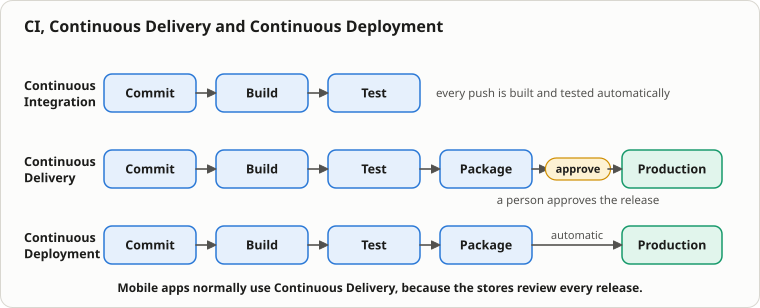
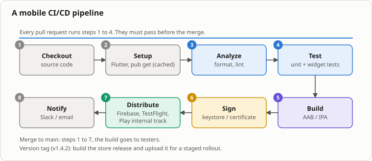
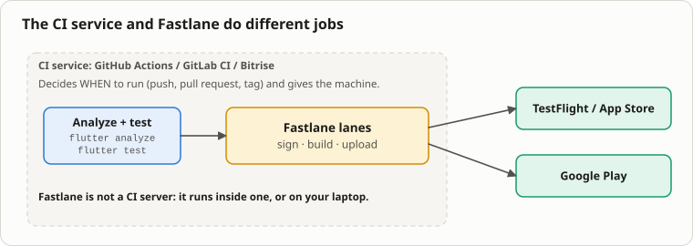
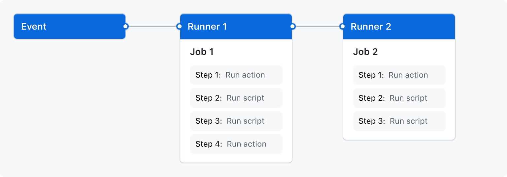
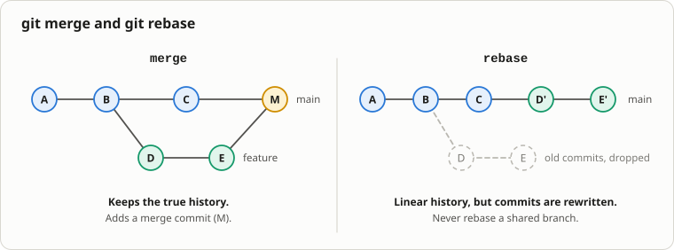
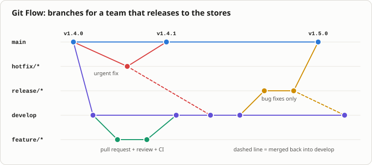
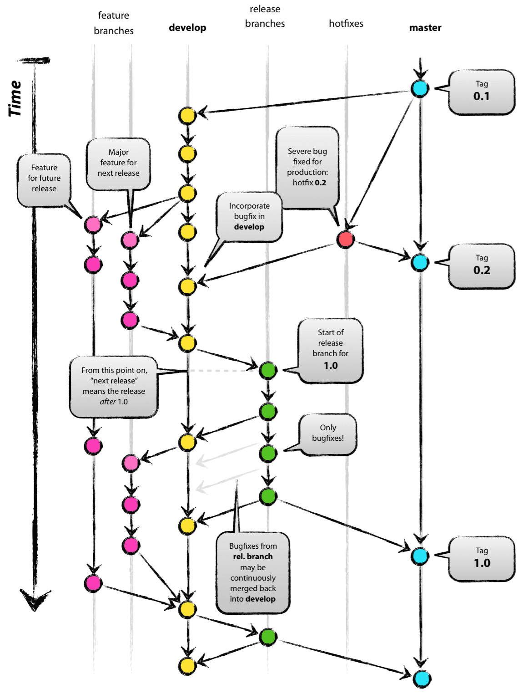
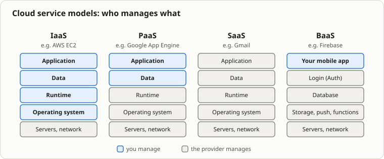
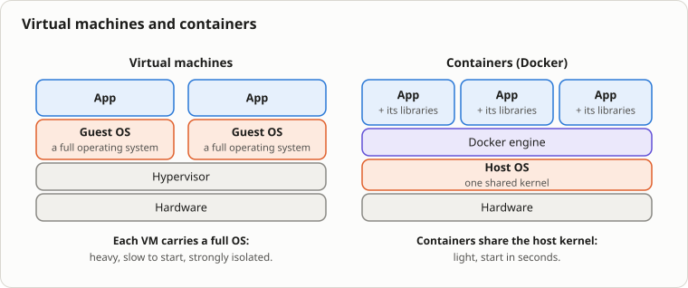
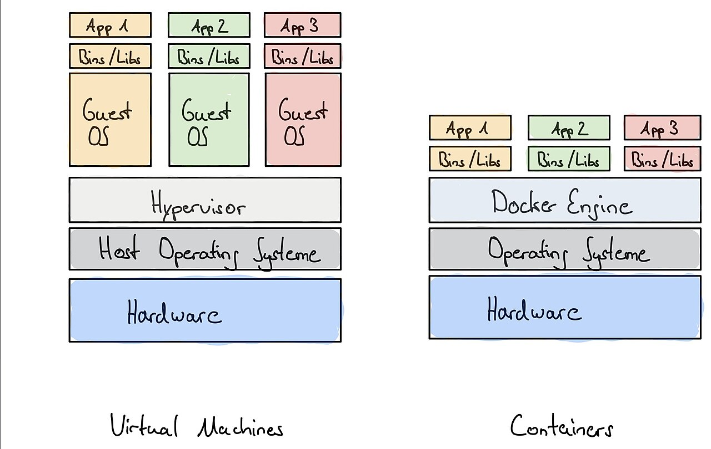

<div class="chapter-head">
<div class="chapter-kicker"><b>Chapter 9</b>App Store Deployment and DevOps</div>

# CI/CD and Build Automation

</div>

> **The skill:** Automate build, test and release with mobile **CI/CD** tools (**Fastlane, GitHub Actions, GitLab CI/CD, Bitrise**) and use mobile cloud platforms (**Firebase, AWS, GCP**).

The common trap is a question like "what is Fastlane?" or "what is the difference between CI and CD?" answered in one line. Learn one sentence for each of the four tools, the pipeline diagram, and one small YAML file.

---

## 1. Definitions

<div class="box def">

**Definition.** **CI/CD** is automation for building, testing and delivering software. **CI** (Continuous Integration) builds and tests the app automatically every time code changes. **CD** (Continuous Delivery) then packages it automatically so it is always ready to release.

</div>

<div class="box story">

**Example scenario.** Imagine a biscuit factory.

1. **Without a machine line:** each worker bakes at home and brings biscuits on the last day. Half of them do not fit the box. *(Developers merge their code only at the end, and nothing works together.)*
2. **With a machine line:** every biscuit goes on the belt as soon as it is made. A machine checks its size and weight at once. A bad one is stopped immediately. *(This is **CI**: every push is built and tested.)*
3. At the end of the belt the biscuits are packed in boxes, ready on the shelf. A manager says "send them". *(This is **Continuous Delivery**: ready, with a human yes.)*
4. In another factory the boxes go straight onto the truck with nobody asking. *(This is **Continuous Deployment**: fully automatic.)*

</div>

<p class="label">Exam notes</p>

| Term | Meaning |
|---|---|
| <mark>**CI — Continuous Integration**</mark> | Developers merge code into the shared branch **often**. Every push or pull request <mark>**automatically builds the app and runs the tests**</mark>, so errors are found within minutes |
| <mark>**CD — Continuous Delivery**</mark> | After CI, the app is **automatically packaged and made ready to release** (for example, sent to testers). <mark>The final release to production needs a **manual approval**</mark> |
| <mark>**CD — Continuous Deployment**</mark> | Every change that passes the pipeline <mark>goes to production **automatically**, with no manual step</mark> |
| **Pipeline** | The ordered, automated steps from commit to release |
| **Build automation** | Scripts and tools produce the build, instead of a person clicking in an IDE |
| **Artifact** | A file produced by the pipeline: APK, AAB, IPA, test report |
| **Runner / agent** | The machine that executes the jobs |
| **DevOps** | <mark>A culture and set of practices joining development and operations</mark> to deliver software faster and more reliably, with automation |



<mark>For mobile, **Continuous Delivery** is normal: the stores review each release</mark>, so production is rarely fully automatic.

**Benefits (list five in an answer):** bugs found early · no "works on my machine" (same clean environment every time) · faster and more frequent releases · fewer human mistakes in signing and versioning · every build is tested · testers always have the latest build · a record of what was built from which commit.

<div class="box q">

**Which one do mobile apps use: Delivery or Deployment?**

Usually **Continuous Delivery**. The stores review every release and developers use staged rollouts, so a person still presses the final button.

</div>

<div class="box rule">

**Remember.** CI = automatic build + test on every change. Continuous Delivery = always ready, manual approval. Continuous Deployment = automatic release.

</div>

## 2. A mobile CI/CD pipeline

<div class="box story">

**Example scenario.** Imagine you finish a small bug fix on Tuesday afternoon.

1. You push your branch and open a **pull request**.
2. Within a minute a clean machine in the cloud wakes up. It downloads your code and installs Flutter.
3. It runs `flutter analyze` and `flutter test`. One test fails. The pull request shows a red ✗ and cannot be merged.
4. You fix the test and push again. Green ✓. A teammate reviews and merges.
5. The merge starts the pipeline again. This time it also builds the app, signs it and sends it to the testers' phones.

**What did you do by hand?** Only the code. Everything else happened by itself, the same way every time.

</div>



- <mark>**On every pull request:** steps 1–4</mark> (fast feedback; merging is blocked if they fail).
- **On merge to `main`:** steps 1–7 to testers.
- **On a version tag (`v1.4.2`):** build the store release and upload it to the stores for a staged rollout.

<div class="box rule">

**Remember.** Checkout → setup → analyze → test → build → sign → distribute → notify. Pull request: steps 1 to 4. Merge to main: all steps.

</div>

## 3. The four tools to know

<div class="box def">

**In simple words.** Three of the four tools are **CI services**: they watch your repository and give you a machine to run steps on (GitHub Actions, GitLab CI/CD, Bitrise). The fourth, **Fastlane**, is different: it is a helper that knows how to **sign and upload** mobile apps.

</div>

| Tool | What it is (one sentence to memorise) | Config | Notes |
|---|---|---|---|
| **Fastlane** | <mark>An **open-source automation tool for mobile release tasks**</mark>: building, code signing, screenshots, and uploading to TestFlight and Google Play | `Fastfile` (Ruby), <mark>organised in **lanes**</mark> | <mark>**Not a CI server.**</mark> It runs on your laptop or *inside* any CI tool |
| **GitHub Actions** | <mark>**GitHub's built-in CI/CD service**</mark>; workflows run on events such as push, pull request or tag | <mark>YAML in `.github/workflows/`</mark> | <mark>Events → **jobs** → **steps**</mark>; hosted runners (Linux, macOS, Windows); a marketplace of ready actions; encrypted **secrets** |
| **GitLab CI/CD** | <mark>**GitLab's built-in CI/CD**</mark>, defined by one file in the repository | <mark>`.gitlab-ci.yml`</mark> | **Stages** → jobs; **GitLab Runners**, <mark>which can be **self-hosted**</mark> on the organisation's own servers |
| **Bitrise** | <mark>A **cloud CI/CD platform made for mobile apps**</mark>, with ready steps for Flutter, Android and iOS | Visual workflow editor + `bitrise.yml` | Hosted macOS machines, built-in code-signing management, hundreds of mobile steps |

Others worth one mention: <mark>**Codemagic** (CI/CD focused on Flutter)</mark>, **Jenkins** (open-source, self-hosted, general purpose), **Xcode Cloud** (Apple's own).

**Fastlane actions to name**
| Action | Old name | Does |
|---|---|---|
| `build_app` | gym | Builds and signs the iOS app |
| `sync_code_signing` | **match** | <mark>Keeps certificates and profiles in a private, encrypted Git repo</mark>, shared by the team and CI |
| `upload_to_testflight` | pilot | Uploads a beta build to TestFlight |
| `upload_to_app_store` | deliver | Uploads build, metadata and screenshots to the App Store |
| `upload_to_play_store` | supply | Uploads the AAB and metadata to Google Play |
| `run_tests` | scan | Runs tests |
| `capture_screenshots` | snapshot | Generates localised screenshots |

**How they combine:** *GitHub Actions (or GitLab CI, or Bitrise) <mark>decides **when** to run and provides the machine. Fastlane does the mobile-specific work of signing and uploading.</mark>*



<br>*How GitHub Actions is organised: an **event** (such as a push) starts a workflow, each **job** runs on its own **runner** (a machine), and a job is a list of **steps**. Source: GitHub Docs.*

<div class="box q">

**Is Fastlane a CI server?**

No. Fastlane does not watch your repository and has no machines. It is a tool you **run**, on your laptop or inside a CI service. The CI service decides **when**. Fastlane does the mobile-specific **what**.

</div>

<div class="box rule">

**Remember.** Fastlane = release automation in lanes, not a CI server. GitHub Actions = YAML in `.github/workflows/`. GitLab CI = `.gitlab-ci.yml`, self-hosted runners. Bitrise = cloud CI/CD made for mobile.

</div>

<div class="box check">

**Quick check**

1. Which tool keeps iOS certificates in an encrypted Git repository for the whole team? (a) Fastlane match (b) GitHub Actions (c) Bitrise
2. Where do GitHub Actions workflow files live?
3. Which of the four tools is **not** a CI/CD service?

<details>
<summary>Show answers</summary>

1. **(a) Fastlane match** (`sync_code_signing`).
2. In `.github/workflows/`, as YAML files.
3. **Fastlane.**

</details>

</div>

## 4. Examples to recognise

<div class="box def">

**How to read these files.** You do not need to write them from memory. You should be able to look at one and say: this is the **trigger**, this is the **machine**, these are the **steps**.

</div>

```yaml
# .github/workflows/ci.yml
name: Flutter CI
on:
  pull_request:
  push:
    branches: [main]

jobs:
  build:
    runs-on: ubuntu-latest            # iOS builds need: macos-latest
    steps:
      - uses: actions/checkout@v4
      - uses: subosito/flutter-action@v2
        with: { channel: stable, cache: true }
      - run: flutter pub get
      - run: dart format --set-exit-if-changed .
      - run: flutter analyze
      - run: flutter test --coverage
      - name: Restore keystore from secret
        run: echo "${{ secrets.KEYSTORE_BASE64 }}" | base64 -d > android/app/upload.jks
      - run: flutter build appbundle --release --build-number=${{ github.run_number }}
      - uses: actions/upload-artifact@v4
        with: { name: release-aab, path: build/app/outputs/bundle/release/*.aab }
```

```ruby
# fastlane/Fastfile
platform :android do
  lane :beta do
    sh "flutter build appbundle --release"
    upload_to_play_store(track: "internal",
                         aab: "../build/app/outputs/bundle/release/app-release.aab")
  end
end

platform :ios do
  lane :beta do
    sync_code_signing(type: "appstore")        # match: fetch certificate + profile
    build_app(workspace: "Runner.xcworkspace", scheme: "Runner")
    upload_to_testflight
  end
end
```

```yaml
# .gitlab-ci.yml
stages: [test, build]
test:
  stage: test
  script: [flutter pub get, flutter analyze, flutter test]
build_android:
  stage: build
  script: [flutter build appbundle --release]
  artifacts: { paths: [build/app/outputs/bundle/release/] }
  only: [main]
```

## 5. Mobile-specific problems and how the pipeline solves them

<div class="box story">

**Example scenario.** Imagine the pipeline must sign the Android app. Signing needs the keystore file and its password.

1. **The wrong way:** a developer commits `upload.jks` and the password to Git. Now everyone who can read the repository can sign apps in the organisation's name, for ever.
2. **The right way:** the keystore and password are saved as encrypted **secrets** in the CI service. At build time the pipeline places the file on the machine, signs the app and deletes the machine.

**What is the rule?** Secrets are given to the pipeline at run time. They never live in the repository.

</div>

| Problem | Solution |
|---|---|
| **Signing secrets** (keystore, passwords, certificates, API keys) | <mark>Store them as **encrypted CI secrets**</mark>; decode at build time; **never commit them**; Fastlane `match` for iOS |
| **iOS needs a Mac** | Use a macOS runner (hosted, or Bitrise/Codemagic machines) |
| **Build numbers must increase** | Take the number from the CI run number |
| **Slow builds** | Cache pub, Gradle and CocoaPods dependencies; run jobs in parallel |
| **Different environments** | **Flavors** (`dev`, `staging`, `prod`) with `--dart-define` values |
| **Crash symbols** | Upload dSYM / mapping / split-debug-info files to Crashlytics or Sentry in the pipeline |
| **Getting builds to testers** | Firebase App Distribution, TestFlight, Play internal track |
| **Quality gates** | Fail the pipeline if formatting, lint or tests fail, or coverage drops below a threshold |

## 6. Git and branching (the base of CI/CD)

<div class="box def">

**Definition.** **Git** is a version control system: it remembers every change to the code, who made it and why, and lets several people work at the same time without overwriting each other.

</div>

<div class="box story">

**Example scenario.** Imagine two developers and one project.

1. Both start from the same code on `main`.
2. Rahim creates a **branch** `feature/login`. Karim creates `feature/sync`. Each works in his own copy of the timeline.
3. Rahim finishes and **merges** into `main`.
4. Karim now has two choices to catch up:
   - **merge** `main` into his branch: Git ties the two timelines together with a merge commit. The history shows what really happened.
   - **rebase** his branch onto `main`: Git lifts his commits and replays them on top of Rahim's work, as if he had started later. The history is one straight line.

</div>

<p class="label">Exam notes</p>

**Version control** records every change, who made it and why, and lets a team work in parallel. <mark>Git is **distributed**: each developer has the full history.</mark>

| Command | Does |
|---|---|
| `git clone` / `init` | Copy / create a repository |
| `git add` → `git commit` | Stage → save a snapshot locally |
| `git push` / `git pull` | Send to / fetch-and-merge from the remote |
| `git fetch` | <mark>Download changes **without** merging</mark> |
| `git branch` / `git switch` | Create or list / change branch |
| `git merge` | Join two histories (keeps a merge commit) |
| `git rebase` | <mark>Replay your commits on top of another branch (linear history; do not rebase shared branches)</mark> |
| `git stash` | Put uncommitted work aside temporarily |
| `git revert` | <mark>New commit that **undoes** an old one (safe on shared branches)</mark> |
| `git reset` | <mark>Move the branch pointer back (rewrites history)</mark> |
| `git cherry-pick` | <mark>Copy one commit to another branch (hotfixes)</mark> |
| `git tag` | Mark a release (`v1.4.2`) |

**Pairs asked in exams:** `fetch` vs `pull` · `merge` vs `rebase` · `revert` vs `reset` · Git (the tool) vs GitHub/GitLab (hosting services).



**Branching strategies**
| | **Git Flow** | **Trunk-based / GitHub Flow** |
|---|---|---|
| Branches | `main`, `develop`, `feature/*`, `release/*`, `hotfix/*` | `main` + short-lived feature branches |
| Fits | <mark>Scheduled releases (mobile apps with store review)</mark> | Continuous delivery, small teams |



<br>*The original Git Flow picture: feature branches (pink) join `develop` (yellow), release branches (green) prepare a version, and `master` (blue) holds the tagged releases. Hotfixes (red) start from `master`. Source: Vincent Driessen, nvie.com.*

**Pull request (merge request):** a request to merge a branch, where teammates **review the code** and CI must pass. Protected branches block direct pushes to `main`.

<div class="box q">

**`git revert` or `git reset`: which one is safe on a shared branch?**

`git revert`. It adds a **new** commit that undoes the old one, so nobody's history changes. `git reset` moves the branch backwards and throws commits away. If others already have those commits, their work no longer matches.

</div>

<div class="box rule">

**Remember.** `pull` = `fetch` + `merge`. Merge keeps history, rebase rewrites it (never on shared branches). `revert` is safe, `reset` rewrites. Git Flow suits scheduled store releases.

</div>

<div class="box check">

**Quick check**

1. Which command downloads changes but does **not** change your files? (a) pull (b) fetch (c) merge
2. You must copy one bug-fix commit from `develop` to a hotfix branch. Which command?
3. In Git Flow, where does a hotfix branch start from?

<details>
<summary>Show answers</summary>

1. **(b) fetch.**
2. `git cherry-pick`.
3. From `main` (production), and it is merged back into both `main` and `develop`.

</details>

</div>

## 7. Mobile cloud platforms (Firebase / AWS / GCP)

<div class="box def">

**Definition.** **Cloud computing** means renting computers and ready services over the internet, instead of buying and running your own servers. The service models differ in **how much the provider does for you**.

</div>

<div class="box story">

**Example scenario.** Imagine you want pizza.

1. **Make it at home:** you buy everything, you own the oven. *(Your own server room.)*
2. **Rent a kitchen:** the oven and gas are there, you bring the ingredients and cook. *(**IaaS**: they give machines, you manage the rest.)*
3. **Take-and-bake:** you only add your toppings and they bake it. *(**PaaS**: you bring the code, they run it.)*
4. **Home delivery:** you just eat. *(**SaaS**: finished software, such as Gmail.)*

For a mobile developer there is a fourth model: **BaaS** (Backend as a Service). Login, database, storage and push are ready-made, and you write only the app. **Firebase** is the best-known example.

</div>

<p class="label">Exam notes</p>

**Service models**
| Model | You manage | Example |
|---|---|---|
| <mark>**IaaS** (Infrastructure)</mark> | OS, runtime, app | AWS EC2, Google Compute Engine |
| <mark>**PaaS** (Platform)</mark> | App and data only | Google App Engine, Cloud Run |
| <mark>**SaaS** (Software)</mark> | Nothing; you use it | Gmail, Google Docs |
| <mark>**BaaS / MBaaS** (Backend as a Service)</mark> | Only the mobile app | **Firebase**, AWS Amplify |



**The same need on each platform**
| Need | **Firebase** | **AWS** | **GCP** |
|---|---|---|---|
| Login | Firebase Authentication | Cognito | Identity Platform |
| Database | Cloud Firestore, Realtime Database | DynamoDB, RDS | Firestore, Cloud SQL |
| File storage | Cloud Storage for Firebase | **S3** | Cloud Storage |
| Server code | Cloud Functions | **Lambda** | Cloud Functions, Cloud Run |
| Push | **FCM** | SNS, Pinpoint | (FCM) |
| Crash and analytics | **Crashlytics**, Analytics, Performance | CloudWatch | Cloud Monitoring |
| Remote config / flags | **Remote Config** | AppConfig | — |
| Tester distribution | **App Distribution** | — | — |
| Device testing | **Test Lab** | **Device Farm** | (Firebase Test Lab) |
| Mobile toolkit | Firebase SDKs | **Amplify** | Firebase SDKs |

Firebase is part of Google Cloud. A **Firestore** document database is NoSQL with real-time listeners and offline persistence; **Realtime Database** is one large JSON tree.

**Containers (one paragraph):** **Docker** packages an application with its dependencies into a **container** that runs the same everywhere. <mark>Containers share the host's OS kernel, so they are lighter and start faster than **virtual machines**, which each carry a full OS</mark>. <mark>**Kubernetes** runs and scales many containers</mark>. CI pipelines often run inside containers.



<br>*Each virtual machine carries its own guest operating system. Containers share one operating system through the Docker engine, so they are much lighter. Source: Wikimedia Commons.*

<div class="box rule">

**Remember.** IaaS = machines (EC2). PaaS = runs your code (App Engine). SaaS = finished software (Gmail). BaaS = ready backend for apps (Firebase). Containers share the host kernel, VMs carry a full OS.

</div>

## Link it to your own projects

Interviews and written exams reward answers that use **your own work** as the example. Before you move on, answer these for yourself:

<div class="box you">

- Which CI tool have you used? Describe your workflow file: triggers, steps, secrets.
- If you have not used Fastlane, GitLab CI or Bitrise, say what each does and how it would fit a pipeline you already know.
- An organisation that keeps its code on its own servers often prefers **self-hosted GitLab runners**; iOS builds still need a Mac.

</div>

---

## Practice questions

**Short (2–3 marks each)**
1. What is Continuous Integration?
2. Continuous Delivery vs Continuous Deployment.
3. What is Fastlane? Is it a CI server?
4. What is GitHub Actions? Where are workflows defined?
5. What is Bitrise?
6. How do you keep a keystore safe in a CI pipeline?
7. `git merge` vs `git rebase`.
8. `git fetch` vs `git pull`.
9. `git revert` vs `git reset`.
10. IaaS vs PaaS vs SaaS vs BaaS, with one example each.
11. Container vs virtual machine.

**Long (8–10 marks each)**

12. What is CI/CD? Draw and explain a CI/CD pipeline for a Flutter app that targets Android and iOS. Name a tool for each stage.
13. Compare Fastlane, GitHub Actions, GitLab CI/CD and Bitrise. Which combination would you propose for the NGO and why?
14. Explain a Git branching strategy for a team of five mobile developers who release to the stores every month, including how hotfixes are handled.

---

## Model answers

<div class="box exam">

**How to read these answers.** They are written for **learning**, so they are fuller than what you would write in the exam hall. Every answer has the same parts:

- **In short** (green): the direct answer. In the exam, write this part first.
- **Table or points:** the details, laid out so you can compare and remember them.
- **Example** (yellow): a real situation, usually from a field app or from your own projects.
- Long answers end with **In the exam** (brown): how to shorten the answer on paper.

Write your own answer first. Then open the model answer and compare.

</div>

<details>
<summary>1. What is Continuous Integration?</summary>

<div class="box def">

**In short.** <mark>**Continuous Integration (CI)**</mark> is the practice where developers **merge their code into a shared repository often**, and every change is **automatically built and tested**. Integration problems are found within minutes, not at the end of the month.

</div>

**What happens on every push or pull request**

1. The CI server takes the new code.
2. It installs the dependencies (`flutter pub get`).
3. It checks the format and runs the analyser (`flutter analyze`).
4. It runs the tests (`flutter test`).
5. It builds the app.
6. It reports a green tick or a red cross on the pull request.

| | Without CI | With CI |
|---|---|---|
| **Merging** | Rare and big, with painful conflicts | Small and frequent |
| **A broken build is found** | Days later, by a teammate | In minutes, by the pipeline |
| **"It works on my machine"** | Common | The pipeline is the neutral judge |
| **Tests** | Run when someone remembers | Run on every change |
| **Code review** | The reviewer must check that it builds | The reviewer reads only code that already passes |

**Tools:** GitHub Actions, GitLab CI/CD, Bitrise, Jenkins, Codemagic.

<div class="box story">

**Example.** Two developers change the same sync service on the same day. With CI, the second pull request fails its tests within five minutes of the first one being merged, and the author fixes it while the change is fresh. Without CI, the conflict would appear on release day.

</div>

<div class="ref">

**From the book:** [1. Definitions](#1-definitions)

</div>

</details>

<details>
<summary>2. Continuous Delivery vs Continuous Deployment.</summary>

<div class="box def">

**In short.** In **Continuous Delivery**, every change is automatically built, tested and made **ready to release**, but a **person presses the button** to go to production. In **Continuous Deployment**, every change that passes the pipeline goes to production **automatically**, with no manual step.

</div>


| Point | Continuous Integration | Continuous Delivery | Continuous Deployment |
|---|---|---|---|
| **Automates** | Build + test | + packaging, signing, delivery to a test or staging environment | + the release to production |
| **Release to production** | — | <mark>Manual approval</mark> | <mark>Automatic</mark> |
| **Result** | Code that integrates | A build that is always releasable | Users get every passing change |
| **Risk control** | Tests | Tests + a human decision | Tests only, so they must be very good |
| **Typical for** | Every team | **Mobile apps**, regulated organisations | Web services, SaaS |

**Why mobile uses Continuous Delivery.** A mobile release passes through **store review** and should go out as a **staged rollout**. Users also dislike updating every day. So the pipeline delivers builds automatically to testers (TestFlight, Play internal track), and a person decides when to publish.

<div class="box story">

**Example.** Every merge to `main` produces a signed build that lands on the QA team's phones within 20 minutes: continuous delivery. The release manager promotes one of those builds to production on the first Sunday of the month. A website for the same project might deploy every merge straight to production: continuous deployment.

</div>

<div class="ref">

**From the book:** [1. Definitions](#1-definitions)

</div>

</details>

<details>
<summary>3. What is Fastlane? Is it a CI server?</summary>

<div class="box def">

**In short.** Fastlane is an **open-source tool that automates mobile build and release tasks**: code signing, building, screenshots, and uploading to TestFlight and Google Play. <mark>It is **not** a CI server.</mark> It is a command-line tool that runs on your computer or **inside** a CI service.

</div>


| | CI service (GitHub Actions, GitLab CI, Bitrise) | Fastlane |
|---|---|---|
| **Job** | *When* and *where* to run: reacts to a push, provides a machine | *What* to do for a mobile release |
| **Has machines (runners)** | Yes | No |
| **Triggers on Git events** | Yes | No |
| **Knows the App Store and Play APIs** | No | Yes |
| **Configuration** | YAML | A `Fastfile` written in Ruby |

**Fastlane's words**

| Term | Meaning |
|---|---|
| **Lane** | A named sequence of steps, for example `beta` or `release` |
| **Action** | One step, for example `build_app` |
| **`match`** | Shares certificates and profiles through an encrypted private repository |
| **`gym`** (`build_app`) | Builds and signs the iOS app |
| **`pilot`** (`upload_to_testflight`) | Uploads to TestFlight |
| **`supply`** (`upload_to_play_store`) | Uploads to Google Play |
| **`deliver`** | Uploads metadata and screenshots to the App Store |

```ruby
# ios/fastlane/Fastfile
lane :beta do
  match(type: "appstore")          # fetch signing files
  build_app(scheme: "Runner")      # build and sign the IPA
  upload_to_testflight             # send it to testers
end
```

Run it with `fastlane beta`, from a laptop or from a CI job.

<div class="box story">

**Example.** Releasing an iOS build by hand takes about 20 clicks in Xcode and App Store Connect, and it is easy to forget one. With a lane, the CI job runs one command, `fastlane beta`, the same way every time.

</div>

<div class="ref">

**From the book:** [3. The four tools to know](#3-the-four-tools-to-know)

</div>

</details>

<details>
<summary>4. What is GitHub Actions? Where are workflows defined?</summary>

<div class="box def">

**In short.** GitHub Actions is **GitHub's built-in CI/CD platform**. Workflows are **YAML files in the `.github/workflows/` folder** of the repository. A workflow starts on an **event** (push, pull request, tag, schedule) and runs **jobs**, made of **steps**, on **runners**.

</div>

<br>*An event triggers a workflow; each job runs its steps on its own runner. Source: GitHub Docs.*

| Term | Meaning |
|---|---|
| **Workflow** | One automated process, in one YAML file |
| **Event** | What starts it: `push`, `pull_request`, a tag, `schedule`, `workflow_dispatch` (manual) |
| **Job** | A group of steps that run on one machine. Jobs can run in parallel |
| **Step** | One command (`run:`) or one reusable action (`uses:`) |
| **Action** | A reusable step from the marketplace, such as `actions/checkout` |
| **Runner** | The machine that runs a job: GitHub-hosted (Ubuntu, macOS, Windows) or self-hosted |
| **Secret** | An encrypted value, such as a keystore password |
| **Artifact** | A file kept from a run, such as the built APK |

```yaml
# .github/workflows/ci.yml
name: CI
on:
  pull_request:
  push:
    branches: [main]

jobs:
  test:
    runs-on: ubuntu-latest
    steps:
      - uses: actions/checkout@v4
      - uses: subosito/flutter-action@v2
        with:
          channel: stable
          cache: true
      - run: flutter pub get
      - run: flutter analyze
      - run: flutter test
      - run: flutter build apk --release
```

**For iOS** the job needs `runs-on: macos-latest`, because an iOS build needs Xcode.

<div class="box story">

**Link to your own work.** If you have used GitHub Actions, describe a workflow like the one above: "On every pull request it ran analyze and tests; on a tag it built the release."

</div>

<div class="ref">

**From the book:** [3. The four tools to know](#3-the-four-tools-to-know) [4. Examples to recognise](#4-examples-to-recognise)

</div>

</details>

<details>
<summary>5. What is Bitrise?</summary>

<div class="box def">

**In short.** Bitrise is a **cloud CI/CD platform made for mobile apps**. It has a visual workflow editor, ready-made steps for Flutter, Android and iOS, hosted **macOS** machines, and built-in code-signing management.

</div>

| Feature | What it means |
|---|---|
| **Mobile-first** | Steps for Flutter build, Xcode archive, Gradle, signing and store upload are ready to use |
| **Visual workflow editor** | Drag and drop steps. The result is saved as `bitrise.yml` |
| **Hosted macOS machines** | iOS builds without owning a Mac |
| **Code signing** | Upload certificates, profiles and keystores once; steps install them |
| **Works with any Git host** | GitHub, GitLab, Bitbucket |
| **Triggers** | Push, pull request, tag |
| **Limits** | Paid above a small free tier; the code is built on someone else's cloud |

| | GitHub Actions | Bitrise |
|---|---|---|
| **Type** | General CI/CD for any software | CI/CD for mobile only |
| **Setup for mobile** | You write the YAML yourself | Mostly ready |
| **Where the code lives** | GitHub only | Any Git host |
| **Best for** | Teams already on GitHub | Mobile teams that want little setup |

<div class="box story">

**Example.** A small team without a Mac needs to ship an iOS app. On Bitrise they connect the repository, the scanner detects Flutter, and a default workflow builds, signs and uploads to TestFlight on a hosted Mac. They are releasing in an afternoon.

</div>

<div class="ref">

**From the book:** [3. The four tools to know](#3-the-four-tools-to-know)

</div>

</details>

<details>
<summary>6. How do you keep a keystore safe in a CI pipeline?</summary>

<div class="box def">

**In short.** **Never commit it to Git.** Store the keystore (Base64-encoded) and its passwords as **encrypted CI secrets**, decode it into a temporary file only during the build, limit who can read the secrets, and keep an offline backup.

</div>

| Rule | How |
|---|---|
| **Not in the repository** | Add `*.jks`, `*.keystore` and `key.properties` to `.gitignore` |
| **Store as secrets** | `base64 upload-keystore.jks` → save the text as an encrypted secret, together with the passwords and alias |
| **Use only during the build** | Decode to a temporary file; the runner is destroyed after the job |
| **Never print it** | No `echo` of secrets; CI masks them in logs |
| **Limit access** | Secrets are available only on protected branches and tags, not on pull requests from forks |
| **Back it up** | An offline, encrypted copy in a password manager or vault |
| **Limit the damage** | **Play App Signing**: a leaked upload key can be reset |
| **iOS** | The same idea for the `.p12` and profile, or use Fastlane `match` |

```yaml
- name: Restore keystore
  run: echo "${{ secrets.KEYSTORE_BASE64 }}" | base64 --decode > android/app/upload-keystore.jks

- name: Build signed bundle
  env:
    KEYSTORE_PASSWORD: ${{ secrets.KEYSTORE_PASSWORD }}
    KEY_ALIAS: ${{ secrets.KEY_ALIAS }}
    KEY_PASSWORD: ${{ secrets.KEY_PASSWORD }}
  run: flutter build appbundle --release
```

<div class="box story">

**Example.** A developer once committed `key.properties` with the passwords to a repository that was later made public. Anyone could then sign an app as that company. With secrets in CI and Play App Signing, even a leak of the upload key is repaired by asking Google for a reset.

</div>

<div class="ref">

**From the book:** [5. Mobile-specific problems and how the pipeline solves them](#5-mobile-specific-problems-and-how-the-pipeline-solves-them) [Ch 8 · 4. Android signing and publishing](08%20-%20Store%20Publishing%20and%20Code%20Signing.md#4-android-signing-and-publishing)

</div>

</details>

<details>
<summary>7. <code>git merge</code> vs <code>git rebase</code>.</summary>

<div class="box def">

**In short.** `git merge` **joins two branches with a merge commit** and keeps the history as it really happened. `git rebase` **moves your commits onto the tip of another branch**, giving a straight-line history, but it **rewrites the commits**.

</div>


| Point | `git merge` | `git rebase` |
|---|---|---|
| **What it does** | Creates a new commit with two parents | Replays your commits on top of the target branch |
| **History** | True, with branches visible | Linear and clean |
| **Changes existing commits** | No | <mark>Yes: they get new hashes</mark> |
| **Safe on a shared branch** | Yes | <mark>No</mark> |
| **Conflicts** | Solved once | May be solved commit by commit |
| **Needs force push afterwards** | No | Yes, if the branch was already pushed |
| **Use it for** | Bringing a finished feature into `develop` or `main` | Updating **your own** feature branch before the pull request |

```bash
# merge: bring feature into develop
git checkout develop
git merge feature/visit-form

# rebase: put my feature on top of the latest develop
git checkout feature/visit-form
git rebase develop
```

<mark>**The golden rule: never rebase a branch that other people use.**</mark> Their copies would no longer match yours.

<div class="box story">

**Example.** You work three days on `feature/photo-upload`. Meanwhile `develop` gets ten new commits. Before opening the pull request you run `git rebase develop` on your own branch, so your three commits sit neatly on top. The team then **merges** the pull request into `develop`. Rebase for yourself, merge for the team.

</div>

<div class="ref">

**From the book:** [6. Git and branching (the base of CI/CD)](#6-git-and-branching-the-base-of-cicd)

</div>

</details>

<details>
<summary>8. <code>git fetch</code> vs <code>git pull</code>.</summary>

<div class="box def">

**In short.** `git fetch` **downloads** the new commits from the remote but does **not change** your working branch. <mark>`git pull` = `git fetch` + `git merge`</mark>: it downloads and immediately merges into your current branch.

</div>

| Point | `git fetch` | `git pull` |
|---|---|---|
| **Downloads remote commits** | Yes | Yes |
| **Changes your branch and files** | No | Yes |
| **Updates** | Only the remote-tracking branches (`origin/main`) | Your local branch too |
| **Can cause conflicts** | No | Yes |
| **Safe at any time** | Yes | Only when you are ready to merge |
| **Variant** | — | `git pull --rebase` = fetch + rebase |

```bash
git fetch origin
git log HEAD..origin/main --oneline     # see what is new, before merging
git merge origin/main                   # merge when ready

git pull origin main                    # the same in one step
```

<div class="box story">

**Example.** You are in the middle of a change and want to know whether a teammate has pushed something. `git fetch` shows the new commits without touching your files. When your work is committed, you run `git pull` to bring them in.

</div>

<div class="ref">

**From the book:** [6. Git and branching (the base of CI/CD)](#6-git-and-branching-the-base-of-cicd)

</div>

</details>

<details>
<summary>9. <code>git revert</code> vs <code>git reset</code>.</summary>

<div class="box def">

**In short.** `git revert` makes a **new commit that undoes** an earlier commit. History is kept, so it is **safe on shared branches**. `git reset` **moves the branch pointer back** to an earlier commit and can throw commits away. It **rewrites history**, so use it only on local work.

</div>

| Point | `git revert` | `git reset` |
|---|---|---|
| **How it undoes** | Adds a new, opposite commit | Removes commits from the branch |
| **History** | Kept, and the undo is visible | Rewritten |
| **Safe on a shared branch** | <mark>Yes</mark> | <mark>No</mark> |
| **Needs force push** | No | Yes, if already pushed |
| **Use it for** | Undoing a commit that is already on `main` | Cleaning up local commits that are not pushed |

**The three modes of reset**

| Mode | Commits | Staging area | Your files |
|---|---|---|---|
| `--soft` | Removed | Kept (changes stay staged) | Kept |
| `--mixed` (default) | Removed | Cleared | Kept |
| `--hard` | Removed | Cleared | <mark>**Discarded**</mark> |

```bash
git revert a1b2c3d            # undo that commit with a new one
git reset --soft HEAD~1       # take back the last commit, keep the changes staged
git reset --hard HEAD~1       # throw away the last commit and its changes
```

<div class="box story">

**Example.** A commit merged to `main` yesterday breaks login. Five teammates have already pulled it. `git revert` adds a commit that removes the change, and everyone gets the fix with a normal pull. `git reset` on `main` would delete history that others already have, and their next push would bring the bad commit back.

</div>

<div class="ref">

**From the book:** [6. Git and branching (the base of CI/CD)](#6-git-and-branching-the-base-of-cicd)

</div>

</details>

<details>
<summary>10. IaaS vs PaaS vs SaaS vs BaaS, with one example each.</summary>

<div class="box def">

**In short.** They are cloud service models. They differ in **how much the provider manages for you**. **IaaS:** raw servers (AWS EC2). **PaaS:** a platform that runs your code (Google App Engine). **SaaS:** finished software (Gmail). **BaaS:** ready-made backend services for apps (Firebase).

</div>


| Model | Full form | You get | You manage | Example |
|---|---|---|---|---|
| **IaaS** | Infrastructure as a Service | Virtual machines, storage, networks | The OS, runtime, your app, your data | AWS EC2, Azure VMs, Google Compute Engine |
| **PaaS** | Platform as a Service | A place to run code, with the OS and runtime managed | Your app and data | Google App Engine, Heroku, Azure App Service |
| **SaaS** | Software as a Service | A finished application | Only your own data and settings | Gmail, Google Docs, Zoom |
| **BaaS** | Backend as a Service | Ready backend features through SDKs: auth, database, storage, push | The mobile app | **Firebase**, Supabase |

**The pizza picture**

- **On-premises:** you make the pizza at home, from the dough up.
- **IaaS:** you buy a frozen pizza and bake it yourself.
- **PaaS:** pizza delivery; you only set the table.
- **SaaS:** you eat at the restaurant.

**Related:** **serverless / FaaS** (Function as a Service) runs single functions on demand, such as AWS Lambda or Cloud Functions.

<div class="box story">

**Example.** A Flutter app that uses **Firebase** (Realtime Database, Firestore, Messaging, Hosting) is using BaaS: nobody wrote server code. A large system with its own Spring Boot and PostgreSQL servers would run on IaaS, or in the organisation's own data centre.

</div>

<div class="ref">

**From the book:** [7. Mobile cloud platforms (Firebase / AWS / GCP)](#7-mobile-cloud-platforms-firebase--aws--gcp)

</div>

</details>

<details>
<summary>11. Container vs virtual machine.</summary>

<div class="box def">

**In short.** A **virtual machine** contains a **full guest operating system** running on a hypervisor: heavy, but strongly isolated. A **container** packages an app with its dependencies and **shares the host's OS kernel**: light, and it starts in seconds.

</div>


| Point | Virtual machine | Container |
|---|---|---|
| **Contains** | App + libraries + a **full guest OS** | App + libraries only |
| **Runs on** | A hypervisor (VMware, Hyper-V, KVM) | A container engine (**Docker**) on the host OS |
| **Kernel** | Its own | Shared with the host |
| **Size** | Gigabytes | Megabytes |
| **Start time** | Minutes | Seconds |
| **Isolation** | Stronger | Weaker (shared kernel) |
| **How many per server** | A few | Many |
| **Can run a different OS** | Yes: Windows on a Linux host | No: the same kernel family |
| **Use it for** | Different operating systems, strong separation | Microservices, CI/CD, moving an app between machines unchanged |

**Words that go with containers**

- **Image:** the read-only template (built from a `Dockerfile`).
- **Container:** a running instance of an image.
- **Kubernetes:** a system that runs and scales many containers.

<div class="box story">

**Example.** A CI job builds the Android app inside a Docker container that already holds Flutter and the Android SDK. Every build uses exactly the same tool versions, on any machine, so "it works on my machine" disappears. An iOS build cannot run in a Linux container. It needs a macOS machine.

</div>

<div class="ref">

**From the book:** [7. Mobile cloud platforms (Firebase / AWS / GCP)](#7-mobile-cloud-platforms-firebase--aws--gcp)

</div>

</details>

<details>
<summary>12. What is CI/CD? Draw and explain a CI/CD pipeline for a Flutter app that targets Android and iOS. Name a tool for each stage.</summary>

<div class="box def">

**In short.** **CI/CD** automates the path from a code change to a released app. **CI** builds and tests every change. **CD** packages, signs and delivers the build to testers and, after approval, to the stores. For Flutter, the pipeline is: trigger → checkout and setup → analyse → test → build (AAB on Linux, IPA on macOS) → sign → distribute → notify.

</div>


#### 1. The three terms

| Term | Meaning |
|---|---|
| **Continuous Integration** | Every change is merged often, then built and tested automatically |
| **Continuous Delivery** | Every passing build is ready for release; a person approves the release |
| **Continuous Deployment** | Every passing build is released automatically |

#### 2. The pipeline, stage by stage

| # | Stage | What happens | Tool |
|---|---|---|---|
| 1 | **Trigger** | A push, a pull request or a version tag starts the pipeline | GitHub Actions / GitLab CI / Bitrise |
| 2 | **Checkout and setup** | Get the code; install Flutter; `flutter pub get`; restore caches | `actions/checkout`, `flutter-action` |
| 3 | **Static checks** | Format and lint | `dart format`, `flutter analyze` |
| 4 | **Test** | Unit and widget tests, with coverage | `flutter test` |
| 5 | **Build Android** | A release AAB, on a Linux runner | `flutter build appbundle` |
| 6 | **Build iOS** | A release IPA, on a **macOS** runner | `flutter build ipa` |
| 7 | **Sign** | Keystore from secrets; certificates and profiles | CI secrets, **Fastlane `match`** |
| 8 | **Distribute to testers** | Send the build to QA | Firebase App Distribution, **TestFlight**, Play **internal track** |
| 9 | **Upload symbols** | For readable crash reports | Crashlytics / Sentry |
| 10 | **Release** | After approval, publish with a staged rollout | Fastlane `supply` / `deliver` |
| 11 | **Notify** | Report the result to the team | Slack, email |

**Which stages run when**

| Event | Stages |
|---|---|
| Pull request | 1–4 (fast feedback) |
| Merge to `develop` or `main` | 1–9 (a build for testers) |
| A tag such as `v1.5.0` | 1–11 (a release candidate for the stores) |

#### 3. A short workflow

```yaml
on:
  push:
    tags: ['v*']
jobs:
  android:
    runs-on: ubuntu-latest
    steps:
      - uses: actions/checkout@v4
      - uses: subosito/flutter-action@v2
      - run: flutter pub get
      - run: flutter analyze
      - run: flutter test
      - run: flutter build appbundle --release
      - run: bundle exec fastlane android internal     # upload to the Play internal track
  ios:
    runs-on: macos-latest
    steps:
      - uses: actions/checkout@v4
      - uses: subosito/flutter-action@v2
      - run: flutter build ipa --release
      - run: bundle exec fastlane ios beta             # upload to TestFlight
```

#### 4. The benefits

- Bugs are found within minutes of the change.
- Every build is made the same way, with no "works on my machine".
- Releases are faster and need no manual clicking.
- Signing keys stay in one protected place, not on laptops.
- There is a record of who released what and when.

**Note for mobile:** the pipeline stops at **continuous delivery**. The final release still passes through store review and a staged rollout.

<div class="box story">

**Link to your own work.** Close with one true sentence about your own projects, for example: "I have set up GitHub Actions for Flutter projects, and I would add Fastlane lanes for signing and store upload."

</div>

<div class="box exam">

**In the exam.** Draw the pipeline as a row of boxes: Code → Build → Test → Sign → Distribute → Release, with the tool name under each box. Split the build box into Android (Linux) and iOS (macOS). Add five benefits and the note about continuous delivery.

</div>

<div class="ref">

**From the book:** [2. A mobile CI/CD pipeline](#2-a-mobile-cicd-pipeline) [4. Examples to recognise](#4-examples-to-recognise)

</div>

</details>

<details>
<summary>13. Compare Fastlane, GitHub Actions, GitLab CI/CD and Bitrise. Which combination would you propose for the NGO and why?</summary>

<div class="box def">

**In short.** **GitHub Actions**, **GitLab CI/CD** and **Bitrise** are **CI/CD services**: they react to code changes and provide machines. **Fastlane** is a **release-automation tool** that runs *inside* any of them. So the question is really "which CI service, plus Fastlane?". For the NGO I would propose **GitLab CI/CD with self-hosted runners + Fastlane** if the code must stay on the NGO's servers, or **GitHub Actions + Fastlane** if the code is on GitHub.

</div>


#### 1. The comparison

| Point | Fastlane | GitHub Actions | GitLab CI/CD | Bitrise |
|---|---|---|---|---|
| **What it is** | Release-automation tool | CI/CD service built into GitHub | CI/CD service built into GitLab | CI/CD service for mobile |
| **Configuration** | `Fastfile` (Ruby) | YAML in `.github/workflows/` | `.gitlab-ci.yml` | Visual editor + `bitrise.yml` |
| **Runs where** | A laptop, or inside a CI job | GitHub-hosted or self-hosted runners | GitLab-hosted or **self-hosted runners** | Bitrise cloud |
| **Self-hosting of everything** | — | Runners only; the code is on GitHub | <mark>Yes: GitLab itself can run on your own servers</mark> | No |
| **macOS for iOS** | Needs a Mac to run on | Hosted macOS runners (cost more minutes) | Your own Mac runner, or hosted | Hosted Macs included |
| **Strength** | Knows signing, TestFlight and Play upload | Huge marketplace; easy if the code is on GitHub | Code, CI and registry in one place; full control | Fastest setup for mobile |
| **Limit** | Not a CI server; Ruby to maintain | Tied to GitHub | More setup work | Paid; code is built on a third party's cloud |
| **Cost** | Free | Free minutes, then paid | Free if self-hosted (you pay for servers) | Paid plans |

#### 2. What I would propose for the NGO

| Situation | Proposal | Reason |
|---|---|---|
| The NGO keeps its code on **its own servers** (data control, financial institution) | **Self-hosted GitLab + GitLab CI with self-hosted runners + Fastlane**, with one Mac as the iOS runner | Code and signing keys never leave the NGO; no cost per minute; one tool for code review and CI |
| The code is on **GitHub** | **GitHub Actions + Fastlane** | No extra system; hosted macOS runners; I already use it |
| The team wants the **least setup** and accepts a cloud service | **Bitrise** (+ Fastlane steps) | Mobile-ready, with hosted Macs |

**The reasons, in order of weight**

1. **Security of code and signing keys.** The NGO handles financial data, so where the code and keys live matters most.
2. **Fit with what the IT team already uses.** Add nothing new if a Git server is already there.
3. **Cost.** Self-hosted runners have no per-minute fee; hosted macOS minutes are expensive.
4. **Maintenance effort.** Self-hosting needs someone to look after the runners.

In every option **Fastlane** does the signing and the store upload, so the release steps stay the same if the CI service changes later.

<div class="box story">

**How to speak about your experience.** "I have used GitHub Actions. Fastlane, GitLab CI and Bitrise follow the same pipeline idea, so I can describe how each fits, and I would learn the specific syntax quickly."

</div>

<div class="box exam">

**In the exam.** One line saying that Fastlane is a tool and the other three are services. A table with four rows (type, configuration, hosting, strength). Then the proposal with three reasons. The self-hosted GitLab point shows that you thought about the NGO as an institution.

</div>

<div class="ref">

**From the book:** [3. The four tools to know](#3-the-four-tools-to-know)

</div>

</details>

<details>
<summary>14. Explain a Git branching strategy for a team of five mobile developers who release to the stores every month, including how hotfixes are handled.</summary>

<div class="box def">

**In short.** I would use **Git Flow**. It has two permanent branches, `main` (what is in the stores) and `develop` (the next release), and three kinds of short-lived branches: `feature/*`, `release/*` and `hotfix/*`. It fits a monthly store release, because a release can be stabilised while new work continues.

</div>


#### 1. The branches

| Branch | Created from | Merged into | Purpose | Lifetime |
|---|---|---|---|---|
| `main` | — | — | Exactly what is in production. Every commit is a release and has a **tag** (`v1.5.0`) | Permanent |
| `develop` | `main` | — | Integration of finished features for the next release | Permanent |
| `feature/visit-photo` | `develop` | `develop` | One feature or task, by one developer | Days |
| `release/1.5.0` | `develop` | `main` **and** `develop` | Stabilise: only bug fixes, version bump, QA build | About a week |
| `hotfix/1.5.1` | `main` | `main` **and** `develop` | An urgent fix for production | Hours |

#### 2. A month in this team

| Week | What happens |
|---|---|
| 1–3 | Each developer works on `feature/*` branches and opens **pull requests** into `develop`. CI runs; one teammate reviews |
| Start of week 4 | `release/1.5.0` is cut from `develop`. **Feature freeze**: only fixes go in. QA tests builds from this branch |
| Meanwhile | New features for 1.6 continue on `develop` |
| End of week 4 | `release/1.5.0` is merged into `main` and tagged `v1.5.0`. The **tag triggers the release pipeline**. It is also merged back into `develop` |
| After release | Staged rollout; watch Crashlytics |

#### 3. How a hotfix works

1. A serious bug is found in production, in version 1.5.0.
2. Create `hotfix/1.5.1` from `main` (the tag `v1.5.0`), not from `develop`, which holds unfinished 1.6 work.
3. Fix it, add a regression test, and raise the version to 1.5.1 with a higher build number.
4. Open a pull request. CI and a quick review follow.
5. Merge into `main` and tag `v1.5.1`. The pipeline builds and releases it.
6. Merge the same fix into `develop` (and into an open release branch), so the bug does not return in 1.6.

#### 4. The team rules

- `main` and `develop` are **protected**: no direct pushes, only pull requests.
- At least **one reviewer**, and **CI must pass**, before a merge.
- **Small pull requests** and short-lived feature branches, rebased on `develop` to avoid large conflicts.
- Clear commit messages and branch names with the ticket number (`feature/FA-142-visit-photo`).
- Unfinished features can be merged behind a **feature flag**.

#### 5. Why not something simpler?

| Strategy | Idea | Fits |
|---|---|---|
| **Git Flow** | `main` + `develop` + release and hotfix branches | Scheduled releases with a QA phase: **mobile store releases** |
| **GitHub Flow** | Only `main` + short feature branches; deploy after each merge | Web apps with continuous deployment |
| **Trunk-based** | Everyone commits to `main` in very small steps, with feature flags | Large teams with strong automated testing |

A monthly store release with review and staged rollout needs a place to stabilise a version. The release branch gives exactly that.

<div class="box exam">

**In the exam.** Draw the diagram: two long horizontal lines (`main`, `develop`), feature branches leaving and joining `develop`, a release branch from `develop` to `main`, and a hotfix from `main` back to both. Then one line for each branch type, the six hotfix steps, and three team rules.

</div>

<div class="ref">

**From the book:** [6. Git and branching (the base of CI/CD)](#6-git-and-branching-the-base-of-cicd)

</div>

</details>

<div class="book-nav"><span>← <a href="08%20-%20Store%20Publishing%20and%20Code%20Signing.md">08 - Store Publishing and Code Signing</a></span><span><a href="00%20-%20Contents%20and%20How%20to%20Use.md">Contents</a></span><span><a href="10%20-%20Architecture%20Patterns%20and%20Testing.md">10 - Architecture Patterns and Testing</a> →</span></div>
