<div class="chapter-head">
<div class="chapter-kicker"><b>Chapter 10</b>Testing, Maintenance and Collaboration · ★ likely long question</div>

# Architecture Patterns and Testing

</div>

> **The skill:** Write maintainable, testable code with a clear architecture (**BLoC, MVVM, MVP, Clean Architecture**) and automated **unit and widget tests**.

Two halves: **architecture** (sections 1–8) and **testing** (sections 9–14). Many Flutter developers start with GetX or Provider, but larger teams often ask for **BLoC** and **Clean Architecture**, so those must be solid. "MVP vs MVVM" is a classic short question.

---

## 1. Why architecture

<div class="box def">

**Definition.** **Architecture** is the plan for where each kind of code lives: what draws the screen, what makes the decisions, and what fetches the data. An **architecture pattern** is a well-known, named plan.

</div>

<div class="box story">

**Example scenario.** Imagine a small restaurant where **one person** takes orders, cooks, washes dishes and counts the money.

1. With five customers, it works.
2. With fifty customers, he mixes up the orders, and nobody else can help because only he knows how everything is done.
3. A good restaurant has a **waiter**, a **cook** and a **storekeeper**. Each one has one job and they pass work in a fixed order.

**In code:** a screen file with 2,000 lines that draws the UI, checks the rules and calls the API is the one-person restaurant. It cannot be tested, and two developers cannot work on it at the same time.

</div>

Without structure, UI code, business rules and database calls sit in one file. Such code is hard to test, hard to change and breaks easily. A pattern gives:
- <mark>**Separation of concerns:** each part has one job.</mark>
- **Testability:** business logic can be tested without a screen or a server.
- **Maintainability and scalability:** several developers can work in parallel; a change in one layer does not break others.
- **Reusability.**

## 2. MVC, MVP, MVVM

<div class="box def">

**In simple words.** All three patterns split a screen into three parts. The **Model** is the data and rules. The **View** is what the user sees. The third part sits in the middle, and its name and behaviour are what make the patterns different: **C**ontroller, **P**resenter or **V**iew**M**odel.

</div>

<div class="box story">

**Example scenario.** Imagine a TV news programme.

- **MVP:** the **producer** (Presenter) speaks into the **newsreader's** earpiece: "Now read the weather. Now show the map." The newsreader (View) does exactly what he is told and decides nothing. One producer, one newsreader.
- **MVVM:** there is a **notice board** (ViewModel) with the latest news written on it. The newsreader **watches the board** and reads whatever appears. The board does not know who is reading it. Ten newsreaders could watch the same board.

**That is the whole difference:** in MVP the middle part **commands** the View. In MVVM the View **observes** the middle part.

</div>

<div class="pair">

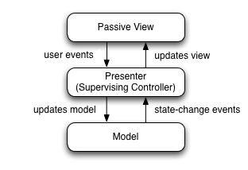<br>*MVP: the Presenter updates a passive View.*

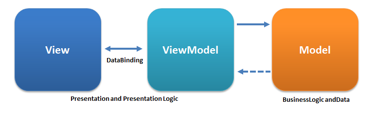<br>*MVVM: the View binds to the ViewModel.*

</div>

*Pictures: Wikimedia Commons.*

<p class="label">Exam notes</p>

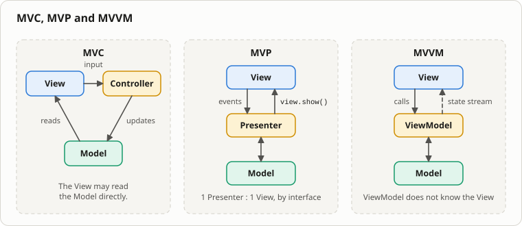

| | **MVC** | **MVP** | **MVVM** |
|---|---|---|---|
| Full form | <mark>Model–View–Controller</mark> | <mark>Model–View–Presenter</mark> | <mark>Model–View–ViewModel</mark> |
| Middle part | Controller handles input | **Presenter** holds the presentation logic | **ViewModel** holds UI state and logic |
| View ↔ middle link | View may read the Model directly | Presenter holds a <mark>**reference to the View through an interface**</mark> and tells it what to show (`view.showLoading()`) | <mark>ViewModel has **no reference to the View**; the View **observes** it</mark> (data binding, streams) |
| Relationship | Many-to-many | <mark>**One Presenter : one View**</mark> | <mark>**One ViewModel : many Views**</mark> |
| View | Has some logic | <mark>**Passive** ("dumb")</mark> | Reacts to state |
| Testability | Lower | Good (mock the View interface) | **Very good** (no View needed) |
| Where used | Classic web, old iOS | Older Android | Modern Android (Jetpack ViewModel), SwiftUI, Flutter |

**Model** in all three = data and business rules (repositories, entities).

**MVP vs MVVM in one line:** <mark>in MVP the Presenter **commands** the View; in MVVM the ViewModel **exposes state** and the View **binds** to it</mark>.

<div class="box q">

**Which one does Flutter use?**

Flutter is closest to **MVVM**. A widget does not get commands. It **watches** a state and rebuilds when the state changes. BLoC, Cubit, Provider and Riverpod all play the ViewModel role.

</div>

<div class="box rule">

**Remember.** MVP: the Presenter **commands** the View through an interface, one to one. MVVM: the View **observes** the ViewModel, one to many, and the ViewModel does not know the View.

</div>

<div class="box check">

**Quick check**

1. In which pattern does the middle part hold a reference to the View? (a) MVP (b) MVVM
2. Which pattern is easiest to unit-test without any screen? (a) MVC (b) MVVM
3. What does the "Model" contain in all three?

<details>
<summary>Show answers</summary>

1. **(a) MVP.**
2. **(b) MVVM**, because the ViewModel has no link to the View.
3. The data and business rules (entities, repositories).

</details>

</div>

## 3. BLoC (Business Logic Component)

<div class="box def">

**Definition.** **BLoC** (Business Logic Component) is a Flutter pattern that puts all decisions in one class, outside the widgets. The screen sends **events** in ("the user tapped Save"). The BLoC sends **states** out ("saving", "saved", "error"). The screen only draws the current state.

</div>

<div class="box story">

**Example scenario.** Imagine ordering in a restaurant.

1. You tell the waiter: "One biryani." This is an **event**. You do not walk into the kitchen.
2. The kitchen (the **BLoC**) checks the stock, cooks, and decides what to tell you.
3. First the waiter says "It is being prepared". Then "Here is your biryani". Or "Sorry, it is finished". These are **states**.
4. You react only to what the waiter tells you.

**In the app:** the widget calls `bloc.add(LoadVisits())`. The BLoC asks the repository, then emits `VisitLoading`, then `VisitLoaded` or `VisitError`. The widget shows a spinner, a list or a message.

</div>

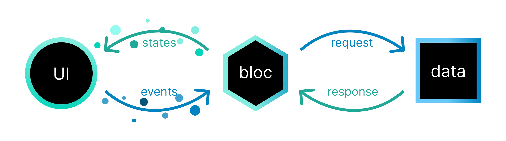<br>*BLoC: the UI sends **events**, the bloc sends back **states**, and the bloc talks to the data layer. Source: bloclibrary.dev.*

<p class="label">Exam notes</p>

A Flutter pattern (from Google) that separates **presentation** from **business logic** using **Streams**. <mark>The UI sends **Events**; the BLoC processes them and emits **States**; the UI rebuilds from the state.</mark>

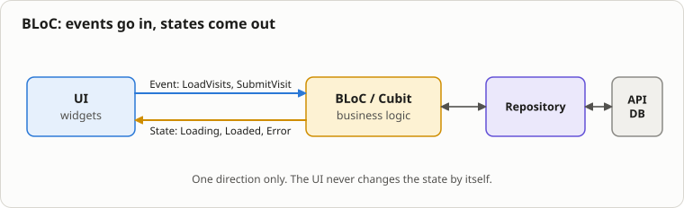

- <mark>**Unidirectional data flow:** events go in, states come out.</mark> State is predictable and easy to trace.
- <mark>**Event:** what happened (a tap, a page opened). **State:** what the UI should show (**immutable** objects, compared with `Equatable`)</mark>.
- **Bloc vs Cubit:**

| | Cubit | Bloc |
|---|---|---|
| Input | <mark>**Method calls** (`cubit.load()`)</mark> | <mark>**Event objects** (`bloc.add(LoadVisits())`)</mark> |
| Code | Less | More |
| Traceability | Lower | Higher: every change has a named event; supports event transformers (debounce, throttle) |
| Use | Simple state | Complex flows |

- **Widgets:** `BlocProvider` (creates and provides; closes it automatically) · <mark>`BlocBuilder` (rebuilds UI on state)</mark> · <mark>`BlocListener` (one-time actions: SnackBar, navigation)</mark> · `BlocConsumer` (both) · `buildWhen` / `listenWhen` (limit rebuilds) · `MultiBlocProvider`, `RepositoryProvider`.

```dart
// States
sealed class VisitState {}
class VisitLoading extends VisitState {}
class VisitLoaded extends VisitState { final List<Visit> visits; VisitLoaded(this.visits); }
class VisitError extends VisitState { final String message; VisitError(this.message); }

// Cubit
class VisitCubit extends Cubit<VisitState> {
  VisitCubit(this._getVisits) : super(VisitLoading());
  final GetVisits _getVisits;                 // use case injected (testable)

  Future<void> load() async {
    emit(VisitLoading());
    try {
      emit(VisitLoaded(await _getVisits()));
    } catch (_) {
      emit(VisitError('Could not load visits'));
    }
  }
}

// UI
BlocBuilder<VisitCubit, VisitState>(
  builder: (context, state) => switch (state) {
    VisitLoading() => const CircularProgressIndicator(),
    VisitLoaded(:final visits) => VisitList(visits),
    VisitError(:final message) => Text(message),
  },
)
```

**The same thing as a Bloc** (event-driven):
```dart
class VisitBloc extends Bloc<VisitEvent, VisitState> {
  VisitBloc(this._getVisits) : super(VisitLoading()) {
    on<LoadVisits>((event, emit) async {
      emit(VisitLoading());
      try { emit(VisitLoaded(await _getVisits())); }
      catch (_) { emit(VisitError('Could not load visits')); }
    });
  }
  final GetVisits _getVisits;
}
```

**Advantages:** clear separation, highly testable (`bloc_test`), predictable state, scales to large teams, good tooling (`BlocObserver` for logging). <mark>**Disadvantages:** boilerplate, learning curve, too heavy for tiny apps.</mark>

<div class="box q">

**What is the difference between a Bloc and a Cubit?**

A **Cubit** is the simple form: the UI calls a **method** (`cubit.load()`) and the Cubit emits states. A **Bloc** is the full form: the UI sends an **event object** (`bloc.add(LoadVisits())`). The Bloc needs more code, but every change has a named event that you can log and trace.

</div>

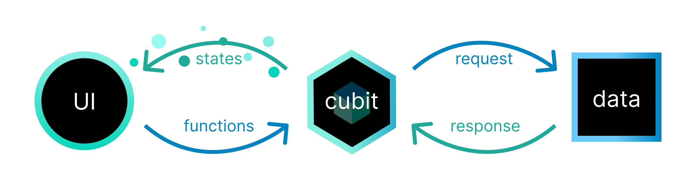<br>*A Cubit is the same picture with **functions** in place of events. Source: bloclibrary.dev.*

<div class="box rule">

**Remember.** BLoC = events in, states out, through streams, in one direction only. Cubit = methods instead of events. `BlocBuilder` rebuilds the UI, `BlocListener` does one-time actions.

</div>

## 4. Comparing Flutter state management

<div class="box def">

**In simple words.** All of these tools answer the same question: when the data changes, how does the screen find out? They differ in how much **discipline** they force on the team. BLoC forces the most, GetX the least.

</div>

| | Provider | BLoC | GetX |
|---|---|---|---|
| Core idea | `ChangeNotifier` + `notifyListeners()` | Events → States through Streams | Reactive `Rx` variables + `Obx` |
| Boilerplate | Low | High | Lowest |
| Separation of logic | Medium (discipline needed) | **Strict** | Loose (easy to mix) |
| Testability | Good | **Excellent** | Harder (global state, service locator) |
| Extras | — | Event tracing, transformers | Routing, DI, snackbars without context |
| Best for | Small to medium apps | Large, long-lived, team apps | Rapid development, prototypes |

**How to present yourself:** you have shipped with GetX and Provider and have used BLoC. For a large, long-lived system with several developers, such as the NGO's apps, BLoC's strict separation and testability are the better fit.

## 5. Clean Architecture

<div class="box def">

**Definition.** **Clean Architecture** arranges the whole app in layers, like rings. The **business rules** are in the centre. The **screens** and the **database** are on the outside. The one rule: **code may depend only on a layer closer to the centre**.

</div>

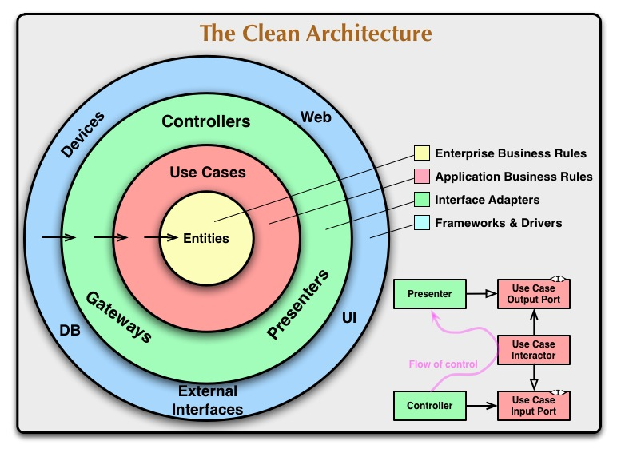<br>*The original picture: entities and use cases in the middle, frameworks and devices outside. The arrows point inward. Source: Robert C. Martin, The Clean Code Blog.*

<div class="box story">

**Example scenario.** Imagine your app uses Dio for the network. One day the team decides to change to another HTTP library.

- **In a messy app,** `Dio` is used directly in 60 screens. You must open and change all 60.
- **In a clean app,** the screens talk to a use case. The use case talks to a `VisitRepository` **interface**. Only one class, `VisitRepositoryImpl` in the data layer, knows Dio. You change that one class. No screen and no business rule is touched.

**Why did this work?** The centre (domain) never knew about Dio. It only knew "there is something that can give me visits".

</div>

<p class="label">Exam notes</p>

<mark>Proposed by Robert C. Martin ("Uncle Bob")</mark>. The code is split into **layers**, and the **Dependency Rule** says: <mark>**source-code dependencies point only inward**</mark>. Inner layers know nothing about outer layers.

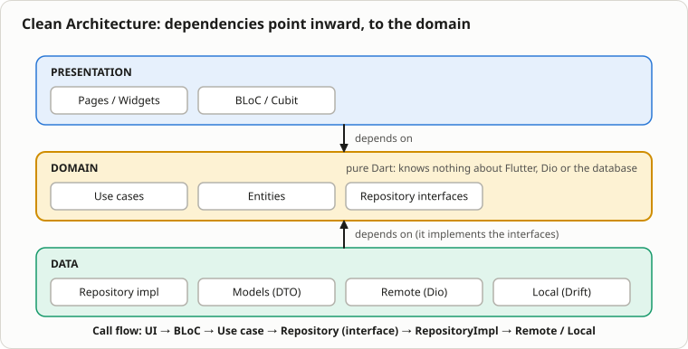

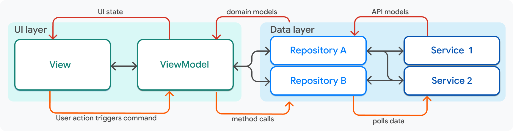<br>*The Flutter team's own recommended structure has the same idea: Views and ViewModels in the UI layer, Repositories and Services in the data layer. Source: Flutter documentation.*

| Layer | Contains | Knows about |
|---|---|---|
| **Presentation** | Screens, widgets, BLoCs | Domain |
| **Domain** | **Entities** (business objects), **use cases** (one business action each: `SubmitVisit`), **repository interfaces** | <mark>**Nothing** (no Flutter, no Dio, no database)</mark> |
| **Data** | Repository implementations, DTO models with `fromJson`, API and DB data sources | Domain |

**Call flow:** <mark>`UI → BLoC → UseCase → Repository (interface) → RepositoryImpl → Remote/Local data source`</mark>.

**Dependency inversion makes it work:** <mark>the domain defines `abstract class VisitRepository`; the data layer implements it</mark>. So the domain does not depend on the database or API, and either can be replaced or mocked.

**Feature-first folders**
```
lib/
  core/            (network, errors, theme, di)
  features/
    visits/
      data/          datasources/ models/ repositories/
      domain/        entities/ repositories/ usecases/
      presentation/  bloc/ pages/ widgets/
```

**Advantages:** independent of frameworks, UI and database; every layer testable alone; easy to swap Dio, Drift or the state library; clear places for code. **Disadvantages:** more files and boilerplate; overkill for small apps.

**How the patterns fit together:** <mark>Clean Architecture describes the **whole app's layers**. BLoC/MVVM/MVP describe the **presentation layer** inside it.</mark> "Clean Architecture with BLoC" = BLoC as the presentation layer of a clean-layered app.

<div class="box rule">

**Remember.** Presentation → Domain ← Data. Dependencies point inward. The domain is pure Dart and knows nothing about Flutter, Dio or the database. Clean Architecture is the layers of the whole app, BLoC is one way to build the presentation layer.

</div>

<div class="box check">

**Quick check**

1. Where does the repository **interface** live? (a) presentation (b) domain (c) data
2. Where does the repository **implementation** live?
3. May the domain layer import the `dio` package?

<details>
<summary>Show answers</summary>

1. **(b) domain.**
2. In the **data** layer.
3. **No.** The domain depends on nothing outside itself.

</details>

</div>

## 6. Supporting ideas

<div class="box def">

**Definition.** **Dependency injection (DI)** means a class does not create the things it needs. They are **given** to it from outside, usually through the constructor.

</div>

<div class="box story">

**Example scenario.** Imagine a table lamp.

1. **Lamp A** has its wire fixed inside the wall. To test the lamp, you must be in that room, with that wall, with the power on.
2. **Lamp B** has a **plug**. You can plug it into any socket, or into a small battery on your desk to test it.

**In code:** a Cubit that writes `final repo = VisitRepository()` inside itself is Lamp A. It can only be tested with the real server. A Cubit that receives `repo` in its constructor is Lamp B. In a test you plug in a fake repository.

</div>

- **Repository pattern:** <mark>one class hides where data comes from (API, cache, DB)</mark>. The rest of the app asks the repository and does not care.
- **Dependency Injection (DI):** <mark>a class **receives** its dependencies (through the constructor) instead of creating them</mark>. This makes swapping in mocks possible. Tools: `get_it` (service locator), `injectable`, Provider/Riverpod, Hilt (Android).
- **SOLID** (details in the [OOP notes](../Notes/Foundations%201%20-%20OOP%20and%20DSA.md)): <mark>**S**ingle Responsibility · **O**pen/Closed · **L**iskov Substitution · **I**nterface Segregation · **D**ependency Inversion</mark>.

```dart
abstract class VisitRepository { Future<List<Visit>> getVisits(); }      // domain

class VisitRepositoryImpl implements VisitRepository {                   // data
  VisitRepositoryImpl(this.remote, this.local);        // dependencies injected
  final VisitApi remote; final VisitDao local;
  @override
  Future<List<Visit>> getVisits() async => (await local.all()).map((m) => m.toEntity()).toList();
}
```

## 7. Design patterns (short-question list)

<div class="box def">

**In simple words.** A **design pattern** is a named, proven answer to a problem that appears again and again in code. Learn the name, the idea in five words, and one mobile example.

</div>

| Pattern | Idea | Mobile example |
|---|---|---|
| **Singleton** | Only one instance | Database connection, Dio client |
| **Factory** | A method decides which object to create | `Model.fromJson` factory constructor |
| **Observer** | Subscribers are notified of changes | Streams, `ChangeNotifier`, LiveData |
| **Repository** | Hide the data source | `VisitRepository` |
| **Adapter** | Convert one interface to another | Wrapper around a third-party SDK; Hive `TypeAdapter` |
| **Builder** | Build a complex object step by step | `AlertDialog.Builder` (Android) |
| **Strategy** | Swap algorithms at run time | Different sync conflict strategies |
| **Facade** | One simple interface over a complex subsystem | A `SyncService` over queue + API + DB |

Three groups: <mark>**creational** (Singleton, Factory, Builder), **structural** (Adapter, Facade, Decorator), **behavioural** (Observer, Strategy, Command)</mark>.

## 8. What "maintainable, testable code" means

<div class="box def">

**In simple words.** Almost every job advert asks for this. *Maintainable* means another developer can understand and change the code next year. *Testable* means each piece can be checked alone.

</div>

Small functions and classes with one job · meaningful names · <mark>**DRY** (Don't Repeat Yourself), **KISS** (Keep It Simple), **YAGNI** (You Aren't Gonna Need It)</mark> · no logic inside widgets · dependencies injected · immutable state · no magic numbers or hard-coded strings · consistent style enforced by lints · errors handled, not swallowed · code reviewed · tests present.

---

## 9. Testing: levels in Flutter

<div class="box def">

**Definition.** A **test** is code that runs your code and checks the result automatically. Flutter has three levels: a **unit test** checks one function or class, a **widget test** checks one piece of UI, and an **integration test** runs the whole app on a device.

</div>

<div class="box story">

**Example scenario.** Imagine a car factory.

1. **Unit test:** test each bolt and each bulb alone on a bench. Thousands of tests, each takes a second.
2. **Widget test:** fit the dashboard and check that pressing the button turns on the light. No road needed.
3. **Integration test:** drive the finished car on a real road. Slow and costly, but it proves that everything works together.

**How many of each?** Many cheap bench tests, some dashboard tests, a few road tests. Drawn as a picture, this is a **pyramid**.

</div>

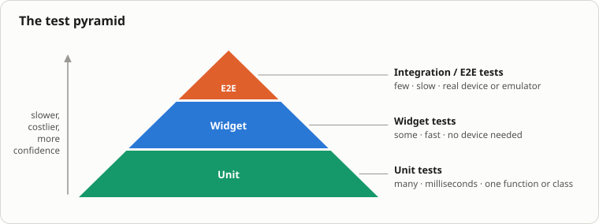

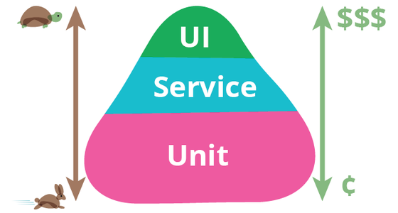<br>*The classic test pyramid: the higher the level, the slower and more expensive each test. Source: Martin Fowler, martinfowler.com.*

| | **Unit test** | **Widget test** (Flutter's UI component test) | **Integration test** |
|---|---|---|---|
| Tests | One function, class, Cubit or use case | One widget or screen: rendering and interaction | The whole app or a full flow |
| Runs on | Dart VM, no UI | Simulated Flutter test environment, **no device** | Real device or emulator |
| Speed | Milliseconds | Fast | Slow |
| Dependencies | Mocked | Mocked | Real or fake backend |
| Confidence | Low per test | Medium | High |
| Tools | `test`, `mocktail`/`mockito`, `bloc_test` | `flutter_test` (`testWidgets`, `WidgetTester`) | `integration_test`, Patrol, Firebase Test Lab |

Also: <mark>**golden tests** compare a widget's rendered image with a saved reference image</mark>, to catch visual changes.

**Native equivalents:** Android unit: <mark>**JUnit**</mark> + Mockito/MockK; Android UI: <mark>**Espresso**</mark>, Compose UI tests. iOS unit: <mark>**XCTest**</mark>; iOS UI: <mark>**XCUITest**</mark>.

<div class="box rule">

**Remember.** Unit = one function, milliseconds. Widget = one piece of UI, no device. Integration = the whole app on a device. Many unit, some widget, few integration.

</div>

## 10. Unit tests

<div class="box def">

**In simple words.** A unit test has three steps, called **AAA**: **Arrange** (prepare the inputs), **Act** (call the code), **Assert** (check the answer).

</div>

Pattern: <mark>**AAA = Arrange, Act, Assert** (also called Given–When–Then)</mark>.

```dart
test('totalPayable adds 10% service charge', () {
  final calc = LoanCalculator();                    // Arrange
  final total = calc.totalPayable(principal: 1000); // Act
  expect(total, 1100);                              // Assert
});
```

**Test doubles**
| Type | Meaning |
|---|---|
| **Mock** | <mark>A fake object that records calls so you can **verify** interactions</mark> |
| **Stub** | <mark>Returns fixed answers</mark> |
| **Fake** | <mark>A simple working implementation (an in-memory database)</mark> |

```dart
class MockGetVisits extends Mock implements GetVisits {}

blocTest<VisitCubit, VisitState>(
  'emits [Loading, Loaded] when loading succeeds',
  build: () {
    when(() => getVisits()).thenAnswer((_) async => [visit]);   // stub
    return VisitCubit(getVisits);
  },
  act: (cubit) => cubit.load(),
  expect: () => [isA<VisitLoading>(), isA<VisitLoaded>()],
  verify: (_) => verify(() => getVisits()).called(1),
);
```
<mark>This works only because the use case is **injected**.</mark> That is why architecture and testability go together.

<div class="box q">

**What is a mock, in simple words?**

A stand-in, like a **crash-test dummy**. You do not put a real person in the car. In a test you do not call the real server. You give the Cubit a mock repository that returns the answer you choose, and afterwards you can ask the mock "were you called once?".

</div>

## 11. Widget tests

<div class="box def">

**In simple words.** A widget test builds one screen in memory, with no phone, then behaves like a user: it finds a button, taps it, and checks what text is now on the screen.

</div>

```dart
testWidgets('shows an error when member name is empty', (tester) async {
  await tester.pumpWidget(const MaterialApp(home: VisitForm()));   // build the widget

  await tester.tap(find.text('Save'));                             // interact
  await tester.pump();                                             // rebuild one frame

  expect(find.text('Member name is required'), findsOneWidget);        // verify
});
```
| API | Does |
|---|---|
| `pumpWidget` | Builds the widget in the test environment |
| `find.text`, `find.byType`, `find.byKey` | **Finders** locate widgets |
| `tester.tap`, `enterText`, `drag` | Simulate user actions |
| `pump()` | <mark>Rebuilds one frame. `pumpAndSettle()` waits for all animations to finish</mark> |
| `findsOneWidget`, `findsNothing`, `findsNWidgets(n)` | **Matchers** |

<div class="box check">

**Quick check**

1. Which test level needs a real device or emulator? (a) unit (b) widget (c) integration
2. What do the three letters of AAA mean?
3. A widget test taps a button that starts an animation. Which call waits until the animation ends? (a) `pump()` (b) `pumpAndSettle()`

<details>
<summary>Show answers</summary>

1. **(c) integration.**
2. Arrange, Act, Assert.
3. **(b) `pumpAndSettle()`.**

</details>

</div>

## 12. Integration tests

<div class="box def">

**In simple words.** An integration test starts the real app on a device and plays a whole story: log in, create a visit, see it in the list. It is the closest thing to a real user.

</div>

Run the real app on a device and drive a full flow (login → create visit → see it in the list). Uses the `integration_test` package with the same `WidgetTester` API. Good for testing offline/online sync flows. Slow, so keep them few and run them in CI on emulators or Firebase Test Lab.

## 13. What to test, coverage, TDD

<div class="box def">

**In simple words.** You cannot test everything, so test what would hurt most if it broke: calculations, validation rules, state logic and sync. **TDD** turns the order around: write the test first, then the code.

</div>

- **Test first:** business rules (calculations, validation), state logic (Cubits/BLoCs), repositories and sync logic, JSON parsing, important screens and forms. Do not unit-test Flutter itself.
- <mark>**Code coverage:** percentage of lines executed by tests.</mark> `flutter test --coverage` creates `lcov.info`. High coverage does not prove correctness, but low coverage shows untested areas.
- <mark>**TDD (Test-Driven Development):** **Red** (write a failing test) → **Green** (write the minimum code to pass) → **Refactor** (clean up with tests still passing)</mark>.
- Tests run **automatically in CI** on every pull request (Ch 9).

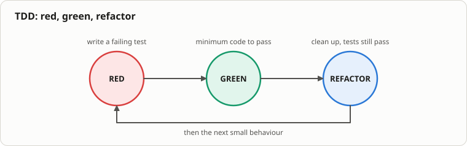

## 14. General testing vocabulary (typical exam terms)

<div class="box def">

**In simple words.** These are general testing words, not only for mobile. They often appear as "define" or "difference between" questions worth 2 marks each.

</div>

| Term | Meaning |
|---|---|
| **Unit → Integration → System → Acceptance** | <mark>The four test levels</mark> |
| <mark>**UAT** (User Acceptance Testing)</mark> | Real users confirm the system meets their needs before go-live |
| **Black-box** | <mark>Test from inputs and outputs, without seeing the code</mark> |
| **White-box** | <mark>Test with knowledge of the internal code paths</mark> |
| **Regression testing** | <mark>Re-run old tests after a change to confirm nothing else broke</mark> |
| **Smoke testing** | <mark>A quick check that the main functions work at all</mark> |
| **Sanity testing** | <mark>A narrow check of one fix or area</mark> |
| **Functional vs non-functional** | <mark>What the system does vs how well</mark> (performance, security, usability) |
| **Load / stress testing** | Behaviour under expected / extreme load |
| **Alpha / beta testing** | By internal staff / by real users before release |
| **Verification vs validation** | <mark>"Are we building the product right?" vs "Are we building the right product?"</mark> |
| **Manual vs automated** | A person runs it / a script runs it |

## Link it to your own projects

Interviews and written exams reward answers that use **your own work** as the example. Before you move on, answer these for yourself:

<div class="box you">

- Which architecture do your apps use? Draw the folder structure of one feature.
- Which state management have you used (GetX, Provider, BLoC, Riverpod)? Be ready to compare them honestly.
- Which tests have you written? If only a few, describe one unit test and one widget test you would add.

</div>

---

## Practice questions

**Short (2–3 marks each)**
1. What does BLoC stand for? Explain Event and State.
2. Bloc vs Cubit.
3. MVP vs MVVM (three differences).
4. What is the Dependency Rule in Clean Architecture?
5. Name the three layers of Clean Architecture and one item in each.
6. What is dependency injection? Why does it help testing?
7. What is the repository pattern?
8. Unit test vs widget test vs integration test.
9. What is the AAA pattern?
10. What is a mock?
11. `pump()` vs `pumpAndSettle()`.
12. What is regression testing? What is UAT?

**Long (10–12 marks each)**

13. Explain the BLoC pattern with a diagram and a code example. What are its advantages and disadvantages compared with Provider and GetX?
14. Explain Clean Architecture for a Flutter app. Draw the layers, state the dependency rule, and show how a "submit field visit" request flows through them.
15. Compare MVC, MVP and MVVM. Which would you choose for a new NGO mobile app and why?
16. Describe the types of tests in Flutter. Write one unit test and one widget test for a login screen.

---

## Model answers

<div class="box exam">

**How to read these answers.** They are written for **learning**, so they are fuller than what you would write in the exam hall. Every answer has the same parts:

- **In short** (green): the direct answer. In the exam, write this part first.
- **Table or points:** the details, laid out so you can compare and remember them.
- **Example** (yellow): a real situation, usually from a field app or from your own projects.
- Long answers end with **In the exam** (brown): how to shorten the answer on paper.

Write your own answer first. Then open the model answer and compare.

</div>

<details>
<summary>1. What does BLoC stand for? Explain Event and State.</summary>

<div class="box def">

**In short.** <mark>**BLoC = Business Logic Component.**</mark> An **Event** is an input: it says *what happened*. A **State** is an output: it says *what the UI should show now*. The BLoC sits between them and turns events into states.

</div>


| | Event | State |
|---|---|---|
| **Direction** | UI → BLoC | BLoC → UI |
| **Says** | "This happened" | "Show this" |
| **Sent by** | A tap, a page opening, a timer, a stream | The BLoC, with `emit()` |
| **Naming** | An action: `LoadVisits`, `SubmitVisit` | A situation: `VisitLoading`, `VisitLoaded`, `VisitError` |
| **Changes** | — | Immutable; a **new** state object replaces the old one |

**The flow goes one way only**

1. The user taps "Refresh". The UI adds the event `LoadVisits`.
2. The BLoC receives it and emits `VisitLoading`.
3. The BLoC asks the repository for data.
4. The BLoC emits `VisitLoaded(visits)` or `VisitError(message)`.
5. The UI rebuilds from the new state.

The UI never changes data by itself, and the BLoC never touches a widget. This **one-way data flow** makes the app predictable and easy to test.

<div class="box story">

**Example.** On the visit list screen, pull-to-refresh adds `LoadVisits`. The screen shows a spinner for `VisitLoading`, the list for `VisitLoaded`, and a "Could not load. Retry" message for `VisitError`. Every possible screen is one named state.

</div>

<div class="ref">

**From the book:** [3. BLoC (Business Logic Component)](#3-bloc-business-logic-component)

</div>

</details>

<details>
<summary>2. Bloc vs Cubit.</summary>

<div class="box def">

**In short.** Both hold state and emit new states, and both come from the `flutter_bloc` package. A **Cubit** is the simple form: the UI **calls a method** and the Cubit emits a state. A **Bloc** is the full form: the UI **adds an event object**, and the Bloc handles it with `on<Event>`.

</div>

| Point | Cubit | Bloc |
|---|---|---|
| **Input** | Method calls: `cubit.load()` | Event objects: `bloc.add(LoadVisits())` |
| **Code** | Less | More (event classes + handlers) |
| **Traceability** | You see state changes | You see which **event** caused each state change |
| **Event transformations** | No | Yes: debounce, throttle, cancel the previous (`restartable`) |
| **Learning** | Easy | A little harder |
| **Relation** | The base class | `Bloc` extends the same base (`BlocBase`) |
| **Use it for** | Simple screens: a form, a toggle, a counter | Complex flows: search-as-you-type, sync, anything worth logging |

```dart
// Cubit
class CounterCubit extends Cubit<int> {
  CounterCubit() : super(0);
  void increment() => emit(state + 1);
}

// Bloc
class CounterBloc extends Bloc<CounterEvent, int> {
  CounterBloc() : super(0) {
    on<Increment>((event, emit) => emit(state + 1));
  }
}
```

**The advice from the library's own documentation:** start with a Cubit, and move to a Bloc when you need events.

<div class="box story">

**Example.** A language switch (Bangla / English) is a Cubit with one method. A borrower search box is a Bloc: each key press is an event, and a **debounce** transformer waits 300 ms, so the app does not query the database on every letter.

</div>

<div class="ref">

**From the book:** [3. BLoC (Business Logic Component)](#3-bloc-business-logic-component)

</div>

</details>

<details>
<summary>3. MVP vs MVVM (three differences).</summary>

<div class="box def">

**In short.** In **MVP** the **Presenter knows the View** (through an interface) and tells it what to show. In **MVVM** the **ViewModel does not know the View**; the View **observes** the ViewModel's state and updates itself.

</div>

<div class="pair">


</div>

*MVP (left) and MVVM (right). Source: Wikipedia.*

| Point | MVP | MVVM |
|---|---|---|
| **1. Reference to the View** | The Presenter holds a View interface and calls `view.showError()` | The ViewModel has **no** reference to the View |
| **2. How the UI updates** | Explicit method calls from the Presenter | **Data binding** or reactive streams; the View observes |
| **3. Relation** | One Presenter for one View (1 : 1) | One ViewModel can serve many Views (1 : many) |
| **Testing** | Good, but the View interface must be mocked | Easier: test the ViewModel's state alone |
| **Amount of code** | More (an interface for each View) | Less |
| **Fits** | Imperative UI: Android XML views, UIKit | Declarative UI: Flutter, Jetpack Compose, SwiftUI |
| **Lifecycle risk** | The Presenter can leak the View | Smaller, because there is no View reference |

<div class="box story">

**Example.** After login fails, an MVP Presenter calls `view.showError("Wrong password")`. An MVVM ViewModel only sets `state = LoginError("Wrong password")`, and whichever widget is listening shows it. Flutter's BLoC, Provider and Riverpod all work in the MVVM way.

</div>

<div class="ref">

**From the book:** [2. MVC, MVP, MVVM](#2-mvc-mvp-mvvm)

</div>

</details>

<details>
<summary>4. What is the Dependency Rule in Clean Architecture?</summary>

<div class="box def">

**In short.** <mark>Source-code dependencies must point **inward** only.</mark> Outer layers (UI, database, network) may depend on inner layers (business rules). The inner layers must know **nothing** about the outer ones.

</div>


| Layer | May import | Must not import |
|---|---|---|
| **Presentation** (outer) | Domain | — |
| **Data** (outer) | Domain | Presentation |
| **Domain** (inner) | Nothing outside itself: pure Dart | Flutter, Dio, Drift, Firebase, JSON |

**The puzzle.** A use case in the domain must save data, and saving is done by the data layer. How can the domain call the data layer without depending on it?

**The answer is dependency inversion:**

1. The **domain** defines an interface: `abstract class VisitRepository`.
2. The **data layer** implements it: `class VisitRepositoryImpl implements VisitRepository`.
3. The use case knows only the interface. The real class is handed in from outside (dependency injection).

So at run time the call goes domain → data, but in the source code the dependency points data → domain.

**What the rule gives you**

- You can replace Dio with another client, or Drift with Isar, and the business rules do not change.
- The domain can be tested with plain Dart tests: no emulator, no network.

<div class="box story">

**Example.** The NGO decides to move the field app's local database from Hive to SQLite. Only `VisitLocalDataSource` and `VisitRepositoryImpl` in the data layer are rewritten. The rule "a visit needs a photo and a GPS position" lives in the domain and is not touched.

</div>

<div class="ref">

**From the book:** [5. Clean Architecture](#5-clean-architecture)

</div>

</details>

<details>
<summary>5. Name the three layers of Clean Architecture and one item in each.</summary>

<div class="box def">

**In short.** **Presentation** (pages and BLoCs), **Domain** (entities, use cases, repository interfaces) and **Data** (repository implementations, models, data sources).

</div>

| Layer | Its job | What is inside | Depends on |
|---|---|---|---|
| **Presentation** | Show state, take user input | Pages, widgets, BLoC / Cubit / ViewModel | Domain |
| **Domain** | The business rules. The heart of the app | **Entities** (`Visit`), **use cases** (`SubmitVisit`), **repository interfaces** | Nothing |
| **Data** | Get and store data | **Repository implementations**, **models** (with `fromJson`), **remote data source** (API), **local data source** (database) | Domain |

**A typical folder structure (feature-first)**

```text
lib/
 └─ features/
     └─ visit/
         ├─ presentation/   pages/  widgets/  bloc/
         ├─ domain/         entities/  usecases/  repositories/
         └─ data/           models/  datasources/  repositories/
```

| Often confused | Entity (domain) | Model (data) |
|---|---|---|
| **What it is** | A pure business object | The entity plus knowledge of JSON or database rows |
| **Has `fromJson`?** | No | Yes |
| **Changes when the API changes?** | No | Yes |

<div class="box story">

**Example.** For "submit a field visit": `VisitFormPage` and `VisitBloc` are presentation. The `SubmitVisit` use case and the `Visit` entity are domain. `VisitRepositoryImpl`, `VisitModel` and the Drift and Dio data sources are data.

</div>

<div class="ref">

**From the book:** [5. Clean Architecture](#5-clean-architecture)

</div>

</details>

<details>
<summary>6. What is dependency injection? Why does it help testing?</summary>

<div class="box def">

**In short.** Dependency injection (DI) means an object **receives the things it needs from outside**, usually through its constructor, and does not create them itself. It helps testing because a test can hand in a **fake or mock**, so the class is tested alone, with no real network or database.

</div>

| | Without DI | With DI |
|---|---|---|
| **Who creates the dependency** | The class itself | Someone outside passes it in |
| **Coupling** | Tight: bound to one concrete class | Loose: depends on an interface |
| **Swap the implementation** | Edit the class | Pass a different object |
| **Unit test** | Calls the real API | Uses a mock |

```dart
// Without DI: cannot be tested without a real server
class VisitBloc {
  final repo = VisitRepositoryImpl(Dio());
}

// With DI: the repository comes from outside
class VisitBloc {
  final VisitRepository repo;
  VisitBloc(this.repo);
}

// In the app
VisitBloc(VisitRepositoryImpl(dio, db));

// In a test
VisitBloc(MockVisitRepository());
```

**Ways to do it in Flutter**

| Tool | Kind |
|---|---|
| Constructor parameters | Plain DI, no package |
| `get_it` (+ `injectable`) | Service locator |
| `Provider`, `RepositoryProvider`, `BlocProvider` | DI through the widget tree |
| Riverpod | Providers as a DI container |

<div class="box story">

**Example.** To test "the screen shows an error when the server is down", you do not switch off a real server. You inject a mock repository that throws an exception and check that the BLoC emits `VisitError`. The test runs in milliseconds and gives the same result every time.

</div>

<div class="ref">

**From the book:** [6. Supporting ideas](#6-supporting-ideas)

</div>

</details>

<details>
<summary>7. What is the repository pattern?</summary>

<div class="box def">

**In short.** A repository is a class that gives the rest of the app **one clean API for data** and **hides where the data comes from**: the remote API, the local database or a cache. It also holds the logic that chooses between those sources.

</div>

```dart
abstract class VisitRepository {                 // the contract (domain)
  Stream<List<Visit>> watchVisits();
  Future<void> saveVisit(Visit visit);
}

class VisitRepositoryImpl implements VisitRepository {   // the implementation (data)
  final VisitLocalSource local;
  final VisitRemoteSource remote;
  VisitRepositoryImpl(this.local, this.remote);

  @override
  Stream<List<Visit>> watchVisits() => local.watchAll();     // the UI reads the local DB

  @override
  Future<void> saveVisit(Visit visit) async {
    await local.insertWithOutbox(visit);                    // save locally first
    // the sync engine pushes it to `remote` later
  }
}
```

| What it gives | How |
|---|---|
| **A single source of truth** | The BLoC asks one place; the repository decides between cache, database and network |
| **Separation** | The BLoC knows nothing about HTTP, SQL or JSON |
| **Easy testing** | Mock the repository interface |
| **Easy change** | Replace the API client or the database without touching screens |
| **One place for rules** | Caching, offline fallback, converting errors to app-level failures |

<div class="box story">

**Example.** The visit list calls `repo.watchVisits()`. Today that reads the Drift database, and a sync job refreshes it from the API. If the NGO later adds a second server or a new cache, the screens and BLoCs do not change, because they only ever knew the repository.

</div>

<div class="ref">

**From the book:** [6. Supporting ideas](#6-supporting-ideas)

</div>

</details>

<details>
<summary>8. Unit test vs widget test vs integration test.</summary>

<div class="box def">

**In short.** A **unit test** checks one function or class. A **widget test** checks one widget's UI and interaction in a simulated environment. An **integration test** runs the whole app on a real device or emulator.

</div>


| Point | Unit test | Widget test | Integration test |
|---|---|---|---|
| **Tests** | One function, class, BLoC or use case | One widget or screen | The whole app, end to end |
| **UI involved** | No | Yes, rendered in a test environment | Yes, the real UI |
| **Runs on** | The Dart VM (your computer) | The Dart VM | A real device or emulator |
| **Speed** | Milliseconds | Fast | Slow (minutes) |
| **Dependencies** | Mocked | Mostly mocked | Real, or a test backend |
| **Confidence** | Low for the whole app, high for the logic | Medium | Highest |
| **Cost to maintain** | Low | Medium | High |
| **Package** | `test`, `mocktail`, `bloc_test` | `flutter_test` (`testWidgets`, `WidgetTester`) | `integration_test` |
| **How many** | Many | Some | Few |

**The pyramid** says: many fast unit tests at the bottom, fewer widget tests in the middle, and a few slow integration tests at the top.

<div class="box story">

**Example for a visit form.** Unit: "the validator rejects an empty observation" and "the sync service retries on a 500". Widget: "tapping Save with empty fields shows the error text". Integration: "log in, create a visit with a photo, go offline, come online, and see it marked Synced".

</div>

<div class="ref">

**From the book:** [9. Testing: levels in Flutter](#9-testing-levels-in-flutter)

</div>

</details>

<details>
<summary>9. What is the AAA pattern?</summary>

<div class="box def">

**In short.** AAA is a way to structure every test in three steps: <mark>**Arrange**, **Act**, **Assert**</mark>.

</div>

| Step | Meaning | In the example below |
|---|---|---|
| **Arrange** | Set up the objects, inputs and mocks | Create the validator |
| **Act** | Call the code under test, once | Call `validate('')` |
| **Assert** | Check that the result is what you expect | `expect(result, 'Email is required')` |

```dart
test('an empty email gives an error message', () {
  // Arrange
  final validator = EmailValidator();

  // Act
  final result = validator.validate('');

  // Assert
  expect(result, 'Email is required');
});
```

**Why use it**

- Every test reads the same way, so anyone can follow it.
- One action per test: when it fails, you know exactly what broke.
- It keeps setup code apart from the check.

**The same idea in other words:** *Given – When – Then*. Given an empty email, when I validate it, then I get an error.

<div class="box story">

**Example.** In `bloc_test` the three steps even have names: `build:` is Arrange, `act:` is Act, and `expect:` is Assert.

</div>

<div class="ref">

**From the book:** [10. Unit tests](#10-unit-tests)

</div>

</details>

<details>
<summary>10. What is a mock?</summary>

<div class="box def">

**In short.** A mock is a **fake object that stands in for a real dependency** in a test. It returns the answers you programmed, and it **records how it was called**, so the test can verify the interaction.

</div>

```dart
class MockVisitRepository extends Mock implements VisitRepository {}

test('saving a visit calls the repository once', () async {
  final repo = MockVisitRepository();
  when(() => repo.saveVisit(any())).thenAnswer((_) async {});   // programmed answer

  await SubmitVisit(repo).call(visit);

  verify(() => repo.saveVisit(visit)).called(1);                 // check the call
});
```

**Why mock:** the real API is slow, needs a network, costs money or changes data. A mock is instant, and always behaves the same. It can also simulate cases that are hard to create for real, such as "the server returns 500".

**The family of test doubles**

| Kind | What it does | Example |
|---|---|---|
| **Dummy** | Fills a parameter and is never used | A `null` logger |
| **Stub** | Returns fixed answers | `getVisits()` always returns two visits |
| **Fake** | A simple working implementation | An in-memory database |
| **Mock** | Returns programmed answers **and verifies calls** | `verify(repo.save(...)).called(1)` |
| **Spy** | Wraps the real object and records calls | — |

**Packages:** `mocktail` (no code generation) and `mockito`.

<div class="box story">

**Example.** To test the sync engine's retry logic, you give it a mock API that fails twice and succeeds the third time. Then you verify that `push()` was called exactly three times. Doing this against a real server would be slow and unreliable.

</div>

<div class="ref">

**From the book:** [10. Unit tests](#10-unit-tests)

</div>

</details>

<details>
<summary>11. <code>pump()</code> vs <code>pumpAndSettle()</code>.</summary>

<div class="box def">

**In short.** In a widget test, time does not move by itself. `pump()` **draws one frame**. `pumpAndSettle()` **keeps drawing frames until nothing is left to animate**.

</div>

| Method | What it does | Use it when |
|---|---|---|
| `pumpWidget(widget)` | Builds the widget for the first time | At the start of the test |
| `pump()` | Triggers **one** rebuild | After a tap or `setState`, to see the next frame |
| `pump(Duration(seconds: 1))` | Moves the clock forward by that time, then draws one frame | To step through a timer or an animation |
| `pumpAndSettle()` | Pumps again and again until no frames are scheduled | After navigation, a dialog or any animation that finishes |

```dart
testWidgets('Save opens the confirmation dialog', (tester) async {
  await tester.pumpWidget(const MaterialApp(home: VisitFormPage()));

  await tester.tap(find.text('Save'));
  await tester.pumpAndSettle();              // wait for the dialog animation

  expect(find.text('Visit saved'), findsOneWidget);
});
```

**The trap:** `pumpAndSettle()` **never finishes** if something animates forever, such as a `CircularProgressIndicator`. The test times out. In that case use `pump()` with a duration.

<div class="box story">

**Example.** A test taps Login and expects a loading spinner. With `pumpAndSettle()` the test hangs, because the spinner never stops. With a single `pump()` the spinner frame is drawn and `expect(find.byType(CircularProgressIndicator), findsOneWidget)` passes.

</div>

<div class="ref">

**From the book:** [11. Widget tests](#11-widget-tests)

</div>

</details>

<details>
<summary>12. What is regression testing? What is UAT?</summary>

<div class="box def">

**In short.** **Regression testing** means running the existing tests again after a change, to make sure that **features which worked before still work**. **UAT (User Acceptance Testing)** is the **final test by real end users**, to confirm the system meets their business needs before go-live.

</div>

| Point | Regression testing | UAT |
|---|---|---|
| **Question** | "Did the change break anything old?" | "Is this what we need?" |
| **Done by** | Developers and QA; mostly automated in CI | End users or the client |
| **When** | After every change, fix or merge | At the end, before release |
| **Environment** | Test environment, CI | A staging environment close to production |
| **Based on** | The existing test suite | Real business scenarios |
| **Result** | Tests pass or fail | **Sign-off**: accepted or not |
| **Kind of testing** | Verification: "did we build it right?" | Validation: "did we build the right thing?" |

**Where UAT sits among the test levels:** unit → integration → system → **acceptance (UAT)**.

- **Alpha testing:** inside the organisation.
- **Beta testing:** by real users outside (TestFlight, Play closed testing).

<div class="box story">

**Example.** A fix to the date format on the visit form accidentally breaks the monthly report. The automated tests in CI catch it: regression testing. Later, ten field officers and two branch managers use the new version for a week with real tasks, then sign that it is fit for use: UAT.

</div>

<div class="ref">

**From the book:** [14. General testing vocabulary (typical exam terms)](#14-general-testing-vocabulary-typical-exam-terms)

</div>

</details>

<details>
<summary>13. Explain the BLoC pattern with a diagram and a code example. What are its advantages and disadvantages compared with Provider and GetX?</summary>

<div class="box def">

**In short.** BLoC (**Business Logic Component**) is a state-management pattern that **separates the business logic from the UI**. The UI sends **events** to the BLoC. The BLoC runs the logic and sends back **states**, and the UI rebuilds from them. Data flows in one direction. Compared with Provider and GetX, BLoC needs more code, but it is stricter, easier to test and better for large team apps.

</div>

<br>*The UI sends events to the Bloc; the Bloc asks the data layer and returns states. Source: bloclibrary.dev.*

#### 1. The parts

| Part | Role |
|---|---|
| **Event** | An input: what happened (`LoadVisits`) |
| **State** | An output: what to show (`VisitLoading`, `VisitLoaded`, `VisitError`) |
| **Bloc** | Receives events, calls the repository, emits states |
| **Repository** | Supplies the data |
| **UI** | Adds events and rebuilds from states. It holds no logic |

#### 2. The code

```dart
// Events
sealed class VisitEvent {}
class LoadVisits extends VisitEvent {}

// States
sealed class VisitState {}
class VisitInitial extends VisitState {}
class VisitLoading extends VisitState {}
class VisitLoaded extends VisitState {
  final List<Visit> visits;
  VisitLoaded(this.visits);
}
class VisitError extends VisitState {
  final String message;
  VisitError(this.message);
}

// Bloc
class VisitBloc extends Bloc<VisitEvent, VisitState> {
  final VisitRepository repo;

  VisitBloc(this.repo) : super(VisitInitial()) {
    on<LoadVisits>((event, emit) async {
      emit(VisitLoading());
      try {
        emit(VisitLoaded(await repo.getVisits()));
      } catch (_) {
        emit(VisitError('Could not load visits'));
      }
    });
  }
}

// UI
BlocProvider(
  create: (_) => VisitBloc(repo)..add(LoadVisits()),
  child: BlocBuilder<VisitBloc, VisitState>(
    builder: (context, state) => switch (state) {
      VisitLoading() => const CircularProgressIndicator(),
      VisitLoaded(:final visits) => VisitList(visits),
      VisitError(:final message) => Text(message),
      VisitInitial() => const SizedBox(),
    },
  ),
)
```

#### 3. The widgets of `flutter_bloc`

| Widget | Use |
|---|---|
| `BlocProvider` | Creates a Bloc, gives it to the subtree and closes it |
| `BlocBuilder` | Rebuilds the UI on a new state (`buildWhen` limits rebuilds) |
| `BlocListener` | One-time actions: a snackbar, navigation |
| `BlocConsumer` | Builder + listener together |
| `BlocSelector` | Rebuilds only when one selected part of the state changes |
| `MultiBlocProvider` | Several providers without nesting |

#### 4. Compared with Provider and GetX

| Point | BLoC | Provider | GetX |
|---|---|---|---|
| **Idea** | Events in, states out, through streams | A `ChangeNotifier` calls `notifyListeners()` | Reactive variables (`.obs`) and controllers |
| **Boilerplate** | Most | Little | Least |
| **Learning curve** | Steeper | Easy | Easiest |
| **Structure enforced** | Strong | Medium | Weak: easy to mix UI and logic |
| **Testability** | Excellent (`bloc_test`) | Good | Fair: global state makes it harder |
| **Traceability** | Every change has an event (`BlocObserver`) | Limited | Limited |
| **Needs `BuildContext`** | Yes | Yes | No |
| **Extras** | State management only | DI + state | Routing, DI, dialogs, translations in one package |
| **Best for** | Large, long-lived team apps | Small and medium apps | Quick prototypes, small apps |

#### 5. Advantages and disadvantages of BLoC

| Advantages | Disadvantages |
|---|---|
| Clear separation of UI and logic | More files and code for a simple screen |
| Easy to unit-test without any UI | Takes time to learn (streams, events) |
| Predictable: one event → known states | Can be too much for a very small app |
| Scales well when many developers work together | |
| Every state change can be logged and traced | |

**Conclusion:** for a field app that will live for years, handle financial data and be maintained by a team, BLoC's strictness is worth the extra code.

<div class="box story">

**Link to your own work.** Close with one true sentence about your own projects, for example: "I have used GetX, Provider and BLoC. GetX was the fastest to write, and BLoC was the easiest to test and to hand over."

</div>

<div class="box exam">

**In the exam.** Draw: UI → (event) → Bloc → (state) → UI, with the Repository under the Bloc. Write about 15 lines of code: one event, three states, the `on<...>` handler and a `BlocBuilder`. Then the comparison table with four rows, and one line of conclusion.

</div>

<div class="ref">

**From the book:** [3. BLoC (Business Logic Component)](#3-bloc-business-logic-component) [4. Comparing Flutter state management](#4-comparing-flutter-state-management) [Ch 1 · 6. State management (overview; BLoC in depth is in Ch 10)](01%20-%20Flutter,%20Dart%20and%20Native.md#6-state-management-overview-bloc-in-depth-is-in-ch-10)

</div>

</details>

<details>
<summary>14. Explain Clean Architecture for a Flutter app. Draw the layers, state the dependency rule, and show how a "submit field visit" request flows through them.</summary>

<div class="box def">

**In short.** Clean Architecture (Robert C. Martin, "Uncle Bob") splits an app into layers, with the **business rules in the centre** and the details (UI, database, network) outside. In Flutter there are three layers: **Presentation**, **Domain** and **Data**. The **dependency rule** says that dependencies point only **inward**, to the domain.

</div>


#### 1. The layers

| Layer | Contains | Knows about |
|---|---|---|
| **Presentation** | Pages, widgets, BLoC / Cubit | Domain |
| **Domain** | Entities, use cases, repository **interfaces** | Nothing else. Pure Dart |
| **Data** | Repository **implementations**, models (JSON), remote and local data sources | Domain |

#### 2. The dependency rule

- <mark>Outer layers depend on inner layers, never the reverse.</mark>
- The domain imports no Flutter, Dio or Drift.
- **Dependency inversion** makes it work: the domain declares `VisitRepository` (an interface), and the data layer provides `VisitRepositoryImpl`. The implementation is passed in by **dependency injection**.

<br>*The original diagram: the arrows of dependency point only towards the centre. Source: Robert C. Martin, The Clean Code Blog.*

#### 3. "Submit field visit", step by step

| # | Layer | Class | What it does |
|---|---|---|---|
| 1 | Presentation | `VisitFormPage` | The officer taps Save. The page adds `SubmitVisitPressed(form)` to the Bloc |
| 2 | Presentation | `VisitBloc` | Emits `VisitSaving`, then calls the use case |
| 3 | Domain | `SubmitVisit` (use case) | Applies the business rules: the observation is not empty, a photo exists, the GPS position is present. Builds a `Visit` entity |
| 4 | Domain | `VisitRepository` (interface) | The use case calls `repository.save(visit)` |
| 5 | Data | `VisitRepositoryImpl` | Converts the entity to a `VisitModel` |
| 6 | Data | `VisitLocalDataSource` | Writes the row **and an outbox entry** in one transaction (Drift) |
| 7 | Data | Sync engine + `VisitRemoteDataSource` | Later, when online, posts the visit to the API (Dio) and marks it synced |
| 8 | Domain → Presentation | Result returns | Success or a `Failure` object goes back up |
| 9 | Presentation | `VisitBloc` → page | Emits `VisitSaved`. The page shows "Saved. Will sync when online." |

The request travels **down** through the layers and the result travels back **up**. The page never sees SQL or HTTP.

#### 4. The folder structure

```text
lib/features/visit/
 ├─ presentation/   pages/ widgets/ bloc/
 ├─ domain/         entities/ usecases/ repositories/
 └─ data/           models/ datasources/ repositories/
```

#### 5. Advantages and disadvantages

| Advantages | Disadvantages |
|---|---|
| **Testable:** each layer is tested alone with mocks | More files and classes |
| **Replaceable details:** change the database or API client without touching the rules | Too heavy for a small app |
| **Clear ownership:** a team can work on different layers and features | Takes time to learn |
| **Long life:** the business rules survive framework changes | Simple features need pass-through code |

<br>*The Flutter team's own guide uses the same idea: View and ViewModel in the UI layer, Repository and Service in the data layer. Source: Flutter documentation.*

<div class="box story">

**Link to your own work.** Close with one true sentence about your own projects, for example: "In an offline-first app, the repository was the piece that hid the local database and the sync from the screens."

</div>

<div class="box exam">

**In the exam.** Draw three boxes in a row, Presentation → Domain ← Data, with both arrows pointing at Domain. Write the rule in one sentence. List what is in each layer. Then the flow as seven or eight numbered steps with class names. Two advantages and one disadvantage.

</div>

<div class="ref">

**From the book:** [5. Clean Architecture](#5-clean-architecture) [6. Supporting ideas](#6-supporting-ideas)

</div>

</details>

<details>
<summary>15. Compare MVC, MVP and MVVM. Which would you choose for a new NGO mobile app and why?</summary>

<div class="box def">

**In short.** All three separate the **data (Model)** from the **screen (View)**. They differ in the **middle part**. In **MVC** a Controller handles input. In **MVP** a Presenter holds the View and tells it what to show. In **MVVM** a ViewModel exposes state that the View observes. For a new NGO app I would choose **MVVM-style presentation with BLoC, inside Clean Architecture**.

</div>


#### 1. The comparison

| Point | MVC | MVP | MVVM |
|---|---|---|---|
| **Full form** | Model–View–Controller | Model–View–Presenter | Model–View–ViewModel |
| **Middle part** | Controller | Presenter | ViewModel |
| **Who handles user input** | The Controller | The View passes it to the Presenter | The View passes it to the ViewModel |
| **How the View is updated** | The View may read the Model directly | The Presenter calls the View's interface | The View **observes** the ViewModel (binding, streams) |
| **Does the middle part know the View?** | Yes | Yes, through an interface | <mark>No</mark> |
| **View ↔ Model** | Can talk directly | Never | Never |
| **Relation** | One Controller, many Views | One Presenter, one View | One ViewModel, many Views |
| **Testability** | Weakest: logic and UI mix easily | Good | Best |
| **Common problem** | "Massive View Controller" | Many interfaces; lifecycle leaks | Binding can be hard to debug |
| **Typical home** | Classic iOS (UIKit), web frameworks | Older Android (XML views) | Flutter, Jetpack Compose, SwiftUI |

#### 2. My choice for the NGO: MVVM with BLoC, inside Clean Architecture

| Reason | Explanation |
|---|---|
| **Flutter is declarative and reactive** | The UI is a function of state. A widget naturally **observes** state, which is exactly MVVM |
| **Testable logic** | The Bloc (the ViewModel) can be unit-tested with no UI. That matters for financial data |
| **One state, many widgets** | A sync status can feed the app bar, the list and a banner at the same time |
| **It matches the native platforms** | Android uses ViewModel + Compose and iOS uses SwiftUI in the same way, so native modules follow one idea |
| **Teams ask for it** | Job adverts name "BLoC, MVVM, MVP, Clean Architecture" |
| **It scales** | Clear layers let several developers work without stepping on each other |

**Why not the others?**

- **MVP:** it suits imperative UIs, where someone must call `view.show...()`. In Flutter there is nothing to call. The UI just rebuilds.
- **MVC:** the Controller and the View tend to mix, and the logic becomes hard to test.

<div class="box story">

**Link to your own work.** Close with one true sentence about your own projects, for example: "In GetX and Provider apps, the controller or notifier plays the ViewModel role. For a new, long-lived app with several developers I would use BLoC for its stricter structure."

</div>

<div class="box exam">

**In the exam.** Three small diagrams of three boxes each, with arrows. A table with five rows (the middle part, how the View updates, who knows whom, testability, typical use). Then your choice with four reasons, and one line each on why not MVC and MVP.

</div>

<div class="ref">

**From the book:** [2. MVC, MVP, MVVM](#2-mvc-mvp-mvvm) [3. BLoC (Business Logic Component)](#3-bloc-business-logic-component) [5. Clean Architecture](#5-clean-architecture)

</div>

</details>

<details>
<summary>16. Describe the types of tests in Flutter. Write one unit test and one widget test for a login screen.</summary>

<div class="box def">

**In short.** Flutter has three levels of test. **Unit tests** check logic (a function, a class, a Bloc). **Widget tests** check one widget's UI and interaction. **Integration tests** run the complete app on a device. The test pyramid says to write many unit tests, some widget tests and a few integration tests.

</div>


#### 1. The three types

| Point | Unit | Widget | Integration |
|---|---|---|---|
| **Tests** | One function, class or Bloc | One widget or screen | The whole app |
| **Runs on** | The Dart VM | The Dart VM (simulated UI) | A real device or emulator |
| **Speed** | Fastest | Fast | Slow |
| **Confidence** | In the logic | In the UI behaviour | In the real flow |
| **Package** | `test`, `mocktail`, `bloc_test` | `flutter_test` | `integration_test` |
| **Login example** | The email validator; `LoginCubit` emits the right states | Empty fields show an error; the button calls `login` | Type the credentials, tap Login, land on the home screen |

#### 2. A unit test

```dart
import 'package:bloc_test/bloc_test.dart';
import 'package:mocktail/mocktail.dart';
import 'package:test/test.dart';

class MockAuthRepository extends Mock implements AuthRepository {}

void main() {
  // A pure function
  test('an empty email gives an error message', () {
    final validator = EmailValidator();           // Arrange
    final result = validator.validate('');        // Act
    expect(result, 'Email is required');          // Assert
  });

  // A Cubit with a mocked repository
  late MockAuthRepository repo;
  setUp(() => repo = MockAuthRepository());

  blocTest<LoginCubit, LoginState>(
    'emits [loading, success] when the login succeeds',
    build: () {
      when(() => repo.login('officer@example.com', 'secret'))
          .thenAnswer((_) async => const User(name: 'Fatema'));
      return LoginCubit(repo);
    },
    act: (cubit) => cubit.login('officer@example.com', 'secret'),
    expect: () => [isA<LoginLoading>(), isA<LoginSuccess>()],
  );

  blocTest<LoginCubit, LoginState>(
    'emits [loading, failure] when the password is wrong',
    build: () {
      when(() => repo.login(any(), any())).thenThrow(InvalidCredentials());
      return LoginCubit(repo);
    },
    act: (cubit) => cubit.login('officer@example.com', 'wrong'),
    expect: () => [isA<LoginLoading>(), isA<LoginFailure>()],
  );
}
```

#### 3. A widget test

```dart
import 'package:flutter/material.dart';
import 'package:flutter_test/flutter_test.dart';

void main() {
  testWidgets('shows an error when Login is tapped with an empty email',
      (tester) async {
    // Arrange: build the screen
    await tester.pumpWidget(const MaterialApp(home: LoginPage()));

    // Act: tap the button and draw the next frame
    await tester.tap(find.text('Login'));
    await tester.pump();

    // Assert
    expect(find.text('Email is required'), findsOneWidget);
  });

  testWidgets('typing an email removes the error', (tester) async {
    await tester.pumpWidget(const MaterialApp(home: LoginPage()));

    await tester.enterText(find.byKey(const Key('email')), 'officer@example.com');
    await tester.enterText(find.byKey(const Key('password')), 'secret');
    await tester.tap(find.text('Login'));
    await tester.pump();

    expect(find.text('Email is required'), findsNothing);
  });
}
```

**The tools used above**

| Tool | Meaning |
|---|---|
| `test()` / `testWidgets()` | Define a unit test / a widget test |
| `expect(actual, matcher)` | The assertion |
| `when(...).thenAnswer(...)` | Program a mock |
| `find.text`, `find.byKey`, `find.byType` | Find widgets |
| `findsOneWidget`, `findsNothing` | Matchers for finders |
| `tester.tap`, `enterText`, `pump` | Interact, and move to the next frame |

#### 4. Around the tests

- **Integration test:** the full login on a device against a test server, with `integration_test`.
- **Golden test:** compares a widget with a saved image, to catch visual changes.
- **Coverage:** `flutter test --coverage`. Aim high for business logic, not for a number.
- **CI:** `flutter test` runs on every pull request, so a failing test blocks the merge.

<div class="box story">

**How to speak about your experience.** "I write unit tests for business logic. Widget and integration tests are the next level, which I apply to critical screens." A strong example: an offline sync engine tested with a fake API and an in-memory database, covering duplicate, conflict and retry cases.

</div>

<div class="box exam">

**In the exam.** Draw the pyramid with three levels. A table with three rows. Then about eight lines for one unit test and eight lines for one widget test. Mark the Arrange, Act and Assert steps with comments, because the marker looks for them.

</div>

<div class="ref">

**From the book:** [9. Testing: levels in Flutter](#9-testing-levels-in-flutter) [10. Unit tests](#10-unit-tests) [11. Widget tests](#11-widget-tests) [12. Integration tests](#12-integration-tests)

</div>

</details>

<div class="book-nav"><span>← <a href="09%20-%20CI-CD%20and%20Build%20Automation.md">09 - CI-CD and Build Automation</a></span><span><a href="00%20-%20Contents%20and%20How%20to%20Use.md">Contents</a></span><span><a href="11%20-%20Post-Deployment%20Support.md">11 - Post-Deployment Support</a> →</span></div>
