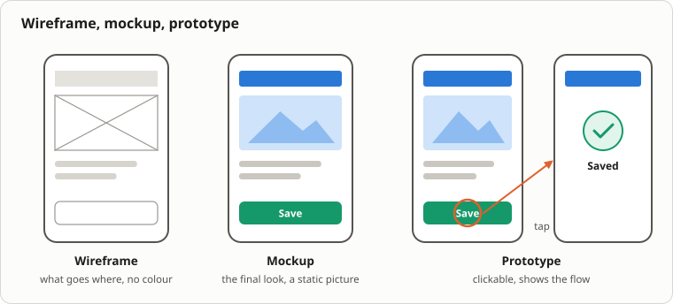
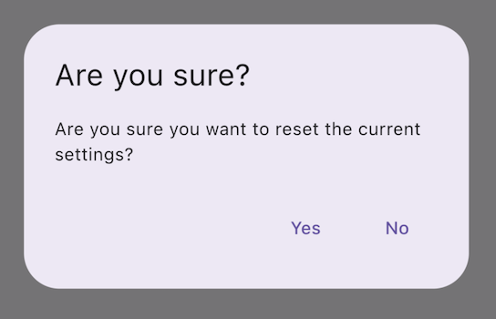
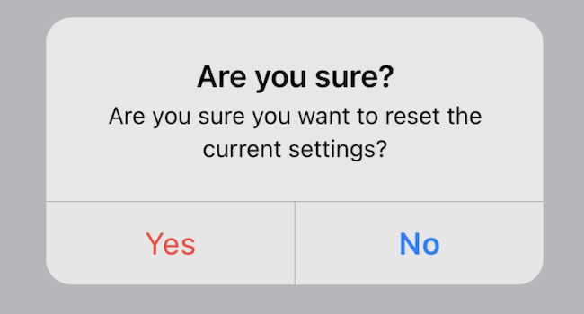
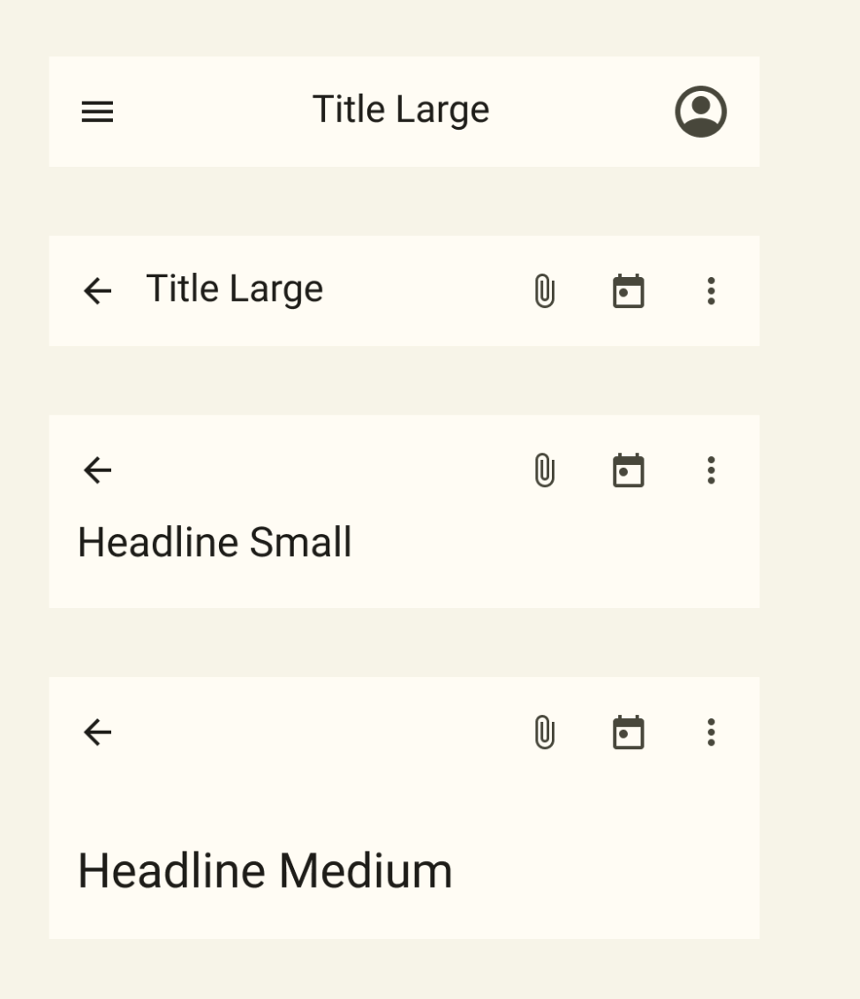
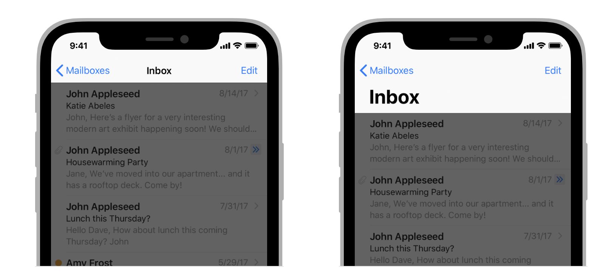
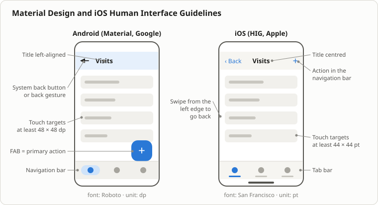
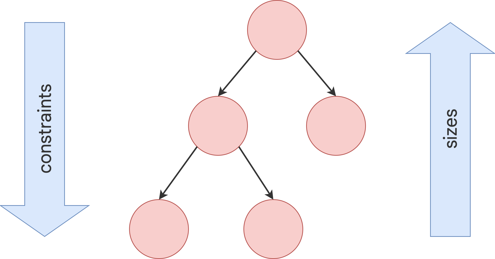
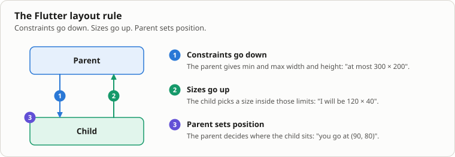
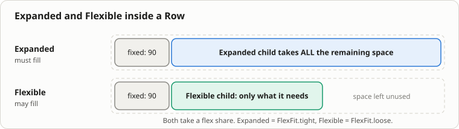
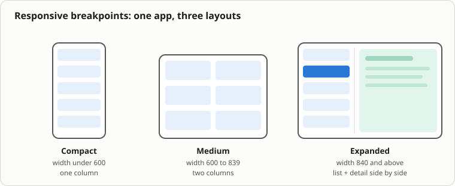

<div class="chapter-head">
<div class="chapter-kicker"><b>A2</b>Part A · Mobile Application Feature Development</div>

# UI/UX Implementation

</div>

> **The skill:** Turn requirements and wireframes into clean, responsive layouts that follow **Material Design** (Android) and the **iOS Human Interface Guidelines**.

Four ideas: **requirements and wireframes**, **responsive layout**, **Material Design**, **iOS HIG**. Typical questions are "what is the difference between Material and HIG?" and "how do you make a UI responsive?".

---

## 1. Basic terms

<div class="box def">

**Definition.** **UI** (User Interface) is what the user sees and touches. **UX** (User Experience) is how easy and pleasant it is to finish a task. A designer shows the plan in three steps: a **wireframe**, then a **mockup**, then a **prototype**.

</div>

<div class="box story">

**Example scenario.** Imagine building a house.

1. First the architect draws a **floor plan** with a pencil: where the rooms and doors go. No colours. This is the **wireframe**.
2. Then he makes a **colour picture** of the finished house. You can look, but you cannot walk in. This is the **mockup**.
3. Then he builds a **small model** where you can open the doors and walk from room to room. This is the **prototype**.

**What do you receive as a developer?** Usually the wireframe and the Figma mockup. Your job is to turn them into real, working screens.

</div>

<p class="label">Exam notes</p>

| Term | Meaning |
|---|---|
| <mark>**UI** (User Interface)</mark> | What the user sees and touches: screens, buttons, colours, text |
| <mark>**UX** (User Experience)</mark> | How the whole experience feels: easy, fast, clear, few mistakes |
| **Wireframe** | <mark>A low-detail sketch of layout and content. No colour.</mark> Answers "what goes where" |
| **Mockup** | <mark>A high-detail static picture</mark> with final colours, fonts and images |
| **Prototype** | <mark>A clickable model that shows flow between screens</mark> |
| **Design system** | Shared rules and reusable components: colours, typography, spacing, buttons |
| **Design handoff** | The designer gives developers the specs (Figma: sizes, colours, assets) |



**From requirement to screen (your working steps):**
1. Read the user requirement or user story. Who is the user and what is the task?
2. Study the wireframe or Figma file. List the screens, components and states.
3. Break each screen into a **widget tree** of small reusable widgets.
4. Set up the **theme** first (colours, text styles, spacing), then build the layouts.
5. <mark>Handle every **state**: loading, empty, error, success, offline.</mark>
6. Make it **responsive** and **accessible**. Test on a small phone, a large phone and a tablet.
7. Review with the designer; fix differences.

<div class="box rule">

**Remember.** Wireframe = where things go. Mockup = how it looks. Prototype = how it flows. UI is the surface, UX is the whole feeling.

</div>

## 2. Material Design vs iOS Human Interface Guidelines

<div class="box def">

**Definition.** **Material Design** is Google's rule book for how Android apps should look and behave. The **Human Interface Guidelines (HIG)** are Apple's rule book for iOS. Users learn these rules from every other app on their phone, so an app that follows them feels familiar.

</div>

<div class="box story">

**Example scenario.** Imagine the same "Are you sure?" question on two phones.

</div>

<div class="pair">

<br>*Material 3 (Android): text buttons at the bottom right.*

<br>*Cupertino (iOS): a centred alert with two equal buttons.*

</div>

Both dialogs ask the same thing. But an Android user expects the first one and an iPhone user expects the second one. The same is true for the top bar:

<div class="pair">

<br>*Material app bars: the title is on the left.*

<br>*iOS navigation bars: the title is centred, or large below the bar.*

</div>

*Pictures: Flutter documentation, "Automatic platform adaptations".*

<p class="label">Exam notes</p>

<mark>**Material Design** is Google's design system (2014)</mark>. The current version is <mark>**Material 3 (Material You)**</mark>: dynamic colour taken from the user's wallpaper, rounded shapes, tonal colour roles. In Flutter: `MaterialApp`, `ThemeData(useMaterial3: true)`, `ColorScheme.fromSeed(...)`.

<mark>**Human Interface Guidelines (HIG)** are Apple's design rules for iOS</mark>. Classic principles: <mark>**Clarity** (text is readable, icons are precise), **Deference** (the UI stays out of the way of content), **Depth** (layers and motion show hierarchy)</mark>. In Flutter: <mark>the **Cupertino** widget set</mark> (`CupertinoApp`, `CupertinoNavigationBar`, `CupertinoButton`).

| | Material Design (Android) | iOS HIG |
|---|---|---|
| Owner | Google | Apple |
| Main navigation | Bottom **NavigationBar**, navigation drawer | Bottom **Tab Bar** |
| Top bar | App bar, title left-aligned | Navigation bar, title centred or large title |
| Back | System back button or gesture; arrow `←` | Swipe from the left edge; chevron `‹` with the previous title |
| Primary action | <mark>**Floating Action Button (FAB)**</mark> | Button in the navigation bar or toolbar |
| Depth | Elevation and shadows, tonal surfaces | Blur and translucency |
| Minimum touch target | <mark>**48 × 48 dp**</mark> | <mark>**44 × 44 pt**</mark> |
| Font | Roboto | San Francisco (SF) |
| Alerts | Dialog with text buttons on the right | Centred alert; action sheet from the bottom |
| Switches, pickers | Material switch, dropdown menu, calendar picker | iOS switch, wheel picker |
| Units | <mark>dp (density-independent pixels)</mark> | pt (points) |



**How one Flutter codebase follows both:**
- Use adaptive constructors: `Switch.adaptive`, `CircularProgressIndicator.adaptive`, `showAdaptiveDialog`.
- Check the platform where needed: `Theme.of(context).platform == TargetPlatform.iOS`.
- Respect platform behaviour: back swipe on iOS, system back on Android, scroll physics (bounce on iOS, glow/stretch on Android; Flutter does this automatically).
- Keep `SafeArea` for the notch, status bar and home indicator.

<div class="box q">

**Do I need two Flutter apps, one for each rule book?**

No. One codebase is enough. Flutter gives two widget sets (`Material` and `Cupertino`), and many widgets have an `.adaptive` constructor that picks the right look by itself. Flutter also changes scrolling and page transitions for each platform automatically.

</div>

<div class="box rule">

**Remember.** Material = Google, FAB, 48 dp, Roboto, bottom navigation bar. HIG = Apple, 44 pt, San Francisco, tab bar, swipe back. HIG's three words: Clarity, Deference, Depth.

</div>

<div class="box check">

**Quick check**

1. What is the minimum touch target in Material Design? (a) 44 pt (b) 48 dp (c) 56 dp
2. Which Flutter widget set follows the iOS guidelines?
3. Which three words describe the classic HIG principles?

<details>
<summary>Show answers</summary>

1. **(b) 48 × 48 dp.** iOS uses 44 × 44 pt.
2. The **Cupertino** widgets.
3. Clarity, Deference, Depth.

</details>

</div>

## 3. Flutter layout: the one rule

<div class="box def">

**Definition.** Layout is how Flutter decides the **size** and **position** of every widget. It follows one rule: *constraints go down, sizes go up, parent sets position.*

</div>

<div class="box story">

**Example scenario.** Imagine a conversation between a parent widget and its child.

1. **Parent:** "You may be at most 300 wide and 200 tall." *(constraints go down)*
2. **Child:** "Then I will be 120 wide and 40 tall." *(sizes go up)*
3. **Parent:** "Good. I will put you at the top left." *(parent sets position)*

**What happens when it goes wrong?** Put a long `Text` inside a `Row`. The Row tells the text "be as wide as you like". The text chooses 500. The screen is only 360 wide. You see the yellow-and-black stripes: **RenderFlex overflowed**. Wrap the text in `Expanded`, and the Row now says "you get only the space that is left".

</div>

<br>*Constraints travel down the widget tree. Sizes travel back up. Source: Flutter documentation.*

<p class="label">Exam notes</p>

> <mark>**Constraints go down. Sizes go up. Parent sets position.**</mark>

A parent gives its child min/max width and height. The child chooses a size inside those limits. The parent then places the child.



| Widget | Use |
|---|---|
| `Row` / `Column` | Lay children out horizontally / vertically |
| `Expanded` | <mark>Child **must** fill the remaining space</mark> |
| `Flexible` | <mark>Child **may** take up to the remaining space</mark> |
| `Stack` + `Positioned` | Overlap widgets |
| `Container` | Padding, margin, colour, border, size |
| `SizedBox` | Fixed size or a gap |
| `Padding`, `Align`, `Center` | Spacing and position |
| `Wrap` | Moves children to the next line when space runs out |
| `ListView.builder`, `GridView.builder` | Long scrolling lists, built lazily |



- **Main axis**: the direction of the Row/Column (`mainAxisAlignment`). **Cross axis**: the other direction (`crossAxisAlignment`).
- <mark>Common error: "RenderFlex overflowed"</mark>. Fix with `Expanded`, `Flexible`, `Wrap`, or scrolling.
- <mark>Common error: "unbounded height"</mark> (a `ListView` inside a `Column`). Fix by wrapping the list in `Expanded`.

<div class="box rule">

**Remember.** Constraints go down. Sizes go up. Parent sets position. `Expanded` = must fill. `Flexible` = may fill.

</div>

## 4. Responsive and adaptive UI

<div class="box def">

**Definition.** A **responsive** layout stretches and rearranges to fit the space, like water taking the shape of a glass. An **adaptive** app chooses a **different layout** for a different device.

</div>

<div class="box story">

**Example scenario.** Imagine the visit list of a field app.

1. On a **phone**, the officer sees a list. She taps a visit and a new screen opens with the details.
2. On a **tablet**, there is room for both. The list stays on the left and the details open on the right.

**What changed?** The data and the code for each part are the same. Only the arrangement changed, chosen by the available **width**.

</div>

<p class="label">Exam notes</p>

- <mark>**Responsive**: the same layout **stretches and rearranges** to fit the space.</mark>
- <mark>**Adaptive**: the app **chooses a different layout or component** for the device</mark> (list on a phone, list plus detail side by side on a tablet).

| Tool | What it gives |
|---|---|
| `MediaQuery.sizeOf(context)` | Screen size, orientation, text scale, padding |
| `LayoutBuilder` | <mark>The **parent's** constraints</mark>, to pick a layout by available width |
| `OrientationBuilder` | Portrait or landscape |
| `Expanded` / `Flexible` / `FractionallySizedBox` | Proportional sizes instead of fixed pixels |
| `FittedBox`, `AspectRatio` | Scale content, keep proportions |
| `SafeArea` | Avoid notches and system bars |
| `Wrap`, `GridView` with max cross-axis extent | Columns that change with width |

```dart
LayoutBuilder(
  builder: (context, c) {
    if (c.maxWidth >= 840) return const TabletLayout();   // list + detail
    if (c.maxWidth >= 600) return const TwoColumnLayout();
    return const PhoneLayout();
  },
)
```
Typical **breakpoints**: <mark>under 600 = phone (compact), 600–839 = small tablet (medium), 840 and above = tablet/desktop (expanded)</mark>.



**Rules:** no fixed pixel widths for whole screens; use **logical pixels** (Flutter's unit is independent of screen density); let text wrap; make every long screen scrollable (a keyboard or a small phone will cover part of it); support the user's **text scale** setting; test in landscape.

<div class="box q">

**Should I use `MediaQuery` or `LayoutBuilder`?**

`MediaQuery` tells you about the **whole screen**. `LayoutBuilder` tells you how much space **this widget** was given. For a reusable widget, `LayoutBuilder` is safer, because the widget may sit in half of the screen.

</div>

<div class="box rule">

**Remember.** Responsive = same layout, it stretches. Adaptive = a different layout. Breakpoints: under 600 phone, 600 to 839 small tablet, 840 and above tablet.

</div>

<div class="box check">

**Quick check**

1. A widget must know the space its parent gave it. Which tool? (a) MediaQuery (b) LayoutBuilder (c) SafeArea
2. Showing list and detail side by side on a tablet is an example of: (a) responsive (b) adaptive

<details>
<summary>Show answers</summary>

1. **(b) LayoutBuilder.**
2. **(b) adaptive**, because the app chooses a different layout.

</details>

</div>

## 5. Theme and consistency

<div class="box def">

**In simple words.** A **theme** is one central place for colours, fonts and shapes. Every widget reads from it. Change the theme once and the whole app changes, including dark mode.

</div>

```dart
MaterialApp(
  theme: ThemeData(
    useMaterial3: true,
    colorScheme: ColorScheme.fromSeed(seedColor: const Color(0xFF00695C)),
    textTheme: const TextTheme(titleLarge: TextStyle(fontWeight: FontWeight.w600)),
  ),
  darkTheme: ThemeData.dark(useMaterial3: true),
  themeMode: ThemeMode.system,
)
```
<mark>Never hard-code colours and font sizes inside widgets.</mark> Read them from `Theme.of(context)`. One change in the theme then updates the whole app, and dark mode works.

## 6. Forms and input (most field screens are forms)

<div class="box def">

**In simple words.** A form is where data enters the system. If wrong data gets in here, every report built on it is wrong. So the form itself must stop mistakes.

</div>

<div class="box story">

**Example scenario.** Imagine a field officer standing in the sun, entering a loan amount on a small phone.

1. The number keyboard opens by itself, because the field is set to `TextInputType.number`.
2. She types 5000000 by mistake. The form says at once: "Amount cannot be more than 5,00,000".
3. A phone call arrives. The app saves a **draft**.
4. After the call, her typing is still there.

**What happened?** The right keyboard, validation at entry and a saved draft removed three common field problems.

</div>

- `Form` + `GlobalKey<FormState>` + `TextFormField(validator: ...)`. Call `formKey.currentState!.validate()` before saving.
- Pick the right keyboard: `TextInputType.number`, `phone`, `emailAddress`.
- <mark>**Validate at entry**</mark> (required fields, ranges, formats) so bad data never reaches the server.
- Prefer **dropdowns, radio buttons and date pickers** to free typing: fewer mistakes, cleaner data.
- <mark>**Save drafts** locally</mark> so a field officer does not lose work when a call comes or the battery dies.
- Show clear error text next to the field, not only a red border.

## 7. Accessibility

<div class="box def">

**In simple words.** Accessibility means people with weak eyesight, shaky hands or other limits can still use the app. Bigger targets, strong contrast, labels for screen readers, and text that can grow.

</div>

- **Touch targets** at least 48 dp (Android) / 44 pt (iOS).
- <mark>**Colour contrast** at least **4.5 : 1** for normal text (WCAG AA)</mark>. Do not use colour as the only signal; add an icon or text.
- **Screen readers**: <mark>TalkBack (Android), VoiceOver (iOS)</mark>. Add labels with `Semantics(label: ...)` and `tooltip` on icon buttons.
- **Text scaling**: layouts must not break when the user sets large fonts.

## 8. Localisation: Bangla and English

<div class="box def">

**Definition.** **Internationalisation (i18n)** is preparing the code so that no text is fixed inside it. **Localisation (l10n)** is adding one language, for example Bangla. *(i18n = "i", 18 letters, "n".)*

</div>

<div class="box story">

**Example scenario.** Imagine the login button.

1. A beginner writes `Text('Login')`. The word is fixed in the code. A Bangla user still sees "Login".
2. You write `Text(AppLocalizations.of(context)!.loginTitle)`. The word now comes from a language file.
3. In `app_en.arb` the key says "Login". In `app_bn.arb` the same key says "লগইন করুন".
4. The user switches the app to Bangla. Every screen changes, with no code change.

</div>

The NGO's staff work in Bangla and English, so an app should support both. Terms: <mark>**i18n** (internationalisation: preparing the code) and **l10n** (localisation: adding a language)</mark>.

Steps in Flutter:
1. Add `flutter_localizations` and `intl`; set `generate: true` in `pubspec.yaml`.
2. <mark>Write **ARB** files</mark>: `app_en.arb`, `app_bn.arb`.
3. `flutter gen-l10n` generates `AppLocalizations`.
4. Use `AppLocalizations.of(context)!.loginTitle` instead of hard-coded text.
5. Set `supportedLocales: [Locale('en'), Locale('bn')]` and let the user switch.

```json
// app_bn.arb
{ "loginTitle": "লগইন করুন", "visitCount": "{count} টি পরিদর্শন" }
```
Points: Bangla digits and dates through `intl` (`NumberFormat('#,##,###', 'bn')`, `DateFormat.yMMMd('bn')`); use a font with full Bangla support (Noto Sans Bengali, Hind Siliguri); leave room because translated text can be longer; Bangladeshi number grouping is lakh/crore (1,20,000).

<div class="box rule">

**Remember.** i18n = prepare the code. l10n = add a language. Flutter uses ARB files and `flutter gen-l10n`.

</div>

## 9. UX rules for a field app

<div class="box def">

**In simple words.** These are the habits that make field staff trust an app. Use them as ready points in any "how will you design the app" answer.

</div>

| Rule | Why |
|---|---|
| Always show **system status**: online/offline, "3 records waiting to sync", last sync time | Field staff must trust that data is safe |
| <mark>Design the four states: **loading, empty, error, success**</mark> | No blank or frozen screens |
| Give **feedback** for every action (SnackBar, progress indicator, haptic) | The user knows the tap worked |
| Large buttons, short forms split into steps | Used outdoors, on small phones, sometimes one-handed |
| Never lose input (drafts, confirm before delete) | Re-entering data in the field is costly |
| Consistent wording, icons and positions | Less training needed |
| High contrast for sunlight | Readability outdoors |

## 10. Animation (short-question level)

<div class="box def">

**In simple words.** An **implicit** animation is automatic: you give a new value and Flutter animates to it. An **explicit** animation is manual: you hold a controller and drive it yourself.

</div>

- <mark>**Implicit** animation: give a new value and Flutter animates to it.</mark> `AnimatedContainer`, `AnimatedOpacity`.
- <mark>**Explicit** animation: you control it with an `AnimationController`</mark> (needs `vsync`, must be disposed).
- <mark>**Hero**: a shared element flies between two screens.</mark>

## Link it to your own projects

Interviews and written exams reward answers that use **your own work** as the example. Before you move on, answer these for yourself:

<div class="box you">

- Pick one screen you built and explain how it adapts to phone and tablet widths.
- Name the Material and Cupertino widgets you used, and one place where Android and iOS needed different behaviour.
- If you worked from Figma designs, describe how you turned them into widgets: spacing, theme, reusable components.

</div>

---

## Practice questions

**Short (2–3 marks each)**
1. UI vs UX.
2. Wireframe vs mockup vs prototype.
3. Responsive vs adaptive design.
4. `Expanded` vs `Flexible`.
5. `MediaQuery` vs `LayoutBuilder`.
6. What is `SafeArea` for?
7. State Flutter's layout rule in one sentence.
8. What are i18n and l10n? What is an ARB file?

**Long (8–10 marks each)**

9. Compare Material Design and the iOS Human Interface Guidelines. How can a single Flutter app conform to both?
10. You receive a wireframe for a "Field Visit Entry" screen. Describe step by step how you turn it into a clean, responsive Flutter screen that works on phones and tablets, in Bangla and English.
11. What is accessibility in mobile apps? List the steps you take to make an app accessible.

---

## Model answers

<div class="box exam">

**How to read these answers.** They are written for **learning**, so they are fuller than what you would write in the exam hall. Every answer has the same parts:

- **In short** (green): the direct answer. In the exam, write this part first.
- **Table or points:** the details, laid out so you can compare and remember them.
- **Example** (yellow): a real situation, usually from a field app or from your own projects.
- Long answers end with **In the exam** (brown): how to shorten the answer on paper.

Write your own answer first. Then open the model answer and compare.

</div>

<details>
<summary>1. UI vs UX.</summary>

<div class="box def">

**In short.** **UI (User Interface)** is what the user sees and touches: screens, buttons, colours, text. **UX (User Experience)** is how the whole use feels: how easily and pleasantly the user finishes a task. Good UI is one part of good UX.

</div>

| Point | UI | UX |
|---|---|---|
| **Full form** | User Interface | User Experience |
| **It is about** | Look and layout | Flow and feeling |
| **Question it answers** | "How does it look?" | "How easily can I finish my task?" |
| **Made of** | Colours, fonts, icons, spacing, buttons | Number of steps, speed, error handling, clear messages, offline behaviour |
| **Who works on it** | Visual designer | UX designer, researcher, and the developer |
| **Measured by** | Consistency with the design | Task success, time taken, mistakes made |

<div class="box story">

**Example.** A visit form has beautiful colours and icons (good UI). But the officer must fill 25 fields on one long page, and one network error clears everything (bad UX). Splitting the form into steps and saving a draft automatically fixes the UX without changing a single colour.

</div>

<div class="ref">

**From the book:** [1. Basic terms](#1-basic-terms)

</div>

</details>

<details>
<summary>2. Wireframe vs mockup vs prototype.</summary>

<div class="box def">

**In short.** A **wireframe** is a rough layout sketch. A **mockup** is the exact visual design, but static. A **prototype** is a clickable model that behaves like the app.

</div>


| Point | Wireframe | Mockup | Prototype |
|---|---|---|---|
| **Detail (fidelity)** | Low | High | High |
| **Shows** | Structure: what goes where | Look: colours, fonts, real icons | Behaviour: flow between screens |
| **Colours and images** | Grey boxes and lines | Final ones | Final ones |
| **Can you click it?** | No | No | Yes |
| **Answers the question** | "What is on this screen?" | "How will it look?" | "How will it work?" |
| **Made with** | Paper, Balsamiq, Figma | Figma, Adobe XD | Figma prototype mode |
| **When** | First | Second | Before development |

<div class="box story">

**Example.** For a "Field Visit Entry" screen: the wireframe is boxes labelled "Branch dropdown, date, note, photo, Save". The mockup shows the NGO's green, the Bangla font and real icons. In the prototype you tap Save and see the "Saved offline" message. A mobile developer turns **wireframes into clean, responsive interfaces**, so you must be able to read all three.

</div>

<div class="ref">

**From the book:** [1. Basic terms](#1-basic-terms)

</div>

</details>

<details>
<summary>3. Responsive vs adaptive design.</summary>

<div class="box def">

**In short.** **Responsive** design is one layout that stretches and reflows to fit the space. **Adaptive** design chooses a *different* layout or component for the device or platform.

</div>

| Point | Responsive | Adaptive |
|---|---|---|
| **Idea** | The same layout resizes | A different layout is picked |
| **Reacts to** | The available width and height | The device type, the input method, the platform |
| **Flutter tools** | `Expanded`, `Flexible`, `Wrap`, `FractionallySizedBox`, `LayoutBuilder` | Breakpoints, `Platform.isIOS`, `.adaptive` constructors |
| **Example** | A form field grows wider on a larger phone | A list on a phone becomes list + detail side by side on a tablet |
| **Platform example** | (none) | `Switch.adaptive` shows an iOS-style switch on an iPhone |

**Flutter's own way of saying it:** responsive is about *fitting* the UI into the space; adaptive is about the UI being *usable* in that space. A good app does both.

<div class="box story">

**Example.** A field officer uses a 5.5-inch phone and the branch manager uses a 10-inch tablet. Responsive: the form fields stretch on both. Adaptive: on the tablet, the visit list stays on the left and the selected visit opens on the right, instead of opening a new page.

</div>

<div class="ref">

**From the book:** [4. Responsive and adaptive UI](#4-responsive-and-adaptive-ui)

</div>

</details>

<details>
<summary>4. <code>Expanded</code> vs <code>Flexible</code>.</summary>

<div class="box def">

**In short.** Both give a child a share of the free space in a `Row` or `Column`. <mark>`Expanded` **forces** the child to fill its whole share. `Flexible` lets the child be **smaller** than its share.</mark>

</div>


| Point | `Expanded` | `Flexible` |
|---|---|---|
| **Fit** | `FlexFit.tight` | `FlexFit.loose` (default) |
| **Child size** | Exactly its share | Up to its share |
| **Left-over space** | None | Possible |
| **Relation** | `Expanded` = `Flexible(fit: FlexFit.tight)` | The general widget |
| **`flex` property** | Yes | Yes |
| **Common use** | A text field next to a button; equal columns | A text that may be short, but must not overflow when long |

```dart
Row(children: [
  Expanded(flex: 2, child: TextField()),        // takes 2 parts
  Expanded(flex: 1, child: ElevatedButton(      // takes 1 part
      onPressed: save, child: Text('Save'))),
])
```

**Remember:** both work only as a direct child of `Row`, `Column` or `Flex`.

<div class="box story">

**Example.** A row shows a borrower's name and an amount. The name is long and gives the yellow-black "RenderFlex overflowed" stripes on a small phone. Wrapping the name in `Expanded` (with `overflow: TextOverflow.ellipsis`) makes it take only the space that is left.

</div>

<div class="ref">

**From the book:** [3. Flutter layout: the one rule](#3-flutter-layout-the-one-rule)

</div>

</details>

<details>
<summary>5. <code>MediaQuery</code> vs <code>LayoutBuilder</code>.</summary>

<div class="box def">

**In short.** <mark>`MediaQuery` tells you about the **whole screen**.</mark> <mark>`LayoutBuilder` tells you the space your **parent widget** gives you.</mark>

</div>

| Point | `MediaQuery` | `LayoutBuilder` |
|---|---|---|
| **Gives** | Screen size, orientation, text scale, system padding (notch, keyboard), brightness | The `BoxConstraints` from the parent (min and max width and height) |
| **Scope** | The whole window | Only this widget's place in the tree |
| **How to use** | `MediaQuery.sizeOf(context)` | `LayoutBuilder(builder: (context, constraints) {...})` |
| **Best for** | Page-level decisions; keyboard height; safe areas | Reusable widgets that must adapt wherever they are placed |

```dart
LayoutBuilder(builder: (context, c) {
  return c.maxWidth < 600 ? const OneColumnForm() : const TwoColumnForm();
});
```

<div class="box story">

**Example.** A "visit card" widget is used on a phone screen (full width) and inside the right half of a tablet screen. On the tablet, `MediaQuery` reports 1000 px, but the card really has only 500 px. `LayoutBuilder` reports the true 500 px, so the card picks the right layout in both places.

</div>

<div class="ref">

**From the book:** [4. Responsive and adaptive UI](#4-responsive-and-adaptive-ui)

</div>

</details>

<details>
<summary>6. What is <code>SafeArea</code> for?</summary>

<div class="box def">

**In short.** `SafeArea` adds padding so your content is not hidden by parts of the screen that the system uses: the **notch**, the **status bar**, **rounded corners** and the **home indicator**.

</div>

| It protects against | Where |
|---|---|
| Status bar (time, battery) | Top |
| Notch or camera cut-out | Top, or the side in landscape |
| Rounded screen corners | All corners |
| Home indicator / gesture bar | Bottom |

**How it works**

- It reads the system padding from `MediaQuery` and adds the same amount around its child.
- You can switch sides off: `SafeArea(top: false, child: ...)`.
- `Scaffold` with an `AppBar` already handles the top. You mostly need `SafeArea` for the body bottom, or for screens without an app bar.

```dart
Scaffold(body: SafeArea(child: VisitForm()))
```

<div class="box story">

**Example.** A full-screen camera page has a Capture button at the very bottom. On an iPhone, the home indicator bar covers part of the button and taps are missed. Wrapping the page in `SafeArea` moves the button above the bar.

</div>

<div class="ref">

**From the book:** [4. Responsive and adaptive UI](#4-responsive-and-adaptive-ui)

</div>

</details>

<details>
<summary>7. State Flutter's layout rule in one sentence.</summary>

<div class="box def">

**In short.** <mark>**Constraints go down. Sizes go up. Parent sets position.**</mark>

</div>


**The three steps**

1. **Constraints go down.** The parent tells the child: "your width must be between this and this, your height between this and this."
2. **Sizes go up.** The child picks a size inside those limits and reports it back.
3. **Parent sets position.** The parent decides where to put the child (x, y).

**What follows from the rule**

| Fact | Result you see |
|---|---|
| A widget cannot choose any size it wants | `Container(width: 100)` directly under the screen still fills the screen, because the screen gives tight constraints |
| A widget does not know its own position | Alignment is always done by the parent (`Center`, `Align`, `Row`) |
| `Column` gives unbounded height to its children | A `ListView` inside a `Column` throws "unbounded height". Fix: wrap it in `Expanded` |
| `Row` gives unbounded width | A long `Text` overflows. Fix: wrap it in `Expanded` or `Flexible` |

<div class="box story">

**Example.** The most common layout error in Flutter, "Vertical viewport was given unbounded height", is just this rule. The `Column` passed down "any height you like" and the `ListView` wanted "as much as possible". `Expanded` gives the list a real limit.

</div>

<div class="ref">

**From the book:** [3. Flutter layout: the one rule](#3-flutter-layout-the-one-rule)

</div>

</details>

<details>
<summary>8. What are i18n and l10n? What is an ARB file?</summary>

<div class="box def">

**In short.** **i18n (internationalisation)** is building the app so that no text, date or number format is hard-coded. **l10n (localisation)** is adding one specific language and region. An <mark>**ARB (Application Resource Bundle)**</mark> file is a JSON-like file that holds the translated strings for one locale.

</div>

| Point | i18n | l10n |
|---|---|---|
| **Full form** | Internationalisation (18 letters between i and n) | Localisation (10 letters between l and n) |
| **What it is** | Preparing the code | Adding the content for one locale |
| **Done by** | The developer, once | The translator, once per language |
| **Example** | Using `AppLocalizations.of(context)!.save` instead of `'Save'` | Writing `"save": "সংরক্ষণ করুন"` in `app_bn.arb` |

**The ARB files**

```json
// lib/l10n/app_en.arb
{ "save": "Save", "pending": "{count} records pending" }

// lib/l10n/app_bn.arb
{ "save": "সংরক্ষণ করুন", "pending": "{count}টি রেকর্ড অপেক্ষমাণ" }
```

**The steps in Flutter**

1. Add `flutter_localizations` and `intl` to `pubspec.yaml`, and set `generate: true`.
2. Write one ARB file per language.
3. Flutter generates the `AppLocalizations` class.
4. Give `MaterialApp` the `localizationsDelegates` and `supportedLocales`.
5. Use `AppLocalizations.of(context)!.save` in widgets.

**Localisation is more than text:** dates, number formats, currency (৳), Bangla digits (১২৩), plural forms and a font that draws Bangla well.

<div class="box story">

**Example.** A field app has a language switch in settings. Field officers choose Bangla, and auditors from a development partner choose English. No screen code changes, because every label comes from the ARB files.

</div>

<div class="ref">

**From the book:** [8. Localisation: Bangla and English](#8-localisation-bangla-and-english)

</div>

</details>

<details>
<summary>9. Compare Material Design and the iOS Human Interface Guidelines. How can a single Flutter app conform to both?</summary>

<div class="box def">

**In short.** **Material Design** is Google's design system for Android. The **Human Interface Guidelines (HIG)** are Apple's design rules for iOS. They differ in navigation, controls, fonts and feel. A Flutter app conforms to both by using a Material base with **adaptive and Cupertino widgets** on iOS, and by respecting each platform's conventions.

</div>


#### 1. The comparison

| Point | Material Design (Android) | Human Interface Guidelines (iOS) |
|---|---|---|
| **Owner** | Google (current version: Material 3) | Apple |
| **Main navigation** | Bottom navigation bar, navigation drawer | Tab bar at the bottom |
| **Going back** | System back button or back gesture | Back arrow at the top left; swipe from the left edge |
| **Primary action** | Floating Action Button (FAB) | A button in the navigation bar or toolbar |
| **Title** | Top app bar, left-aligned | Navigation bar, centred or large title |
| **Depth** | Elevation, shadows, tonal colour | Translucency, blur, layers |
| **Minimum touch target** | <mark>48 × 48 dp</mark> | <mark>44 × 44 pt</mark> |
| **System font** | Roboto | San Francisco |
| **Icons** | Material Symbols | SF Symbols |
| **Dialogs** | Alert with text buttons at the bottom right | Centred alert; action sheet from the bottom |
| **Pickers** | Calendar and clock dialogs | Scrolling wheels |

<div class="pair">


</div>

*The same alert in Material (left) and Cupertino (right). Source: Flutter documentation.*

#### 2. How one Flutter app conforms to both

| What I do | How |
|---|---|
| **One Material 3 base** | `MaterialApp` with a `ThemeData` built from a colour scheme. All colours and text styles come from the theme |
| **Adaptive widgets** | `Switch.adaptive`, `Slider.adaptive`, `CircularProgressIndicator.adaptive`, `AlertDialog.adaptive` show the iOS look on an iPhone |
| **Cupertino widgets where it matters** | `CupertinoDatePicker`, `CupertinoActionSheet`, `CupertinoNavigationBar` on iOS |
| **Platform checks** | `Theme.of(context).platform` or `Platform.isIOS` to choose a pattern |
| **What Flutter adapts by itself** | Scroll physics (bounce on iOS), page transitions, back swipe, text selection handles, the system font |
| **Safe areas and touch sizes** | `SafeArea`; targets of at least 48 dp, which also satisfies 44 pt |

#### 3. The balance

- **Brand consistency** matters: the app should look like one product on both platforms.
- **Platform conventions** must still be respected: back gesture, system permission dialogs, keyboard behaviour. If they are broken, users get confused and **Apple may reject the app** in review.

<div class="box story">

**Link to your own work.** Close with one true sentence about your own projects, for example: "My apps passed both Google's and Apple's review. I turned Figma designs into Flutter with one theme and platform-adaptive controls."

</div>

<div class="box exam">

**In the exam.** One line for each system with its owner. A table with six rows (navigation, back, primary action, touch target, font, dialogs). Then four or five points on the Flutter approach. Close with the balance between brand consistency and platform conventions.

</div>

<div class="ref">

**From the book:** [2. Material Design vs iOS Human Interface Guidelines](#2-material-design-vs-ios-human-interface-guidelines)

</div>

</details>

<details>
<summary>10. You receive a wireframe for a "Field Visit Entry" screen. Describe step by step how you turn it into a clean, responsive Flutter screen that works on phones and tablets, in Bangla and English.</summary>

<div class="box def">

**In short.** I go in ten steps: understand the user → list the components → plan the widget tree → apply the theme → make it responsive → add validation → handle every state → localise → make it accessible → test on real devices.

</div>


#### Step 1. Understand the requirement

- **Who:** a field officer, outdoors, in sunlight, often with one hand.
- **Where:** weak or no network.
- **So:** big touch targets, strong contrast, few steps, and the form must save offline.

#### Step 2. List the components in the wireframe

| In the wireframe | Flutter widget |
|---|---|
| branch dropdown | `DropdownButtonFormField` (or a searchable picker for a long list) |
| Visit date | Read-only field that opens `showDatePicker` |
| Observation text | `TextFormField` with `maxLines` |
| "Take photo" button and preview | `OutlinedButton.icon` + `Image.file` |
| GPS line | `Text` with an icon, filled automatically |
| Save button | `FilledButton`, full width |

#### Step 3. Plan the widget tree

```text
Scaffold
 ├─ AppBar (title, sync status)
 └─ SafeArea
     └─ Form (key)
         └─ SingleChildScrollView
             └─ Column
                 ├─ PoDropdownField        ← reusable widgets,
                 ├─ DateField              ← one small class each
                 ├─ ObservationField
                 ├─ PhotoPicker
                 ├─ GpsLine
                 └─ SaveButton
```

#### Step 4. Style from the theme

- Colours, text styles and spacing come from `ThemeData`. No hard-coded colours in widgets.
- This keeps every screen consistent, and a brand change needs one edit.

#### Step 5. Make it responsive

| Width | Layout |
|---|---|
| Under 600 dp (phone) | One column |
| 600 dp and above (tablet) | Two columns: fields on the left, photo and GPS on the right |

- `LayoutBuilder` chooses the layout from the real width.
- `Expanded` and `Flexible`, never fixed pixel widths.
- `SingleChildScrollView` so the keyboard never hides a field. Check both orientations.

#### Step 6. Validate the input

- A validator on every `TextFormField` (required, length, number range).
- The right keyboard for each field (`TextInputType.number` for amounts).
- The error message sits under the field, in the user's language.

#### Step 7. Handle every state

| State | What the user sees |
|---|---|
| Saving | Button disabled, with a small progress indicator |
| Saved offline | "Saved on this phone. Will sync later." |
| Synced | A green tick |
| Error | A clear message and a Retry action |
| Offline | A thin banner at the top |
| Leaving with unsaved text | Draft saved automatically |

#### Step 8. Bangla and English

- All labels in ARB files (`app_en.arb`, `app_bn.arb`), used through `AppLocalizations`.
- A font that draws Bangla well. Bangla text is often taller and longer, so nothing has a fixed height.
- Dates and numbers formatted with `intl` for the chosen locale.

#### Step 9. Accessibility

- Touch targets of at least 48 dp.
- Contrast of at least 4.5:1 (it also helps in sunlight).
- `Semantics` labels on icon buttons. The layout survives a large font setting.

#### Step 10. Test and review

- A small phone, a large phone and a tablet; portrait and landscape.
- Both languages; the largest font size; airplane mode.
- Widget tests for validation. A review with the designer against the wireframe.

<div class="box story">

**Link to your own work.** A strong example of UX preventing bad data is a camera screen that checks image quality in real time, so the user retakes a blurred photo at once. If you have built something like it, use it in step 7.

</div>

<div class="box exam">

**In the exam.** Write the ten steps as numbered points, two lines each. Add a small sketch of the phone layout (one column) next to the tablet layout (two columns). About one page.

</div>

<div class="ref">

**From the book:** [4. Responsive and adaptive UI](#4-responsive-and-adaptive-ui) [5. Theme and consistency](#5-theme-and-consistency) [6. Forms and input (most field screens are forms)](#6-forms-and-input-most-field-screens-are-forms) [8. Localisation: Bangla and English](#8-localisation-bangla-and-english) [9. UX rules for a field app](#9-ux-rules-for-a-field-app)

</div>

</details>

<details>
<summary>11. What is accessibility in mobile apps? List the steps you take to make an app accessible.</summary>

<div class="box def">

**In short.** Accessibility (**a11y**) means the app can be used by **everyone**, including people with low vision, blindness, colour blindness, hearing loss or limited hand movement. In practice: large touch targets, enough contrast, text that scales, labels for screen readers, and never relying on colour alone.

</div>

#### 1. Who it helps

| User | Problem | What the app must do |
|---|---|---|
| Low vision | Small text is unreadable | Support text scaling and strong contrast |
| Blind | Cannot see the screen | Work with a screen reader (TalkBack, VoiceOver) |
| Colour blind | Red and green look the same | Add an icon or text, not only colour |
| Limited hand movement | Small buttons are hard to hit | Large touch targets with space between them |
| Hearing loss | Misses sound alerts | Captions and visual or vibration alerts |
| Anyone outdoors | Sunlight, one hand, gloves | All of the above help here too |

#### 2. The steps

| Step | Rule | In Flutter |
|---|---|---|
| **Touch targets** | <mark>At least 48 × 48 dp (Android), 44 × 44 pt (iOS)</mark> | `IconButton` already does this; set `minimumSize` on custom buttons |
| **Colour contrast** | <mark>At least 4.5:1</mark> for normal text, 3:1 for large text (WCAG AA) | Choose theme colours with a contrast checker |
| **Text scaling** | The layout must not break at large font sizes | No fixed heights; use `Flexible`; test at 200% |
| **Screen reader labels** | Every control has a spoken name | `Semantics(label: ...)`, `tooltip` on `IconButton`, `semanticLabel` on `Image` and `Icon` |
| **Not colour alone** | Add a second signal | "Failed" in red **plus** an error icon and text |
| **Focus order** | Reading order follows the visual order | Check with the screen reader; use `FocusTraversalGroup` if needed |
| **Clear errors** | Say what is wrong and how to fix it | A validator message under the field |
| **Media** | Captions for video, text for audio | Subtitles; alt text |

#### 3. How I test it

1. Turn on **TalkBack** (Android) or **VoiceOver** (iOS) and complete the main task without looking.
2. Set the system font to the largest size and check every screen.
3. Use Flutter's guideline tests in widget tests:

```dart
await expectLater(tester, meetsGuideline(androidTapTargetGuideline));
await expectLater(tester, meetsGuideline(textContrastGuideline));
await expectLater(tester, meetsGuideline(labeledTapTargetGuideline));
```

<div class="box story">

**Example.** In a field app the sync status was shown only as a red or green dot. A colour-blind officer could not tell them apart. Adding the words "Pending" and "Synced" with an icon fixed it for everyone, and made it readable in bright sunlight too.

</div>

<div class="box exam">

**In the exam.** One-line definition, then six to eight steps as points with the numbers (48 dp, 44 pt, 4.5:1), then two lines on testing with TalkBack and VoiceOver.

</div>

<div class="ref">

**From the book:** [7. Accessibility](#7-accessibility)

</div>

</details>

<div class="book-nav"><span>← <a href="A1%20-%20Flutter,%20Dart%20and%20Native.md">A1 - Flutter, Dart and Native</a></span><span><a href="00%20-%20Contents%20and%20How%20to%20Use.md">Contents</a></span><span><a href="A3%20-%20Offline%20Storage%20and%20Data%20Sync.md">A3 - Offline Storage and Data Sync</a> →</span></div>
