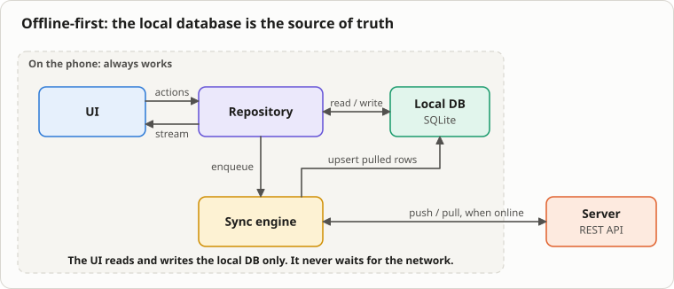
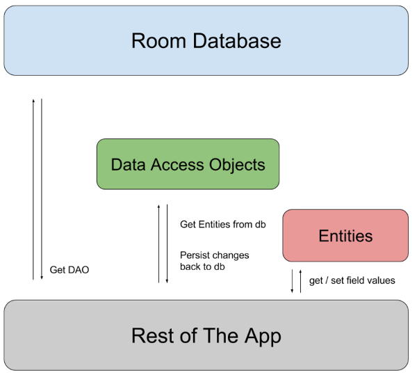
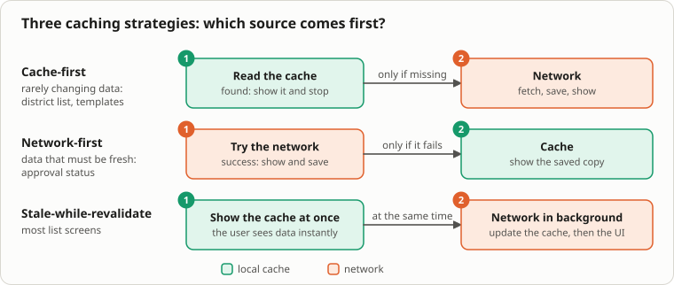
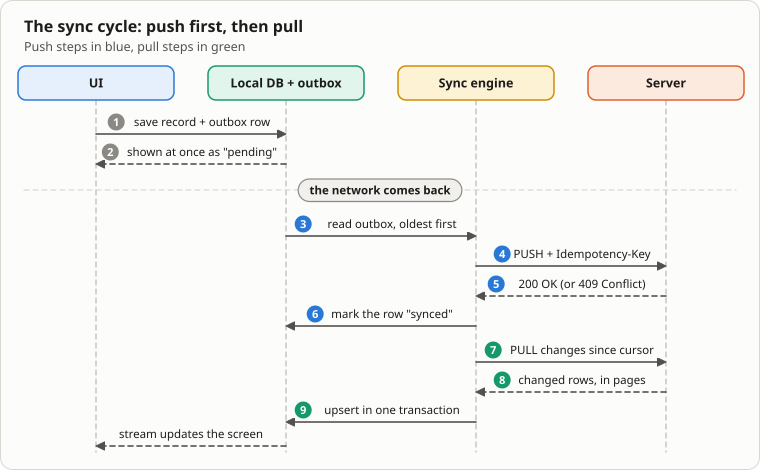
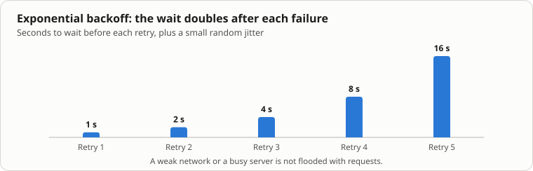
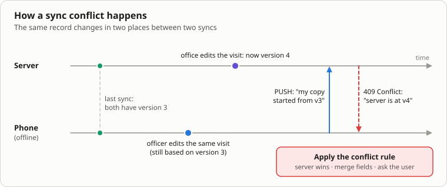

<div class="chapter-head">
<div class="chapter-kicker"><b>A3</b>Part A · Mobile Application Feature Development · ★ likely long question</div>

# Offline Storage and Data Sync

</div>

> **The skill:** Store data on the device, cache it, and sync it with the server in the background (**SQLite, Room, Core Data, Hive, Realm**), so the app keeps working on a weak or missing network.

Offline-first design is one of the most common long questions for mobile developers, especially for apps used in the field. The aim of this chapter is to turn the ideas into a full written answer with names, a diagram and a table.

Three parts: **offline storage** (sections 1–3), **local caching** (section 4), **background sync** (sections 5–9).

---

## 1. Offline-first: the idea

<div class="box def">

**Definition.** An **offline-first** app saves and reads everything in a database **on the phone**. It works with no network at all. When the network is available, it quietly exchanges data with the server in the background.

**Its purpose** is that the user can always work, and no entry is ever lost.

</div>

<div class="box story">

**Example scenario.** Imagine a field officer visiting a village where the mobile network comes and goes.

1. She opens the app. There is no signal.
2. She records three visits and takes two photos.
3. Each time she presses Save, the app answers at once: "Saved". A small badge says "3 waiting to sync".
4. She drives back. Near the town the signal returns.
5. The app sends the three visits by itself. The badge disappears.

**What happened?** Save wrote to the **local database**, not to the server. The screen read from the local database too. The network was only needed in step 5, and the officer never had to think about it.

</div>

<p class="label">Exam notes</p>

- **Online-first:** the app needs the network. With no network it shows an error.
- <mark>**Offline-first:** the app **reads and writes the local database first**</mark>. The network is used in the background to synchronise. The user can always work.

> Golden rule: <mark>**the local database is the single source of truth for the UI.** The UI never waits for the network.</mark>



**Why field apps need it:** field offices have an intermittent network. Field staff must still record visits and photos when the network drops. Data is sent when the network returns.

<div class="box q">

**Is "offline-first" the same as "caching"?**

No. A cache only keeps a copy of server data for **reading**. An offline-first app also lets the user **create and change** data offline, and then synchronises those changes. That is why it needs a queue and conflict rules.

</div>

<div class="box rule">

**Remember.** The local database is the single source of truth. The UI never waits for the network.

</div>

## 2. Storage options (know all five)

<div class="box def">

**In simple words.** There are five common ways to store data on the phone. Two questions sort them: is it **SQL** (tables with relations) or **NoSQL** (objects or key-value)? And is it for **Android**, **iOS** or **Flutter**?

</div>

<div class="box story">

**Example scenario.** Imagine three things your app must remember.

1. **Visits, members and branches**, linked to each other, with reports like "visits per branch". This is related data, so use **SQLite** (through Drift in Flutter, Room on Android, Core Data on iOS).
2. **The chosen language**, "bn" or "en". One small value, so use a key-value store such as **Hive** or SharedPreferences.
3. **The login token.** It is a secret, so it goes in **secure storage** (Keystore or Keychain), never in a normal database.

</div>

<br>*Room on Android: the app asks the database for a DAO, and uses the DAO to read and save entities. Source: Android Developers.*

<p class="label">Exam notes</p>

| Name | Platform | Type | Key facts |
|---|---|---|---|
| **SQLite** | All | <mark>**Relational** (SQL), a single file, embedded, serverless, ACID</mark> | The base of most mobile storage. In Flutter: `sqflite` (raw SQL) or **Drift** (type-safe queries, reactive streams, migrations) |
| **Room** | **Android** (Jetpack) | <mark>Abstraction layer **over SQLite**</mark> | Three parts: <mark>`@Entity` (table), `@Dao` (queries), `@Database`</mark>. <mark>**SQL is checked at compile time**</mark>. Returns `Flow`/`LiveData`. Built-in migrations |
| **Core Data** | **iOS** (Apple) | <mark>**Object graph** and persistence framework, usually backed by SQLite</mark> | Stack: data model (`.xcdatamodeld`) → `NSPersistentContainer` → `NSManagedObjectContext` → `NSManagedObject`. Newer Swift-first API: SwiftData |
| **Hive** | Flutter (pure Dart) | <mark>**NoSQL key-value**</mark> | <mark>Data in **boxes**; custom objects need a **TypeAdapter**</mark>; very fast for simple data; <mark>built-in **AES-256** encryption. No relations or joins</mark> |
| **Realm** | Android, iOS, Flutter | <mark>**NoSQL object database** with its own engine (not SQLite)</mark> | Store objects directly, live auto-updating objects, fast. Owned by MongoDB; its cloud sync service has been deprecated, so treat it as a local database |

Others to mention: **Isar** and **ObjectBox** (fast NoSQL for Flutter), **SharedPreferences / DataStore / UserDefaults** (small key-value settings, <mark>**not** for secrets or large data</mark>), **flutter_secure_storage** (tokens and keys, see B2), **files** (photos, documents).

**Choosing**
| Need | Choice |
|---|---|
| Related data, joins, reports, strict integrity (loans, members, visits) | **SQLite** (Drift / Room / Core Data) |
| Simple settings, flags, a small cache | Key-value (Hive, SharedPreferences) |
| Objects with few relations, high speed | Hive, Isar, Realm |
| Tokens, passwords, encryption keys | Secure storage (Keystore / Keychain) |
| Photos, PDFs | File system; <mark>store only the **path** in the DB</mark> |

**SQL vs NoSQL on mobile:** <mark>SQL gives a schema, relations, joins, transactions and constraints. NoSQL gives speed and simple code</mark> for object or key-value data but weaker querying and integrity.

<div class="box q">

**Is Room a different database from SQLite?**

No. Room is a helper layer **on top of** SQLite. The data is still in a SQLite file. Room adds safety: it checks your SQL when the app is compiled, not when it crashes on a user's phone. Drift does the same job in Flutter.

</div>

<div class="box rule">

**Remember.** SQLite = relational base. Room = SQLite helper on Android (Entity, DAO, Database). Core Data = object graph on iOS. Hive = fast key-value boxes in Dart. Realm = object database with its own engine.

</div>

<div class="box check">

**Quick check**

1. Which one is **not** built on SQLite? (a) Room (b) Drift (c) Realm
2. Name the three main parts of Room.
3. Where should the access token be stored? (a) Hive box (b) SharedPreferences (c) Keystore / Keychain

<details>
<summary>Show answers</summary>

1. **(c) Realm.** It has its own storage engine.
2. Entity, DAO, Database.
3. **(c).** Through `flutter_secure_storage`.

</details>

</div>

### Code to recognise

```dart
// Drift (Flutter): a table that is ready for sync
class Visits extends Table {
  TextColumn get id => text()();                    // UUID created on the device
  TextColumn get memberId => text()();
  TextColumn get note => text().nullable()();
  RealColumn get lat => real().nullable()();
  RealColumn get lng => real().nullable()();
  DateTimeColumn get updatedAt => dateTime()();
  IntColumn get version => integer().withDefault(const Constant(0))();
  TextColumn get syncStatus => text().withDefault(const Constant('pending'))();
  BoolColumn get isDeleted => boolean().withDefault(const Constant(false))();
  @override
  Set<Column> get primaryKey => {id};
}
```
```kotlin
// Room (Android)
@Entity(tableName = "visits")
data class VisitEntity(@PrimaryKey val id: String, val memberId: String, val syncStatus: String)

@Dao
interface VisitDao {
    @Query("SELECT * FROM visits WHERE syncStatus = 'pending'")
    suspend fun pending(): List<VisitEntity>

    @Insert(onConflict = OnConflictStrategy.REPLACE)
    suspend fun upsert(v: VisitEntity)
}

@Database(entities = [VisitEntity::class], version = 1)
abstract class AppDb : RoomDatabase() { abstract fun visitDao(): VisitDao }
```
```dart
// Hive (Flutter)
final box = await Hive.openBox('settings');
await box.put('language', 'bn');
final lang = box.get('language', defaultValue: 'en');
```

## 3. Schema changes: migrations

<div class="box def">

**Definition.** A **migration** is a small script that changes an existing database from the old table design to the new one, without losing the data inside it.

</div>

<div class="box story">

**Example scenario.** Imagine version 1 of your app is on 500 phones. Each phone has a `visits` table.

1. In version 2 you add a new column, `photo_path`.
2. A user updates the app. Her phone still has the **old** table, with her unsynced visits in it.
3. The app sees: "database is version 1, I need version 2".
4. It runs the migration: `ALTER TABLE visits ADD COLUMN photo_path TEXT`.
5. Her old visits are still there, and the new column exists.

**What happens with no migration?** The new code asks for a column that is not there. The app crashes on launch, for every user who updated.

</div>

When a new app version changes the tables, existing users already have the old database on their phones.
- <mark>Each schema has a **version number**. On upgrade the app runs **migration steps**</mark> from the old version to the new one (`ALTER TABLE ... ADD COLUMN`).
- <mark>Never drop and recreate a table that may hold **unsynced** data.</mark>
- Test the upgrade path from every released version. A failed migration is a crash at launch for every user.

## 4. Local caching

<div class="box def">

**Definition.** **Caching** is keeping a local copy of data that came from the server, so the app can show it again quickly, even with no network.

</div>

<div class="box story">

**Example scenario.** Imagine the list of 64 districts.

1. The first time, the app downloads the list and saves a copy.
2. The next day the officer opens the form. The app shows the saved copy at once. No download.

**The hard question** is: when is the copy too old? The district list almost never changes, so the cache can be trusted (**cache-first**). An approval status changes often, so the app should ask the server first (**network-first**). For most lists, show the copy now and refresh it quietly (**stale-while-revalidate**).

</div>

<p class="label">Exam notes</p>

<mark>**Caching** = keeping a local copy of server data</mark> so the app is fast and works offline.

| Strategy | How it works | Use for |
|---|---|---|
| **Cache-first** | <mark>Show the cache; go to the network only if there is no cache</mark> | Rarely changing data: district lists, form templates |
| **Network-first** | <mark>Try the network; fall back to the cache on failure</mark> | Data that must be fresh: approval status |
| **Stale-while-revalidate** | <mark>Show the cache at once, fetch in the background, then update the UI</mark> | Most list screens |
| **Cache-only / network-only** | Extremes | Offline packs / payments |



**Invalidation (when to throw the cache away):**
- <mark>**TTL** (time to live)</mark>: the entry expires after a set time.
- **ETag / `If-None-Match`:** <mark>the server answers **304 Not Modified**</mark> when nothing has changed, so no data is downloaded.
- **Manual:** pull-to-refresh; clear on logout.
- **Size limit:** remove the least recently used items <mark>(**LRU**)</mark>.

Also: cache **images** on disk (`cached_network_image`), download thumbnails instead of full photos, and pre-load **master data** (branch list, loan products, checklists) at login so forms work offline.

<div class="box rule">

**Remember.** Cache-first for data that rarely changes. Network-first for data that must be fresh. Stale-while-revalidate for most lists. Throw the cache away by TTL, ETag (304) or pull-to-refresh.

</div>

## 5. Sync design: the outbox pattern

<div class="box def">

**Definition.** The **outbox** is a table on the phone that works like a "to send" tray. Every change the user makes is written to the real table **and** to the outbox. The sync engine later sends the outbox to the server, one item at a time.

</div>

<div class="box story">

**Example scenario.** Imagine the officer saved 10 visits offline. The network returns and the app starts sending.

1. Visits 1 to 6 go through.
2. While visit 7 is on its way, the network drops. The app does not know: did the server get visit 7 or not?
3. The network returns. The app sends visit 7 **again**.

**What could go wrong?** If the server saved it the first time, there are now **two** copies of visit 7.

**How is it prevented?** Each item carries an **idempotency key**, a unique ID. The server sees the same key twice and answers "I already have this one". No duplicate.

</div>

<div class="box q">

**Why push first and then pull?**

If the app pulled first, the server's older copy could overwrite a change that the officer made offline and has not sent yet. So: send my changes first, then fetch everyone else's.

</div>

<p class="label">Exam notes</p>

**Extra columns on every synced table**
| Column | Purpose |
|---|---|
| `id` (**UUID**) | <mark>Created on the device, so offline records never clash with server IDs</mark> |
| `created_at`, `updated_at` | Ordering, delta sync, conflict checks |
| `version` | Server's revision number, for conflict detection |
| `sync_status` | `pending` / `synced` / `failed` |
| `is_deleted` | <mark>**Soft delete** (a "tombstone")</mark>, so the delete itself can be synced |

**Outbox (sync queue) table:** every local create, update or delete also adds a row: `(op_id, entity, entity_id, operation, payload, created_at, attempts)`. <mark>The data write and the outbox write happen in **one transaction**, so the queue can never miss a change.</mark>

<mark>**The sync cycle: push first, then pull**</mark>



The same cycle as pseudocode:

```
sync():
  if no network or sync already running: return

  # 1. PUSH local changes, oldest first
  for op in outbox order by created_at:
      res = POST /sync/push   body: op   header: Idempotency-Key = op_id
      200/201          -> mark row 'synced', delete op
      409 Conflict     -> apply the conflict rule (section 7)
      400/422          -> mark 'failed', show to the user (bad data; retrying will not help)
      5xx / timeout    -> stop; retry later with exponential backoff

  # 2. PULL server changes since the last sync
  repeat:
      page = GET /sync/pull?since=<cursor>&limit=200
      upsert page.rows in ONE transaction (do not overwrite rows that are still 'pending')
      cursor = page.next_cursor
  until page is empty
  save cursor and last_sync_time
```

**Why push before pull?** <mark>Otherwise the pull could overwrite local changes that have not been sent yet.</mark>

**Points that earn marks (use these words):**
- <mark>**Delta (incremental) sync:** send and fetch only what changed since the last cursor</mark>, not the whole database.
- <mark>**Idempotency:** each operation carries a unique key</mark>. If the app retries after a timeout, the server sees the same key and <mark>**does not create a duplicate**</mark>.
- <mark>**Retry with exponential backoff and jitter:** wait 1 s, 2 s, 4 s, 8 s</mark> (plus a small random delay) so a weak network or a busy server is not flooded.
- **Batching and pagination:** send records in groups; pull in pages.
- **Transactions:** apply each pulled page atomically, so a crash never leaves half-applied data.
- **Media separately:** sync the small JSON record first, then upload photos by **multipart** or **chunked/resumable** upload, compressed, preferably on Wi-Fi. The record stores the file's upload status.
- **Sync status in the UI:** a badge on each record, a pending count and the last sync time.



<div class="box rule">

**Remember.** Outbox → push, then pull → only the changes (delta) → idempotency key against duplicates → retry with exponential backoff.

</div>

<div class="box check">

**Quick check**

1. A request times out and the app retries. What stops a duplicate record? (a) UUID primary key (b) idempotency key (c) soft delete
2. Why are IDs created on the phone as UUIDs?
3. The server answers 500. What should the sync engine do? (a) delete the record (b) retry later with backoff (c) show an error and stop for ever

<details>
<summary>Show answers</summary>

1. **(b) the idempotency key.** The server recognises the repeated request.
2. An offline phone cannot ask the server for the next number. A UUID is unique without asking anyone.
3. **(b).** A 5xx error is the server's problem and may pass.

</details>

</div>

## 6. Background sync

<div class="box def">

**Definition.** **Background sync** means the app sends and fetches data while the user is not looking at it. The operating system decides when background work may run, because it protects the battery.

</div>

<div class="box story">

**Example scenario.** Imagine the officer saves five visits, then locks the phone and puts it in her bag.

1. On **Android**, your app has asked **WorkManager**: "run sync when the network is connected". Android runs it some time later, even if the app was closed or the phone was restarted.
2. On **iOS**, your app has asked **BGTaskScheduler** for time. iOS decides when, or even whether, to give it. It may be in ten minutes or tomorrow morning.

**What does this mean?** Background sync is a helper, not a promise. So the app must also sync the moment it is opened again.

</div>

<p class="label">Exam notes</p>

| Platform | Tool | Key facts |
|---|---|---|
| Android | **WorkManager** | <mark>Guaranteed, survives app kill and reboot</mark>. **Constraints**: network connected, battery not low, charging. Periodic work has a <mark>**minimum interval of 15 minutes**</mark>. Built-in backoff |
| iOS | **BGTaskScheduler** (`BGAppRefreshTask`, `BGProcessingTask`) | <mark>The **system decides when** to run</mark>, based on usage and battery. Short time budget. Not guaranteed |
| Flutter | `workmanager` plugin (wraps both), `background_fetch` | <mark>The callback runs in a **separate isolate**</mark>, so it must open the database and HTTP client itself |
| Android, long uploads | **Foreground service** with a notification | For large media uploads the user should see |

**Sync triggers (list them all):** app start, app resume, connectivity returns, after a local save, pull-to-refresh, a manual "Sync now" button, periodic background task, and a push notification that says "new data".

Because background runs are not guaranteed (especially on iOS and on phones with aggressive battery savers), <mark>**always sync again when the app comes to the foreground**</mark>.

<div class="box q">

**Why does my WorkManager job sometimes run late?**

Because of Android's battery savers, **Doze** and **App Standby**. When the phone lies still with the screen off, Android delays background jobs and runs them together in short "maintenance windows". WorkManager works with these rules, it does not break them. See chapter B3, section 5.

</div>

<div class="box rule">

**Remember.** Android: WorkManager, guaranteed, 15-minute minimum for periodic work. iOS: BGTaskScheduler, the system decides. Always sync again when the app opens.

</div>

## 7. Conflict resolution

<div class="box def">

**Definition.** A **sync conflict** happens when the same record was changed in two places since the last sync, for example on the phone and on the server.

</div>

<div class="box story">

**Example scenario.** Imagine one visit record, saved on Monday.

1. On Tuesday the officer is offline. She changes the note to "Borrower was absent".
2. On the same day a supervisor in the office changes the same visit's status to "Verified".
3. On Wednesday the officer's phone goes online and sends her copy.

**What happens?** Her copy says "I started from version 3". The server is already at version 4. The server answers **409 Conflict**. Now a rule must decide.

- **Last-write-wins:** her copy replaces everything. The supervisor's "Verified" is lost, silently.
- **Server-wins:** her note is lost.
- **Field-level merge:** she changed *note*, he changed *status*. Different fields, so keep both. Nothing is lost.

</div>

<p class="label">Exam notes</p>

<mark>A **conflict** happens when the same record was changed on the device and on the server since the last sync.</mark>

**Detecting it:** the client sends the `version` (or `updated_at`) it started from. If the server's version is newer, <mark>it answers **409 Conflict**. This is **optimistic locking**.</mark>



| Strategy | Rule | Good | Bad |
|---|---|---|---|
| <mark>**Last-Write-Wins (LWW)**</mark> | Newest timestamp wins | Simple | Silently loses the other edit; device clocks can be wrong, so <mark>use **server time or version numbers**</mark> |
| **Server-wins** | Server copy is kept | Safe for controlled data | Loses field edits |
| **Client-wins** | Device copy is kept | Field data is never lost | May overwrite an office correction |
| <mark>**Field-level merge**</mark> | Merge column by column; conflict only when both changed the same field | Loses the least | More logic |
| **Manual** | Show both versions; the user chooses | Most correct | Needs a UI and user effort |
| <mark>**CRDT**</mark> | Data types that merge automatically | No conflicts | Complex; for collaborative editing |

**A sensible rule set for the NGO (write this in a design answer):**
- New field records (visits, observations, photos) <mark>are **append-only** with UUIDs, so they rarely conflict</mark>.
- **Approved or locked** records, and <mark>**master data** (branch list, loan products): **server wins**</mark>.
- Drafts edited on two devices: **field-level merge**, with a manual choice when the same field differs.
- Financial figures: never overwrite silently. <mark>Flag for review and keep an **audit trail**</mark>.

<div class="box rule">

**Remember.** Detect with a version number (409 Conflict). Field data is append-only. Master and approved data: server wins. Money: never overwrite silently, keep an audit trail.

</div>

<div class="box check">

**Quick check**

1. Which HTTP status means "your copy is older than mine"? (a) 401 (b) 404 (c) 409
2. Why is last-write-wins risky when it uses the phone's clock?
3. Which strategy loses the least data?

<details>
<summary>Show answers</summary>

1. **(c) 409 Conflict.**
2. A phone clock can be wrong, so the "newest" change may not be the newest. Use server time or version numbers.
3. **Field-level merge**, with a manual choice when both changed the same field.

</details>

</div>

## 8. Deletes

<div class="box story">

**Example scenario.** Imagine the officer deletes a wrong visit while offline.

1. The app removes the row from the phone.
2. Later the app pulls from the server. The server still has that visit, so it sends it back.
3. The deleted visit appears again, like a ghost.

**What went wrong?** The delete left nothing behind to tell the server. The fix is a **soft delete**: keep the row, mark it `is_deleted = true`, and sync that mark like any other change.

</div>

If the app hard-deletes a row offline, the server never learns about it, and the next pull brings the row back. <mark>So use **soft delete**: set `is_deleted = true`</mark>, sync that flag as a normal update, and purge the row after the server confirms.

## 9. Reliability under intermittent network

<div class="box def">

**In simple words.** An "intermittent network" means the connection is weak, slow and drops in the middle of a request. These habits keep data safe when that happens.

</div>

- **Timeouts** on every request; treat a timeout as "unknown result" and rely on idempotency.
- **Connectivity check:** `connectivity_plus` <mark>tells the type of connection, but not that the internet works</mark>. Confirm with a real request.
- **Resume** interrupted uploads instead of starting again.
- **Atomic writes:** wrap multi-table changes in a transaction (ACID).
- **Validate before saving** so the outbox does not fill with records the server will reject.
- **Storage limits:** compress photos; clean up synced media; warn when space is low.
- <mark>**Never log the user out or wipe data while unsynced records exist**</mark> without a clear warning.
- **Security of offline data:** <mark>encrypted database (SQLCipher)</mark>, tokens in secure storage (B2).

## 10. Testing offline sync

<div class="box def">

**In simple words.** You cannot wait for a real village with no signal to find bugs. You create the bad conditions yourself: airplane mode, a killed app, a slow network, two phones editing the same record.

</div>

The app must work reliably on an intermittent network, so test exactly that.

| Test | What to check |
|---|---|
| Airplane mode | Create, edit and delete all work offline |
| Reconnect | Queue drains in order; UI status updates |
| Kill the app mid-sync | No data lost, no duplicates after restart |
| Slow or flaky network | Retries and backoff work; no frozen UI |
| Duplicate submit | Idempotency key prevents double records |
| Two devices, same record | Conflict rule gives the expected result |
| App upgrade with pending data | Migration keeps unsynced rows |
| Wrong device clock | Server time is used |

## Link it to your own projects

Interviews and written exams reward answers that use **your own work** as the example. Before you move on, answer these for yourself:

<div class="box you">

- Have you built an app that works offline? Name the local database (Drift, sqflite, Isar, Hive) and what triggered the sync.
- How did you handle a record changed in two places? Name your conflict rule.
- If you have not used Room, Core Data or Realm, say that they solve the same problem on other platforms, and describe them from the table in section 2.

</div>

---

## Practice questions

**Short (2–3 marks each)**
1. What does "offline-first" mean?
2. SQLite vs Hive.
3. What is Room? Name its three main components.
4. What is Core Data?
5. Why use UUIDs as primary keys in an offline app?
6. What is an idempotency key and why does sync need it?
7. What is exponential backoff?
8. Why soft delete instead of hard delete?
9. What is WorkManager? Give two constraints it supports.
10. Name three caching strategies.

**Long (10–12 marks each)**

11. Design the offline storage and synchronisation for a field data-collection app used in areas with intermittent network. Cover local storage, the sync process, conflict resolution, background execution and data safety. Draw a diagram.
12. What is a sync conflict? Explain four conflict resolution strategies with their advantages and disadvantages. Which would you use for the NGO and why?
13. Compare SQLite, Room, Core Data, Hive and Realm. When would you choose each?

---

## Model answers

<div class="box exam">

**How to read these answers.** They are written for **learning**, so they are fuller than what you would write in the exam hall. Every answer has the same parts:

- **In short** (green): the direct answer. In the exam, write this part first.
- **Table or points:** the details, laid out so you can compare and remember them.
- **Example** (yellow): a real situation, usually from a field app or from your own projects.
- Long answers end with **In the exam** (brown): how to shorten the answer on paper.

Write your own answer first. Then open the model answer and compare.

</div>

<details>
<summary>1. What does "offline-first" mean?</summary>

<div class="box def">

**In short.** In an offline-first app, every screen reads from and writes to a **local database on the phone**. The network is only used in the background, to sync that database with the server. So the app works fully with no signal.

</div>


| | Online-first app | Offline-first app |
|---|---|---|
| **The screen reads from** | The server (API call) | The local database |
| **When you press Save** | Waits for the server | Saves locally at once, syncs later |
| **With no network** | Error or spinner | Works normally |
| **Speed** | Depends on the network | Always fast |
| **Extra work for the developer** | Little | Sync, conflicts, migrations |

**Three things to remember**

- The local database is the <mark>**single source of truth** for the UI</mark>.
- Sync happens **in the background**, when a connection is available.
- The user must always see what is still waiting ("3 records pending").

<div class="box story">

**Example.** A field officer visits a borrower in a char area with no signal. She fills in the visit form and presses Save. The record is stored on the phone immediately and shows "Pending". In the evening, at the branch office Wi-Fi, the app sends it to the server and the label changes to "Synced". She never saw an error.

</div>

<div class="ref">

**From the book:** [1. Offline-first: the idea](#1-offline-first-the-idea)

</div>

</details>

<details>
<summary>2. SQLite vs Hive.</summary>

<div class="box def">

**In short.** **SQLite** is a relational database: tables, SQL, joins and transactions. **Hive** is a simple NoSQL key-value store written in pure Dart: very fast, but no joins.

</div>

| Point | SQLite | Hive |
|---|---|---|
| **Type** | Relational (SQL) | NoSQL, key-value |
| **Data lives in** | Tables with rows and columns | Boxes with keys and values |
| **Queries** | SQL: `WHERE`, `JOIN`, `GROUP BY` | Get by key; filter in Dart code |
| **Relations between data** | Yes (foreign keys, joins) | No |
| **Transactions** | Full ACID | Limited |
| **Schema changes** | Needs migrations | Mostly free-form |
| **Encryption** | Add SQLCipher | Built-in AES-256 |
| **In Flutter** | `sqflite` or **Drift** | `hive` package |
| **Best for** | Structured business data that is related | Settings, small caches, simple objects |

<div class="box story">

**Example.** In a field app, visits, branches, members and loans are related to each other ("all visits of this branch this month"). That needs joins, so they go in **SQLite**. The chosen language, the last sync time and the "remember me" flag are single values. They fit **Hive**.

</div>

<div class="ref">

**From the book:** [2. Storage options (know all five)](#2-storage-options-know-all-five)

</div>

</details>

<details>
<summary>3. What is Room? Name its three main components.</summary>

<div class="box def">

**In short.** Room is the **Android Jetpack** persistence library. It is a layer on top of SQLite that removes boilerplate and <mark>checks your SQL at compile time</mark>. Its three components are **Entity**, **DAO** and **Database**.

</div>

| Component | Annotation | What it is | In plain words |
|---|---|---|---|
| **Entity** | `@Entity` | A data class | One table; each object is one row |
| **DAO** (Data Access Object) | `@Dao` | An interface with query methods | The only door to the table |
| **Database** | `@Database` | An abstract class | Holds the entities, the version number and the migrations; gives out the DAOs |

<br>*Room on Android: the app asks the database for a DAO, and uses the DAO to read and save entities. Source: Android Developers.*

```kotlin
@Entity
data class Visit(@PrimaryKey val id: String, val note: String)

@Dao
interface VisitDao {
    @Query("SELECT * FROM Visit") fun all(): Flow<List<Visit>>
    @Insert suspend fun insert(v: Visit)
}

@Database(entities = [Visit::class], version = 1)
abstract class AppDb : RoomDatabase() { abstract fun visitDao(): VisitDao }
```

**Why people use Room instead of raw SQLite**

- A wrong column name in a query is a **build error**, not a crash on the user's phone.
- Queries can return `Flow` or `LiveData`, so the screen updates when the data changes.
- Migrations are written and tested in one place.

<div class="box story">

**Example from your side.** Room is for native Android. In Flutter you used **Drift**, which gives the same three ideas: table classes (entity), DAO classes, and one database class with a schema version. Say this if you are asked about Room.

</div>

<div class="ref">

**From the book:** [2. Storage options (know all five)](#2-storage-options-know-all-five)

</div>

</details>

<details>
<summary>4. What is Core Data?</summary>

<div class="box def">

**In short.** Core Data is **Apple's framework** for storing and managing an app's model objects on iOS. It manages an **object graph** (objects and the links between them) and usually saves it in a SQLite file.

</div>

**A point people get wrong:** Core Data is *not* a database. It is an object manager. SQLite is only the default place where it keeps the data.

| Part | What it does | Like in Room |
|---|---|---|
| **Data model** (`.xcdatamodeld`) | Describes entities, attributes, relationships | The `@Entity` classes |
| `NSManagedObject` | One record, as an object | One entity object |
| `NSManagedObjectContext` | A scratchpad: you change objects here, then call `save()` | The DAO plus a transaction |
| `NSPersistentContainer` | Sets up the whole stack and the store file | The `@Database` class |

**What it gives you**

- Change tracking and undo.
- Lazy loading ("faulting"): an object is read from disk only when used.
- Lightweight migration for simple model changes.
- iCloud sync through CloudKit.

<div class="box story">

**Example.** A native iOS version of a field app would define a `Visit` entity in the data model, create a `Visit` object in the context when the officer fills in the form, and call `context.save()`. Core Data then writes it to the SQLite file.

</div>

<div class="ref">

**From the book:** [2. Storage options (know all five)](#2-storage-options-know-all-five)

</div>

</details>

<details>
<summary>5. Why use UUIDs as primary keys in an offline app?</summary>

<div class="box def">

**In short.** An offline phone cannot ask the server for the next ID. <mark>A UUID is created on the device and is globally unique</mark>, so records from many phones never clash.

</div>

**The problem with auto-increment IDs (1, 2, 3...)**

1. Phone A is offline and creates visit number `101`.
2. Phone B is also offline and creates its own visit number `101`.
3. Both sync. The server now has two different visits with the same ID.

| | Auto-increment ID | UUID |
|---|---|---|
| **Who creates it** | The server | The device |
| **Works offline** | No | Yes |
| **Clash between devices** | Yes | Practically impossible |
| **Child records before sync** | Cannot link (parent ID not known yet) | Can link at once |
| **ID changes after sync** | Yes, must be replaced everywhere | Never |
| **Size** | Small (integer) | Larger (36 characters) |

**One more benefit:** the same UUID can be used on retry, so the server can spot a duplicate.

<div class="box story">

**Example.** The officer saves a visit offline and attaches three photos. Each photo row stores `visit_id`. With a UUID, the visit already has its final ID, so the photos point to the right visit from the first second, before any sync.

</div>

<div class="ref">

**From the book:** [5. Sync design: the outbox pattern](#5-sync-design-the-outbox-pattern)

</div>

</details>

<details>
<summary>6. What is an idempotency key and why does sync need it?</summary>

<div class="box def">

**In short.** An idempotency key is a **unique ID sent with each write request**. If the same request arrives twice, the server sees the same key and returns the first result instead of saving a second copy.

</div>

**Why it is needed.** On a weak network the app often cannot tell whether a request reached the server.

1. The app sends "create visit" to the server.
2. The server saves it and sends back "OK".
3. The network drops. The "OK" never reaches the phone.
4. The app thinks it failed, so it **retries**.

| | Without a key | With a key |
|---|---|---|
| **Second request** | Server saves the visit again | Server finds the key and returns the earlier result |
| **Result** | Duplicate record | One record |
| **Is retry safe?** | No | Yes |

**How it is done**

- The app creates a UUID for each outbox operation and sends it in a header, for example `Idempotency-Key: 7f3a...`.
- The server stores the key together with the result for some time.
- The key stays the same on every retry of that operation.

<div class="box story">

**Example.** A loan repayment of BDT 5,000 is recorded offline. If the retry created a second repayment, the borrower's balance would be wrong. With an idempotency key, ten retries still give one repayment.

</div>

<div class="ref">

**From the book:** [5. Sync design: the outbox pattern](#5-sync-design-the-outbox-pattern)

</div>

</details>

<details>
<summary>7. What is exponential backoff?</summary>

<div class="box def">

**In short.** Exponential backoff is a retry rule: <mark>after each failure, wait twice as long before trying again</mark> (1 s, 2 s, 4 s, 8 s...), up to a limit.

</div>


| Attempt | Wait before it | Formula |
|---|---|---|
| 1st retry | 1 s | base × 2⁰ |
| 2nd retry | 2 s | base × 2¹ |
| 3rd retry | 4 s | base × 2² |
| 4th retry | 8 s | base × 2³ |
| 5th retry | 16 s | base × 2⁴ |
| Later | 60 s (the cap) | never more than the limit |

**The parts of a good retry policy**

- **Doubling wait:** gives a weak network or a busy server time to recover.
- **Jitter:** add a small random time, so 500 phones do not all retry in the same second.
- **Cap:** a maximum wait (for example 60 s) and a maximum number of tries.
- **Retry only what can succeed later:** timeouts, no connection, `5xx`, `429`. Do **not** retry `400`, `401`, `403`, `422`. They will fail again.

```dart
Future<T> retry<T>(Future<T> Function() task, {int max = 5}) async {
  for (var i = 0; ; i++) {
    try {
      return await task();
    } catch (e) {
      if (i == max - 1) rethrow;
      final wait = Duration(seconds: 1 << i);                     // 1, 2, 4, 8...
      final jitter = Duration(milliseconds: Random().nextInt(500));
      await Future.delayed(wait + jitter);
    }
  }
}
```

<div class="box story">

**Example.** The NGO's server is down for five minutes. Without backoff, every field phone retries every second and floods the server the moment it comes back. With backoff and jitter, the retries are spread out and the server recovers.

</div>

<div class="ref">

**From the book:** [5. Sync design: the outbox pattern](#5-sync-design-the-outbox-pattern) [9. Reliability under intermittent network](#9-reliability-under-intermittent-network)

</div>

</details>

<details>
<summary>8. Why soft delete instead of hard delete?</summary>

<div class="box def">

**In short.** A hard delete removes the row, so nothing is left to tell the server. On the next pull the server sends the row back. A **soft delete** keeps the row with `is_deleted = true`, and that flag is synced like any other change.

</div>

| | Hard delete | Soft delete |
|---|---|---|
| **What happens** | `DELETE FROM visits WHERE id = ?` | `UPDATE visits SET is_deleted = 1` |
| **Row on the phone** | Gone | Still there, hidden from the UI |
| **Does the server learn about it?** | No | Yes, on the next push |
| **After the next pull** | The row comes back (a "ghost") | Stays deleted |
| **Undo and audit** | Not possible | Possible |
| **Cost** | None | Every query needs `WHERE is_deleted = 0`; rows must be purged later |

**The steps of a soft delete**

1. The user deletes the record. The app sets `is_deleted = true` and adds an outbox entry.
2. The UI hides it at once.
3. Sync pushes the change. The server marks its copy as deleted too.
4. After the server confirms, the app can remove the row for real (purge).

The flagged row is called a <mark>**tombstone**</mark>.

<div class="box story">

**Example.** An officer enters a visit for the wrong borrower and deletes it while offline. With a hard delete it reappears the next morning after sync, and she thinks the app is broken. With a soft delete it stays gone on her phone and on the server.

</div>

<div class="ref">

**From the book:** [8. Deletes](#8-deletes)

</div>

</details>

<details>
<summary>9. What is WorkManager? Give two constraints it supports.</summary>

<div class="box def">

**In short.** WorkManager is the **Android Jetpack** API for background work that is <mark>**deferrable** (it can wait) and **guaranteed** (it will run, even after the app is killed or the phone restarts)</mark>. Two constraints: **network connected** and **battery not low**.

</div>

| Constraint | Meaning | Use it for |
|---|---|---|
| **Network type** (connected / unmetered) | Run only with internet, or only on Wi-Fi | Sync; large photo uploads on Wi-Fi |
| **Battery not low** | Skip when the battery is low | Any heavy job |
| **Requires charging** | Run only while plugged in | Big backups |
| **Storage not low** | Skip when the disk is nearly full | Downloads |
| **Device idle** | Run when the phone is not in use | Database clean-up |

**Other features to know**

- **One-time** or **periodic** work. The shortest period is <mark>**15 minutes**</mark>.
- Built-in **retry with backoff** when a job fails.
- Jobs can be **chained** (compress photo → upload → clean up).
- It respects Doze and App Standby, so the system decides the exact time.
- On iOS the matching tool is **BGTaskScheduler**.

```dart
// Flutter, with the workmanager plugin
Workmanager().registerPeriodicTask(
  'sync', 'syncOutbox',
  frequency: const Duration(minutes: 15),
  constraints: Constraints(networkType: NetworkType.connected),
);
```

<div class="box story">

**Example.** The officer closes the field app with five unsynced visits and puts the phone in her bag. When the phone gets a signal on the road, WorkManager starts the sync job by itself. She does not need to open the app.

</div>

<div class="ref">

**From the book:** [6. Background sync](#6-background-sync) [B3 · Doze and App Standby (Android's two battery savers)](B3%20-%20Performance%20Optimization.md#doze-and-app-standby-androids-two-battery-savers)

</div>

</details>

<details>
<summary>10. Name three caching strategies.</summary>

<div class="box def">

**In short.** **Cache-first**, **network-first** and **stale-while-revalidate**. They differ in which source the app asks first.

</div>


| Strategy | How it works | Good for | Risk |
|---|---|---|---|
| **Cache-first** | Read the cache. Go to the network only if the cache is empty | Data that rarely changes: branch list, district list, images | Can show old data |
| **Network-first** | Ask the network. Use the cache only if the network fails | Data that must be fresh: balances, approval status | Slow on a weak network |
| **Stale-while-revalidate** | Show the cache at once, fetch fresh data in the background, then update the screen | Lists and dashboards | The screen changes after a moment |
| Cache-only | Never use the network | Fully offline data | Never refreshed |
| Network-only | Never use the cache | Login, payments | No offline use |

**Two more words that go with caching**

- **TTL (time to live):** how long a cached item counts as fresh.
- **Invalidation:** removing or refreshing a cached item when the data changes.

<div class="box story">

**Example.** A field app opens the branch list with cache-first (it changes maybe once a month). The dashboard uses stale-while-revalidate: yesterday's numbers appear instantly and are replaced a second later. The loan approval screen uses network-first, because a stale status could lead to a wrong decision.

</div>

<div class="ref">

**From the book:** [4. Local caching](#4-local-caching)

</div>

</details>

<details>
<summary>11. Design the offline storage and synchronisation for a field data-collection app used in areas with intermittent network. Cover local storage, the sync process, conflict resolution, background execution and data safety. Draw a diagram.</summary>

<div class="box def">

**In short.** Make the app **offline-first**. All reads and writes go to an encrypted local SQLite database. Every change is also written to an **outbox**. A sync engine **pushes** the outbox and then **pulls** server changes whenever a network is available. Conflicts are found by version number and settled by fixed rules.

</div>


#### 1. Local storage

- **SQLite through Drift.** Visits, members, branches and checklists are related data and need transactions.
- **Master data** (branch list, loan products, checklists) is downloaded at login and cached.
- **Photos** are compressed and saved as files. The table stores only the file path, the GPS position and the capture time.
- An **outbox table** records each change, written in the **same transaction** as the data. So a change can never exist without its outbox entry.

Every synced table carries these extra columns:

| Column | Why it is there |
|---|---|
| `id` (UUID) | Created on the device, unique across all phones |
| `updated_at` | When the row last changed (server time after sync) |
| `version` | Used to detect conflicts |
| `sync_status` | `pending`, `synced` or `failed`, shown to the user |
| `is_deleted` | Soft delete, so deletes can be synced |

#### 2. The sync process


1. **Push first.** Send the outbox operations in order, each with an **idempotency key**. When the server confirms one, remove it from the outbox and mark the row `synced`.
2. **Then pull.** Ask the server for "everything changed since my last **cursor**". This is **delta sync**. It comes in pages.
3. **Apply** the pulled rows with an upsert, inside one transaction. Save the new cursor.
4. **Upload photos separately**, with a resumable upload, on Wi-Fi where possible.

Push comes first so that local work is safe on the server before anything from the server can change it.

| Server reply | What the app does |
|---|---|
| `200` / `201` | Mark synced, remove from the outbox |
| Timeout, no network, `5xx`, `429` | Retry later with **exponential backoff** |
| `409 Conflict` | Run the conflict rules (part 3) |
| `400` / `422` | Mark `failed`, show the reason to the user. Do not retry |
| `401` | Refresh the token, then repeat the request |

The screen always shows the pending count, a status on each record and the last sync time.

#### 3. Conflict resolution

The app sends the `version` it started from. If the server has a newer one, it answers `409`.

| Kind of data | Rule | Reason |
|---|---|---|
| New visits, observations, photos | **Append-only** with UUIDs | They are new rows, so they do not conflict |
| Master data (branch list, loan products) | **Server wins** | The head office owns it |
| Approved or locked records | **Server wins** | An approval must not be undone from a phone |
| Drafts edited in two places | **Field-level merge**; ask the user if the same field differs | Loses the least |
| Financial figures | Never overwrite silently; flag for review | Money needs an **audit trail** |

#### 4. Background execution

| When | How |
|---|---|
| Regularly in the background | Android **WorkManager**, periodic (minimum 15 minutes), with a network constraint |
| On iOS | **BGTaskScheduler** |
| When the app comes to the front | Sync on resume |
| When the network returns | Listen for connectivity changes |
| When the user wants it | A "Sync now" button |

#### 5. Data safety

- Database encrypted with **SQLCipher**. The key is kept in the Android Keystore or iOS Keychain.
- Tokens in secure storage. All traffic over **HTTPS**.
- Session timeout and biometric unlock.
- <mark>No logout or data wipe while unsynced records exist</mark>, without a clear warning.
- Schema **migrations** are tested, so an app update never loses pending data.
- Photos live in the app's private folder, not in the public gallery.

<div class="box story">

**Link to your own work (use it as the closing line).** If it is true for you, end with a sentence such as: "I built this pattern in an offline-first Flutter app with SQLite through Drift and automatic background sync, used in low-connectivity areas."

</div>

<div class="box exam">

**In the exam.** About one and a half pages. Draw the first diagram. Use the five headings from the question. Under each heading write three or four points. Include the conflict table if time allows. End with the line about your own project.

</div>

<div class="ref">

**From the book:** [1. Offline-first: the idea](#1-offline-first-the-idea) [5. Sync design: the outbox pattern](#5-sync-design-the-outbox-pattern) [6. Background sync](#6-background-sync) [7. Conflict resolution](#7-conflict-resolution) [9. Reliability under intermittent network](#9-reliability-under-intermittent-network) [B2 · 11. Secure storage and local data encryption](B2%20-%20Mobile%20Security%20and%20Identity.md#11-secure-storage-and-local-data-encryption)

</div>

</details>

<details>
<summary>12. What is a sync conflict? Explain four conflict resolution strategies with their advantages and disadvantages. Which would you use for the NGO and why?</summary>

<div class="box def">

**In short.** A sync conflict happens when the **same record is changed in two places** (the phone and the server) since the last sync. A rule must then decide which change survives. For the NGO, no single rule fits all data, so I would use a **different rule for each kind of data**.

</div>

<div class="box story">

**Example.** One visit record was saved on Monday.

1. On Tuesday the officer is offline. She changes the note to "Borrower was absent".
2. The same day a supervisor in the office changes the status of that visit to "Verified".
3. On Wednesday her phone goes online and sends her copy.

Her copy says "I started from version 3". The server is already at version 4. That is a conflict.

</div>


#### How a conflict is detected

- Each record has a `version` number (or `updated_at`).
- The app sends the version it started from.
- If the server's version is newer, <mark>it answers **409 Conflict**</mark>. This is called **optimistic locking**.

#### The strategies

| Strategy | Rule | Advantage | Disadvantage | In the example |
|---|---|---|---|---|
| **Last-write-wins (LWW)** | The newest change replaces the other | Simplest to build | Silently loses one edit; phone clocks can be wrong | "Verified" is lost |
| **Server-wins** | The server copy is kept | Safe for controlled data | The field edit is lost | Her note is lost |
| **Client-wins** | The device copy is kept | Field work is never lost | Can overwrite an office correction | "Verified" is lost |
| **Field-level merge** | Compare column by column; conflict only if both changed the same field | Loses the least | More code and testing | Both changes are kept |
| **Manual** | Show both versions; the user picks | Most correct | Needs a screen and user effort | The officer chooses |

For LWW, always use **server time or version numbers**, never the phone's clock.

#### What I would use for the NGO

| Kind of data | Rule | Why |
|---|---|---|
| New field records (visits, photos) | Append-only with UUIDs | New rows cannot conflict, and field data is never lost |
| Master data and approved records | Server wins | The office owns them; an approval must not be undone from a phone |
| Drafts edited on two devices | Field-level merge, then manual choice | Keeps both people's work |
| Financial figures | Flag for review, keep an audit trail | Money must never change silently |

**Why not plain last-write-wins?** Microfinance data is financial and is audited. A silent overwrite cannot be explained later. The rule set above loses no field data and leaves a record of every decision.

<div class="box exam">

**In the exam.** Definition, the three-step example, how it is detected (409), then the table with any **four** strategies, then the NGO's rules with one reason each. A small sketch of "phone v3 → server v4 → 409" earns marks.

</div>

<div class="ref">

**From the book:** [7. Conflict resolution](#7-conflict-resolution)

</div>

</details>

<details>
<summary>13. Compare SQLite, Room, Core Data, Hive and Realm. When would you choose each?</summary>

<div class="box def">

**In short.** **SQLite** is the relational engine found on every phone. **Room** (Android) and **Core Data** (iOS) are the native layers built on top of it. **Hive** and **Realm** are NoSQL stores that keep objects directly, without SQL.

</div>

| | SQLite | Room | Core Data | Hive | Realm |
|---|---|---|---|---|---|
| **Platform** | All | Android (Kotlin/Java) | iOS/macOS (Swift) | Flutter (pure Dart) | Android, iOS, Flutter |
| **Type** | Relational database | Layer over SQLite | Object graph manager, usually over SQLite | Key-value NoSQL | Object database |
| **How you query** | SQL | SQL in `@Query`, checked at compile time | Fetch requests with predicates | By key, or filter in code | Object queries |
| **Relations** | Joins | Joins | Relationships between objects | None | Links between objects |
| **Main strength** | Proven, ACID, powerful queries | Compile-time safety, `Flow`/`LiveData` | Change tracking, undo, Apple integration | Very fast, simple, built-in encryption | Fast, live objects that update themselves |
| **Main limit** | Boilerplate when used raw | Android only | iOS only; harder to learn | No joins, not for complex data | Bigger app size; its own file format |

**When I would choose each**

- **SQLite:** relational business data on any platform. In Flutter, through `sqflite` or **Drift**.
- **Room:** when writing a native Android app.
- **Core Data:** when writing a native iOS app.
- **Hive:** settings, small caches and simple objects in a Flutter app.
- **Realm:** when the team prefers working with objects instead of SQL, on more than one platform.

<div class="box story">

**For a field app in Flutter.** The data is relational (branch → member → loan → visit) and must be safe in transactions. So I would use **SQLite through Drift**, which adds type-safe queries, streams and migrations. Hive holds the small settings. This is the same split used in my own offline-first apps.

</div>

<div class="box exam">

**In the exam.** One line for each of the five, then the table with four rows (platform, type, strength, limit), then "choose when" in five short points, then your recommendation for the NGO.

</div>

<div class="ref">

**From the book:** [2. Storage options (know all five)](#2-storage-options-know-all-five)

</div>

</details>

<div class="book-nav"><span>← <a href="A2%20-%20UI-UX%20Implementation.md">A2 - UI-UX Implementation</a></span><span><a href="00%20-%20Contents%20and%20How%20to%20Use.md">Contents</a></span><span><a href="B1%20-%20Backend%20API%20Integration.md">B1 - Backend API Integration</a> →</span></div>
