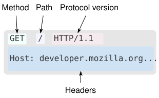
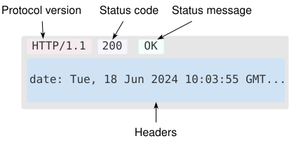
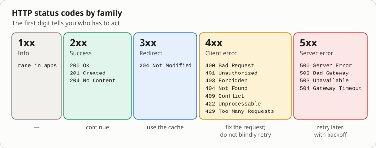
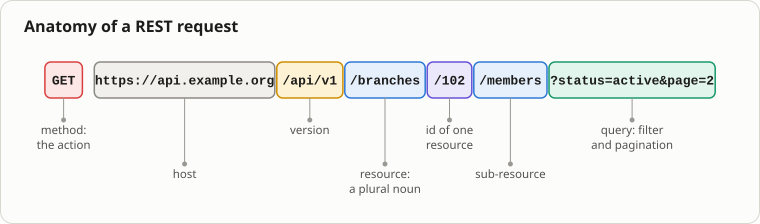
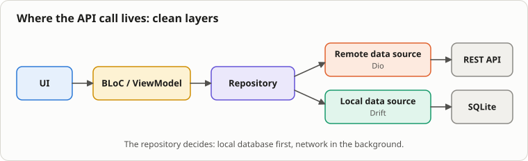
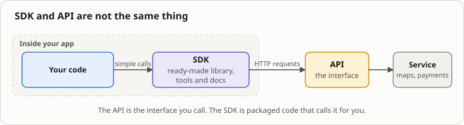

<div class="chapter-head">
<div class="chapter-kicker"><b>B1</b>Part B · API Integration, Security and Performance</div>

# Backend API Integration

</div>

> **The skill:** Connect a mobile app to backend **REST APIs**, **JSON/XML** web services and **third-party SDKs**.

Three parts: **REST APIs** (sections 1–4), **JSON and XML** (section 5), **third-party SDKs** (section 7). The networking theory you need (HTTP, status codes) is here too.

---

## 1. HTTP in one page

<div class="box def">

**Definition.** **HTTP** (HyperText Transfer Protocol) is the set of rules a mobile app and a server use to talk. The app sends a **request**. The server sends back a **response**. That is the whole conversation.

</div>

<div class="box story">

**Example scenario.** Imagine a restaurant.

1. You (the **app**) cannot walk into the kitchen (the **database**).
2. You give your order to the waiter (the **API**): "One tea, please." This is the **request**.
3. The waiter comes back with tea, or with a message: "Sorry, we have no tea." This is the **response**.
4. Each time you order, you show your table card again, because the waiter does not remember you. This is **stateless**: every request carries the token.

</div>

<div class="pair">

<br>*A request: method, path, version, then headers.*

<br>*A response: version, status code, status message, then headers.*

</div>

*Pictures: MDN Web Docs, "An overview of HTTP".*

<p class="label">Exam notes</p>

The mobile app is the **client**; the backend is the **server**. The client sends a **request**; the server returns a **response**. HTTP is **stateless**: each request stands alone, so the app sends its token every time.

```
Request                                   Response
POST /api/v1/visits HTTP/1.1              HTTP/1.1 201 Created
Host: api.example.org                     Content-Type: application/json
Authorization: Bearer <access token>
Content-Type: application/json            { "id": "9f1c...", "status": "received" }

{ "branchId": "BR-102", "note": "..." }
```

**Methods**

| Method | Use | Safe? | Idempotent? |
|---|---|---|---|
| **GET** | Read | Yes | Yes |
| **POST** | Create | No | **No** |
| **PUT** | Replace the whole resource | No | Yes |
| **PATCH** | Change part of a resource | No | Not guaranteed |
| **DELETE** | Remove | No | Yes |

*Safe* = does not change data. *Idempotent* = doing it twice gives the same result as doing it once. This matters for retries: you may safely retry GET, PUT and DELETE; a POST needs an idempotency key (A3).

**Status codes (memorise)**

| Code                                            | Meaning                       | What the app does                         |
| ----------------------------------------------- | ----------------------------- | ----------------------------------------- |
| **200** OK, **201** Created, **204** No Content | Success                       | Continue                                  |
| **304** Not Modified                            | Cache is still valid          | Use the cache                             |
| **400** Bad Request, **422** Unprocessable      | Invalid input                 | Show the validation message; do not retry |
| **401** Unauthorized                            | Token missing or expired      | Refresh the token, else go to login       |
| **403** Forbidden                               | Logged in but **not allowed** | Show "no permission"                      |
| **404** Not Found                               | Resource does not exist       | Show a message                            |
| **409** Conflict                                | Version conflict              | Run the conflict rule                     |
| **429** Too Many Requests                       | Rate limit                    | Wait (`Retry-After`), back off            |
| **500** Server Error, **502**, **503**, **504** | Server-side failure           | Retry later with backoff                  |

Groups: **1xx** information, **2xx** success, **3xx** redirect, **4xx** client error, **5xx** server error.



**Useful headers:** `Authorization`, `Content-Type`, `Accept`, `Accept-Language` (bn/en), `ETag` / `If-None-Match`, `Cache-Control`, `Retry-After`.

**HTTPS** = HTTP over **TLS**. It gives encryption, server identity (certificate) and integrity. All API traffic must use it (details in B2).

<div class="box q">

**What is the difference between 401 and 403?**

**401** means "I do not know who you are". The token is missing or expired, so the app refreshes it or shows the login screen. **403** means "I know who you are, but you are not allowed". Logging in again will not help.

</div>

<div class="box q">

**What does "idempotent" mean, in simple words?**

Doing it twice gives the same result as doing it once. Pressing a lift button twice still calls one lift: idempotent. Pressing "Pay" twice may pay twice: **not** idempotent. `GET`, `PUT` and `DELETE` are idempotent. `POST` is not, so a retried `POST` needs an idempotency key.

</div>

<div class="box rule">

**Remember.** 2xx = success. 3xx = redirect or use the cache. 4xx = the app's request is wrong. 5xx = the server failed. Retry 5xx, do not blindly retry 4xx.

</div>

<div class="box check">

**Quick check**

1. The user is logged in but opens a page only managers may see. Which code? (a) 401 (b) 403 (c) 404
2. Which method is **not** idempotent? (a) GET (b) PUT (c) POST (d) DELETE
3. The server answers 304. What does the app do?

<details>
<summary>Show answers</summary>

1. **(b) 403 Forbidden.**
2. **(c) POST.**
3. It uses its cached copy. 304 means "Not Modified".

</details>

</div>

## 2. REST

<div class="box def">

**Definition.** **REST** (Representational State Transfer) is a style for designing APIs. Everything is a **resource** with its own address (URL), and you act on it with the standard HTTP methods.

</div>

<div class="box story">

**Example scenario.** Imagine the visits of a field officer.

- A **bad API** invents a new name for every action: `/getAllVisits`, `/createNewVisit`, `/deleteVisitById`.
- A **REST API** has one address, `/visits`, and lets the **method** say what to do:

| You want to | You send |
|---|---|
| See all visits | `GET /visits` |
| See one visit | `GET /visits/9f1c` |
| Add a visit | `POST /visits` |
| Change part of a visit | `PATCH /visits/9f1c` |
| Remove a visit | `DELETE /visits/9f1c` |

**What is the benefit?** A developer who knows one REST API can guess the next one.

</div>

<p class="label">Exam notes</p>

**REST** (Representational State Transfer) is an architectural style for APIs where everything is a **resource** with a URL, and standard HTTP methods act on it.

**Six constraints:** client–server · **stateless** · cacheable · uniform interface · layered system · code on demand (optional).

**Good REST design**

| Rule                                      | Example                                                                                        |
| ----------------------------------------- | ---------------------------------------------------------------------------------------------- |
| Nouns, plural, no verbs                   | `GET /visits`, not `/getVisits`                                                                |
| Hierarchy for relations                   | `GET /branches/102/members`                                                                        |
| Method gives the action                   | `POST /visits`, `PATCH /visits/9f1c`, `DELETE /visits/9f1c`                                    |
| **Versioning**                            | `/api/v1/...` so old app versions keep working                                                 |
| **Pagination**                            | `?page=2&size=20` (offset) or `?cursor=abc&limit=20` (cursor; better for large, changing data) |
| Filtering and sorting                     | `?status=pending&sort=-createdAt`                                                              |
| Correct status codes and one error format | `{ "code": "VALIDATION_ERROR", "message": "...", "fields": {...} }`                            |



<div class="box rule">

**Remember.** REST = resources (nouns) + HTTP methods (verbs) + stateless + usually JSON.

</div>

## 3. REST compared with others

<div class="box def">

**In simple words.** REST is not the only way. **SOAP** is the older, strict, XML-only way that banks still use. **GraphQL** lets the app ask for exactly the fields it wants. **gRPC** is a very fast binary way, used mostly between servers.

</div>

|             | REST                    | SOAP                                                                                          | GraphQL                               | gRPC                        |
| ----------- | ----------------------- | --------------------------------------------------------------------------------------------- | ------------------------------------- | --------------------------- |
| Kind        | Architectural style     | Protocol                                                                                      | Query language                        | RPC framework               |
| Data format | Usually **JSON**        | **XML** only                                                                                  | JSON                                  | Protocol Buffers (binary)   |
| Endpoints   | One per resource        | One, with operations in a WSDL contract                                                       | One; the client asks for exact fields | Service methods             |
| Strength    | Simple, cacheable       | Strict contract, built-in security standards; common in banking and government legacy systems | No over-fetching                      | Very fast, streaming        |
| Weakness    | Over- or under-fetching | Heavy and verbose                                                                             | Caching is harder                     | Not readable; needs tooling |

**Real-time options:** **WebSocket** (one long-lived, two-way connection; chat, live tracking), **SSE** (server-to-client stream), **MQTT** (lightweight publish/subscribe through a broker; IoT, weak networks), **polling** (asking repeatedly; wasteful). You have used WebSocket and MQTT in production.

## 4. Calling an API from the app

<div class="box def">

**In simple words.** Calling an API is three jobs: **send** the request with the token, **turn** the JSON answer into Dart objects, and **handle** everything that can go wrong. Good code keeps these jobs in their own layers.

</div>

<div class="box story">

**Example scenario.** Imagine the officer opens the visit list in a place with a very weak signal.

1. The app sends `GET /visits`.
2. Ten seconds pass. Nothing comes back.
3. **A bad app** keeps showing a spinner for ever. The officer thinks the app is frozen.
4. **A good app** has a **timeout**. After ten seconds it stops waiting, shows the visits saved on the phone, and says "Network is slow. Showing saved data."

**What happened?** The good app expected failure. Every request had a time limit and a plan B.

</div>

<p class="label">Exam notes</p>

| Platform | Client library                                                                       |
| -------- | ------------------------------------------------------------------------------------ |
| Flutter  | `http` (simple), **Dio** (interceptors, timeouts, cancel, upload progress, FormData) |
| Android  | **Retrofit** + **OkHttp**                                                            |
| iOS      | **URLSession**, Alamofire                                                            |

**A clean structure (layers):**



```dart
final dio = Dio(BaseOptions(
  baseUrl: 'https://api.example.org/api/v1',
  connectTimeout: const Duration(seconds: 10),
  receiveTimeout: const Duration(seconds: 20),
))..interceptors.add(AuthInterceptor());       // adds the token, refreshes on 401 (B2)

class VisitApi {
  Future<List<VisitDto>> getVisits({String? cursor}) async {
    try {
      final res = await dio.get('/visits', queryParameters: {'cursor': cursor, 'limit': 20});
      return (res.data['items'] as List).map((j) => VisitDto.fromJson(j)).toList();
    } on DioException catch (e) {
      throw _mapError(e);          // turn transport errors into app-level failures
    }
  }
}
```

**Error handling: map every failure to a clear type**

| Failure | Cause | User message |
|---|---|---|
| No connection | Offline, DNS failure | "No internet. Saved on device." |
| Timeout | Slow network | "Network is slow. Will retry." |
| 401 | Session expired | Silent refresh, else login |
| 403 | No permission | "You are not allowed to do this." |
| 4xx validation | Bad input | The field message from the server |
| 5xx | Server problem | "Server problem. Try again later." |
| Parsing error | Response shape changed | Log to Crashlytics; generic message |

**Robust integration checklist:** timeouts · retry only safe requests, with backoff · cancel requests when the screen closes · pagination · debounce search input · respect 429 · gzip compression · never trust the response blindly (null checks) · log without sensitive data.

**File upload:** `multipart/form-data` (Dio `FormData` with `MultipartFile`), compress first, show progress, allow resume.

<div class="box rule">

**Remember.** UI → BLoC → Repository → data source. Set timeouts. Map every failure to a clear message. Retry only safe requests, with backoff.

</div>

## 5. JSON and XML

<div class="box def">

**Definition.** **JSON** and **XML** are two text formats for sending data between systems. **JSON** uses keys and values in curly brackets. **XML** uses opening and closing tags.

</div>

<div class="box story">

**Example scenario.** Imagine writing the same address in two ways.

- **JSON** is like a short form: *name: ASA, active: yes*. Small and quick to read.
- **XML** is like a formal letter where every part has a labelled start and a labelled end: `<name>ASA</name>`. Longer, but it can carry strict rules (a schema) about what is allowed.

**What happens in the app?** Text arrives from the network. The app must turn it into objects. Text → object is **deserialisation** (parsing). Object → text is **serialisation**.

</div>

<p class="label">Exam notes</p>

|            | JSON                                         | XML                                                                      |
| ---------- | -------------------------------------------- | ------------------------------------------------------------------------ |
| Full form  | JavaScript Object Notation                   | eXtensible Markup Language                                               |
| Shape      | Key–value pairs, arrays                      | Tags in a tree, with attributes                                          |
| Size       | Small                                        | Verbose (closing tags)                                                   |
| Data types | String, number, boolean, null, array, object | Everything is text (types need a schema)                                 |
| Schema     | JSON Schema (optional)                       | **XSD**, DTD (strong validation)                                         |
| Extras     | —                                            | Namespaces, comments, attributes                                         |
| Used in    | REST APIs, mobile                            | **SOAP**, legacy and banking systems, Android layouts, RSS, config files |
| Parsing    | Fast and simple                              | Slower (DOM or SAX parsers)                                              |

```json
{ "id": 7, "branchName": "Mirpur", "active": true, "areas": ["Pallabi", "Kafrul"] }
```

```xml
<branch id="7" active="true">
  <branchName>Mirpur</branchName>
  <areas><area>Pallabi</area><area>Kafrul</area></areas>
</branch>
```

**Terms:** **serialisation** = object → JSON/XML text. **Deserialisation** (parsing) = text → object. A **DTO/model class** holds the parsed data.

```dart
class Po {
  final int id; final String branchName; final bool active;
  Branch({required this.id, required this.branchName, required this.active});

  factory Po.fromJson(Map<String, dynamic> j) =>
      Branch(id: j['id'], branchName: j['branchName'], active: j['active'] ?? false);
  Map<String, dynamic> toJson() => {'id': id, 'branchName': branchName, 'active': active};
}

final po = Po.fromJson(jsonDecode(responseBody));          // dart:convert
```

- For many models use **code generation**: `json_serializable` or `freezed`.
- Parse **large** responses in an isolate (`compute(parseVisits, body)`) so the UI does not freeze.
- XML in Dart: the `xml` package (`XmlDocument.parse(body).findAllElements('branchName')`).
- Native: Kotlin `kotlinx.serialization`, Moshi, Gson. Swift `Codable` with `JSONDecoder`; `XMLParser` for XML.

**Why XML still matters:** government and financial systems (banks, MFS, older in-house systems) often expose **SOAP/XML** services. The app must be able to consume both.

<div class="box q">

**JSON is simpler. Why do job adverts still mention XML?**

Because older systems still speak it. Banks, mobile financial services and many government services use **SOAP**, which is XML only. A field app may have to read data from such a system.

</div>

<div class="box rule">

**Remember.** JSON = light, has data types, used by REST. XML = tags, verbose, has schemas (XSD), used by SOAP. Serialise = object to text. Deserialise = text to object.

</div>

<div class="box check">

**Quick check**

1. Which format has built-in number and boolean types? (a) JSON (b) XML
2. Turning a JSON string into a Dart object is called: (a) serialisation (b) deserialisation
3. A 4 MB JSON response freezes the screen while parsing. What is the fix?

<details>
<summary>Show answers</summary>

1. **(a) JSON.** In XML everything is text unless a schema says more.
2. **(b) deserialisation.**
3. Parse it in an isolate, for example with `compute()`.

</details>

</div>

## 6. API documentation and contract

<div class="box def">

**In simple words.** The mobile team and the backend team agree on a written **contract**: which addresses exist, what to send, what comes back. With the contract in hand, both teams can build at the same time.

</div>

- **OpenAPI / Swagger:** a machine-readable description of every endpoint, its parameters and its responses.
- **Postman:** test endpoints by hand, share collections, run a mock server before the backend is ready.
- **API-first:** mobile and backend agree on the contract first, then build in parallel.
- **Backward compatibility:** old app versions stay on users' phones for months. So the backend adds fields but does not remove or rename them inside a version; breaking changes go to `/v2`; the app ignores unknown fields.

## 7. Third-party SDKs

<div class="box def">

**Definition.** An **SDK** (Software Development Kit) is ready-made code from another company that you add to your app to use their service: maps, payments, push notifications.

</div>

<div class="box story">

**Example scenario.** Imagine the app must take a payment through a payment gateway.

1. **Without an SDK:** you read the gateway's API documents and write every HTTP call, every signature and every error case yourself.
2. **With the SDK:** you add one package, give it your key, and call `pay(amount)`. The SDK makes the HTTP calls for you.

**What is the price?** The SDK's code is now inside your app. If it crashes, your app crashes. If it collects data, your app collects data. So you check it before you add it, and you wrap it behind your own class so it can be replaced.

</div>

<p class="label">Exam notes</p>

An **SDK** (Software Development Kit) is a packaged library, with tools and documentation, for using another company's service. An **API** is the interface you call; an SDK is the ready-made code that calls it for you.



| Need | SDK examples |
|---|---|
| Maps and location | Google Maps SDK, `geolocator` |
| Push, analytics, crash reports | Firebase (FCM, Analytics, Crashlytics), Sentry |
| Payments | SSLCommerz, ShurjoPay, bKash, Nagad |
| Login | Google Sign-In, AppAuth (Keycloak/OIDC) |
| Scanning, camera, ML | ML Kit, `mobile_scanner` (QR), ONNX Runtime |
| Devices | Bluetooth printer SDK, biometric SDKs |

**Integration steps (a good 5-mark answer):**

1. **Evaluate**: maintained? licence? app size? permissions and data collected? Android and iOS support? minimum OS version?
2. **Add the dependency** (`pubspec.yaml`; Gradle; CocoaPods/SPM) with a **pinned version**.
3. **Platform setup**: `AndroidManifest.xml` permissions and keys; `Info.plist` usage descriptions; Gradle/Podfile settings.
4. **Initialise** once at app start with the API key.
5. **Wrap it** behind your own interface (adapter/repository), so the rest of the app does not depend on the vendor and the SDK can be swapped or mocked in tests.
6. **Handle** permissions, errors and the no-network case.
7. **Test** on both platforms, including release builds (obfuscation can break SDKs).
8. **Declare** it in the stores' privacy forms (Data Safety, privacy labels).

**API key safety:** never commit keys to Git; restrict keys by package name and signing certificate; keep real secrets on the server, because anything inside the app can be extracted.

<div class="box rule">

**Remember.** API = the interface you call. SDK = packaged code that calls it for you. Evaluate → add (pinned version) → platform setup → initialise → wrap → handle errors → test → declare in the store forms.

</div>

## Link it to your own projects

Interviews and written exams reward answers that use **your own work** as the example. Before you move on, answer these for yourself:

<div class="box you">

- Describe your API layer: Dio or http, interceptors, error handling, models with `fromJson` / `toJson`.
- Name the third-party SDKs you have integrated (maps, payments, analytics) and one problem you solved with them.
- Have you consumed XML or SOAP? If not, explain how you would parse it.

</div>

---

## Practice questions

**Short (2–3 marks each)**

1. What is REST? Name three of its constraints.
2. PUT vs PATCH vs POST.
3. What does "idempotent" mean? Which HTTP methods are idempotent?
4. 401 vs 403.
5. Give the meaning of 200, 201, 304, 404, 429, 500.
6. JSON vs XML (four points).
7. What are serialisation and deserialisation?
8. SDK vs API.
9. Why version an API?
10. REST vs SOAP.

**Long (8–10 marks each)**

11. Explain how you integrate a RESTful API into a Flutter app. Include the layers, the HTTP client, model parsing, error handling and a short code example.
12. Compare JSON and XML with examples. Show how each is parsed in a mobile app.
13. You must add a third-party payment or map SDK to a field app. Describe the steps and the risks you check.

---

## Model answers

<div class="box exam">

**How to read these answers.** They are written for **learning**, so they are fuller than what you would write in the exam hall. Every answer has the same parts:

- **In short** (green): the direct answer. In the exam, write this part first.
- **Table or points:** the details, laid out so you can compare and remember them.
- **Example** (yellow): a real situation, usually from a field app or from your own projects.
- Long answers end with **In the exam** (brown): how to shorten the answer on paper.

Write your own answer first. Then open the model answer and compare.

</div>

<details>
<summary>1. What is REST? Name three of its constraints.</summary>

<div class="box def">

**In short.** <mark>**REST (Representational State Transfer)**</mark> is an architectural style for web APIs. Data is exposed as **resources**, each with its own URL, and the client works on them with the standard HTTP methods. Three constraints: **client–server**, **stateless**, **cacheable**.

</div>


| Constraint | Meaning | What it gives |
|---|---|---|
| **Client–server** | The app (UI) and the server (data) are separate | Each can change without the other |
| **Stateless** | <mark>Every request carries everything the server needs</mark> (for example the token). The server keeps no session between requests | Easy to scale: any server can answer |
| **Cacheable** | A response says whether it may be cached | Fewer calls, faster app |
| **Uniform interface** | The same rules everywhere: URLs for resources, HTTP methods for actions, status codes for results | Easy to learn and use |
| **Layered system** | The client does not know if it talks to the real server, a load balancer or a gateway | Security and scaling layers can be added |
| **Code on demand** (optional) | The server may send code to run | Rarely used |

**How a REST API looks**

| Action | Request | Reply |
|---|---|---|
| List visits | `GET /visits` | `200` + list |
| Read one | `GET /visits/42` | `200` + object |
| Create | `POST /visits` | `201 Created` |
| Replace | `PUT /visits/42` | `200` |
| Change part | `PATCH /visits/42` | `200` |
| Delete | `DELETE /visits/42` | `204 No Content` |

Note the style: **nouns in the URL, verbs in the method**. `GET /visits/42`, not `GET /getVisit?id=42`.

<div class="box story">

**Example.** Because REST is stateless, the field app sends its JWT in the `Authorization` header on *every* request. The NGO can then run five API servers behind a load balancer, and it does not matter which one answers.

</div>

<div class="ref">

**From the book:** [2. REST](#2-rest)

</div>

</details>

<details>
<summary>2. PUT vs PATCH vs POST.</summary>

<div class="box def">

**In short.** **POST** creates a new resource. **PUT** replaces a whole resource at a known URL. **PATCH** changes only the fields you send.

</div>

| Point | POST | PUT | PATCH |
|---|---|---|---|
| **Purpose** | Create | Replace completely | Update partly |
| **URL** | The collection: `/visits` | The item: `/visits/42` | The item: `/visits/42` |
| **Body** | The new object | The **whole** object | Only the changed fields |
| **Who chooses the ID** | The server (usually) | The client knows it already | The client knows it already |
| **Idempotent** | <mark>No</mark> | <mark>Yes</mark> | Not guaranteed |
| **Sent twice** | Two records | Same result | Usually the same result |
| **Success code** | `201 Created` | `200` or `204` | `200` or `204` |

```http
POST /visits          {"member": "M-451", "note": "Met borrower"}     → 201, new id 42
PUT  /visits/42       {"member": "M-451", "note": "Borrower absent"}   → whole record replaced
PATCH /visits/42      {"note": "Borrower absent"}                → only note changed
```

**A trap with PUT:** if you leave a field out, it is cleared, because PUT replaces everything.

<div class="box story">

**Example.** A supervisor changes only the status of a visit to "Verified". PATCH sends 20 bytes. PUT would send the whole visit again, and could overwrite a note that the officer changed a minute earlier. On a weak rural network, PATCH is also cheaper.

</div>

<div class="ref">

**From the book:** [1. HTTP in one page](#1-http-in-one-page) [2. REST](#2-rest)

</div>

</details>

<details>
<summary>3. What does "idempotent" mean? Which HTTP methods are idempotent?</summary>

<div class="box def">

**In short.** A request is idempotent when <mark>sending it many times has the same effect on the server as sending it once</mark>. **GET, PUT, DELETE, HEAD and OPTIONS** are idempotent. **POST** is not.

</div>

| Method | Safe (changes nothing)? | Idempotent? | Why |
|---|---|---|---|
| **GET** | Yes | Yes | Only reads |
| **HEAD**, **OPTIONS** | Yes | Yes | Only read information |
| **PUT** | No | Yes | Replacing with the same data twice gives the same record |
| **DELETE** | No | Yes | Deleted once or twice, it is gone (the second reply may be `404`, but the state is the same) |
| **POST** | No | **No** | Each call can create a new record |
| **PATCH** | No | Not guaranteed | "Set note = X" is; "add 1 to count" is not |

**Why a mobile developer cares.** On a weak network a request can time out *after* the server did the work. The app does not know, so it retries.

- Idempotent methods are **safe to retry** automatically.
- POST is not. To make it safe, send an **idempotency key**, so the server can recognise a repeat.

<div class="box story">

**Example.** The app posts a repayment of BDT 5,000 and the reply is lost. An automatic retry of that POST would record the repayment twice. With an `Idempotency-Key` header, the server returns the first result and the balance stays correct.

</div>

<div class="ref">

**From the book:** [1. HTTP in one page](#1-http-in-one-page) [A3 · 5. Sync design: the outbox pattern](A3%20-%20Offline%20Storage%20and%20Data%20Sync.md#5-sync-design-the-outbox-pattern)

</div>

</details>

<details>
<summary>4. 401 vs 403.</summary>

<div class="box def">

**In short.** <mark>**401 Unauthorized** = "I do not know who you are"</mark> (not authenticated). <mark>**403 Forbidden** = "I know who you are, but you are not allowed"</mark> (not authorized).

</div>

| Point | 401 Unauthorized | 403 Forbidden |
|---|---|---|
| **Problem with** | Authentication (identity) | Authorization (permission) |
| **Typical cause** | No token, an expired token, a wrong token | A valid token, but the role lacks the permission |
| **Will logging in again help?** | Yes | No |
| **What the app does** | Refresh the token silently and repeat the request. If the refresh fails, go to login | Show "You do not have access". Do not retry, do not log out |
| **Example** | The access token expired after 15 minutes | A field officer calls the "approve loan" API |

<div class="box story">

**Example.** A field officer leaves the app open over lunch. The next API call returns **401**. The interceptor refreshes the token and repeats the call, and she notices nothing. Later she taps a menu meant for branch managers and the API returns **403**. The app shows an access message. Refreshing the token would not help, because her role is the problem.

</div>

<div class="ref">

**From the book:** [1. HTTP in one page](#1-http-in-one-page)

</div>

</details>

<details>
<summary>5. Give the meaning of 200, 201, 304, 404, 429, 500.</summary>

<div class="box def">

**In short.** 200 OK · 201 Created · 304 Not Modified · 404 Not Found · 429 Too Many Requests · 500 Internal Server Error.

</div>


| Code | Name | Meaning | What the app does |
|---|---|---|---|
| **200** | OK | Success; the data is in the body | Show the data |
| **201** | Created | A new resource was created (after POST) | Mark the record as synced |
| **304** | Not Modified | Your cached copy is still good; no body is sent | Use the cache |
| **404** | Not Found | No resource at that URL | Show "not found"; remove the stale local item |
| **429** | Too Many Requests | Rate limit reached | Wait (read the `Retry-After` header), then retry with backoff |
| **500** | Internal Server Error | The server failed | Retry later with backoff; show a polite message |

**The five families**

| Family | Meaning | Whose fault? | Retry? |
|---|---|---|---|
| **1xx** | Information | — | — |
| **2xx** | Success | — | — |
| **3xx** | Redirection or cache | — | — |
| **4xx** | Client error | The app or the user | No (fix the request first), except 401 after a refresh and 429 after a wait |
| **5xx** | Server error | The server | Yes, with backoff |

**Others worth knowing:** 204 No Content, 400 Bad Request, 401 Unauthorized, 403 Forbidden, 409 Conflict, 422 Unprocessable Entity (validation failed), 502 Bad Gateway, 503 Service Unavailable.

<div class="box story">

**Example.** During month-end reporting, 500 field phones sync at the same time and the API answers **429**. A good app waits and retries with backoff. A bad app retries at once and makes the overload worse.

</div>

<div class="ref">

**From the book:** [1. HTTP in one page](#1-http-in-one-page)

</div>

</details>

<details>
<summary>6. JSON vs XML (four points).</summary>

<div class="box def">

**In short.** Both are text formats for exchanging data. **JSON** is lighter, has real data types and is the standard for REST and mobile. **XML** is more verbose but has schemas, namespaces and attributes, and is used in SOAP and older systems.

</div>

| Point | JSON | XML |
|---|---|---|
| **Full form** | JavaScript Object Notation | eXtensible Markup Language |
| **Structure** | Key–value pairs and arrays | Nested tags, with attributes |
| **Size** | Small | Larger (every tag is written twice) |
| **Data types** | String, number, boolean, null, array, object | Everything is text, unless a schema says otherwise |
| **Arrays** | Built in: `[ ]` | Repeated tags |
| **Schema / validation** | JSON Schema (optional) | XSD, DTD (strong and common) |
| **Namespaces, comments** | No | Yes |
| **Parsing** | Fast and simple (`jsonDecode`) | Slower (DOM or SAX parser) |
| **Used in** | REST APIs, mobile apps | SOAP, banking, government and legacy systems, Android layouts |

**The same data in both**

```json
{ "id": 42, "branch": "Mirpur", "verified": true, "tags": ["loan", "visit"] }
```

```xml
<visit id="42">
  <po>ABC Sangstha</po>
  <verified>true</verified>
  <tags><tag>loan</tag><tag>visit</tag></tags>
</visit>
```

<div class="box story">

**Example.** The field app talks to its own backend in JSON. But if it must read data from an older government or banking service, that service may only speak SOAP/XML. This is why job adverts say "JSON/XML" and not only JSON.

</div>

<div class="ref">

**From the book:** [5. JSON and XML](#5-json-and-xml)

</div>

</details>

<details>
<summary>7. What are serialisation and deserialisation?</summary>

<div class="box def">

**In short.** **Serialisation** turns an object in memory into a format that can be sent or stored (JSON, XML, bytes). **Deserialisation** is the reverse: it turns that text back into an object.

</div>

| | Serialisation | Deserialisation |
|---|---|---|
| **Direction** | Object → text | Text → object |
| **In Dart** | `toJson()` then `jsonEncode()` | `jsonDecode()` then `fromJson()` |
| **When** | Before sending a request; before saving | After receiving a response; after reading |
| **Also called** | Encoding, marshalling | Decoding, parsing, unmarshalling |

```dart
class Visit {
  final String id;
  final String note;
  Visit({required this.id, required this.note});

  factory Visit.fromJson(Map<String, dynamic> j) =>          // deserialise
      Visit(id: j['id'] as String, note: j['note'] as String);

  Map<String, dynamic> toJson() => {'id': id, 'note': note};  // serialise
}

final text  = jsonEncode(visit.toJson());        // object → JSON string
final visit = Visit.fromJson(jsonDecode(text));  // JSON string → object
```

**Good practice**

- Generate the code with `json_serializable` or `freezed`, so there are no typing mistakes.
- Handle missing and null fields, because the server may add or drop fields.
- Parse very large lists in an isolate, to keep the UI smooth.

<div class="box story">

**Example.** The officer saves a visit. The app serialises the `Visit` object to JSON and sends it with POST. The server replies with JSON, and the app deserialises it back into a `Visit` object to update the local database.

</div>

<div class="ref">

**From the book:** [4. Calling an API from the app](#4-calling-an-api-from-the-app) [5. JSON and XML](#5-json-and-xml)

</div>

</details>

<details>
<summary>8. SDK vs API.</summary>

<div class="box def">

**In short.** An **API** is an **interface**: the set of endpoints or functions through which you use a service. An **SDK** is a **kit**: ready-made libraries, tools and documentation that call those APIs for you.

</div>


| Point | API | SDK |
|---|---|---|
| **Full form** | Application Programming Interface | Software Development Kit |
| **What it is** | A contract: "send this, get that" | A package of code you add to your app |
| **You get** | Endpoints and documentation | Libraries, tools, sample code, documentation |
| **Your work** | Write the HTTP calls, parsing and error handling yourself | Call a few functions |
| **Inside your app?** | No, it lives on the server | Yes, its code ships in your app |
| **Size and risk** | None added to the app | Adds size, permissions and possible crashes |
| **Relation** | An SDK usually wraps one or more APIs | — |
| **Example** | Google Maps REST API | Google Maps SDK for Android |

**Daily-life picture:** the API is the restaurant menu and the waiter. The SDK is a meal kit delivered to your kitchen, with the ingredients measured and a recipe card.

<div class="box story">

**Example.** For payments, an app uses a gateway's SDK, such as **ShurjoPay** or **SSLCommerz**. The app calls a pay function, and the SDK makes the HTTP calls to the gateway's **API**. For its own backend, the app calls the REST **API** directly with Dio, because no SDK exists.

</div>

<div class="ref">

**From the book:** [7. Third-party SDKs](#7-third-party-sdks)

</div>

</details>

<details>
<summary>9. Why version an API?</summary>

<div class="box def">

**In short.** Because **old app versions stay on users' phones for a long time**. Versioning lets the backend change without breaking those old apps, and gives time for a planned retirement of the old version.

</div>

**The mobile problem.** A website updates for everyone at once. A mobile app does not: some users update after months, some never.

1. App 1.0 expects the field `name`.
2. The backend renames it to `full_name`.
3. Every phone still on 1.0 breaks at once.

With `/v1` and `/v2` side by side, app 1.0 keeps calling `/v1` and the new app calls `/v2`.

| Way to version | Example | Note |
|---|---|---|
| **URL path** | `/api/v1/visits` | Most common and most visible |
| **Header** | `Accept: application/vnd.example.v2+json` | Clean URLs, harder to test |
| **Query parameter** | `/visits?version=2` | Simple, less common |

| Change | Breaking? | New version needed? |
|---|---|---|
| Add an optional field or a new endpoint | No | No |
| Remove or rename a field | Yes | Yes |
| Change a field's type or meaning | Yes | Yes |
| Make an optional field required | Yes | Yes |

**The rest of the policy**

- Announce a **deprecation** date for the old version.
- Add a **minimum supported app version** check, so very old apps are asked to update (force update).
- The app should ignore unknown fields, so small additions never break it.

<div class="box story">

**Example.** The NGO adds GPS accuracy as a required field for visits. The change goes into `/v2`. Field officers who have not yet updated continue on `/v1` for two months, then see "Please update the app".

</div>

<div class="ref">

**From the book:** [6. API documentation and contract](#6-api-documentation-and-contract) [2. REST](#2-rest)

</div>

</details>

<details>
<summary>10. REST vs SOAP.</summary>

<div class="box def">

**In short.** **REST** is a lightweight architectural **style** that uses plain HTTP, usually with JSON. **SOAP** is a strict **protocol** that wraps every message in an XML envelope and has a formal contract (WSDL).

</div>

| Point | REST | SOAP |
|---|---|---|
| **What it is** | An architectural style | A protocol |
| **Full form** | Representational State Transfer | Simple Object Access Protocol |
| **Data format** | JSON (also XML, text) | XML only |
| **Message** | Plain body | Envelope → Header → Body |
| **Transport** | HTTP | HTTP, SMTP and others |
| **Contract** | OpenAPI / Swagger (optional) | WSDL (required) |
| **Operations** | HTTP methods on resource URLs | Named operations, usually all through POST |
| **Errors** | HTTP status codes | A `Fault` element inside the body |
| **Caching** | Yes (GET) | No |
| **Security** | HTTPS + OAuth 2.0 / JWT | WS-Security (built-in standards) |
| **Size and speed** | Light and fast | Heavy |
| **Common in** | Mobile and web apps | Banking, telecom, government, legacy systems |

<div class="box story">

**Example.** The field app's own backend is REST with JSON: small messages suit a weak network. If the app must call a bank's older payment service, it may have to build a SOAP envelope in XML and read the XML reply. A mobile developer mostly uses REST, but should recognise SOAP.

</div>

<div class="ref">

**From the book:** [3. REST compared with others](#3-rest-compared-with-others)

</div>

</details>

<details>
<summary>11. Explain how you integrate a RESTful API into a Flutter app. Include the layers, the HTTP client, model parsing, error handling and a short code example.</summary>

<div class="box def">

**In short.** I keep the API call out of the UI. The screen talks to a **BLoC**, the BLoC to a **repository**, and the repository to a **remote data source** that uses **Dio**. JSON is parsed into **model classes**. Every failure is mapped to a clear error type that the UI can show.

</div>


#### 1. The layers

| Layer | Its job | Knows about HTTP? |
|---|---|---|
| **UI (widgets)** | Shows state, sends user actions | No |
| **BLoC / ViewModel** | Holds the screen state: loading, data, error | No |
| **Repository** | Decides where the data comes from: API, local database or both | No |
| **Remote data source** | Makes the HTTP calls | Yes |
| **Local data source** | Reads and writes the local database | No |

Why layers: the UI can be tested without a server, and the HTTP client can be changed without touching a screen.

#### 2. The HTTP client

I use **Dio** (the `http` package is fine for simple apps). One shared instance, configured once:

- **Base URL** and API version.
- **Timeouts** for connect and receive.
- **Interceptors:** add the `Authorization: Bearer` token; refresh on 401; log in debug mode only.

#### 3. Model parsing

- One model class per resource, with `fromJson` and `toJson`.
- Code generation (`json_serializable`, `freezed`) to avoid mistakes.
- Null-safe parsing, because the server may leave fields out.
- Large lists are parsed in an isolate.

#### 4. The code

```dart
final dio = Dio(BaseOptions(
  baseUrl: 'https://api.example.org/v1',
  connectTimeout: const Duration(seconds: 10),
  receiveTimeout: const Duration(seconds: 20),
))..interceptors.add(AuthInterceptor());

class Visit {
  final String id;
  final String note;
  Visit({required this.id, required this.note});
  factory Visit.fromJson(Map<String, dynamic> j) =>
      Visit(id: j['id'] as String, note: j['note'] as String? ?? '');
}

class VisitRemoteSource {
  Future<List<Visit>> fetchVisits({int page = 1}) async {
    try {
      final res = await dio.get('/visits', queryParameters: {'page': page});
      return (res.data as List).map((e) => Visit.fromJson(e)).toList();
    } on DioException catch (e) {
      throw mapToAppException(e);      // see the table below
    }
  }
}
```

#### 5. Error handling

| What went wrong | How the app knows | What the app does |
|---|---|---|
| No network | Connection error | Show cached data and an "offline" banner |
| Timeout | `DioExceptionType.connectionTimeout` / `receiveTimeout` | Retry with backoff (GET only) |
| **401** | Status code | Refresh the token, repeat once; else go to login |
| **403** | Status code | "You do not have access" |
| **400 / 422** | Status code + error body | Show the validation message beside the field |
| **404** | Status code | "Not found" |
| **5xx** | Status code | "Server problem, try later"; retry with backoff |
| Bad JSON | `FormatException` / type error | Log to Crashlytics; show a generic error |

Rule: the user never sees a raw exception or a stack trace.

#### 6. Making it robust

- **Pagination** for long lists.
- **Cancel** the request when the user leaves the screen (`CancelToken`).
- **Retry with exponential backoff** only for safe methods, or with an idempotency key.
- **Cache** responses. In an offline-first app the repository returns data from the **local database**, and the API only keeps it fresh.
- **HTTPS** always; certificate pinning for sensitive apps.

<div class="box story">

**Link to your own work.** Close with one true sentence about your own projects, for example: "In my Flutter apps the screen read from a local database, and a sync service called the REST API in the background, so the screen worked with no network."

</div>

<div class="box exam">

**In the exam.** Draw the layers as a column of boxes with arrows. Give one line for each of client, parsing and errors. Write eight to ten lines of code (`dio.get`, `fromJson`, `try/catch`). Add the error table with four rows. End with the offline line.

</div>

<div class="ref">

**From the book:** [4. Calling an API from the app](#4-calling-an-api-from-the-app) [D1 · 5. Clean Architecture](D1%20-%20Architecture%20Patterns%20and%20Testing.md#5-clean-architecture)

</div>

</details>

<details>
<summary>12. Compare JSON and XML with examples. Show how each is parsed in a mobile app.</summary>

<div class="box def">

**In short.** JSON and XML are both text formats for structured data. **JSON** uses key–value pairs and arrays. It is small and maps directly to objects. **XML** uses nested tags with attributes. It is larger but supports schemas and namespaces. In a mobile app, JSON is decoded into maps and model classes; XML is read with a DOM or SAX parser.

</div>

#### 1. The same data in both formats

```json
{
  "id": 42,
  "branch": "Mirpur",
  "verified": true,
  "photos": ["a.jpg", "b.jpg"]
}
```

```xml
<?xml version="1.0" encoding="UTF-8"?>
<visit id="42">
  <po>ABC Sangstha</po>
  <verified>true</verified>
  <photos>
    <photo>a.jpg</photo>
    <photo>b.jpg</photo>
  </photos>
</visit>
```

The JSON is about half the size, and `42` and `true` are already a number and a boolean. In XML they are text until you convert them.

#### 2. The comparison

| Point | JSON | XML |
|---|---|---|
| **Structure** | Objects `{ }` and arrays `[ ]` | Elements, attributes, text |
| **Size** | Compact | Verbose |
| **Data types** | Built in | Text only (types come from an XSD schema) |
| **Validation** | JSON Schema | XSD, DTD |
| **Namespaces, comments, attributes** | No | Yes |
| **Reading by a person** | Easy | Harder when deeply nested |
| **Parsing** | Fast, one function call | Slower, needs a parser |
| **Typical use** | REST APIs, mobile, config files | SOAP, documents, legacy and enterprise systems |

#### 3. Parsing JSON

| Platform | How |
|---|---|
| **Flutter (Dart)** | `jsonDecode()` from `dart:convert`, then `Model.fromJson()` |
| **Android (Kotlin)** | `kotlinx.serialization`, Moshi or Gson |
| **iOS (Swift)** | `Codable` with `JSONDecoder` |

```dart
final map = jsonDecode(body) as Map<String, dynamic>;
final visit = Visit.fromJson(map);
print(visit.po);                       // ABC Sangstha
```

#### 4. Parsing XML

| Platform | How |
|---|---|
| **Flutter (Dart)** | The `xml` package |
| **Android** | `XmlPullParser` |
| **iOS** | `XMLParser` |

```dart
final doc = XmlDocument.parse(body);
final visit = doc.rootElement;                       // <visit>
final id = int.parse(visit.getAttribute('id')!);     // 42
final po = visit.getElement('po')!.innerText;        // ABC Sangstha
final photos = visit.findAllElements('photo').map((e) => e.innerText).toList();
```

| Parser type | How it works | Memory | Use for |
|---|---|---|---|
| **DOM** | Loads the whole document as a tree; you can move around in it | High | Small documents |
| **SAX / pull** | Reads as a stream and gives one event per tag | Low | Large documents |

#### 5. Which one to choose

- **JSON** for REST APIs and mobile apps: small messages save data and battery on a weak network.
- **XML** only when the other system requires it: SOAP services, some banking and government integrations.

<div class="box exam">

**In the exam.** A one-line definition for each, the same small record in both formats, a table with five rows, three or four lines of parsing code for each, and a one-line conclusion.

</div>

<div class="ref">

**From the book:** [5. JSON and XML](#5-json-and-xml)

</div>

</details>

<details>
<summary>13. You must add a third-party payment or map SDK to a field app. Describe the steps and the risks you check.</summary>

<div class="box def">

**In short.** An SDK's code becomes part of my app, so I **check it before I add it**, **wrap it behind my own interface**, and **test and monitor it** after. The order is: evaluate → add with a pinned version → platform setup → initialise → wrap → handle errors → test → declare in the store forms.

</div>

#### 1. The eight steps

| # | Step | What I do |
|---|---|---|
| 1 | **Evaluate** | Is it maintained? What is the licence? How much app size does it add? Which permissions and data does it take? Does it support Android and iOS, and our minimum OS version? |
| 2 | **Add the dependency** | `pubspec.yaml` (and Gradle, CocoaPods or SPM for native parts), with a **pinned version** |
| 3 | **Platform setup** | `AndroidManifest.xml` permissions and keys; `Info.plist` usage descriptions; Gradle and Podfile settings |
| 4 | **Initialise** | Once, at app start, with the API key |
| 5 | **Wrap it** | Put it behind my own interface (`PaymentService`, `MapService`), so the rest of the app does not depend on the vendor |
| 6 | **Handle** | Permissions denied, errors, cancelled payment, no network, timeouts |
| 7 | **Test** | Both platforms, in **release** builds too (obfuscation can break an SDK); the sandbox first for payments |
| 8 | **Declare** | Google Play Data Safety form and Apple privacy labels |

```dart
abstract class PaymentService {                 // my interface
  Future<PaymentResult> pay(double amount, String orderId);
}

class ShurjoPayService implements PaymentService {  // the vendor, hidden inside
  @override
  Future<PaymentResult> pay(double amount, String orderId) async { /* SDK call */ }
}
```

With this wrapper, changing the gateway later means writing one new class. Tests can use a fake `PaymentService`.

#### 2. The risks and how I control them

| Risk | Control |
|---|---|
| **Abandoned or buggy SDK** | Check the last release date and open issues; pin the version; update on purpose, not by accident |
| **Licence problems** | Read the licence before adding |
| **App size and slow start** | Measure the app size before and after; initialise lazily if possible |
| **Extra permissions** | Review the merged manifest; remove what is not needed |
| **Privacy: data leaving the app or the country** | Read what the SDK collects; switch off optional analytics; declare it honestly |
| **API keys stolen** | Never commit keys to Git; restrict the key by package name and signing certificate; keep real secrets on the server |
| **Crashes inside the SDK** | Wrap calls in error handling; watch Crashlytics after release; staged rollout |
| **Payment tampering** | Never trust the app's "payment success". The **server** confirms with the gateway (callback / IPN) |
| **Store rejection** | Follow the store's payment and location policies |

#### 3. Special points for each kind

- **Payment SDK:** use the sandbox first; the amount and order ID come from the server; verify on the server; handle "user closed the page".
- **Map SDK:** restrict the API key; ask for location permission only when needed, with a clear reason; watch the billing quota; cache map data for offline use where the licence allows.

<div class="box story">

**Link to your own work.** Close with one true sentence about your own projects, for example: "I integrated a payment gateway and the Google Maps SDK in production apps. Each SDK was wrapped in a service class, so the rest of the app did not depend on it."

</div>

<div class="box exam">

**In the exam.** The eight steps as a numbered list with a few words each. Then five or six risks, each with its control, in a two-column table. Close with one SDK you have integrated yourself.

</div>

<div class="ref">

**From the book:** [7. Third-party SDKs](#7-third-party-sdks)

</div>

</details>

<div class="book-nav"><span>← <a href="A3%20-%20Offline%20Storage%20and%20Data%20Sync.md">A3 - Offline Storage and Data Sync</a></span><span><a href="00%20-%20Contents%20and%20How%20to%20Use.md">Contents</a></span><span><a href="B2%20-%20Mobile%20Security%20and%20Identity.md">B2 - Mobile Security and Identity</a> →</span></div>
