<div class="chapter-head">
<div class="chapter-kicker"><b>B2</b>Part B · API Integration, Security and Performance · ★ likely long question</div>

# Mobile Security and Identity

</div>

> **The skill:** Secure a mobile app: token-based login (**OAuth2, JWT**, an SSO server such as **Keycloak**), **biometric** login, and **encryption** of the data stored on the phone.

Any app that handles money, health or personal records must get this right, so security comes up in almost every mobile interview and exam.

Order of this chapter: basics (1–3) → tokens and JWT (4–5) → OAuth2, OIDC, SSO, Keycloak (6–9) → biometrics (10) → storage and encryption (11) → other controls (12).

---

## 1. Basic terms

<div class="box def">

**Definition.** **Authentication** answers "who are you?". **Authorization** answers "what are you allowed to do?".

</div>

<div class="box story">

**Example scenario.** Imagine entering the NGO's building.

1. At the gate, the guard checks your ID card. He now knows who you are. This is **authentication**.
2. Inside, your card opens the IT room but not the accounts room. This is **authorization**.
3. To enter the server room you need your card **and** a PIN. Two proofs. This is **multi-factor authentication (MFA)**.

**What comes first?** Always authentication. The building cannot decide which doors you may open before it knows who you are.

</div>

<p class="label">Exam notes</p>

| Term | Meaning |
|---|---|
| **CIA triad** | <mark>**Confidentiality** (only the right people read), **Integrity** (data is not changed wrongly), **Availability** (the system is usable when needed)</mark> |
| **Authentication (AuthN)** | <mark>**Who are you?**</mark> Password, OTP, biometric |
| **Authorization (AuthZ)** | <mark>**What may you do?**</mark> Roles and permissions |
| **MFA** | <mark>Multi-Factor Authentication</mark>: two or more of something you **know** (password), **have** (phone, OTP), **are** (fingerprint) |
| **RBAC** | <mark>Role-Based Access Control</mark>: permissions belong to roles; users get roles |
| **Least privilege** | <mark>Give only the access that is needed</mark> |

<div class="box rule">

**Remember.** AuthN = who you are (401 when it fails). AuthZ = what you may do (403 when it fails). CIA = Confidentiality, Integrity, Availability.

</div>

## 2. Encoding vs hashing vs encryption

<div class="box def">

**In simple words.** All three change data into another form, but for different reasons. **Encoding** changes the format so it can travel. **Hashing** makes a fingerprint that cannot be turned back. **Encryption** locks data so that only the key holder can open it.

</div>

<div class="box story">

**Example scenario.** Imagine three things you can do with a letter.

1. **Encoding:** you translate it into Bangla. Anyone who knows Bangla can translate it back. Nothing is secret.
2. **Hashing:** you burn it and keep the ash. Nobody can rebuild the letter from the ash. But the same letter always gives the same ash, so you can check if two letters were equal.
3. **Encryption:** you lock it in a box. Whoever has the key can open the box and read it.

</div>

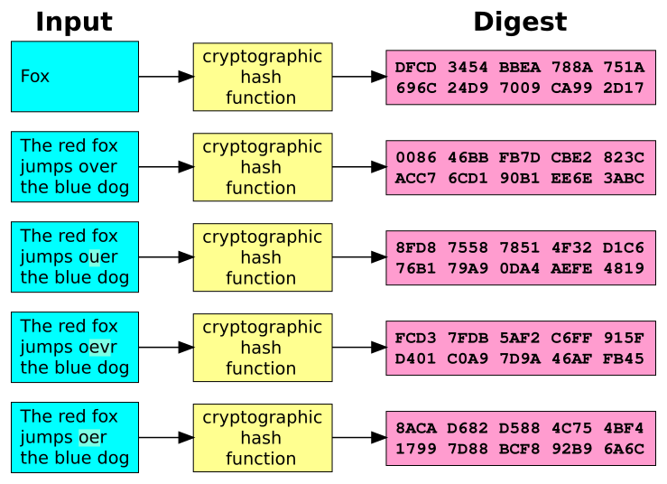<br>*A hash function: any input gives a fixed-size digest, and one changed letter gives a completely different digest. Source: Wikimedia Commons.*

<p class="label">Exam notes</p>

| | Encoding | Hashing | Encryption |
|---|---|---|---|
| Purpose | Change format | Fingerprint, verify | Keep secret |
| Reversible? | Yes, by anyone | <mark>**No** (one-way)</mark> | <mark>Yes, **with the key**</mark> |
| Key? | No | No (a salt for passwords) | Yes |
| Examples | Base64, URL encoding | SHA-256; **bcrypt, Argon2** for passwords | **AES**, **RSA** |
| Use | Send binary as text | Password storage, file integrity | Data at rest and in transit |

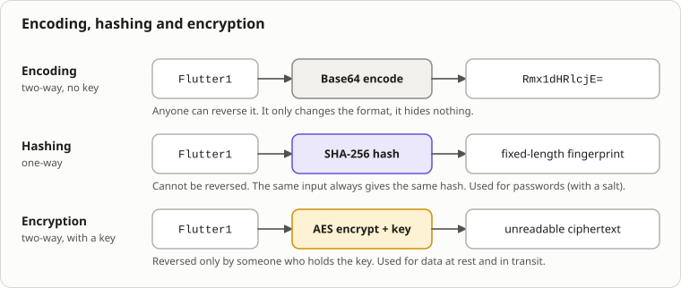

<mark>**Passwords are hashed with a salt, never encrypted and never stored as plain text.**</mark> <mark>A **salt** is a random value added before hashing</mark> so equal passwords give different hashes.

<div class="box q">

**Why are passwords hashed and not encrypted?**

Encrypted data can be unlocked by anyone who steals the key, and then every password is open. A hash cannot be reversed, so even the server does not know your password. At login the server hashes what you typed and compares the two hashes.

</div>

<div class="box rule">

**Remember.** Encoding = reversible by anyone. Hashing = one-way. Encryption = reversible with the key. Passwords are hashed with a salt.

</div>

## 3. Symmetric vs asymmetric encryption, and TLS

<div class="box def">

**Definition.** **Symmetric** encryption uses **one** key to lock and to unlock. **Asymmetric** encryption uses a **pair** of keys: what one key locks, only the other key can open.

</div>

<div class="box story">

**Example scenario.** Imagine you want people to send you secret letters.

1. **Symmetric:** you and your friend each hold a copy of the same key. Fast and simple. But how do you give him the key safely the first time?
2. **Asymmetric:** you hand out open **padlocks** to everyone (your **public key**). Anyone can snap a padlock shut on a box. Only you have the key that opens it (your **private key**).

**What does HTTPS do?** It uses both. First the padlock trick, to agree on a shared key safely. Then the fast shared key for all the data.

</div>

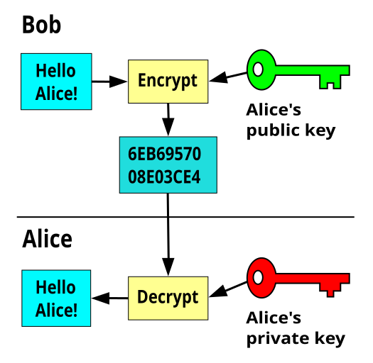<br>*Bob encrypts with Alice's public key. Only Alice's private key can decrypt. Source: Wikimedia Commons.*

<p class="label">Exam notes</p>

| | Symmetric | Asymmetric |
|---|---|---|
| Keys | <mark>**One** shared secret key</mark> | <mark>A **pair**: public key and private key</mark> |
| Speed | Fast | Slow |
| Examples | **AES-256**, ChaCha20 | **RSA**, ECC |
| Problem | How to share the key safely | Too slow for large data |
| Use | Encrypting the database and files | Key exchange, **digital signatures** |

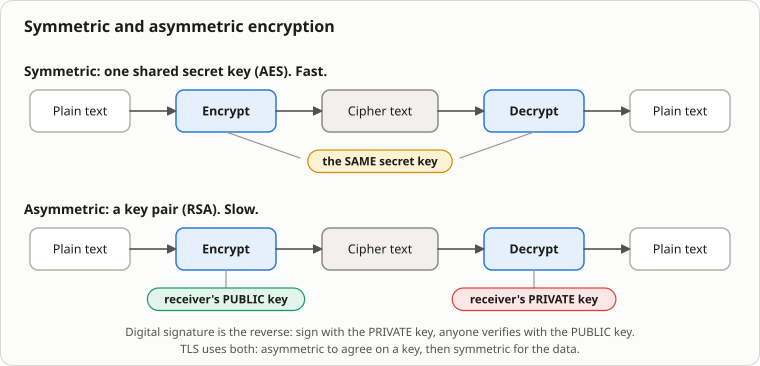

**Digital signature:** <mark>the sender signs a hash with the **private key**; anyone checks it with the **public key**</mark>. It proves who sent it and that it was not changed. JWTs and app code signing both use this.

<mark>**HTTPS / TLS uses both:**</mark> asymmetric cryptography to verify the server's **certificate** and agree on a session key, then fast symmetric encryption (AES) for the data.

<mark>**Man-in-the-middle (MITM) attack:**</mark> an attacker sits between app and server and reads or changes traffic. Defences: HTTPS only, certificate validation, and <mark>**certificate pinning** (the app accepts only a known certificate or public key)</mark>. Pinning's cost: the app must be updated or carry backup pins when the certificate changes.

<div class="box q">

**What is a digital signature?**

It is the padlock trick in reverse. You lock a fingerprint (hash) of the document with your **private** key. Anyone can open it with your **public** key. If it opens and the fingerprint matches, the document really came from you and nobody changed it. JWTs and app code signing both work this way.

</div>

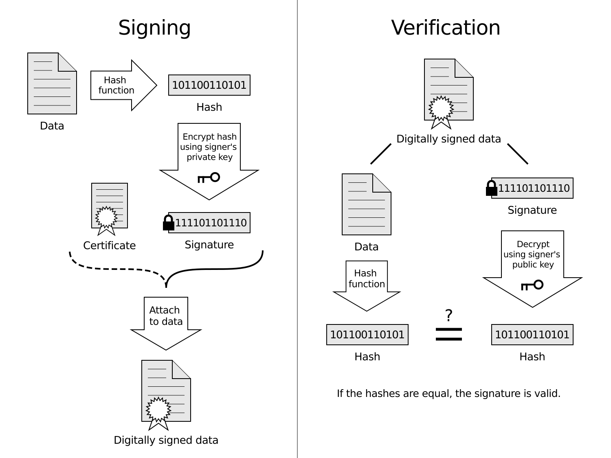<br>*Signing: hash the data, encrypt the hash with the private key. Verification: decrypt with the public key and compare the two hashes. Source: Wikimedia Commons.*

<div class="box rule">

**Remember.** Symmetric = one key, fast (AES). Asymmetric = key pair, slow (RSA). TLS uses asymmetric to share a key, then symmetric for the data. Sign with the private key, verify with the public key.

</div>

<div class="box check">

**Quick check**

1. Which algorithm is symmetric? (a) RSA (b) AES (c) ECC
2. To check a signature you need the signer's: (a) private key (b) public key
3. What attack does certificate pinning stop?

<details>
<summary>Show answers</summary>

1. **(b) AES.**
2. **(b) the public key.**
3. A man-in-the-middle attack that uses a fake or user-installed certificate.

</details>

</div>

## 4. Session vs token authentication

<div class="box def">

**In simple words.** After login, the server must recognise you on every later request. There are two ways. With a **session**, the server keeps a list of who is logged in. With a **token**, the server gives you a signed pass and keeps no list.

</div>

| | Session (cookie) | Token (JWT) |
|---|---|---|
| State | Server stores the session | <mark>**Stateless**: the token carries the data</mark> |
| Sent as | Cookie | `Authorization: Bearer <token>` header |
| Scaling | Needs a shared session store | Any server can verify the token |
| Fit | Traditional websites | **Mobile apps, APIs, microservices** |
| Revoke | Easy (delete the session) | Hard before expiry, so keep tokens short-lived |

## 5. JWT (JSON Web Token)

<div class="box def">

**Definition.** A **JWT** (JSON Web Token) is a small signed text that says who the user is and what they may do. The app sends it with every request. The server checks the signature and trusts what is written inside.

</div>

<div class="box story">

**Example scenario.** Imagine an office ID card.

1. Your name, your role and an expiry date are **printed on the front**. Anyone who picks up the card can read them.
2. The card carries an official **stamp**. If someone scratches out "Officer" and writes "Manager", the stamp no longer matches and the guard rejects the card.

**What does this teach?** A JWT is **readable by everyone** but **cannot be changed**. So never write a secret on it, and always check the stamp (the signature).

</div>

<p class="label">Exam notes</p>

A compact, signed token with three Base64URL parts joined by dots:

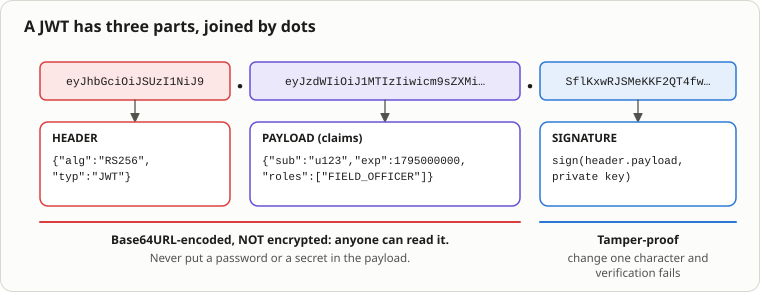

| Part | Holds |
|---|---|
| **Header** | Algorithm (`HS256`, `RS256`) and type |
| **Payload** | **Claims**: <mark>`iss` (issuer), `sub` (subject = user ID), `aud` (audience), `exp` (expiry), `iat` (issued at)</mark>, plus custom claims such as roles |
| **Signature** | Proves the token came from the issuer and was not changed |

- <mark>The payload is **encoded, not encrypted**. Anyone can read it. **Never put passwords or secrets in it.**</mark>
- The signature makes it **tamper-proof**: changing one character makes verification fail.
- <mark>**HS256** = one shared secret (symmetric). **RS256** = private key signs, public key verifies</mark> (asymmetric; used by Keycloak).

**Access token and refresh token**
| | Access token | Refresh token |
|---|---|---|
| Purpose | Sent with every API call | Gets a new access token |
| Lifetime | <mark>Short (5–15 minutes)</mark> | <mark>Long (days or weeks)</mark> |
| Sent to | Resource servers (APIs) | **Only** the auth server's token endpoint |
| If stolen | Limited damage (expires soon) | Serious, so store in Keystore/Keychain and <mark>use **rotation**</mark> (each use issues a new one and cancels the old) |

**Refresh flow in the app:** API returns **401** → the interceptor calls the token endpoint with the refresh token → saves the new tokens → <mark>**repeats the original request**</mark>. If the refresh also fails, clear the tokens and go to login.

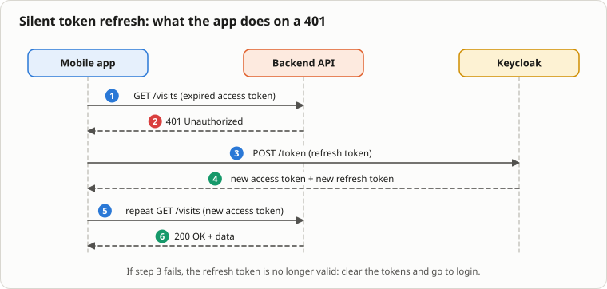

<div class="box q">

**Why two tokens? Why not one token that lasts a month?**

Because the access token travels with every request, so it is the one most likely to be stolen. If it lived for a month, a thief could use it for a month. So it lives for minutes. The **refresh token** lives longer, but it is sent to only one place, the login server, and it stays in the phone's secure storage.

</div>

```dart
class AuthInterceptor extends QueuedInterceptor {     // queued: only one refresh at a time
  @override
  void onRequest(RequestOptions options, RequestInterceptorHandler handler) async {
    final token = await storage.read(key: 'access_token');
    if (token != null) options.headers['Authorization'] = 'Bearer $token';
    handler.next(options);
  }

  @override
  void onError(DioException err, ErrorInterceptorHandler handler) async {
    if (err.response?.statusCode == 401 && await _refreshTokens()) {
      return handler.resolve(await dio.fetch(err.requestOptions));   // retry once
    }
    handler.next(err);                                               // refresh failed → logout
  }
}
```

<div class="box rule">

**Remember.** JWT = header.payload.signature. Signed, **not** encrypted. Access token: short life, sent to the APIs. Refresh token: long life, sent only to the auth server.

</div>

<div class="box check">

**Quick check**

1. Can someone who steals a JWT read the payload? (a) yes (b) no, it is encrypted
2. The API answers 401. What does the app do first?
3. Which claim holds the expiry time? (a) `iss` (b) `sub` (c) `exp`

<details>
<summary>Show answers</summary>

1. **(a) yes.** It is only Base64URL-encoded.
2. It calls the token endpoint with the refresh token, then repeats the request.
3. **(c) `exp`.**

</details>

</div>

## 6. OAuth 2.0

<div class="box def">

**Definition.** **OAuth 2.0** is a standard way to let an app act for a user **without the app ever seeing the user's password**. The user logs in on the login server's own page. The app receives only tokens.

</div>

<div class="box story">

**Example scenario.** Imagine a hotel.

1. You show your passport at the **reception** (the authorization server, here Keycloak). You do not show it to the cleaner, the waiter or the gym.
2. Reception gives you a **key card** (the access token). It opens your room and the gym, and it stops working after checkout.
3. Every door (each API) only checks the key card. No door ever sees your passport.

**What is the benefit?** Only one place handles the password. If the mobile app is hacked, the thief gets a short-lived key card, not the passport.

</div>

<p class="label">Exam notes</p>

<mark>**OAuth 2.0 is an authorization framework**</mark>: it lets an app get **limited access** to a user's resources <mark>**without ever seeing the user's password**</mark>. The user logs in at the authorization server; the app receives tokens.

**Four roles**
| Role | In the NGO's case |
|---|---|
| **Resource Owner** | The user (a field officer) |
| **Client** | The mobile app |
| **Authorization Server** | **Keycloak** |
| **Resource Server** | The NGO's backend APIs |

**Grant types (flows)**
| Grant | Used for |
|---|---|
| **Authorization Code + PKCE** | <mark>**Mobile and single-page apps. The correct one for you.**</mark> |
| Client Credentials | Server-to-server (no user) |
| Refresh Token | Getting new access tokens |
| Device Code | TVs and devices without a keyboard |
| Implicit, Password (ROPC) | <mark>**Deprecated; do not use**</mark> |

### Authorization Code flow with PKCE (learn this diagram)

<div class="box story">

**Example scenario for PKCE.** Imagine a cloakroom.

1. Before you hand in your coat, you tear a banknote in two. You show the attendant **one half** and keep the other half in your pocket. *(The app sends the `code_challenge` and keeps the `code_verifier`.)*
2. The attendant gives you a **ticket**. *(The authorization code.)*
3. A thief steals the ticket and goes to collect the coat.
4. The attendant says: "Show me the other half of the banknote." The thief does not have it. *(No `code_verifier`, so no tokens.)*

</div>

<mark>A mobile app is a **public client**: it cannot keep a client secret</mark>, because the app can be decompiled. <mark>**PKCE** (Proof Key for Code Exchange, said "pixy")</mark> replaces the secret with a one-time proof.

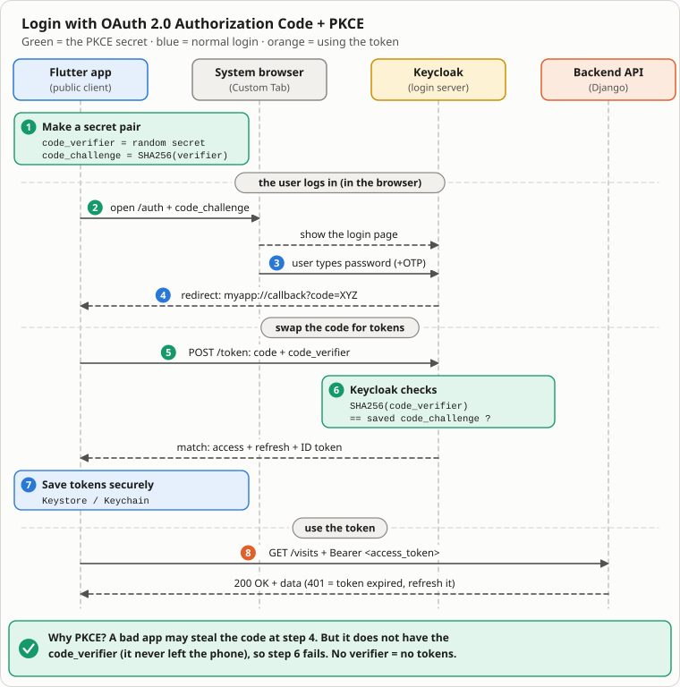

**Why PKCE works:** if a malicious app steals the authorization **code** from the redirect, <mark>it still cannot exchange it, because it does not have the **code_verifier**</mark>.

**Mobile rules:** use the **system browser** (Chrome Custom Tabs, `ASWebAuthenticationSession`), <mark>**not a WebView**</mark> (a WebView lets the app read the password and breaks SSO); redirect by app link or custom scheme; Flutter package: **`flutter_appauth`**.

<div class="box q">

**Why must login open in the system browser and not in a WebView inside the app?**

In a WebView the app can read everything the user types, including the password. That breaks the main promise of OAuth. The system browser is separate from the app, and it also remembers the login for other apps, which gives single sign-on.

</div>

<div class="box rule">

**Remember.** OAuth 2.0 = authorization without sharing the password. Mobile apps use **Authorization Code + PKCE**. PKCE replaces the client secret, because an app cannot keep a secret.

</div>

## 7. OpenID Connect (OIDC)

<div class="box def">

**In simple words.** OAuth 2.0 gives the app a key card but does not say whose it is. **OpenID Connect (OIDC)** adds an **ID token**: a small signed card with the user's name and ID. So OAuth is about access, and OIDC adds identity.

</div>

OAuth 2.0 only says what the app may **access**. <mark>**OIDC is an identity layer on top of OAuth 2.0** that says **who the user is**</mark>.

| | OAuth 2.0 | OpenID Connect |
|---|---|---|
| Purpose | **Authorization** | **Authentication** |
| Token | Access token | <mark>Adds an **ID token** (a JWT with the user's identity)</mark> |
| Extras | — | `openid` scope, `/userinfo` endpoint, discovery document |

One line: <mark>**"OAuth2 gives the key to the room; OIDC tells you who is holding the key."**</mark>

### Example: "Sign in with Google" uses both

When a user taps **Sign in with Google**, OAuth 2.0 and OIDC work **together in one flow**. The app asks for the scope <mark>`openid email profile`</mark>. The word `openid` switches OIDC on, so Google returns **two tokens**:

| | **ID token** | **Access token** |
|---|---|---|
| Comes from | <mark>**OIDC**</mark> (the authentication part) | <mark>**OAuth 2.0**</mark> (the authorization part) |
| Answers | <mark>**Who** logged in?</mark> | <mark>**What** may the app access?</mark> |
| Format | <mark>**Always a JWT**</mark> (the OIDC rule) | Not fixed: Google's is **opaque** (a random string); Keycloak's is a JWT |
| Meant for | **The app** (and your own backend, to verify the login) | **An API** (sent as `Authorization: Bearer …`), such as Google Drive |
| Inside | Claims: `sub` (Google user ID), `email`, `name`, `picture`, `iss`, `aud`, `exp` | Scopes: what the app is allowed to do |

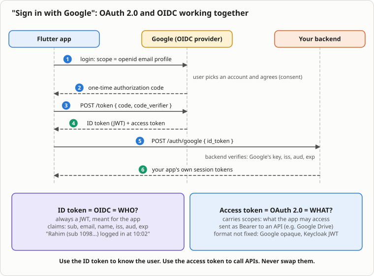

**Who makes the JWT?** <mark>Google's **authorization server** creates and signs the ID token</mark>. OIDC is the **standard** that defines the ID token and says it must be a JWT. So "OIDC makes the JWT" is close but not exact. Write it as "**the OIDC provider issues an ID token, which is a JWT**".

**Steps:**
1. The app starts login with scope `openid email profile` (Flutter: `google_sign_in`, or `flutter_appauth` with PKCE).
2. The user picks a Google account and agrees (consent).
3. Google returns a one-time code, and the app exchanges it at `/token`.
4. The app receives an **ID token (JWT)** plus an **access token**.
5. The app sends the **ID token** to its own backend. The backend **verifies** it: <mark>the signature with Google's public keys, `iss` = accounts.google.com, `aud` = your app's client ID, `exp` not passed</mark>.
6. The backend finds or creates the user by `sub` and returns **its own** session tokens (or JWT).

**A decoded ID token payload looks like this:**
```json
{
  "iss": "https://accounts.google.com",
  "sub": "109876543210987654321",
  "aud": "1234-abc.apps.googleusercontent.com",
  "email": "rahim@example.com",
  "name": "Rahim Uddin",
  "iat": 1795000000,
  "exp": 1795003600
}
```

**Two common mistakes:**
- <mark>Using the **access token** to identify the user.</mark> It only says what may be accessed. Use the ID token.
- <mark>Sending the **ID token** as a Bearer token to call APIs.</mark> Use the access token.
- Also: never trust an ID token the backend has not verified. Anyone can create a fake JSON.

**Same pattern with Keycloak:** Keycloak is also an OIDC provider, so the NGO's login works the same way. The difference is that Keycloak's access token is also a JWT, carrying roles for RBAC (section 9).

**Exam line:** <mark>"In Sign in with Google, **OAuth 2.0** handles **authorization** and issues the **access token**; **OIDC**, built on top, handles **authentication** and adds the **ID token**, a signed **JWT** that tells the app **who** logged in."</mark>

## 8. SSO (Single Sign-On)

<div class="box def">

**Definition.** **Single Sign-On (SSO)** means the user logs in **once** and can then use **many** applications without logging in again.

</div>

<div class="box story">

**Example scenario.** Imagine an NGO field officer on Monday morning.

1. She opens the field app and logs in with her password and an OTP.
2. She opens the reporting app. It opens directly. No password.
3. She opens the web portal. It opens directly too.
4. On Friday she leaves the organisation. The administrator disables her account in **one** place, and all three applications are closed to her.

**What made this possible?** All three trust the same **identity provider**. They ask it "is she logged in?" instead of keeping their own passwords.

</div>

<mark>The user logs in **once** and gets access to **many applications** without logging in again</mark>. Each app trusts one central <mark>**identity provider (IdP)**</mark>.

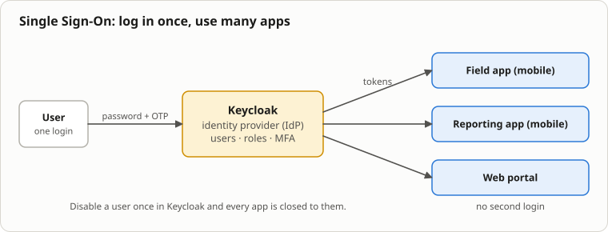

- Benefits: one password, central control of users and MFA, one place to disable a staff member who leaves, consistent audit logs.
- Risk: <mark>the IdP is a single point of failure</mark> and a high-value target, so it needs MFA and high availability.
- Protocols: **OIDC / OAuth2** (modern, mobile) and <mark>**SAML 2.0** (XML, older enterprise web apps)</mark>.
- **Single logout:** logging out of the IdP ends the sessions of all apps.

<div class="box rule">

**Remember.** SSO = one login, many apps, one identity provider. Good: one password, one place to disable. Risk: the provider is a single point of failure.

</div>

## 9. Keycloak

<div class="box def">

**Definition.** **Keycloak** is a free, open-source login server. It stores the users, shows the login page, checks passwords and OTPs, and issues the tokens. Your apps do not build their own login. They send the user to Keycloak.

**Its purpose** is to give an organisation SSO on its **own servers**.

</div>

<div class="box story">

**Example scenario.** Imagine setting up Keycloak for the NGO.

1. The administrator creates a **realm** called `ngo`: one closed world of users.
2. In the realm he registers each application as a **client**: the field app, the web portal.
3. He creates **roles**: `FIELD_OFFICER`, `SUPERVISOR`.
4. He creates **users** and gives each one a role.
5. An officer logs in. Keycloak puts her role inside the token. The API reads the role and decides what she may do.

</div>

<p class="label">Exam notes</p>

<mark>**Keycloak is an open-source Identity and Access Management (IAM) server.**</mark> It provides SSO, user management and token issuing, so applications do not write their own login systems. It supports <mark>**OpenID Connect, OAuth 2.0 and SAML 2.0**</mark>, and it can be **self-hosted** (important for an organisation that keeps data on its own servers).

| Keycloak term | Meaning |
|---|---|
| **Realm** | <mark>An isolated space of users, roles and clients</mark> (for example an `ngo` realm) |
| **Client** | An application registered to use Keycloak (the mobile app is a **public** client with PKCE) |
| **User** | A person who can log in |
| **Role** | A permission label. <mark>**Realm roles** are global; **client roles** belong to one app</mark> |
| **Group** | A set of users sharing roles and attributes |
| **Identity Provider (brokering)** | Log in through another IdP (Google, another organisation) |
| **User Federation** | <mark>Read users from **LDAP / Active Directory**</mark> |
| **Authentication flow** | Configurable login steps: password, **OTP/MFA**, required actions |
| **Client scope / mapper** | Controls which claims go into the tokens |

**Features to list:** SSO and single logout, MFA (OTP), social login, user federation, fine-grained roles (RBAC), admin console, login-page themes, brute-force protection, password policies, session management, events and audit logs.

**Endpoints** (found through `/realms/{realm}/.well-known/openid-configuration`): `/protocol/openid-connect/auth`, `/token`, `/userinfo`, `/logout`.

**Mobile app + Keycloak, step by step:**
1. An admin creates the realm, a **public client** for the app (redirect URI, PKCE required), roles and users.
2. The app starts Authorization Code + PKCE with `flutter_appauth` → Keycloak's login page opens in the system browser.
3. The user logs in (plus OTP if MFA is on).
4. The app receives **access, refresh and ID tokens** and stores them in **secure storage**.
5. Every API call carries the access token. The backend API <mark>verifies the **signature with Keycloak's public key**</mark> and reads the roles (`realm_access.roles`) to enforce RBAC.
6. On 401 the app refreshes silently. On logout it calls the end-session endpoint and wipes local tokens.

**RBAC in the app:** read roles from the token to **show or hide** menus and buttons (field officer, supervisor, manager). This is only for a good user experience. <mark>**The server must check the role on every request**, because a client can be modified.</mark>

<div class="box rule">

**Remember.** Keycloak = open-source IAM server. Realm = a space of users. Client = an app. Role = a permission label. It speaks OIDC, OAuth 2.0 and SAML.

</div>

<div class="box check">

**Quick check**

1. In Keycloak, the mobile app is registered as a: (a) realm (b) client (c) role
2. Which protocol adds the ID token? (a) OAuth 2.0 (b) OIDC (c) SAML
3. Hiding a button in the app is enough to protect a manager-only action. True or false?

<details>
<summary>Show answers</summary>

1. **(b) client**, a public client with PKCE.
2. **(b) OIDC.**
3. **False.** The server must check the role on every request, because an app can be modified.

</details>

</div>

## 10. Biometric login

<div class="box def">

**Definition.** **Biometric login** lets the user open the app with a fingerprint or face. The check is done by the **operating system**. The app never receives the fingerprint. It only hears "yes" or "no".

</div>

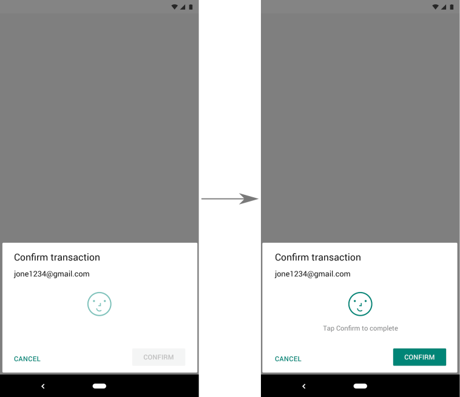<br>*The system's own biometric prompt slides up over the app. The app cannot see what the sensor reads. Source: Android Developers.*

<div class="box story">

**Example scenario.** Imagine a locker with a fingerprint door.

1. On the first day you log in the normal way, with password and OTP. The app receives a refresh token.
2. The app puts the refresh token **inside the locker** (Keystore or Keychain) and tells the locker: "open only for her fingerprint".
3. Next morning she touches the sensor. The locker opens and hands the token to the app.
4. The app uses the token to get a fresh access token. She is in.

**What is the fingerprint, then?** It is not the login. It is the key to the locker where the login is kept.

</div>

<p class="label">Exam notes</p>

**What it is:** fingerprint or face recognition handled by the **operating system**. <mark>The app **never receives the fingerprint**</mark>; it only gets success or failure, or the release of a protected key. Biometric data stays in secure hardware <mark>(**TEE / Secure Enclave**)</mark>.

| | Android | iOS | Flutter |
|---|---|---|---|
| API | <mark>**BiometricPrompt**</mark> | <mark>**LocalAuthentication** (`LAContext`)</mark>, Face ID / Touch ID | **`local_auth`** |
| Setup | `USE_BIOMETRIC` permission | `NSFaceIDUsageDescription` in Info.plist | Both |
| Key storage | **Android Keystore** | **Keychain** + Secure Enclave | `flutter_secure_storage` |

<mark>**The right design (biometric is a convenient unlock, not a replacement for server login):**</mark>
1. **First login:** username + password (+ OTP) at Keycloak → tokens.
2. The app asks, "Enable fingerprint login?" If yes, the refresh token is stored in Keystore/Keychain <mark>**protected by biometric authentication**</mark>.
3. **Next launch:** biometric prompt → success → the OS releases the refresh token → the app gets a new access token → home screen.
4. **Fallback:** device PIN, or full login again. After several failures, or when a new fingerprint is enrolled, require the password.
5. The server can still revoke the session at any time.

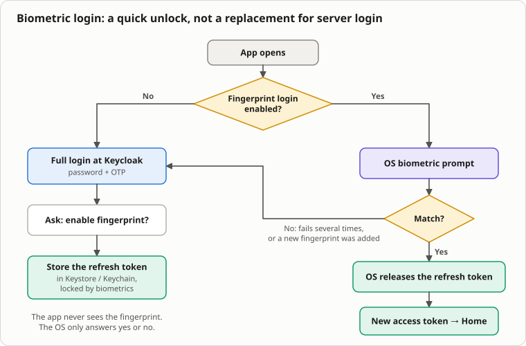

```dart
final auth = LocalAuthentication();
if (await auth.canCheckBiometrics && await auth.isDeviceSupported()) {
  final ok = await auth.authenticate(
    localizedReason: 'Confirm your fingerprint to open the Field App',
    options: const AuthenticationOptions(biometricOnly: true, stickyAuth: true),
  );
  if (ok) { /* read the refresh token from secure storage, then refresh */ }
}
```
**Weak design to avoid:** saving the password in plain storage and using biometrics as an `if (ok)` gate only. A rooted device can skip that check. Binding a Keystore key to biometric authentication is stronger.

<div class="box q">

**What happens if the fingerprint fails?**

After a few wrong tries the system stops the prompt. The app then offers the device PIN or the full login. If a **new** fingerprint is added to the phone, the protected key is cancelled, and the user must log in with the password again.

</div>

<div class="box rule">

**Remember.** The OS checks the biometric. The app never sees it. Biometric = a quick unlock of a stored token, never a replacement for the server login.

</div>

## 11. Secure storage and local data encryption

<div class="box def">

**In simple words.** Data is in danger in two places: while it **travels** on the network (*in transit*) and while it **sits** on the phone (*at rest*). HTTPS protects the first. This section is about the second.

</div>

<div class="box story">

**Example scenario.** Imagine a field officer loses her phone in a bus. The phone holds borrower records for offline work.

1. A thief connects the phone to a computer and copies the app's database file.
2. **If the database is plain SQLite:** he opens the file and reads every record.
3. **If the database is encrypted with SQLCipher:** the file is unreadable noise. The key is locked inside the phone's secure hardware and cannot be copied out.
4. Meanwhile the administrator disables her session on the server.

**What saved the data?** Encryption at rest, a key kept in the Keystore or Keychain, and a session that can be cancelled.

</div>

<p class="label">Exam notes</p>

<mark>**Data at rest** (stored on the device) vs **data in transit** (moving over the network)</mark>. HTTPS covers transit. This section covers rest.

| What | Where to keep it | Never |
|---|---|---|
| Access/refresh tokens, DB encryption key | **Android Keystore** / **iOS Keychain**, through `flutter_secure_storage` | SharedPreferences, plain files, source code |
| Business records | **Encrypted database**: <mark>SQLite + **SQLCipher** (AES-256)</mark>; Hive `HiveAesCipher`; Realm/Isar encryption | Plain SQLite for sensitive data |
| Photos, documents | App-private storage; encrypt sensitive files with AES | Public gallery or shared storage |
| Passwords | <mark>**Do not store them at all**</mark> | Anywhere |

**How database encryption works:** generate a random 256-bit key on first run → store the key in Keystore/Keychain (hardware-backed, not extractable) → open the SQLCipher database with that key. <mark>A copied database file is useless without the key.</mark>

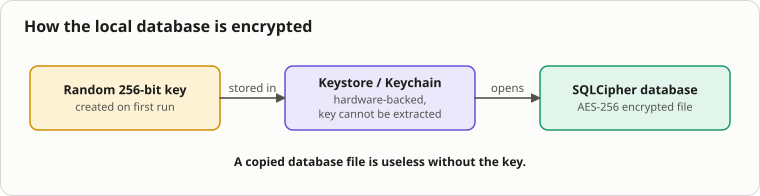

**Keystore and Keychain:** system services that keep cryptographic keys in secure hardware. The key material is not exposed to the app's memory; the app asks the system to use it.

<div class="box rule">

**Remember.** Tokens and keys → Keystore / Keychain. Records → encrypted database (SQLCipher, AES-256). Passwords → not stored at all.

</div>

## 12. Other mobile security controls (a ready list)

<div class="box def">

**In simple words.** No single lock is enough. Good security puts several different locks one behind another, so a thief who breaks one still meets the next. This is **defence in depth**.

</div>

- **Code obfuscation:** `flutter build apk --obfuscate --split-debug-info=<dir>`; R8/ProGuard on Android.
- **Root / jailbreak detection**; **Play Integrity API** and **App Attest** to confirm a genuine app on a genuine device.
- **Session timeout / auto-lock** after inactivity; re-authenticate for sensitive actions (approving a loan).
- **Screenshot blocking** on sensitive screens (`FLAG_SECURE`); hide content in the app switcher.
- **No sensitive data in logs**, crash reports, notifications or the clipboard.
- **Input validation**; parameterised queries (Drift and Room do this) to stop SQL injection.
- **Minimum permissions**, requested at the time of use.
- **Logout:** revoke tokens on the server and wipe local tokens and cache.
- **Lost device:** the server disables the session; a short token life limits damage.
- **Audit trail:** log who did what, when, from which device.
- **Keep dependencies and OS targets updated**; VAPT before release.

<mark>**Defence in depth:** no single control is enough.</mark> Layers: device (biometric, encryption) → app (obfuscation, validation) → network (TLS, pinning) → server (auth, RBAC, rate limiting, audit).

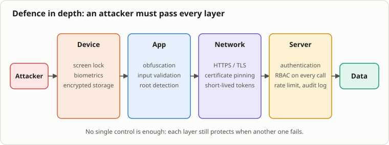

## Link it to your own projects

Interviews and written exams reward answers that use **your own work** as the example. Before you move on, answer these for yourself:

<div class="box you">

- How did your apps log in? Where was the token stored? What happened when it expired?
- Have you added biometric login? Explain who checks the fingerprint (the OS, not your app or your server).
- Take one of your apps through the checklist in section 12. What would you change?

</div>

---

## Practice questions

**Short (2–3 marks each)**
1. Authentication vs authorization.
2. Hashing vs encryption. Which is used for passwords and why?
3. Symmetric vs asymmetric encryption, with one example each.
4. What are the three parts of a JWT? Is the payload encrypted?
5. Access token vs refresh token.
6. What is PKCE and why does a mobile app need it?
7. OAuth 2.0 vs OpenID Connect.
8. What is SSO? Give two benefits.
9. In Keycloak, what are a realm, a client and a role?
10. Where should a mobile app store tokens? Where should it not?
11. What is certificate pinning?

**Long (10–12 marks each)**

12. Explain, with a sequence diagram, how a Flutter app logs in through Keycloak SSO using OAuth 2.0 Authorization Code flow with PKCE, and how it uses and refreshes the tokens.
13. Design a biometric login feature for a field app. Explain the flow, where secrets are stored, and what happens when the biometric check fails.
14. A field officer's phone holds borrower and financial data offline. Describe all the measures you take to protect this data on the device and in transit.

---

## Model answers

<div class="box exam">

**How to read these answers.** They are written for **learning**, so they are fuller than what you would write in the exam hall. Every answer has the same parts:

- **In short** (green): the direct answer. In the exam, write this part first.
- **Table or points:** the details, laid out so you can compare and remember them.
- **Example** (yellow): a real situation, usually from a field app or from your own projects.
- Long answers end with **In the exam** (brown): how to shorten the answer on paper.

Write your own answer first. Then open the model answer and compare.

</div>

<details>
<summary>1. Authentication vs authorization.</summary>

<div class="box def">

**In short.** **Authentication** checks **who you are**. **Authorization** decides **what you are allowed to do**. Authentication always comes first.

</div>

| Point | Authentication (AuthN) | Authorization (AuthZ) |
|---|---|---|
| **Question** | "Who are you?" | "What may you do?" |
| **Checked with** | Password, OTP, fingerprint, token | Roles, permissions, policies |
| **Order** | First | After authentication |
| **Who decides** | The identity provider (Keycloak) | The backend API, for each request |
| **When it fails** | <mark>**401** Unauthorized</mark> | <mark>**403** Forbidden</mark> |
| **Standard** | OpenID Connect | OAuth 2.0, RBAC |
| **Daily life** | Showing your ID card at the gate | Your card opens only some doors |

<div class="box story">

**Example.** A field officer logs in with her username, password and OTP: authentication. Inside the app she can enter visits but cannot approve a loan, because her role is `field_officer` and not `branch_manager`: authorization. The app hides the Approve button, and the server also refuses the request, because hiding a button is not security.

</div>

<div class="ref">

**From the book:** [1. Basic terms](#1-basic-terms)

</div>

</details>

<details>
<summary>2. Hashing vs encryption. Which is used for passwords and why?</summary>

<div class="box def">

**In short.** **Hashing** is **one-way**: you cannot get the input back, and there is no key. **Encryption** is **two-way**: with the key you can get the data back. Passwords are **hashed with a salt**, so nobody can recover them, not even the server.

</div>


| Point | Encoding | Hashing | Encryption |
|---|---|---|---|
| **Purpose** | Change the format | Fingerprint of the data; check integrity | Keep data secret |
| **Reversible?** | Yes, by anyone | <mark>No</mark> | Yes, with the key |
| **Key** | None | None | Yes |
| **Output size** | Grows with the input | Fixed (SHA-256 gives 256 bits) | About the input size |
| **Examples** | Base64, URL encoding | SHA-256; for passwords **bcrypt**, **Argon2**, PBKDF2 | **AES**, **RSA** |
| **Is it security?** | No | Yes (integrity) | Yes (confidentiality) |

#### Why passwords are hashed

1. At sign-up, the server makes a random **salt**, hashes `password + salt`, and stores only the hash and the salt.
2. At login, it hashes the typed password with the same salt and **compares the two hashes**.
3. The real password is never stored anywhere.

| Question | Answer |
|---|---|
| **Why not encrypt?** | Whoever steals the key can decrypt every password. A hash has no key to steal |
| **Why a salt?** | Two users with the same password get different hashes. Ready-made "rainbow tables" stop working |
| **Why bcrypt or Argon2, not plain SHA-256?** | They are **slow on purpose**, so guessing billions of passwords takes too long |

<div class="box story">

**Example.** A database backup leaks. With hashed and salted passwords the thief sees only values like `$2b$12$Kix...`, and cannot log in with them. With encrypted passwords, one leaked key opens them all. With plain text, every account is lost at once.

</div>

<div class="ref">

**From the book:** [2. Encoding vs hashing vs encryption](#2-encoding-vs-hashing-vs-encryption)

</div>

</details>

<details>
<summary>3. Symmetric vs asymmetric encryption, with one example each.</summary>

<div class="box def">

**In short.** **Symmetric** encryption uses **one shared key** to lock and unlock (example: **AES-256**). **Asymmetric** encryption uses a **key pair**: the public key locks, the private key unlocks (example: **RSA**).

</div>


| Point | Symmetric | Asymmetric |
|---|---|---|
| **Keys** | One secret key | A pair: public + private |
| **Encrypt / decrypt** | The same key | Public key encrypts, private key decrypts |
| **Speed** | Fast | Slow (often 100 to 1000 times slower) |
| **Good for** | Large data | Small data: keys, signatures |
| **Main problem** | How to share the key safely | Speed |
| **Examples** | AES, ChaCha20 | RSA, ECC (elliptic curve) |
| **Also used for** | — | **Digital signatures**: sign with the private key, verify with the public key |
| **On a phone** | The SQLCipher database, encrypted files | The JWT signature (RS256), TLS certificates |

<mark>**TLS (HTTPS) uses both:** asymmetric encryption to agree on a key safely, then symmetric encryption for the data.</mark> That gives the safety of one and the speed of the other.

<div class="box story">

**Example.** The field app encrypts its local database with **AES-256** (symmetric): fast enough for thousands of rows. Keycloak signs each JWT with its **private** RSA key, and the NGO's API checks it with the **public** key. The API never needs Keycloak's secret.

</div>

<div class="ref">

**From the book:** [3. Symmetric vs asymmetric encryption, and TLS](#3-symmetric-vs-asymmetric-encryption-and-tls)

</div>

</details>

<details>
<summary>4. What are the three parts of a JWT? Is the payload encrypted?</summary>

<div class="box def">

**In short.** A JWT (JSON Web Token) is `header.payload.signature`. <mark>The payload is **not encrypted**. It is only Base64URL-encoded</mark>, so anyone can read it. But nobody can change it, because the signature would no longer match.

</div>


| Part | Contains | Example |
|---|---|---|
| **Header** | The token type and the signing algorithm | `{"alg": "RS256", "typ": "JWT"}` |
| **Payload** | The **claims**: facts about the user and the token | `{"sub": "u123", "exp": 1790000000, "roles": ["field_officer"]}` |
| **Signature** | Header + payload, signed with the server's key | Proves who issued it and that it was not changed |

**Claims worth knowing**

| Claim | Meaning |
|---|---|
| `sub` | Subject: the user's ID |
| `iss` | Issuer: who made the token (the Keycloak realm URL) |
| `aud` | Audience: who the token is for |
| `exp` | Expiry time |
| `iat` | Issued at |

**What follows from "not encrypted"**

- Never put a password, an NID or other secrets in the payload.
- Always send the token over **HTTPS**.
- The app may read the payload (for example to show the user's name), but only the **server** can trust it, after checking the signature and `exp`.

<div class="box story">

**Example.** Someone copies a token, pastes it into jwt.io and reads the roles. That is normal and expected. They then change `field_officer` to `admin` and send it to the API. The signature no longer matches, so the API answers 401.

</div>

<div class="ref">

**From the book:** [5. JWT (JSON Web Token)](#5-jwt-json-web-token)

</div>

</details>

<details>
<summary>5. Access token vs refresh token.</summary>

<div class="box def">

**In short.** The **access token** is short-lived and is sent to the API with every request. The **refresh token** is long-lived and is sent only to the auth server, to get a new access token without asking the user to log in again.

</div>

| Point | Access token | Refresh token |
|---|---|---|
| **Purpose** | Proves the right to call an API | Gets a new access token |
| **Lifetime** | Short: 5 to 15 minutes | Long: days or weeks |
| **Sent to** | The resource server (the NGO APIs), on every request | Only the authorization server (Keycloak `/token`) |
| **How it is sent** | `Authorization: Bearer <token>` | In the body of the refresh request |
| **Format** | Usually a JWT | Often an opaque string |
| **If stolen** | Useful for a few minutes only | Dangerous, so it is **rotated** and can be **revoked** |
| **Where the app keeps it** | Memory, or secure storage | <mark>Secure storage only (Keystore / Keychain)</mark> |


**Silent refresh, step by step**

1. The app calls the API. The access token has expired, so the API answers **401**.
2. An interceptor sends the refresh token to Keycloak.
3. Keycloak returns a new access token (and a new refresh token: **rotation**).
4. The interceptor repeats the original request. The user notices nothing.
5. If the refresh also fails, the app clears the tokens and opens the login screen.

**Why two tokens?** A short life limits the damage of a stolen access token. The refresh token keeps the user logged in, so security does not cost convenience.

<div class="box story">

**Example.** A field officer works for eight hours. Her access token expires 30 times, but she logs in only once in the morning. If her phone is reported stolen, the admin revokes her session in Keycloak. The next refresh fails and the app locks.

</div>

<div class="ref">

**From the book:** [5. JWT (JSON Web Token)](#5-jwt-json-web-token)

</div>

</details>

<details>
<summary>6. What is PKCE and why does a mobile app need it?</summary>

<div class="box def">

**In short.** <mark>**PKCE (Proof Key for Code Exchange**, said "pixy")</mark> is an extension of the OAuth 2.0 Authorization Code flow. The app proves, with a one-time secret, that **the app that started the login is the same app that collects the tokens**. A mobile app needs it because it cannot keep a client secret.

</div>

**The two problems on mobile**

| Problem | Why |
|---|---|
| **No safe client secret** | The app can be decompiled, so any secret inside it is public. A mobile app is a **public client** |
| **The redirect can be intercepted** | Another app on the phone could register the same redirect scheme and catch the authorization code |

**How PKCE solves it**

| Step | What the app does | Term |
|---|---|---|
| 1 | Creates a long random string and keeps it in memory | `code_verifier` |
| 2 | Hashes it with SHA-256 and sends the hash when it opens the login page | `code_challenge` |
| 3 | Receives the authorization code after login | `code` |
| 4 | Sends the code **and the original verifier** to the token endpoint | — |
| 5 | The server hashes the verifier and compares it with the stored challenge. If they match, it gives the tokens | — |

<mark>A thief who steals the code still cannot exchange it, because the thief does not have the `code_verifier`.</mark>

<div class="box story">

**The cloakroom picture.** Before handing in your coat, you tear a banknote in two. You show the attendant one half (the challenge) and keep the other (the verifier). You get a ticket (the code). A thief steals the ticket. The attendant says: "Show me the other half of the banknote." The thief does not have it.

</div>

**In Flutter:** the `flutter_appauth` package does PKCE automatically.

<div class="ref">

**From the book:** [Authorization Code flow with PKCE (learn this diagram)](#authorization-code-flow-with-pkce-learn-this-diagram)

</div>

</details>

<details>
<summary>7. OAuth 2.0 vs OpenID Connect.</summary>

<div class="box def">

**In short.** **OAuth 2.0** is for **authorization**: it gives an app an access token to call an API. **OpenID Connect (OIDC)** is a thin **authentication** layer on top of OAuth 2.0: it adds an **ID token** that tells the app who the user is.

</div>

| Point | OAuth 2.0 | OpenID Connect (OIDC) |
|---|---|---|
| **Purpose** | Authorization (delegated access) | Authentication (identity) |
| **Question it answers** | "May this app call this API?" | "Who is the user?" |
| **Main token** | Access token (+ refresh token) | **ID token** (always a JWT), plus the OAuth tokens |
| **The token is for** | The API (resource server) | The app (client) |
| **Extra endpoints** | `/authorize`, `/token` | `/userinfo`, the discovery document (`.well-known/openid-configuration`) |
| **Scope** | Any, for example `visits.read` | Must include `openid`; also `profile`, `email` |
| **Relation** | The base framework | OIDC = OAuth 2.0 + identity |

**A common mistake:** using an OAuth access token as proof of login. OAuth alone does not say who the user is. OIDC was created to fix exactly this.

<div class="box story">

**Example.** A field app logs in through Keycloak. It receives an **ID token** ("this is Fatema, field officer, Rangpur branch"), which the app uses to show her name. It also receives an **access token**, which it sends to the NGO's API. One login, two different jobs. "Sign in with Google" works the same way: it is OIDC.

</div>

<div class="ref">

**From the book:** [7. OpenID Connect (OIDC)](#7-openid-connect-oidc) [6. OAuth 2.0](#6-oauth-20)

</div>

</details>

<details>
<summary>8. What is SSO? Give two benefits.</summary>

<div class="box def">

**In short.** <mark>**SSO (Single Sign-On)**</mark> means the user logs in **once**, at a central identity provider, and can then use **many applications** without logging in again. Two benefits: one set of credentials for the user, and central control for the organisation.

</div>


| Benefit | For whom | Explanation |
|---|---|---|
| **One password** | User | Fewer passwords to remember, fewer weak or reused ones |
| **Faster work** | User | No repeated login screens |
| **Central user management** | IT | Create, change or disable a user in one place |
| **Quick removal of leavers** | IT | Disable one account and every app is closed to that person |
| **One place for MFA and password policy** | Security | A strong policy is applied to all apps at once |
| **One audit trail** | Audit | Who logged in where and when |
| **Less code** | Developers | The apps do not build their own login |

**The risk:** the identity provider is a single point of failure and a high-value target. So it needs MFA, high availability and good monitoring.

**How it works:** the browser keeps a session with the identity provider. When a second app sends the user there, the provider sees the session and returns tokens without asking for the password. This is why mobile apps use the **system browser, not a WebView**, for login.

<div class="box story">

**Example.** An NGO officer logs in to the field app in the morning through Keycloak. Later she opens the NGO's reporting app. It sends her to Keycloak, which already knows her, and she is inside in a second without typing anything. When she leaves the NGO, the admin disables one account.

</div>

<div class="ref">

**From the book:** [8. SSO (Single Sign-On)](#8-sso-single-sign-on)

</div>

</details>

<details>
<summary>9. In Keycloak, what are a realm, a client and a role?</summary>

<div class="box def">

**In short.** A **realm** is a separate space with its own users and settings. A **client** is an application registered to log in through Keycloak. A **role** is a named permission given to users.

</div>

| Term | What it is | Example (an NGO) |
|---|---|---|
| **Realm** | An isolated tenant with its own users, roles, clients and login settings. Realms do not see each other | An `ngo` realm for all the NGO's staff and apps |
| **Client** | An application that asks Keycloak to authenticate users | `field-app` (the mobile app, a **public** client with PKCE), `field-api` (the backend) |
| **Role** | A named permission. It is placed in the token for RBAC | `field_officer`, `branch_manager`, `admin` |

**More Keycloak words**

| Term | Meaning |
|---|---|
| **User** | A person who can log in |
| **Group** | A set of users that share roles ("Rangpur branch") |
| **Realm role / client role** | A role for the whole realm, or for one client only |
| **Client scope** | Which claims go into the token |
| **Identity provider** | An outside login, such as Google or Active Directory |
| **User federation** | Reading users from LDAP or Active Directory |

**What Keycloak is:** an open-source **identity and access management** server. It speaks **OpenID Connect, OAuth 2.0 and SAML**, and gives SSO, MFA, a login page and an admin console without custom code.

<div class="box story">

**Example.** Fatema logs in to the `field-app` client in the `ngo` realm. Her access token contains `"roles": ["field_officer"]`. The API reads the role and lets her create visits, but refuses loan approval. This is role-based access control (RBAC).

</div>

<div class="ref">

**From the book:** [9. Keycloak](#9-keycloak)

</div>

</details>

<details>
<summary>10. Where should a mobile app store tokens? Where should it not?</summary>

<div class="box def">

**In short.** Store tokens in the **Android Keystore** or **iOS Keychain**, through `flutter_secure_storage`. Never store them in SharedPreferences, UserDefaults, plain files, an unencrypted database, logs or source code.

</div>

| Where | Safe? | Why |
|---|---|---|
| **Android Keystore** (through `flutter_secure_storage`) | ✅ Yes | The key lives in secure hardware (TEE / StrongBox) and cannot be exported |
| **iOS Keychain** (through `flutter_secure_storage`) | ✅ Yes | Encrypted by the OS, protected by the Secure Enclave |
| **In memory only** | ✅ For the access token | Gone when the app closes |
| **SharedPreferences / UserDefaults** | ❌ No | Plain text files; readable on a rooted phone or from a backup |
| **A plain file or unencrypted SQLite** | ❌ No | The same problem |
| **Logs or crash reports** | ❌ No | Logs leave the device |
| **Source code or the APK** | ❌ No | The app can be decompiled |

```dart
const storage = FlutterSecureStorage();
await storage.write(key: 'refresh_token', value: token);
final token = await storage.read(key: 'refresh_token');
await storage.deleteAll();                    // on logout
```

**Extra care**

- Keep the **refresh token** in secure storage and the access token in memory where possible.
- Delete everything on logout.
- Switch off cloud backup for this data.
- For higher security, require a biometric check before the key is released.

<div class="box story">

**Example.** A field phone is lost in a market. With tokens in SharedPreferences, a person with simple tools can copy the file and call the NGO's API as that officer. With the Keystore, the token cannot be taken out of the phone, and the admin revokes the session on the server anyway.

</div>

<div class="ref">

**From the book:** [11. Secure storage and local data encryption](#11-secure-storage-and-local-data-encryption)

</div>

</details>

<details>
<summary>11. What is certificate pinning?</summary>

<div class="box def">

**In short.** With certificate pinning, the app **stores the server's expected certificate or public key** and refuses any HTTPS connection that presents a different one, even if a trusted certificate authority signed it. It stops **man-in-the-middle** attacks.

</div>

| | Normal HTTPS | With pinning |
|---|---|---|
| **The app trusts** | Any certificate signed by any CA in the phone's trust store | Only the certificate or key it has stored |
| **A fake certificate from a trusted or user-installed CA** | Accepted | Rejected |
| **A proxy tool on the same Wi-Fi** | Can read the traffic if its CA is installed | Connection fails |

**The attack it stops**

1. The officer joins a public Wi-Fi, or someone installs a root certificate on her phone.
2. The attacker sits between the app and the server and shows a fake certificate.
3. Without pinning, the phone trusts it and the attacker reads tokens and borrower data.
4. With pinning, the fake certificate does not match the pin and the app drops the connection.

| What to pin | Good | Bad |
|---|---|---|
| **The whole certificate** | Simple | Breaks when the certificate is renewed (every year or sooner) |
| **The public key (SPKI hash)** | Survives renewal if the same key is kept | A little more work |

**The risk and the remedy.** If the server's certificate changes and the app has only the old pin, **every installed app stops working**. So pin the public key, ship a **backup pin**, and plan certificate rotation together with an app release.

**In Flutter:** a custom `SecurityContext`, or a check of the certificate fingerprint in the HTTP client (Dio adapter). On Android natively: Network Security Configuration.

<div class="box story">

**Example.** A field app carries borrower and loan data. Pinning is worth its cost here. For a simple public information app it usually is not.

</div>

<div class="ref">

**From the book:** [3. Symmetric vs asymmetric encryption, and TLS](#3-symmetric-vs-asymmetric-encryption-and-tls) [12. Other mobile security controls (a ready list)](#12-other-mobile-security-controls-a-ready-list)

</div>

</details>

<details>
<summary>12. Explain, with a sequence diagram, how a Flutter app logs in through Keycloak SSO using OAuth 2.0 Authorization Code flow with PKCE, and how it uses and refreshes the tokens.</summary>

<div class="box def">

**In short.** The app opens Keycloak's login page in the **system browser** and sends a hashed one-time secret (the PKCE challenge). After the user logs in, Keycloak returns an **authorization code**. The app exchanges the code **plus the original secret** for tokens, stores them in secure storage, sends the access token with every API call, and refreshes it silently when it expires.

</div>

#### 1. The four roles

| OAuth role | In the NGO |
|---|---|
| **Resource owner** | The user (a field officer) |
| **Client** | The Flutter app (a public client) |
| **Authorization server** | **Keycloak** |
| **Resource server** | The NGO's backend APIs |

#### 2. The login flow


| # | Step |
|---|---|
| 1 | The app creates a random `code_verifier` and its SHA-256 hash, the `code_challenge` |
| 2 | The app opens the **system browser** at Keycloak's `/auth` endpoint with `client_id`, `redirect_uri`, `scope=openid`, `state` and the `code_challenge` |
| 3 | The user logs in on Keycloak's page (password, and OTP if MFA is on). The app never sees the password |
| 4 | Keycloak redirects back to the app (app link or custom scheme) with an **authorization code** |
| 5 | The app sends the code **and the `code_verifier`** to Keycloak's `/token` endpoint |
| 6 | Keycloak hashes the verifier and compares it with the challenge. If they match, it returns the **access token**, **refresh token** and **ID token** |
| 7 | The app saves the tokens in secure storage (Keystore / Keychain) |
| 8 | The app calls the API with `Authorization: Bearer <access token>` |

```dart
final result = await FlutterAppAuth().authorizeAndExchangeCode(
  AuthorizationTokenRequest(
    'field-app',                            // client id
    'org.example.field:/callback',             // redirect URI
    issuer: 'https://sso.example.org/realms/ngo',
    scopes: ['openid', 'profile', 'offline_access'],
  ),
);                                          // PKCE is done by the package
await storage.write(key: 'refresh_token', value: result.refreshToken);
```

#### 3. Using the token

- A Dio interceptor adds the `Authorization: Bearer` header to every request.
- The API checks the JWT **signature** with Keycloak's public key, then `exp`, `iss`, `aud` and the **roles**.
- The API does not call Keycloak on every request, so it is fast and stateless.

#### 4. Refreshing the token


1. The access token expires. The API answers **401**.
2. The interceptor calls `/token` with `grant_type=refresh_token`.
3. Keycloak returns new tokens. The old refresh token stops working (**rotation**).
4. The interceptor repeats the failed request.
5. If the refresh fails (revoked, expired), the app wipes the tokens and shows the login page.

#### 5. Logout

- Call Keycloak's **end-session** endpoint, so the SSO session ends too.
- Delete the tokens from secure storage.

#### 6. Rules for mobile

| Rule | Reason |
|---|---|
| Use the **system browser** (Chrome Custom Tabs, `ASWebAuthenticationSession`), <mark>not a WebView</mark> | A WebView lets the app read the password, and it breaks SSO |
| **No client secret** in the app | The app can be decompiled. PKCE replaces the secret |
| **HTTPS** everywhere | Tokens travel in headers |
| **Short access-token life** | Limits the damage of a stolen token |
| Check the `state` value | Stops forged redirects (CSRF) |

**The SSO benefit:** because the login happens at Keycloak in the system browser, the same session opens the NGO's other apps without another password.

<div class="box story">

**How to speak about your experience.** "I have integrated token-based login against REST APIs in every app. Keycloak is a standard OpenID Connect provider, so the flow is the same, and `flutter_appauth` handles PKCE."

</div>

<div class="box exam">

**In the exam.** Draw three vertical lines (App, Keycloak, API) and eight numbered arrows between them. Under the diagram write two lines on using the token, three lines on refresh, and three mobile rules. About one and a half pages.

</div>

<div class="ref">

**From the book:** [Authorization Code flow with PKCE (learn this diagram)](#authorization-code-flow-with-pkce-learn-this-diagram) [9. Keycloak](#9-keycloak) [5. JWT (JSON Web Token)](#5-jwt-json-web-token)

</div>

</details>

<details>
<summary>13. Design a biometric login feature for a field app. Explain the flow, where secrets are stored, and what happens when the biometric check fails.</summary>

<div class="box def">

**In short.** Biometric login is a **quick unlock, not a replacement for the server login**. The user logs in once with a password. The app then stores the refresh token in the Keystore/Keychain, **locked by the biometric**. On later launches a successful fingerprint or face check releases that token, and the app gets a new access token.

</div>

#### 1. The principle

- The **operating system** checks the fingerprint or face. <mark>The app never receives the biometric data.</mark>
- The data stays in secure hardware (**TEE** on Android, **Secure Enclave** on iOS).
- The app gets only "success" or "failure", or the release of a protected key.

#### 2. The flow


| # | Step |
|---|---|
| 1 | **First login:** username + password (+ OTP) at Keycloak → tokens |
| 2 | The app asks: "Enable fingerprint login?" |
| 3 | If yes, the refresh token is saved in Keystore/Keychain, **protected by biometric authentication** |
| 4 | **Next launch:** the app shows the biometric prompt |
| 5 | Success → the OS releases the refresh token → the app gets a new access token → home screen |
| 6 | The server can still revoke the session at any time |

```dart
final auth = LocalAuthentication();
if (await auth.canCheckBiometrics && await auth.isDeviceSupported()) {
  final ok = await auth.authenticate(
    localizedReason: 'Confirm your fingerprint to open the Field App',
    options: const AuthenticationOptions(biometricOnly: true, stickyAuth: true),
  );
  if (ok) { /* read the refresh token from secure storage, then refresh */ }
}
```

#### 3. Where the secrets are stored

| Item | Where | Note |
|---|---|---|
| Fingerprint / face data | Secure hardware, managed by the OS | The app cannot read it |
| Refresh token | **Android Keystore / iOS Keychain**, bound to the biometric | Through `flutter_secure_storage` |
| Access token | Memory | Short-lived |
| Password | **Nowhere** | Never stored on the device |
| "Biometric enabled" flag | Normal preferences | Not a secret |

| | Android | iOS | Flutter |
|---|---|---|---|
| **API** | BiometricPrompt | LocalAuthentication (Face ID / Touch ID) | `local_auth` |
| **Setup** | `USE_BIOMETRIC` permission | `NSFaceIDUsageDescription` in `Info.plist` | Both |

#### 4. When the check fails

| Situation | What happens |
|---|---|
| Wrong finger a few times | The system locks the prompt. The app offers the **device PIN** or the **full login** |
| The user cancels | Show the normal login screen |
| No biometric enrolled, or no sensor | Hide the option; use password login |
| A **new fingerprint is added** to the phone | The protected key is invalidated. The user must log in with the password again |
| The refresh token expired or was revoked on the server | Full login at Keycloak |
| The phone is offline | The biometric unlocks the app and its local data; sync waits for the network |

#### 5. Extra safety for the NGO

- **Session timeout:** lock the app after some minutes in the background.
- **Step-up check:** ask for the biometric again before a sensitive action, such as approving or submitting financial data.
- The server still checks roles on every request.

**The weak design to avoid:** saving the password in plain storage and using the biometric only as an `if (ok)` gate. On a rooted phone that check can be skipped. Binding a Keystore key to the biometric is stronger.

<div class="box story">

**Link to your own work.** Close with one true sentence about your own projects, for example: "I have added biometric unlock with `local_auth` in Flutter, with the password as the fallback."

</div>

<div class="box exam">

**In the exam.** State the principle in two lines. Draw a small flowchart: first login → opt in → token in Keystore → next launch → prompt → success or fallback. Add the storage table (four rows) and the failure cases (four rows).

</div>

<div class="ref">

**From the book:** [10. Biometric login](#10-biometric-login) [11. Secure storage and local data encryption](#11-secure-storage-and-local-data-encryption)

</div>

</details>

<details>
<summary>14. A field officer's phone holds borrower and financial data offline. Describe all the measures you take to protect this data on the device and in transit.</summary>

<div class="box def">

**In short.** I use **defence in depth**: several independent layers, so that if one fails the next still protects the data. The layers are strong login, encryption at rest, encryption in transit, app hardening, access control on the server, and a plan for a lost phone.

</div>


#### 1. Who gets in (authentication)

- Login through **Keycloak SSO** with **MFA** (password + OTP).
- **Biometric unlock** for daily use.
- **Session timeout:** the app locks after a few minutes in the background.
- Short-lived access tokens; the refresh token is rotated and can be revoked.

#### 2. Data on the device (at rest)


| What | How it is protected |
|---|---|
| Local database | **SQLCipher** (AES-256) |
| The database key | Random, kept in **Android Keystore / iOS Keychain**; never in the code |
| Tokens | `flutter_secure_storage` |
| Photos and files | App-private storage, encrypted; not in the public gallery |
| Logs | No personal or financial data in logs or crash reports |
| Screens | Block screenshots and hide the app preview on sensitive screens (`FLAG_SECURE`) |
| Backups | Exclude sensitive data from cloud backup |
| Amount of data | Keep only what the officer needs (her own branch); purge old synced data |

#### 3. Data on the network (in transit)

- **HTTPS / TLS** for every call. Cleartext traffic is disabled.
- **Certificate pinning** against man-in-the-middle attacks.
- A short-lived **JWT** in the `Authorization` header, never in the URL.

#### 4. The app itself (hardening)

- Code **obfuscation** (`--obfuscate --split-debug-info`).
- **Root / jailbreak detection** and **Play Integrity / App Attest**.
- **Minimum permissions**.
- No secrets or keys in the source code.
- Dependencies kept up to date.

#### 5. What the user may do (authorization)

- **RBAC:** roles in the token; the UI shows only what the role allows.
- The **server checks every request**. Hiding a button is not security.

#### 6. Lost or stolen phone

| Step | Effect |
|---|---|
| The officer reports it | The admin disables the session in Keycloak |
| The next token refresh fails | The app locks and wipes its local data |
| The database is encrypted | The files are unreadable without the key |
| The device has a screen lock | The first barrier |

#### 7. Process

- **VAPT** (vulnerability assessment and penetration testing) before release.
- An **audit trail** on the server: who changed what and when.
- Unsynced data is pushed to the server as soon as possible, so less stays on the phone.

<div class="box story">

**Example.** A phone with 200 borrower records is stolen. The thief meets the screen lock, then the app's biometric lock, then an encrypted database whose key is inside secure hardware. Meanwhile the admin has revoked the session. Four layers stand between the thief and the data.

</div>

<div class="box exam">

**In the exam.** Use the headings: Authentication · Data at rest · Data in transit · App hardening · Access control · Lost device · Process. Two or three points under each, with the tool names (SQLCipher, Keystore, TLS, pinning, RBAC). Close with the words "defence in depth".

</div>

<div class="ref">

**From the book:** [11. Secure storage and local data encryption](#11-secure-storage-and-local-data-encryption) [12. Other mobile security controls (a ready list)](#12-other-mobile-security-controls-a-ready-list) [3. Symmetric vs asymmetric encryption, and TLS](#3-symmetric-vs-asymmetric-encryption-and-tls)

</div>

</details>

<div class="book-nav"><span>← <a href="B1%20-%20Backend%20API%20Integration.md">B1 - Backend API Integration</a></span><span><a href="00%20-%20Contents%20and%20How%20to%20Use.md">Contents</a></span><span><a href="B3%20-%20Performance%20Optimization.md">B3 - Performance Optimization</a> →</span></div>
