<div class="chapter-head">
<div class="chapter-kicker"><b>B3</b>Part B · API Integration, Security and Performance</div>

# Performance Optimization

</div>

> **The skill:** Reduce **memory** use, keep **rendering** smooth and save **battery** across many devices and OS versions.

Three things: **memory**, **rendering speed**, **battery**. Structure every answer under those three headings, then add tools. Many users have low-cost phones, so performance on weak devices matters.

---

## 1. What "performance" means: the numbers

<div class="box def">

**Definition.** A phone screen is redrawn 60 times every second. Each drawing is a **frame**. So the app has about **16.67 ms** to prepare each frame. If a frame is late, the screen skips it and the user sees a small stutter. This stutter is called **jank**.

</div>

<div class="box story">

**Example scenario.** Imagine a flip book: a small cartoon drawn on the corners of a notebook.

1. You flip the pages at a steady speed. The cartoon moves smoothly.
2. Two pages are stuck together. For a moment the picture jumps.

**What happened?** A missing page is a dropped frame. In an app, the "stuck page" is a frame that took 30 ms instead of 16 ms, for example because the code sorted a long list while the user was scrolling.

</div>

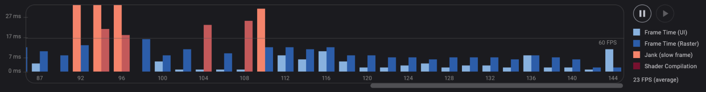<br>*The frames chart in Flutter DevTools. Each bar is one frame. Red bars are janky frames that missed the budget. Source: Flutter documentation.*

<p class="label">Exam notes</p>

| Metric | Target / fact |
|---|---|
| **Frame rate** | <mark>**60 fps** = each frame in **16.67 ms**</mark> (120 Hz screens: 8.33 ms). <mark>A late frame is dropped: this is **jank**</mark> |
| **App start** | <mark>**Cold start** (process not running; slowest), **warm start** (process alive, UI recreated), **hot start** (brought back from the background)</mark> |
| **ANR** (Android) | <mark>"Application Not Responding": the main thread was blocked</mark>, for example no response to input for <mark>**5 seconds**</mark> |
| **Memory** | Low and stable. <mark>Growth that never falls = a **leak**</mark>. Too much = the OS kills the app <mark>(**OOM**)</mark> |
| **App size** | Smaller download = more installs, less storage |
| **Battery, data** | Low use of CPU, GPS, radio and wake time |

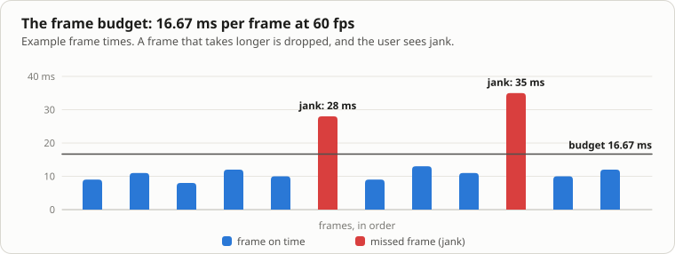

**The method (say this first in any answer):** <mark>*measure → find the bottleneck → fix → measure again.*</mark> Always profile in <mark>**profile mode on a real, low-end device**</mark>, never in debug mode or only on an emulator.

<div class="box q">

**Why must I test in profile mode on a real, cheap phone?**

Debug mode is slow on purpose: it carries extra checks and uses JIT. An emulator borrows the power of your computer. Both give false numbers. Profile mode on a real low-end phone shows what a field officer will actually feel.

</div>

<div class="box rule">

**Remember.** 60 fps = 16.67 ms per frame. A late frame = jank. Measure → find the bottleneck → fix → measure again, in profile mode, on a real low-end device.

</div>

## 2. How Flutter renders a frame

<div class="box def">

**Definition.** To make one frame, Flutter works in two places. The **UI thread** runs your Dart code: it builds the widgets, measures them and decides what to paint. The **raster thread** turns that plan into real pixels with the GPU.

</div>

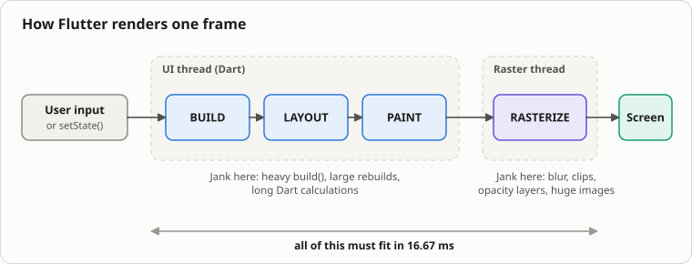

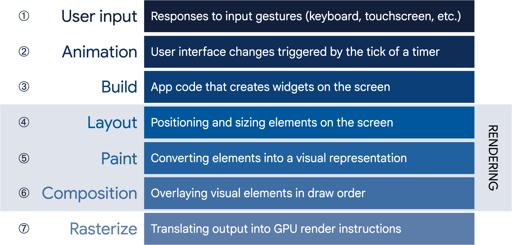<br>*The full pipeline from the official documentation: user input, animation, build, layout, paint, composition, rasterize. Source: Flutter documentation.*

<div class="box story">

**Example scenario.** Imagine a restaurant with a cook and a waiter.

1. The **cook** (UI thread) prepares the plate: build, layout, paint.
2. The **waiter** (raster thread) carries the plate to the table: rasterize.
3. If the cook is slow, the food is late. If the waiter is slow, the food is also late.

**How do you know who is slow?** Turn on the **performance overlay**. It shows two graphs, one for each thread. A tall red bar in the top graph means the raster thread was slow. In the bottom graph it means the UI thread, your Dart code, was slow.

</div>

<div class="pair">

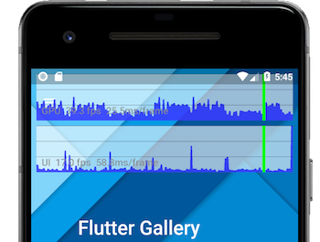<br>*All bars are short: every frame was on time.*

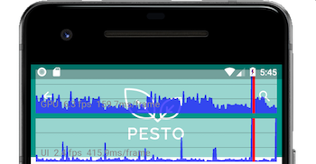<br>*Red bars: these frames took too long.*

</div>

*Pictures: Flutter documentation, "Flutter performance profiling".*

- **UI thread jank:** <mark>`build()` is too heavy, or Dart code is doing long calculations</mark>.
- **Raster thread jank:** <mark>the scene is too expensive to draw</mark> (many layers, blur, clipping, big images).
- The **Performance overlay** shows two graphs, one per thread. A bar above the line is a missed frame.

<div class="box rule">

**Remember.** UI thread = build, layout, paint (your Dart code). Raster thread = turns the layer tree into pixels. Both must finish inside 16.67 ms.

</div>

## 3. Rendering speed

<div class="box def">

**In simple words.** A fast screen does **less work per frame**. Three habits do most of the job: rebuild only the small part that changed, build only the list items that are visible, and never do heavy work inside `build()`.

</div>

<div class="box story">

**Example scenario.** Imagine a list of 1,000 borrowers.

1. You put all 1,000 rows inside a `Column`. Flutter builds 1,000 rows before it can show the first frame. The screen opens slowly and uses a lot of memory.
2. You change to `ListView.builder`. Flutter now builds only the 8 rows that fit on the screen, plus a few more. As the user scrolls, old rows are thrown away and new rows are built.

**What changed?** The work went from 1,000 rows to about 10. This is **lazy loading**.

</div>

<p class="label">Exam notes</p>

| Technique | Why it helps |
|---|---|
| **`const` constructors** | <mark>A const widget is created once and never rebuilt</mark> |
| **Small widgets; call `setState` low in the tree** | Only the small part rebuilds, not the whole screen |
| **`ListView.builder` / `GridView.builder`** | <mark>Builds only the visible items (**lazy loading**)</mark>. Never put a long list in `Column` + `SingleChildScrollView` |
| **Pagination / infinite scroll** | Do not load 10,000 rows at once |
| **Selective rebuilds** | `BlocBuilder(buildWhen:)`, `Selector`, `context.select`, `ValueListenableBuilder` |
| **Keep `build()` pure and cheap** | <mark>No network calls, DB queries, sorting or parsing inside `build()`</mark> |
| **`RepaintBoundary`** | <mark>Isolates an often-repainting area</mark> (animation, chart) from the rest |
| **Avoid costly effects** | `Opacity`, `ClipRRect`, `BackdropFilter` and shadows <mark>force extra layers (`saveLayer`)</mark>. Prefer `AnimatedOpacity`, or draw with a colour that already has alpha |
| **Right-sized images** | Decode at display size (`cacheWidth`/`cacheHeight`), use thumbnails, WebP, `cached_network_image` |
| **Keys** on list items | Lets Flutter reuse elements when items move |
| **Heavy work in an isolate** | JSON parsing, image compression, encryption, ML inference: `Isolate.run()` / `compute()` |
| **Impeller** | Flutter's renderer pre-compiles shaders, removing first-run animation jank |

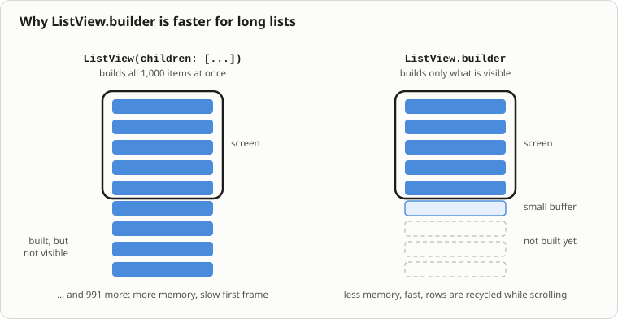

**Process vs thread vs isolate (theory link):** <mark>a **process** has its own memory. **Threads** share the memory of their process. A Dart **isolate** has its own memory and event loop and talks by messages.</mark> The UI runs on the main isolate, so long work there freezes the screen.

<div class="box rule">

**Remember.** `const` widgets are never rebuilt. `ListView.builder` builds only visible rows. Keep `build()` cheap. Heavy work goes to an isolate.

</div>

<div class="box check">

**Quick check**

1. Scrolling stutters and the UI graph shows red bars. Where is the problem? (a) GPU effects (b) your Dart code (c) the network
2. Which widget keeps one often-repainting area from repainting the rest? (a) RepaintBoundary (b) Expanded (c) SafeArea
3. Why does a `const` widget help?

<details>
<summary>Show answers</summary>

1. **(b)** The UI thread runs your Dart code: a heavy `build()` or a long calculation.
2. **(a) RepaintBoundary.**
3. It is created once at compile time. Flutter sees the same object again and skips rebuilding it.

</details>

</div>

## 4. Memory usage

<div class="box def">

**Definition.** A **memory leak** is memory that the app no longer needs but cannot give back, because some forgotten object is still holding on to it.

</div>

<div class="box story">

**Example scenario.** Imagine a tap in a room.

1. You enter the room and open the tap. *(The screen opens and starts listening to a stream.)*
2. You leave the room but forget to close the tap. *(The screen closes, but nobody cancelled the listener.)*
3. You do this in ten rooms. Ten taps are running.
4. The water tank is empty. *(The phone has no memory left. Android kills the app.)*

**What is the fix?** Close the tap when you leave. In Flutter that place is `dispose()`: cancel subscriptions and timers, dispose controllers.

</div>

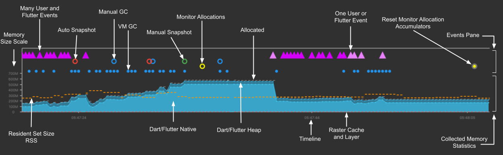<br>*The memory chart in Flutter DevTools. A healthy line goes up and comes back down after garbage collection. Source: Flutter documentation.*

<p class="label">Exam notes</p>

<mark>**Memory leak:** memory that is no longer needed but cannot be freed because something still references it.</mark>

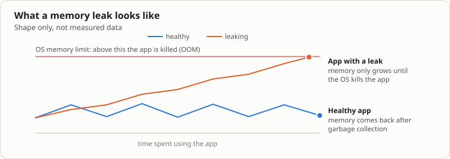

| Common cause | Fix |
|---|---|
| Controllers not disposed (`TextEditingController`, `AnimationController`, `ScrollController`) | <mark>Call `dispose()` in `State.dispose()`</mark> |
| `StreamSubscription`, listeners, `Timer` left running | `cancel()` / `removeListener()` in `dispose()` |
| BLoCs or streams never closed | `close()`; let `BlocProvider` own them |
| Global or static variables holding big objects or a `BuildContext` | Do not keep contexts; clear caches |
| Huge images decoded at full resolution | Resize; limit `ImageCache` |
| Loading a whole table into a list | Pagination; SQL `LIMIT`/`OFFSET`; streams |
| Android native: leaked Activity context | Use application context; LeakCanary |
| iOS native: retain cycles | `[weak self]` |

```dart
class _FormState extends State<VisitForm> {
  final _note = TextEditingController();
  late final StreamSubscription _sub;

  @override
  void initState() { super.initState(); _sub = repo.watchVisits().listen(_onData); }

  @override
  void dispose() { _note.dispose(); _sub.cancel(); super.dispose(); }   // prevents leaks
}
```

**Memory management by platform:** Dart, Kotlin and Java <mark>use a **garbage collector**</mark> (Dart's is generational: a fast collector for short-lived objects, a slower one for long-lived objects). <mark>Swift uses **ARC** (reference counting)</mark>.

**Also:** <mark>check `mounted` before calling `setState` after an `await`</mark>; free the camera and large buffers when a screen closes; respond to low-memory warnings (`didHaveMemoryPressure`).

<div class="box rule">

**Remember.** Leak = memory still referenced but no longer needed. Whatever you create in `initState`, you close in `dispose`. Check `mounted` before `setState` after an `await`.

</div>

## 5. Battery consumption

<div class="box def">

**In simple words.** The battery is drained by the things that use power: the screen, the GPS, the network radio and the processor. An app saves battery by using them **less often** and **for a shorter time**.

</div>

<div class="box story">

**Example scenario.** Imagine an app that asks the server "anything new?" every 30 seconds, all day.

1. Each question wakes the network radio.
2. After each question the radio stays awake for several more seconds.
3. By the afternoon the officer's battery is at 20%.

**The better way:** the app asks nothing. When something new exists, the server sends one **push notification**. The radio wakes only when there is a reason.

</div>

<p class="label">Exam notes</p>

**What drains the battery:** screen · **GPS** · **network radio** (cellular more than Wi-Fi; waking it repeatedly is the worst pattern) · CPU · wake locks · Bluetooth scanning · camera.

| Technique | Detail |
|---|---|
| **Batch network calls** | <mark>One sync of 20 records beats 20 separate requests; the radio wakes once</mark> |
| **Schedule background work with constraints** | WorkManager/BGTaskScheduler: run when connected, on Wi-Fi or charging; let the OS group jobs |
| <mark>**Push instead of polling**</mark> | Use FCM to say "new data", rather than asking the server every minute |
| **Location with care** | <mark>Get one fix when the form is saved, not continuous tracking.</mark> Lower accuracy and set a `distanceFilter` when tracking is needed. Stop the listener when done |
| **Stop work in the background** | Pause streams, timers, animations and sensors on `AppLifecycleState.paused` |
| **No needless wake locks** | Release them immediately |
| **Efficient rendering** | Fewer rebuilds and animations = less CPU and GPU. Dark theme saves power on OLED screens |
| **Compress uploads** | Smaller photos = less radio time |
| **Exponential backoff** | Do not hammer a failing connection |

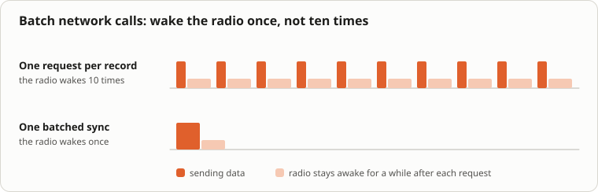

**OS limits you must design for:** <mark>Android **Doze** and **App Standby** delay background work</mark> and network when the phone is idle; Android restricts background location and background services; iOS decides when background tasks run. Some manufacturers kill background apps aggressively. Design sync so that it also runs when the app is opened.

### Doze and App Standby (Android's two battery savers)

Both are Android features that save battery by limiting what apps do in the background. They work in different ways.

<div class="box def">

**Definition: Doze.** Doze is a power-saving mode for the **whole phone**. It starts when the phone is **unplugged**, **not moving**, and its **screen is off** for some time.

**Its purpose** is to save battery while nobody is using the phone, by stopping background CPU and network work.

</div>

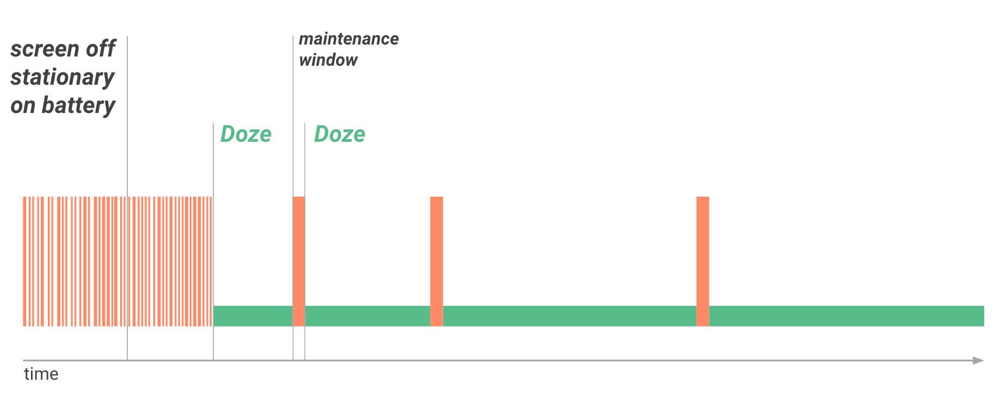<br>*In Doze, apps are stopped (green). From time to time Android opens a short maintenance window (orange) and lets waiting work run. The windows come less and less often. Source: Android Developers.*

<div class="box story">

**Example scenario.** Imagine:

1. You charge your phone to 100%.
2. You unplug the charger.
3. You put the phone on a table.
4. The screen turns off.
5. You do not touch the phone for a long time.

Android now enters Doze.

**What happens?**

| Activity | In Doze |
|---|---|
| Network access for apps | Stopped |
| Background CPU work, wake locks | Stopped (wake locks are ignored) |
| Jobs and WorkManager tasks | Delayed |
| Sync | Delayed |
| Normal alarms | Delayed |
| GPS and Wi-Fi scans | Stopped |
| High-priority FCM message | **Still delivered** |

</div>

<div class="box q">

**Does Doze stop background work completely?**

No. From time to time Android opens a short **maintenance window**. During the window, waiting jobs and syncs run and the network works. Then the phone goes back to Doze. Doze ends as soon as the user moves the phone, turns on the screen or plugs in the charger.

</div>

<div class="box def">

**Definition: App Standby.** App Standby limits **one app** that the user has not opened for some time. Other apps on the same phone are not affected.

</div>

<div class="box story">

**Example scenario.** Imagine three apps on a phone: WhatsApp, Facebook and your Flutter app.

1. The user opens WhatsApp and Facebook every day.
2. The user has not opened your app for three days.
3. Android puts your app in a low **standby bucket**.

**What happens?** Your app's jobs run less often, its alarms are delayed and its network access in the background is limited. WhatsApp and Facebook keep working normally.

| Bucket | Meaning |
|---|---|
| Active | The app is being used now |
| Working set | Used often |
| Frequent | Used regularly, not every day |
| Rare | Rarely used |
| Restricted | Almost no background work allowed |

The less an app is used, the stronger the limits.

</div>

**Doze and App Standby side by side**

| | Doze | App Standby |
|---|---|---|
| Works on | The whole device | One app |
| Starts when | The device is idle: unplugged, still, screen off | The user has not used the app |
| Screen must be off | Yes | No |
| Device must be still | Yes | No |
| Background network | Stopped until a maintenance window | Limited for that app |
| Background jobs | Delayed | Delayed or limited |
| Purpose | Save battery while the phone sleeps | Save battery from unused apps |

<div class="box dev">

**What this means for a Flutter developer.** Imagine your app keeps 10 records in the outbox and has asked WorkManager to sync them.

- **The app is open:** sync runs normally.
- **The app is in the background and the phone is in Doze:** the WorkManager task waits for the next maintenance window.
- **The user rarely opens the app:** App Standby makes the task run even less often.

So: use **WorkManager** with a network constraint, make sync **idempotent**, retry with **backoff**, use a **high-priority FCM** message when something is urgent, and always **sync again when the user opens the app**. WorkManager does not break Doze or App Standby. It works together with them.

</div>

<div class="box rule">

**Remember.** Doze = the **phone** is sleeping. App Standby = one **app** is not being used. Both can delay your background sync.

</div>

<div class="box check">

**Quick check**

1. A phone is unused, still, unplugged and its screen is off. Which mechanism starts? (a) App Standby (b) Doze (c) WorkManager
2. A user has not opened your app for several days but uses other apps daily. Which mechanism limits your app? (a) Doze (b) App Standby (c) Foreground service
3. Will a WorkManager task run immediately during Doze? (a) yes, always (b) no, it may be delayed (c) it skips Android's limits

<details>
<summary>Show answers</summary>

1. **(b) Doze.**
2. **(b) App Standby.**
3. **(b).** It waits for a maintenance window.

</details>

</div>

## 6. Network and data efficiency

<div class="box def">

**In simple words.** Send fewer bytes, fewer times. Mobile data is slow and costs the user money, and every request also costs battery.

</div>

Gzip responses · paginate · delta sync (only changes) · cache with ETag · thumbnails first · debounce search (wait ~300 ms after typing stops) · cancel requests for closed screens · reuse connections (HTTP keep-alive / HTTP/2).

## 7. App size and start-up time

<div class="box def">

**In simple words.** Two first impressions: how big the download is, and how long the user waits after tapping the icon. A **cold start** is the slowest: the app is not in memory, so Android must create it from nothing.

</div>

**Size:** release build with tree shaking · <mark>**Android App Bundle** (Play delivers only the code and resources for that device)</mark> or `--split-per-abi` · R8 code shrinking · compress images, use WebP and vector icons · remove unused packages, fonts and assets · deferred components for rare features · inspect with `flutter build apk --analyze-size`.

**Start-up:** do little in `main()` before `runApp` · initialise SDKs lazily · show the first screen from local data, then refresh · avoid heavy synchronous work at launch · native splash screen.

## 8. "Across various handheld devices and OS versions"

<div class="box def">

**In simple words.** Android phones differ a lot: many makers, many screen sizes, old and new versions, and 2 GB phones next to 12 GB phones. This is called **fragmentation**. The app must work on the weakest phone that your users really have.

</div>

- <mark>**Fragmentation:**</mark> many Android manufacturers, screen sizes, RAM sizes (2 GB phones are common in the field) and OS versions.
- Set a sensible **`minSdkVersion`** / iOS deployment target from real user data.
- Test matrix: one low-end, one mid-range and one new device; oldest and newest supported OS; small and large screens. Use emulators, real devices and <mark>**Firebase Test Lab**</mark>.
- Check API availability before using new features (`Build.VERSION.SDK_INT`, `#available`).
- Watch **Android vitals** (crash and ANR rates by device model) and Crashlytics device filters to find device-specific problems.
- Offer lighter behaviour on weak devices: lower image quality, fewer animations.

## 9. Tools

<div class="box def">

**In simple words.** Never guess what is slow. Each tool below answers one question. In an exam answer, name the tool together with what it finds.

</div>

| Tool | Finds |
|---|---|
| **Flutter DevTools → Performance** | Frame chart, jank, slow build/layout/paint phases, "track widget rebuilds" |
| **DevTools → CPU Profiler** | Which functions take the time |
| **DevTools → Memory** | Heap growth, leaks, snapshots and diffs |
| **DevTools → Network** | Slow or repeated requests |
| **DevTools → App Size** | What makes the app big |
| **Performance overlay** | Live UI and raster thread graphs on the device |
| **Android Studio Profiler** | CPU, memory, **energy**, network on Android |
| <mark>**Xcode Instruments**</mark> | Time Profiler, Allocations, Leaks, Energy Log on iOS |
| <mark>**LeakCanary**</mark> | Android memory leaks |
| **Firebase Performance Monitoring** | Real users: app start time, screen rendering, HTTP request duration |
| **Android vitals / Xcode Organizer** | Crash, ANR, battery and launch metrics from production |

## Link it to your own projects

Interviews and written exams reward answers that use **your own work** as the example. Before you move on, answer these for yourself:

<div class="box you">

- Name one performance problem you fixed (jank, memory, battery) and the tool that showed it.
- Which crash-free rate or frame times do your apps reach?
- Which low-cost device do you test on?

</div>

---

## Practice questions

**Short (2–3 marks each)**
1. What is jank? How many milliseconds does one frame have at 60 fps?
2. Why is `ListView.builder` better than `ListView(children: [...])` for long lists?
3. How does `const` improve performance?
4. What is a memory leak? Give three causes in Flutter.
5. What is an ANR?
6. Cold start vs warm start vs hot start.
7. Give four ways to reduce battery consumption.
8. Why should performance be measured in profile mode?
9. What does `RepaintBoundary` do?
10. Name four profiling tools and what each is for.

**Long (8–10 marks each)**

11. Users report that a field app is slow and drains the battery on low-end Android phones. Explain how you would find the causes and what optimisations you would apply for memory, rendering speed and battery.
12. Explain Flutter's rendering pipeline. What causes jank on the UI thread and on the raster thread, and how do you fix each?
13. What are memory leaks in mobile apps? How do you detect and prevent them in Flutter, Android and iOS?

---

## Model answers

<div class="box exam">

**How to read these answers.** They are written for **learning**, so they are fuller than what you would write in the exam hall. Every answer has the same parts:

- **In short** (green): the direct answer. In the exam, write this part first.
- **Table or points:** the details, laid out so you can compare and remember them.
- **Example** (yellow): a real situation, usually from a field app or from your own projects.
- Long answers end with **In the exam** (brown): how to shorten the answer on paper.

Write your own answer first. Then open the model answer and compare.

</div>

<details>
<summary>1. What is jank? How many milliseconds does one frame have at 60 fps?</summary>

<div class="box def">

**In short.** **Jank** is a visible stutter. It happens when a frame takes longer than its time budget, so the frame is dropped and the screen shows the old picture again. At 60 fps each frame has <mark>about **16.67 ms**</mark> (1000 ms ÷ 60).

</div>


| Screen refresh rate | Frames per second | Budget for one frame |
|---|---|---|
| 60 Hz | 60 | **16.67 ms** |
| 90 Hz | 90 | 11.11 ms |
| 120 Hz | 120 | **8.33 ms** |

**What uses the budget.** In those 16.67 ms Flutter must **build** the widgets, **lay them out**, **paint** them, and **rasterise** them on the GPU. If the total is 25 ms, the frame misses the screen refresh and the user sees a jump.

| Common cause of jank | Where |
|---|---|
| Heavy work inside `build()` | UI thread |
| Rebuilding the whole screen for a small change | UI thread |
| Parsing big JSON or resizing images on the main isolate | UI thread |
| Very large images, many blurs, shadows and clips | Raster thread |

<div class="box story">

**Example.** A field officer scrolls a list of 300 borrowers on a low-cost phone. Each row decodes a full-size photo. Some frames take 40 ms, so the list moves in jumps. That is jank. Smaller cached images and `ListView.builder` bring the frames back under 16 ms.

</div>

<div class="ref">

**From the book:** [1. What "performance" means: the numbers](#1-what-performance-means-the-numbers) [2. How Flutter renders a frame](#2-how-flutter-renders-a-frame)

</div>

</details>

<details>
<summary>2. Why is <code>ListView.builder</code> better than <code>ListView(children: [...])</code> for long lists?</summary>

<div class="box def">

**In short.** `ListView.builder` builds items **lazily**: <mark>only the rows that are visible, plus a small buffer</mark>. `ListView(children: [...])` builds **every** row at once, even the ones far below the screen.

</div>


| Point | `ListView(children: [...])` | `ListView.builder` |
|---|---|---|
| **Builds** | All items immediately | Only visible items + a small cache area |
| **1,000 items** | 1,000 widgets built and kept | About 10 to 15 at a time |
| **Memory** | Grows with the list | Stays almost constant |
| **First frame** | Slow | Fast |
| **While scrolling** | — | Builds new rows as they appear; removes the ones that leave |
| **Use for** | A few fixed items (a settings page) | Long or unknown-length lists |

```dart
ListView.builder(
  itemCount: visits.length,
  itemBuilder: (context, i) => VisitTile(visit: visits[i]),
);
```

**To make a long list even better**

- Load the data in **pages** (pagination), not 10,000 rows at once.
- Give `itemExtent` or `prototypeItem` when every row has the same height.
- Use `ListView.separated` for dividers, `GridView.builder` for grids.
- Keep each row light: `const` parts and small cached images.

<div class="box story">

**Example.** A branch has 2,000 borrowers. With `children`, the screen takes three seconds to open and may run out of memory on a 2 GB phone. With `builder` and a page size of 30, it opens at once and scrolls smoothly.

</div>

<div class="ref">

**From the book:** [3. Rendering speed](#3-rendering-speed)

</div>

</details>

<details>
<summary>3. How does <code>const</code> improve performance?</summary>

<div class="box def">

**In short.** A `const` widget is created **once, at compile time**, and the same instance is reused. When the parent rebuilds, Flutter sees the identical instance and **skips rebuilding that subtree**. That means less CPU work and less garbage.

</div>

| | Without `const` | With `const` |
|---|---|---|
| **On every rebuild** | A new widget object is created | The same object is reused |
| **Flutter's check** | Must compare and update the subtree | Identical instance → skip |
| **Garbage collector** | More short-lived objects to clean | Fewer |
| **Memory** | A copy per use | One shared copy for identical values |

```dart
// Rebuilt every time the parent rebuilds
Padding(padding: EdgeInsets.all(16), child: Text('Save'))

// Built once, then skipped
const Padding(padding: EdgeInsets.all(16), child: Text('Save'))
```

**Rules**

- A widget can be `const` only if its constructor is `const` **and** all its arguments are compile-time constants.
- Give your own widgets a `const` constructor.
- Turn on the lint `prefer_const_constructors`, so the editor reminds you.

**Keep it in proportion.** `const` is a cheap and safe habit, but it does not fix a slow screen alone. The bigger wins are rebuilding less (small widgets, `buildWhen`, `Selector`) and lazy lists.

<div class="box story">

**Example.** A dashboard has a timer that calls `setState` every second. Without `const`, the header, the icons and the labels are all created again each second. With `const`, only the clock text is rebuilt.

</div>

<div class="ref">

**From the book:** [3. Rendering speed](#3-rendering-speed)

</div>

</details>

<details>
<summary>4. What is a memory leak? Give three causes in Flutter.</summary>

<div class="box def">

**In short.** A memory leak is memory that the app **no longer needs but still holds a reference to**, so the garbage collector cannot free it. Three causes in Flutter: controllers that are not disposed, stream subscriptions or timers that are not cancelled, and static or global references to large objects.

</div>


| Cause | Fix |
|---|---|
| `TextEditingController`, `AnimationController`, `ScrollController`, `FocusNode` not disposed | Call `.dispose()` in `dispose()` |
| `StreamSubscription` not cancelled | `subscription.cancel()` in `dispose()` |
| `Timer.periodic` still running | `timer.cancel()` in `dispose()` |
| Listeners not removed | `removeListener()` in `dispose()` |
| BLoC or Cubit not closed | Let `BlocProvider` close it, or call `close()` |
| A static or global variable holds a `BuildContext`, a widget or a big list | Do not keep them in globals; clear them when done |
| An image cache that grows without limit | Decode at display size; limit the cache |
| A callback after `await` uses a screen that is gone | Check `if (!mounted) return;` |

```dart
class _VisitFormState extends State<VisitForm> {
  final _note = TextEditingController();
  late final StreamSubscription _sub;

  @override
  void initState() {
    super.initState();
    _sub = syncService.status.listen(_onStatus);
  }

  @override
  void dispose() {
    _note.dispose();       // free the controller
    _sub.cancel();         // stop listening
    super.dispose();
  }
}
```

**What the user sees:** the app gets slower the longer it is used, and in the end Android kills it with an **out-of-memory** error.

<div class="box story">

**Example.** A field officer opens and closes the visit form 50 times in a day. Each time, a stream subscription is left behind and keeps the whole form in memory. By the afternoon the app uses 600 MB and crashes on her 2 GB phone. One `cancel()` in `dispose()` fixes it.

</div>

<div class="ref">

**From the book:** [4. Memory usage](#4-memory-usage)

</div>

</details>

<details>
<summary>5. What is an ANR?</summary>

<div class="box def">

**In short.** <mark>**ANR (Application Not Responding)**</mark> is an Android error. The system shows it when the app's <mark>**main thread is blocked** for too long</mark>, about **5 seconds** without responding to a touch or key press. The user sees a dialog: "App isn't responding. Close app / Wait".

</div>

| When Android raises an ANR | Limit |
|---|---|
| No response to an input event (tap, key) | About 5 seconds |
| A `BroadcastReceiver` does not finish | About 10 seconds |
| A `Service` does not finish starting | About 20 seconds |

**Causes:** heavy work on the main thread, such as file or database I/O, a network call, a long loop, waiting for a lock, or a deadlock.

| | Jank | ANR | Crash |
|---|---|---|---|
| **What happens** | A few frames are dropped | The app is frozen for seconds | The app closes |
| **The user sees** | A stutter | The "not responding" dialog | The app disappears |
| **Cause** | A frame over 16 ms | Main thread blocked for seconds | An unhandled exception |
| **Where reported** | DevTools | Android vitals (Play Console), Crashlytics | Crashlytics, Android vitals |

**How to prevent it**

- Keep the main thread for the UI only.
- Native Android: coroutines with `Dispatchers.IO`, WorkManager.
- Flutter: `async`/`await` for I/O, **isolates** for CPU-heavy Dart code, and no heavy native work in a platform-channel handler on the main thread.

**Why it matters for publishing:** Google Play tracks the ANR rate in **Android vitals**. A high rate lowers the app's visibility in the store.

<div class="box story">

**Example.** On opening, an app reads and decrypts a large local database synchronously. On a slow phone this takes seven seconds. Android shows the ANR dialog and many users tap "Close app". Moving the work off the main thread and showing a loading screen removes the ANR.

</div>

<div class="ref">

**From the book:** [1. What "performance" means: the numbers](#1-what-performance-means-the-numbers)

</div>

</details>

<details>
<summary>6. Cold start vs warm start vs hot start.</summary>

<div class="box def">

**In short.** **Cold start:** the app's process does not exist, so everything is created from zero (slowest). **Warm start:** the process is alive, but the screen must be created again. **Hot start:** the app is still in memory and is only brought to the front (fastest).

</div>

| Point | Cold start | Warm start | Hot start |
|---|---|---|---|
| **Process** | Does not exist | Exists | Exists |
| **Activity / UI** | Created | Created again | Still in memory |
| **What runs** | Process creation → `Application` → Activity → Flutter engine → `main()` → first frame | Activity `onCreate` again | `onRestart` → `onStart` → `onResume` |
| **Speed** | Slowest | Medium | Fastest |
| **When** | First launch; after a reboot; after the system killed the app | The user pressed Back to leave, then returned; the activity was removed from memory | The user pressed Home, then returned soon |

**Cold start is the one to optimise.** Google Play flags a cold start of 5 seconds or more as slow.

- Do less in `main()`: initialise only what the first screen needs.
- Start SDKs (analytics, maps) **lazily**, after the first frame.
- Do not block on a network call before showing the UI.
- Show a light splash, then load data from the local database.
- Reduce the app size and the number of plugins.

<div class="box story">

**Example.** In the morning the officer opens the field app for the first time after charging the phone overnight: a cold start. She presses Home to answer a call and returns ten seconds later: a hot start. If the app had waited for the server before showing the home screen, the cold start would hang in an area with no signal.

</div>

<div class="ref">

**From the book:** [1. What "performance" means: the numbers](#1-what-performance-means-the-numbers) [7. App size and start-up time](#7-app-size-and-start-up-time)

</div>

</details>

<details>
<summary>7. Give four ways to reduce battery consumption.</summary>

<div class="box def">

**In short.** (1) **Batch** network requests, (2) **schedule** background work with WorkManager and constraints, (3) use **push instead of polling**, and (4) use **location** only when needed and at lower accuracy.

</div>


The big battery users are the **radio** (mobile data, Wi-Fi), **GPS**, the **CPU** kept awake, and the **screen**.

| What drains | How to reduce it |
|---|---|
| **Many small network calls** | Batch them into one. Each call wakes the radio, and the radio stays in high power for seconds afterwards |
| **Polling the server every minute** | Use **push (FCM)**: the server tells the app when something changed |
| **Sync at any time** | **WorkManager** with constraints: network connected, battery not low, or only while charging |
| **Retrying in a tight loop** | Exponential backoff |
| **Continuous GPS** | One location fix when the record is saved; lower accuracy; stop updates when the screen closes |
| **Wake locks** | Avoid them; release at once if they are needed |
| **Work in the background** | Stop timers, streams, animations and the camera when the app is paused |
| **Large uploads** | Compress photos; upload on Wi-Fi |
| **Heavy CPU work** | Efficient code; less rebuilding; no endless animations |
| **Screen** | A dark theme saves power on OLED screens |

**Respect the system:** Android's **Doze** and **App Standby** already delay background work when the phone is idle. Work with them (WorkManager, high-priority FCM for urgent messages), not against them.

<div class="box story">

**Example.** A field app tracked the officer's position every five seconds all day, and the battery was empty by 2 PM. The visit only needs the position at the moment of saving. One GPS fix per visit gave the same data and the phone lasted until evening.

</div>

<div class="ref">

**From the book:** [5. Battery consumption](#5-battery-consumption) [Doze and App Standby (Android's two battery savers)](#doze-and-app-standby-androids-two-battery-savers) [A3 · 6. Background sync](A3%20-%20Offline%20Storage%20and%20Data%20Sync.md#6-background-sync)

</div>

</details>

<details>
<summary>8. Why should performance be measured in profile mode?</summary>

<div class="box def">

**In short.** Debug mode is much slower than what users get, so its numbers are misleading. <mark>**Profile mode** is compiled like a release build (AOT) but keeps the profiling tools switched on</mark>, so the numbers are realistic. Always measure on a **real device**.

</div>

| Point | Debug | Profile | Release |
|---|---|---|---|
| **Command** | `flutter run` | `flutter run --profile` | `flutter run --release` |
| **Compiler** | JIT | AOT | AOT |
| **Hot reload** | Yes | No | No |
| **Assertions and debug checks** | On | Off | Off |
| **DevTools profiling** | Yes, but the numbers are wrong | <mark>Yes, with real numbers</mark> | No |
| **Speed** | Slow | Almost the same as release | Fastest |
| **Runs on an emulator** | Yes | No (real device only) | Real device |
| **Use it for** | Writing and debugging code | Measuring performance | Shipping to users |

**Two more rules for a fair measurement**

- Use a **real device**, because an emulator uses the computer's CPU and GPU.
- Use a **low-end device**, the kind your users have, not your own flagship phone.

<div class="box story">

**Example.** A list looks janky in debug mode on your phone. Before spending a day on it, you run it in profile mode: every frame is under 10 ms. The jank was only the debug build. On a low-cost field phone in profile mode you then find the real problem, large images.

</div>

<div class="ref">

**From the book:** [1. What "performance" means: the numbers](#1-what-performance-means-the-numbers)

</div>

</details>

<details>
<summary>9. What does <code>RepaintBoundary</code> do?</summary>

<div class="box def">

**In short.** `RepaintBoundary` gives its child **its own layer**. When the child repaints, the rest of the screen is not repainted. And when the rest repaints, the child is not.

</div>

**Without it:** when one small part changes (a spinner, a chart, a clock), Flutter may repaint everything that shares the same layer.

**With it:** the changing part is separated, so only that layer is painted again.

```dart
RepaintBoundary(
  child: SyncProgressAnimation(),     // repaints 60 times a second
)
```

| Use it for | Do not use it |
|---|---|
| Something that repaints often next to static content: an animation, a progress ring, a chart, a signature pad, a camera preview overlay | Everywhere. Each boundary costs memory for an extra layer |
| A complex but static widget next to something that animates | For widgets that always change together with their parent |

**How to check that it helps:** turn on `debugRepaintRainbowEnabled`, or "Highlight repaints" in DevTools. Areas that change colour on every frame are being repainted.

**Good to know:** `ListView` already wraps each item in a `RepaintBoundary`.

<div class="box story">

**Example.** A sync screen shows a rotating icon at the top and a list of 30 pending records below. Without a boundary, the whole list is repainted 60 times a second. With `RepaintBoundary` around the icon, only a small square is repainted.

</div>

<div class="ref">

**From the book:** [3. Rendering speed](#3-rendering-speed)

</div>

</details>

<details>
<summary>10. Name four profiling tools and what each is for.</summary>

<div class="box def">

**In short.** **Flutter DevTools** (frames, rebuilds, memory), **Android Studio Profiler** (CPU, memory, energy on Android), **Xcode Instruments** (leaks and time profiling on iOS), and **Firebase Performance Monitoring** (real users' start-up and network times).

</div>

| Tool | Platform | What it shows | Use it when |
|---|---|---|---|
| **DevTools: Performance** | Flutter | Frame chart: UI and raster time per frame; janky frames; rebuild counts | The UI stutters |
| **DevTools: Memory** | Flutter | Heap size over time; snapshots and diffs | You suspect a leak |
| **DevTools: CPU Profiler** | Flutter | Which functions use the time | A screen is slow to open |
| **DevTools: Network** | Flutter | Every HTTP call, its size and time | APIs feel slow |
| **Performance overlay** | Flutter | Two live graphs on the device: UI and raster | A quick check on the phone |
| **Android Studio Profiler** | Android | CPU, memory, network and energy of the native side | ANR, battery drain |
| **Xcode Instruments** | iOS | Time Profiler, Allocations, Leaks, Energy Log | iOS-only problems |
| **LeakCanary** | Android | Automatic detection of native memory leaks | Native Android code |
| **Firebase Performance Monitoring** | Production | App start time, slow frames and HTTP times from real users | After release |
| **Android vitals** (Play Console) | Production | ANR rate, crash rate, slow start, battery | After release |

<br>*The frames chart in DevTools: each pair of bars is one frame (UI and raster). Red bars are janky frames. Source: Flutter documentation.*

<div class="box story">

**Example.** Users in the field say the app is slow, but it is fast on your desk. **Firebase Performance** shows that the visit list API takes eight seconds on 2G. **DevTools** on a low-end phone shows the list itself builds in 5 ms. So the problem is the network, and the fix is caching and pagination, not widget tuning.

</div>

<div class="ref">

**From the book:** [9. Tools](#9-tools)

</div>

</details>

<details>
<summary>11. Users report that a field app is slow and drains the battery on low-end Android phones. Explain how you would find the causes and what optimisations you would apply for memory, rendering speed and battery.</summary>

<div class="box def">

**In short.** **Measure first, then fix, then measure again.** I reproduce the problem on a low-end phone in profile mode, find the real causes with profiling tools, and fix them in three groups: rendering speed, memory and battery.

</div>

#### Step 1. Find the causes (measure)

| What I check | Tool |
|---|---|
| The same low-end phone model, in **profile mode** | `flutter run --profile` |
| Which frames are slow, and why | DevTools Performance; the performance overlay |
| Memory growth and leaks | DevTools Memory (snapshots) |
| Battery and background activity | Android Studio energy profiler; the phone's battery usage screen |
| Data from real users | Android vitals, Firebase Performance, Crashlytics filtered by device model |
| Which screens the users mean | Ask the field officers; add custom traces |

Without measuring, I would only be guessing, and I might optimise the wrong thing.

#### Step 2. Rendering speed

| Problem found | Fix |
|---|---|
| The whole screen rebuilds for a small change | Split into small widgets; narrow `setState`; `BlocBuilder` with `buildWhen`, `Selector` |
| Widgets are created again and again | `const` constructors |
| A long list builds all its rows | `ListView.builder` + pagination |
| Heavy work in `build()` | Move it out; compute once and keep the result |
| JSON parsing or image work freezes the UI | Isolates (`Isolate.run`) |
| Large photos in lists | Thumbnails; `cacheWidth`; cached images |
| Many `Opacity`, clips and shadows | Reduce them; use `RepaintBoundary` around animations |

#### Step 3. Memory

| Problem found | Fix |
|---|---|
| Controllers, streams and timers left alive | `dispose()` and `cancel()` |
| Thousands of rows loaded from the local database | Paginate queries (`LIMIT` / `OFFSET`) |
| Full-size camera photos held in memory | Compress on capture; decode at display size |
| The camera and buffers stay open | Release them when leaving the screen |
| An image cache without a limit | Set a cache size |

Out-of-memory kills are common on 2 GB phones, so this also reduces crashes.

#### Step 4. Battery

| Problem found | Fix |
|---|---|
| Sync runs too often, one record per request | Batch records; schedule with **WorkManager** and a network constraint |
| Retries in a loop when the network is weak | Exponential backoff |
| The app polls the server for changes | **FCM push** |
| GPS is on all the time | One fix at the moment of saving; stop updates after |
| Work continues in the background | Stop streams, timers and animations when paused |
| Large photo uploads on mobile data | Compress; prefer Wi-Fi |

#### Step 5. Check and keep it fixed

- Measure again on the **same phone** and compare the numbers before and after.
- Add a low-end phone to release testing.
- Release with a **staged rollout** and watch Android vitals and Firebase Performance.

<div class="box story">

**Link to your own work.** Close with one true sentence about your own projects, for example: "In one app, image processing in the camera was CPU-heavy, so I moved it to an isolate and resized the images, and the jank disappeared."

</div>

<div class="box exam">

**In the exam.** Five headings: Measure → Rendering → Memory → Battery → Verify. Under each of the three middle headings, a two-column "problem → fix" table with four rows. Name the tools. One page is enough.

</div>

<div class="ref">

**From the book:** [3. Rendering speed](#3-rendering-speed) [4. Memory usage](#4-memory-usage) [5. Battery consumption](#5-battery-consumption) [9. Tools](#9-tools)

</div>

</details>

<details>
<summary>12. Explain Flutter's rendering pipeline. What causes jank on the UI thread and on the raster thread, and how do you fix each?</summary>

<div class="box def">

**In short.** For every frame Flutter runs **build → layout → paint** on the **UI thread**, then **rasterises** the result on the **raster thread** (GPU). Both must finish within **16.67 ms** at 60 fps. Jank on the UI thread comes from slow Dart code. Jank on the raster thread comes from scenes that are expensive to draw.

</div>


#### 1. The pipeline

| Phase | Thread | What happens |
|---|---|---|
| **Vsync** | — | The screen says "I need a new frame" |
| **Animate** | UI | Animations move one tick forward |
| **Build** | UI | `build()` runs for the widgets marked dirty; the widget tree is updated |
| **Layout** | UI | Each render object gets its size and position (constraints down, sizes up) |
| **Paint** | UI | Render objects record drawing commands into layers |
| **Composite** | UI | The layers are put together into a scene and sent to the raster thread |
| **Rasterise** | Raster | The engine (Impeller) turns the scene into pixels on the GPU |

Your Dart code runs on the UI thread. You never write code for the raster thread, but **what you ask it to draw** decides how hard it works.

#### 2. Jank on each thread

| | UI thread jank | Raster thread jank |
|---|---|---|
| **Sign in the overlay** | The **lower** graph (UI) is red | The **upper** graph (raster) is red |
| **Meaning** | The Dart code took too long | The scene is too expensive to draw |
| **Causes** | Expensive `build()`; rebuilding too much; long synchronous loops; JSON parsing or image work on the main isolate; building every item of a long list | `saveLayer` effects: `Opacity`, clips, blur, shadows; very large images; many overlapping layers; shader compilation on first use (older Skia) |
| **Fixes** | `const`; small widgets; selective rebuilds (`buildWhen`, `Selector`); `ListView.builder`; isolates; keep `build()` pure and cheap | Avoid `Opacity` and clipping in animations (use `AnimatedOpacity`, `FadeTransition`); resize and cache images (`cacheWidth`); fewer shadows and blurs; `RepaintBoundary`; Impeller, which compiles shaders ahead of time |

<div class="pair">


</div>

*The performance overlay: the top graph is the raster thread, the bottom graph is the UI thread. A red bar is a frame over budget. Source: Flutter documentation.*

#### 3. How I find out which one

1. Run in **profile mode** on a real device.
2. Turn on the **performance overlay**, or open the **DevTools frame chart**.
3. See which bar is over the line: UI or raster.
4. For UI: open the CPU profiler and "Track widget builds". For raster: check images, opacity and clips.

<div class="box story">

**Example.** Scrolling a list stutters. The overlay shows the raster graph in red. The rows have rounded photos with shadows, loaded at full camera size. Resizing the photos with `cacheWidth` and removing the shadow fixes it. No Dart logic was changed, because the Dart code was never the problem.

</div>

<div class="box exam">

**In the exam.** Draw the pipeline as boxes: Vsync → Build → Layout → Paint (UI thread) → Rasterise (raster thread), with "16.67 ms" written above. Then the two-column table of causes and fixes. Then two lines on the tools.

</div>

<div class="ref">

**From the book:** [2. How Flutter renders a frame](#2-how-flutter-renders-a-frame) [3. Rendering speed](#3-rendering-speed)

</div>

</details>

<details>
<summary>13. What are memory leaks in mobile apps? How do you detect and prevent them in Flutter, Android and iOS?</summary>

<div class="box def">

**In short.** A memory leak is memory that is **no longer needed but is still referenced**, so it can never be freed. The app's memory grows until it becomes slow and is finally killed. I **detect** leaks with memory profilers (DevTools, LeakCanary, Instruments) and **prevent** them by releasing every resource in the matching lifecycle method.

</div>


#### 1. Why it matters

- Memory use rises with every screen visit and never comes down.
- The garbage collector runs more often, which causes jank.
- In the end the system kills the app: an **OOM (out of memory)** crash.
- Low-end field phones with 2 GB of RAM reach this point first.

#### 2. Causes and prevention on each platform

| Platform | Typical causes | Prevention |
|---|---|---|
| **Flutter** | Controllers not disposed; stream subscriptions, timers and listeners not cancelled; BLoCs not closed; `BuildContext` or widgets held in static variables; callbacks running after the screen is gone | Release everything in `dispose()`; `if (!mounted) return;` after `await`; let `BlocProvider` close BLoCs; do not store contexts in globals |
| **Android** (Kotlin/Java) | A static reference to an `Activity` or `Context`; an inner class or `Handler` holding the Activity; unregistered listeners and receivers; coroutines that outlive the screen | Lifecycle-aware components (`ViewModel`, `viewModelScope`, `lifecycleScope`); use the application context for long-lived objects; unregister in `onStop` / `onDestroy` |
| **iOS** (Swift) | **Retain cycles** under ARC: a closure capturing `self` strongly; a strong delegate; a `Timer` or `NotificationCenter` observer not removed | `[weak self]` in closures; `weak var delegate`; invalidate timers and remove observers in `deinit` |

```dart
@override
void dispose() {
  _controller.dispose();
  _subscription.cancel();
  _timer?.cancel();
  super.dispose();
}
```

#### 3. Detection

| Platform | Tool | How |
|---|---|---|
| **Flutter** | **DevTools Memory** | The snapshot method below; also the `leak_tracker` package in tests |
| **Android** | **LeakCanary**; Android Studio Memory Profiler | LeakCanary shows a notification with the leaking object and the reference chain |
| **iOS** | **Xcode Instruments** (Leaks, Allocations); Memory Graph Debugger | The memory graph shows objects that hold each other |
| **Production** | Crashlytics, Android vitals | Watch OOM crashes by device model |

**The snapshot method (works everywhere)**

1. Open the app and take a memory snapshot.
2. Open the suspected screen, use it, and leave it. Repeat five times.
3. Force a garbage collection.
4. Take a second snapshot and **compare** the two.
5. If five copies of the screen's `State` or controller are still alive, that screen leaks.

<div class="box story">

**Example.** In a field app the camera screen kept its `CameraController` alive after closing. Each visit to the screen added about 30 MB. After ten photos the app was killed. The snapshot diff showed ten `CameraController` objects. Adding `dispose()` solved it. Fixes like this support the "99% crash-free" figure on your CV, because out-of-memory kills count as crashes.

</div>

<div class="box exam">

**In the exam.** Definition and effect in three lines. A table with three rows (Flutter, Android, iOS) and three columns (cause, prevention, tool). The five-step snapshot method. A four-line `dispose()` snippet.

</div>

<div class="ref">

**From the book:** [4. Memory usage](#4-memory-usage) [9. Tools](#9-tools) [A1 · 10. Native iOS basics](A1%20-%20Flutter,%20Dart%20and%20Native.md#10-native-ios-basics)

</div>

</details>

<div class="book-nav"><span>← <a href="B2%20-%20Mobile%20Security%20and%20Identity.md">B2 - Mobile Security and Identity</a></span><span><a href="00%20-%20Contents%20and%20How%20to%20Use.md">Contents</a></span><span><a href="B4%20-%20Push%20Notifications%20and%20Crash%20Monitoring.md">B4 - Push Notifications and Crash Monitoring</a> →</span></div>
