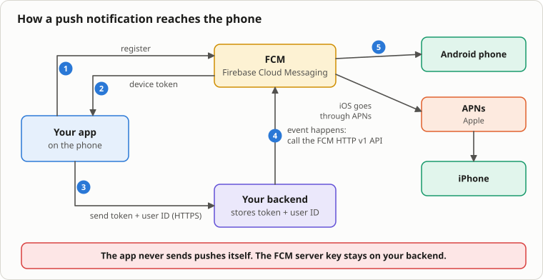
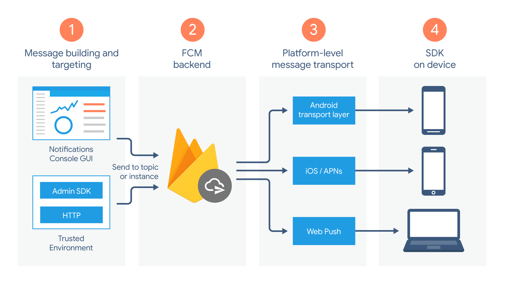
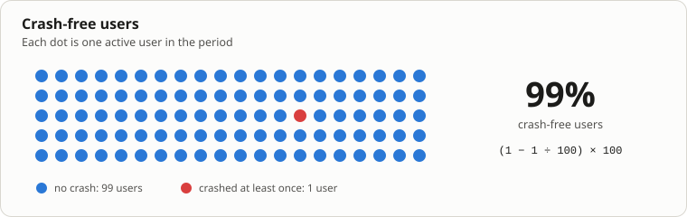
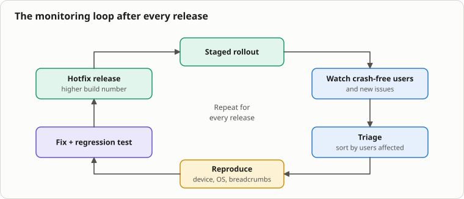

<div class="chapter-head">
<div class="chapter-kicker"><b>B4</b>Part B · API Integration, Security and Performance</div>

# Push Notifications and Crash Monitoring

</div>

> **The skill:** Add **push notifications** (FCM, APNs) and track crashes and performance with **Firebase Crashlytics** or **Sentry**.

Two halves: **push notifications** (sections 1–7) and **crash and performance monitoring** (sections 8–12). The most likely question is "explain how a push notification reaches a device", so learn the diagram in section 2.

---

## 1. Basic terms

<div class="box def">

**Definition.** A **push notification** is a message that a **server** sends to a phone. It arrives even when the app is closed. A **local notification** is created by the app itself on the phone, like an alarm.

</div>

<div class="box story">

**Example scenario.** Imagine a post office.

1. Your app cannot keep a private messenger waiting at the server all day. That would empty the battery.
2. So every phone keeps **one** connection open to a shared "post office": **FCM** on Android, **APNs** on iPhone.
3. Any server that wants to reach an app hands its letter to the post office.
4. The post office delivers it to the right phone and the right app.

**What is the address on the letter?** The **device token**: a long ID for one app on one phone.

</div>

<p class="label">Exam notes</p>

| Term | Meaning |
|---|---|
| **Push notification** | <mark>A message sent **from a server** to a device, delivered even when the app is closed</mark> |
| **Local notification** | <mark>Created and scheduled **by the app itself** on the device</mark> (a reminder). No server |
| **FCM** | <mark>**Firebase Cloud Messaging**</mark>: Google's free, cross-platform messaging service (Android, iOS, web) |
| **APNs** | <mark>**Apple Push Notification service**</mark>: Apple's service. <mark>**Every** push to an iPhone goes through it</mark> |
| **Device token** | <mark>A unique address for one app on one device</mark>. FCM calls it a <mark>**registration token**</mark> |

Why the OS runs this: one shared, battery-efficient connection per phone (Google Play services on Android, APNs on iOS) serves all apps, so each app does not keep its own connection open.

<div class="box rule">

**Remember.** Push = from a server, through FCM or APNs. Local = made on the phone. The device token is the address.

</div>

## 2. How a push notification travels (learn this)

<div class="box story">

**Example scenario.** Imagine a supervisor approves a field report in the office. The officer's phone is in her pocket, with the app closed.

1. Weeks ago, when she first logged in, the app asked FCM for a **token** and sent it to the NGO's backend. The backend saved "this token belongs to this officer".
2. Today the supervisor clicks **Approve**.
3. The backend finds her token and tells FCM: "send *Your report was approved* to this token".
4. FCM delivers it. For an iPhone, FCM passes it to APNs, and APNs delivers it.
5. Her phone shows the notification. She taps it and the app opens the report.

</div>



<br>*The official picture: (1) something creates the message, (2) the FCM backend takes it, (3) a transport layer for each platform carries it (APNs for iOS), (4) the SDK on the device receives it. Source: Firebase documentation.*

1. On launch the app registers with FCM (on iOS, with APNs first; FCM then maps the APNs token to an FCM token).
2. The app receives a **registration token**.
3. <mark>The app sends the token to **its own backend**</mark>, which saves it against the user.
4. When something happens, the backend calls the <mark>**FCM HTTP v1 API**</mark>, authenticated with a Firebase **service account** (OAuth2).
5. FCM delivers it: <mark>directly on Android, **through APNs** on iOS</mark>. The OS shows the notification or hands the data to the app.

<mark>**The app never sends pushes to other devices itself.** The server key must stay on the server.</mark>

<div class="box q">

**Can my app send a push directly to another phone?**

No, and it should not. Sending needs the project's **server key**. If that key were inside the app, anyone could take it out and send messages to all your users. So the app only **receives**. Your backend sends.

</div>

<div class="box rule">

**Remember.** App gets a token → app gives the token to your backend → backend calls FCM → FCM delivers (through APNs for iOS).

</div>

<div class="box check">

**Quick check**

1. Every push to an iPhone finally goes through: (a) FCM only (b) APNs (c) Play services
2. Where is the device token stored so messages can be sent later?
3. The user logs out. What should happen to the token on the server?

<details>
<summary>Show answers</summary>

1. **(b) APNs.**
2. On **your backend**, next to the user's ID.
3. It is deleted, so the next person using that phone does not get her messages.

</details>

</div>

## 3. APNs specifics

<div class="box def">

**In simple words.** Apple wants proof that a push really comes from you. You can prove it with a **key file (.p8)** that never expires, or with a **certificate (.p12)** that you must renew every year. The key is the easier, recommended way.

</div>

- Needs a paid **Apple Developer account** and the **Push Notifications capability** on the App ID.
- Server authentication, two options:

| | **APNs Auth Key (.p8)** | **APNs Certificate (.p12)** |
|---|---|---|
| Type | Token-based (JWT) | Certificate-based |
| Expiry | <mark>**Does not expire**</mark> | <mark>Renew **every year**</mark> |
| Scope | One key for all your apps | One per app |
| Recommended | **Yes** | Older method |

- With FCM on iOS, you <mark>**upload the .p8 key to the Firebase console**</mark>; FCM then talks to APNs for you.
- Two environments: <mark>**sandbox** (development builds) and **production**</mark>.
- <mark>iOS **must ask the user's permission**</mark> before showing notifications. Remote pushes need a real device (or a recent simulator).

## 4. Message types

<div class="box def">

**Definition.** A **notification message** has a title and a body, and the **system** shows it for you. A **data message** has only your own key-value data, and **your code** decides what to do with it.

</div>

<div class="box story">

**Example scenario.** Imagine two messages arrive while the app is in the background.

1. Message one says `title: "Report approved"`. The phone shows it in the notification bar at once. Your code did nothing. This is a **notification message**.
2. Message two says `type: "sync_needed"`. Nothing appears on screen. Your background handler wakes up and starts a sync. This is a **data message**.

</div>

<p class="label">Exam notes</p>

| | **Notification message** | **Data message** |
|---|---|---|
| Payload | `notification: {title, body}` | `data: {key: value}` only |
| In the background | <mark>The **system shows it** automatically</mark> | <mark>The **app's code** handles it</mark> |
| Use | Simple alerts | Trigger a sync, update a badge, custom display |

A message can carry both. <mark>**Silent push**</mark> (iOS `content-available: 1`, Android data-only): no alert; it wakes the app briefly to fetch data. It is throttled by the OS, so it is not guaranteed.

**Targeting:** one **token** · <mark>a **topic** (publish/subscribe</mark>, such as `po_102` or `all_field_officers`) · a **device group** · a **condition** on topics.

**Options:** **priority** (high wakes the device; normal may be delayed by Doze) · <mark>**TTL** (how long FCM keeps trying for an offline device; default and maximum 4 weeks)</mark> · <mark>**collapse key** (a newer message replaces an older one of the same kind)</mark>.

## 5. Handling messages in the three app states (Flutter)

<div class="box def">

**In simple words.** The app can be in three states when a message arrives: **open on screen**, **in the background**, or **fully closed**. Each state has its own Flutter callback.

</div>

| App state | What happens | Flutter API |
|---|---|---|
| **Foreground** | <mark>The system does **not** show a notification message automatically; your code decides</mark> | `FirebaseMessaging.onMessage` (show it with `flutter_local_notifications`) |
| **Background** | The system shows it; a tap opens the app | `onMessageOpenedApp`; data handled in `onBackgroundMessage` |
| **Terminated** | The system shows it; a tap launches the app | `getInitialMessage()` |

```dart
@pragma('vm:entry-point')
Future<void> _bgHandler(RemoteMessage m) async {       // must be a top-level function:
  await Firebase.initializeApp();                      // it runs in a separate isolate
  // e.g. mark "sync needed"
}

Future<void> initPush() async {
  final fm = FirebaseMessaging.instance;
  await fm.requestPermission();                                   // iOS, Android 13+
  final token = await fm.getToken();
  await api.registerDevice(token);                                // step ③
  fm.onTokenRefresh.listen(api.registerDevice);                   // token can change
  FirebaseMessaging.onBackgroundMessage(_bgHandler);
  FirebaseMessaging.onMessage.listen(showLocalNotification);      // foreground
  FirebaseMessaging.onMessageOpenedApp.listen(openTargetScreen);  // tapped from background
  final first = await fm.getInitialMessage();                     // tapped from terminated
  if (first != null) openTargetScreen(first);
}
```

<div class="box q">

**The app is open, a push arrives, and nothing shows. Is it a bug?**

No. When the app is in the **foreground**, the system does not show a notification message by itself. It gives the message to `onMessage` and lets your code decide. You show it yourself, usually with `flutter_local_notifications` or an in-app banner.

</div>

<div class="box rule">

**Remember.** Foreground → `onMessage` (you show it). Background → the system shows it, a tap gives `onMessageOpenedApp`. Closed → a tap gives `getInitialMessage()`.

</div>

## 6. Platform rules

<div class="box def">

**In simple words.** Both systems now ask the user before an app may show notifications. Android 13 needs a permission, and since Android 8 every notification belongs to a **channel** that the user can switch off.

</div>

- <mark>**Android 13+ (API 33):** the `POST_NOTIFICATIONS` **runtime permission** is required.</mark>
- <mark>**Android 8+ (API 26):** every notification belongs to a **notification channel**</mark>; the user controls sound and importance per channel.
- **iOS:** permission prompt; enable *Push Notifications* and *Background Modes → Remote notifications* in Xcode.
- **Token lifecycle:** the token changes on reinstall, restore, or clearing data. Listen to `onTokenRefresh`. <mark>**Delete the token from the server on logout.**</mark> The server removes tokens that FCM reports as unregistered.

## 7. Good practice

<div class="box story">

**Example scenario.** Imagine a notification that says: *"Loan of BDT 50,000 approved for Rahima Begum."*

1. The phone lies on a tea-stall table with the screen locked.
2. The notification lights up. Everyone at the table can read the name and the amount.

**What should it say?** Only: *"You have a new approval."* The app then fetches the details from the API, after the officer unlocks the phone. A notification is a doorbell, not a letter.

</div>

- <mark>**No sensitive data in the payload.**</mark> Send "You have a new approval request" plus an ID; the app fetches details over the authenticated API. Notifications appear on the lock screen and pass through third-party servers.
- <mark>**Delivery is best-effort, not guaranteed**</mark> (Doze, battery savers, no network, user disabled notifications). Never rely on push alone for critical data; the app also syncs when opened.
- **Deep link** from the notification to the right screen (`data: {type: "approval", id: "123"}`).
- Ask for permission **in context**, explain why, and do not spam. Let users choose categories.
- <mark>Use **topics** for broadcasts and **tokens** for personal messages.</mark>
- Localise the text (Bangla/English).
- The NGO uses: approval requests, task assignments, sync reminders, exception alerts, announcements to branches.

---

## 8. Why monitor after release

<div class="box def">

**Definition.** **Crash monitoring** means the app itself reports its errors to a dashboard, with the device model, the OS version and the exact line of code.

**Its purpose** is that you learn about a problem from the tool, not from an angry user.

</div>

<div class="box story">

**Example scenario.** Imagine a field officer in Rangpur taps **Save** and the app closes.

1. She cannot explain what happened. You cannot connect a debugger to her phone.
2. **Without monitoring:** you hear about it two weeks later, in a meeting.
3. **With Crashlytics:** within minutes the dashboard shows a new issue: *null error in `VisitForm.save`, 14 users, all on Android 9, app version 1.4.2*.
4. You open the stack trace, find the line, fix it and release 1.4.3.

</div>

<p class="label">Exam notes</p>

You cannot attach a debugger to a field officer's phone. **Crash reporting** tools collect errors from real devices so you see problems before users complain, know how many users are affected, and get the stack trace needed to fix them. This is "instrumenting" the app.

| Term | Meaning |
|---|---|
| **Crash (fatal)** | <mark>An unhandled exception that closes the app</mark> |
| **Non-fatal error** | <mark>A caught or handled error that you choose to report</mark> |
| **ANR** | The app froze (main thread blocked) |
| **Crash-free users** | Percentage of users with **no crash** in a period = <mark>`(1 − users who crashed ÷ active users) × 100`</mark> |
| **Stack trace** | The chain of function calls at the moment of the error |
| **Symbolication / de-obfuscation** | Turning memory addresses or obfuscated names back into readable file and line numbers, using <mark>**dSYM** files (iOS), the **R8 mapping file** (Android) and Flutter's **`--split-debug-info`** symbols</mark> |
| **Breadcrumbs / logs** | The trail of events before the crash |
| **Instrumentation** | Adding code that records how the app behaves |



<div class="box q">

**What does "99% crash-free users" mean?**

Of every 100 people who used the app in that period, 99 had no crash at all. It counts **users**, not crashes: one user who crashed five times still counts as one.

</div>

<div class="box rule">

**Remember.** Fatal = the app closed. Non-fatal = an error you caught and reported. Crash-free users = (1 − crashed users ÷ active users) × 100.

</div>

## 9. Firebase Crashlytics

<div class="box def">

**In simple words.** Crashlytics is Google's free crash reporter. You add it once at the start of `main()`, and from then on every crash on every user's phone is sent to the Firebase console and grouped into issues.

</div>

A free, real-time crash reporter from Google.

- <mark>**Groups** similar crashes into **issues** and ranks them by number of users affected</mark>.
- Shows **crash-free users**, device model, OS version, app version and app state for each crash.
- **Custom keys**, **logs** and a **user identifier** (an internal ID, not personal data) add context.
- Records **non-fatal** errors.
- <mark>**Velocity alerts**</mark> warn when one issue suddenly grows; integrates with email, Slack and Jira.
- Works with Analytics to show the events ("breadcrumbs") before a crash.

```dart
Future<void> main() async {
  WidgetsFlutterBinding.ensureInitialized();
  await Firebase.initializeApp();

  // 1. Errors caught by the Flutter framework (build, layout, paint)
  FlutterError.onError = FirebaseCrashlytics.instance.recordFlutterFatalError;

  // 2. Uncaught asynchronous errors outside the framework
  PlatformDispatcher.instance.onError = (error, stack) {
    FirebaseCrashlytics.instance.recordError(error, stack, fatal: true);
    return true;
  };
  runApp(const App());
}

// 3. A handled error you still want to know about
try { await syncNow(); }
catch (e, s) {
  FirebaseCrashlytics.instance
    ..setCustomKey('pending_records', pendingCount)
    ..recordError(e, s, reason: 'sync failed');
}
```

## 10. Sentry

<div class="box def">

**In simple words.** Sentry does the same job as Crashlytics, with two differences that matter: it also watches the **web and backend**, and you can run it on **your own servers**, so no error data leaves the organisation.

</div>

<mark>An **open-source** error tracking and performance monitoring platform.</mark>

| | Firebase Crashlytics | Sentry |
|---|---|---|
| Owner | Google (Firebase) | Sentry (open source) |
| Cost | Free | Free tier, paid plans, or **self-hosted** free |
| Hosting | Google cloud only | <mark>Cloud **or on your own servers**</mark> |
| Platforms | Mobile (Android, iOS, Flutter, Unity) | Mobile, **web, backend, desktop**: one tool for the whole system |
| Performance | Separate product (Firebase Performance) | Built in: **tracing**, slow screens, slow API calls |
| Context | Logs, keys, Analytics breadcrumbs | Rich breadcrumbs, tags, release health, session replay |
| Best when | The app already uses Firebase; you want simple and free | Full-stack tracing is needed, or data must stay **in-house** |

For the NGO, which holds sensitive financial data and may prefer its own infrastructure, <mark>**self-hosted Sentry**</mark> is a point worth writing.

<div class="box check">

**Quick check**

1. Which tool can be self-hosted? (a) Crashlytics (b) Sentry
2. A release build's stack trace shows meaningless names. What is missing?
3. An error is caught in `try/catch` and reported with `recordError`. Is it fatal or non-fatal?

<details>
<summary>Show answers</summary>

1. **(b) Sentry.**
2. The **symbol files**: dSYM for iOS, the R8 mapping file for Android, and Flutter's `--split-debug-info` symbols.
3. **Non-fatal.** The app kept running.

</details>

</div>

## 11. Application performance tracking (APM)

<div class="box def">

**In simple words.** A crash tool tells you when the app **breaks**. A performance tool tells you when the app is **slow**: how long it takes to start, to draw a screen, or to get an answer from the API, measured on real users' phones.

</div>

| Tool | Tracks |
|---|---|
| **Firebase Performance Monitoring** | App start time, slow and frozen frames per screen, HTTP request time and success rate, **custom traces** (for example "sync duration") |
| **Sentry Performance** | Transactions and spans across app and backend |
| **Firebase / Google Analytics** | Engagement: screens viewed, events, active users (DAU/MAU), retention, funnels |
| **Android vitals** (Play Console) | Crash rate, ANR rate, battery, start-up. Google's "bad behaviour" thresholds: <mark>user-perceived crash rate **1.09%**, ANR rate **0.47%**</mark>; exceeding them reduces the app's visibility on the Play Store |
| **Xcode Organizer / App Store Connect** | Crashes, hangs, energy, launch time on iOS |

## 12. Monitoring workflow

<div class="box def">

**In simple words.** Monitoring is a loop, not a single step. Every release goes through the same six steps.

</div>

1. <mark>Release with **staged rollout**</mark> (C1).
2. Watch crash-free users and new issues for the new version.
3. Triage: sort by users affected; set priority.
4. Reproduce with the device, OS, version, breadcrumbs and custom keys.
5. Fix, add a regression test, release a hotfix.
6. Confirm the issue stops in the new version; close it.



**Privacy:** <mark>never send names, NIDs, phone numbers, tokens or financial values in logs or crash reports</mark>. Use internal IDs.

## Link it to your own projects

Interviews and written exams reward answers that use **your own work** as the example. Before you move on, answer these for yourself:

<div class="box you">

- Have you set up FCM? Describe the token handling, and what happens when a notification is tapped in each app state.
- Which crash tool do you use, and which crash-free rate do you reach?
- Describe one crash you found in Crashlytics or Sentry, and how you fixed it.

</div>

---

## Practice questions

**Short (2–3 marks each)**
1. What are FCM and APNs?
2. Push notification vs local notification.
3. Notification message vs data message.
4. What is a device (registration) token? When can it change?
5. APNs auth key (.p8) vs APNs certificate (.p12).
6. What must an app do on Android 13 before showing notifications?
7. What is "crash-free users"? Write the formula.
8. What is symbolication (de-obfuscation)?
9. Fatal vs non-fatal error.
10. Give three differences between Crashlytics and Sentry.

**Long (8–10 marks each)**

11. Explain with a diagram how a push notification is delivered from a backend server to Android and iOS devices using FCM and APNs. How does a Flutter app handle messages in the foreground, background and terminated states?
12. How do you set up crash monitoring and performance tracking in a production mobile app? Compare Firebase Crashlytics and Sentry.
13. The NGO wants to notify field officers when a report is approved or rejected. Design the feature end to end, including security and reliability.

---

## Model answers

<div class="box exam">

**How to read these answers.** They are written for **learning**, so they are fuller than what you would write in the exam hall. Every answer has the same parts:

- **In short** (green): the direct answer. In the exam, write this part first.
- **Table or points:** the details, laid out so you can compare and remember them.
- **Example** (yellow): a real situation, usually from a field app or from your own projects.
- Long answers end with **In the exam** (brown): how to shorten the answer on paper.

Write your own answer first. Then open the model answer and compare.

</div>

<details>
<summary>1. What are FCM and APNs?</summary>

<div class="box def">

**In short.** <mark>**FCM (Firebase Cloud Messaging)**</mark> is Google's free service for sending messages to Android, iOS and web apps. <mark>**APNs (Apple Push Notification service)**</mark> is Apple's service that delivers every remote notification to Apple devices. FCM reaches an iPhone **through APNs**.

</div>


| Point | FCM | APNs |
|---|---|---|
| **Full form** | Firebase Cloud Messaging | Apple Push Notification service |
| **Owner** | Google | Apple |
| **Delivers to** | Android directly; iOS and web through their own services | iPhone, iPad, Mac, Apple Watch |
| **Cost** | Free | Free (needs the paid Apple Developer account) |
| **The server authenticates with** | A Firebase **service account** (HTTP v1 API) | An APNs auth key (`.p8`) or certificate (`.p12`) |
| **Address of a device** | FCM registration token | APNs device token |
| **Can you skip it?** | Yes, on iOS you could call APNs directly | No. Every push to an Apple device goes through APNs |

**Why these services exist.** An app cannot keep its own connection to its server open all day, because that would empty the battery. So the phone keeps **one** shared connection to FCM or APNs, and every app's messages arrive through it.

<div class="box story">

**Example.** A Flutter app uses the `firebase_messaging` package. The NGO's backend only talks to **FCM**. For an Android phone, FCM delivers the message itself. For an iPhone, FCM hands it to **APNs**, which delivers it. The backend does not need to know which kind of phone the officer has.

</div>

<div class="ref">

**From the book:** [1. Basic terms](#1-basic-terms) [2. How a push notification travels (learn this)](#2-how-a-push-notification-travels-learn-this)

</div>

</details>

<details>
<summary>2. Push notification vs local notification.</summary>

<div class="box def">

**In short.** A **push (remote) notification** is sent by a **server** through FCM/APNs and can arrive even when the app is closed. A **local notification** is created and scheduled **by the app itself on the device**, with no server and no internet.

</div>

| Point | Push notification | Local notification |
|---|---|---|
| **Who creates it** | A server | The app on the device |
| **Needs internet** | Yes | No |
| **Needs FCM / APNs** | Yes | No |
| **Needs a device token** | Yes | No |
| **Trigger** | An event on the server | A time, or an event inside the app |
| **Flutter package** | `firebase_messaging` | `flutter_local_notifications` |
| **Examples** | "Your report was approved", a new message | A reminder at 9 AM, "Download complete", "5 records still not synced" |
| **Needs the user's permission** | Yes | Yes |

**They work together.** When an FCM message arrives while the app is in the **foreground**, the system does not show it. The app shows it itself with a **local** notification.

<div class="box story">

**Example.** "Report approved by your supervisor" comes from the server: push. "You have 3 visits that are not synced. Connect to the internet." comes from the app, which checks its outbox at 6 PM, even with no network: local.

</div>

<div class="ref">

**From the book:** [1. Basic terms](#1-basic-terms)

</div>

</details>

<details>
<summary>3. Notification message vs data message.</summary>

<div class="box def">

**In short.** A **notification message** carries a `title` and `body`, and the **system shows it automatically** when the app is in the background. A **data message** carries only custom key–value pairs, and **your code decides** what to do with it.

</div>

| Point | Notification message | Data message |
|---|---|---|
| **Payload** | `notification: {title, body}` | `data: {key: value}` |
| **Who handles it in the background** | The system tray, automatically | Your background handler |
| **Who handles it in the foreground** | Your code (`onMessage`) | Your code (`onMessage`) |
| **Visible to the user** | Yes | Only if your code shows something |
| **Use it for** | Simple alerts | Silent sync, custom UI, deep links, updating a badge |
| **Reliability in the background** | High | Can be delayed by Doze or battery savers, unless sent with high priority |

```json
{ "message": {
    "token": "<device token>",
    "notification": { "title": "Report approved", "body": "Tap to view" },
    "data": { "type": "report_status", "reportId": "R-1042" }
} }
```

**The usual choice:** send **both** in one message. The `notification` part shows the alert, and the `data` part tells the app which screen to open on tap.

<div class="box story">

**Example.** Message one says "Report approved". The phone shows it at once, and your code did nothing: a notification message. Message two says `type: "sync_needed"`. Nothing appears on screen. The background handler wakes up and starts a sync: a data message.

</div>

<div class="ref">

**From the book:** [4. Message types](#4-message-types)

</div>

</details>

<details>
<summary>4. What is a device (registration) token? When can it change?</summary>

<div class="box def">

**In short.** The device token is a **unique ID for one installation of the app on one device**. It is the delivery address that FCM uses. It can change when the app is reinstalled, its data is cleared, it is restored on a new phone, or FCM refreshes it.

</div>

| The token changes when... | Why |
|---|---|
| The app is uninstalled and installed again | It is a new installation |
| The user clears the app data | The old registration is gone |
| The app is restored on a new device | A different device |
| FCM refreshes it | Old or unused tokens expire |

**What the app must do**

1. Get the token after login.
2. Send it to **your own backend**, which saves it with the user ID.
3. Listen for changes and send the new token.
4. On **logout**, delete the token from the server.

```dart
final token = await FirebaseMessaging.instance.getToken();
await api.registerDevice(token);                              // save on the backend

FirebaseMessaging.instance.onTokenRefresh.listen(api.registerDevice);

await api.unregisterDevice(token);                            // on logout
await FirebaseMessaging.instance.deleteToken();
```

**What the server must do:** when FCM answers that a token is no longer registered, the server removes it. One user can have several tokens (a phone and a tablet).

<div class="box story">

**Example.** Two officers share one office phone. Officer A logs out and officer B logs in. If the token is not removed from A's account on logout, A's "report approved" notifications appear on the phone while B is using it. That is a privacy leak.

</div>

<div class="ref">

**From the book:** [2. How a push notification travels (learn this)](#2-how-a-push-notification-travels-learn-this)

</div>

</details>

<details>
<summary>5. APNs auth key (.p8) vs APNs certificate (.p12).</summary>

<div class="box def">

**In short.** Both let a server (or Firebase) prove to APNs that it may send pushes for your app. The **`.p8` auth key** is token-based, never expires and works for all your apps. The **`.p12` certificate** is for one app and must be renewed every year. Apple and Firebase recommend the `.p8` key.

</div>

| Point | APNs auth key (`.p8`) | APNs certificate (`.p12`) |
|---|---|---|
| **Type** | Token-based authentication | Certificate-based authentication |
| **Expires** | <mark>Never</mark> (until you revoke it) | <mark>After one year</mark> |
| **Covers** | All apps in the developer account | One app (one bundle ID) |
| **Development and production** | The same key for both | Separate certificates (or one combined) |
| **You also need** | The **Key ID** and the **Team ID** | A password for the file |
| **Risk** | You can download it only once, so keep it safe | Push silently stops when it expires |
| **Recommended** | Yes | Legacy |

**Where it goes:** in the Firebase console, under Project settings → Cloud Messaging → Apple app configuration. After that, FCM can pass messages to APNs for you.

<div class="box story">

**Example.** A team used a `.p12` certificate. One year later, iPhone users stopped getting notifications while Android worked. Nobody had noted the expiry date. With a `.p8` key this cannot happen.

</div>

<div class="ref">

**From the book:** [3. APNs specifics](#3-apns-specifics)

</div>

</details>

<details>
<summary>6. What must an app do on Android 13 before showing notifications?</summary>

<div class="box def">

**In short.** On Android 13 (API 33) and above, the app must **declare and request the `POST_NOTIFICATIONS` runtime permission**. It must also create a **notification channel**, which has been required since Android 8.

</div>

| Android version | Rule |
|---|---|
| Before Android 8 | Notifications work with no extra step |
| **Android 8 (API 26)+** | Every notification must belong to a **notification channel** |
| **Android 13 (API 33)+** | The user must grant <mark>`POST_NOTIFICATIONS`</mark> at run time. Notifications are **off by default** for newly installed apps |

**The steps**

1. Declare it in `AndroidManifest.xml`:

```xml
<uses-permission android:name="android.permission.POST_NOTIFICATIONS"/>
```

2. Ask at a sensible moment and explain why:

```dart
final settings = await FirebaseMessaging.instance.requestPermission();
if (settings.authorizationStatus == AuthorizationStatus.authorized) { /* ok */ }
```

3. Create a channel, for example "Report status" with high importance.
4. If the user says no, the app must still work. Show the same information in an in-app list.

| | Android 13+ | iOS |
|---|---|---|
| **Permission needed** | Yes, `POST_NOTIFICATIONS` | Yes, always |
| **If denied** | The user must turn it on in Settings | The same |
| **Channels** | Yes: the user can mute one kind and keep another | No channels (there are categories and interruption levels) |

<div class="box story">

**Example.** An app asked for the permission on the very first screen, before the user knew what the app was. Most users tapped "Don't allow". The better way is to ask after login, with one line: "Allow notifications to know when your report is approved."

</div>

<div class="ref">

**From the book:** [6. Platform rules](#6-platform-rules)

</div>

</details>

<details>
<summary>7. What is "crash-free users"? Write the formula.</summary>

<div class="box def">

**In short.** Crash-free users is the **percentage of users who did not have a single crash** in a period of time.

**Crash-free users (%) = (1 − users who crashed ÷ total active users) × 100**

</div>


**A worked example**

| | Number |
|---|---|
| Active users this week | 2,000 |
| Users who had at least one crash | 20 |
| Calculation | (1 − 20 ÷ 2,000) × 100 |
| **Crash-free users** | **99%** |

| Metric | Counts | Note |
|---|---|---|
| **Crash-free users** | People | One user with ten crashes counts once |
| **Crash-free sessions** | App sessions | One user with ten crashes counts ten times |

**How to use the number**

- A common target is **99% or higher**. Many teams aim for 99.5%.
- Watch it **per app version**. A drop right after a release means the new version has a problem.
- It is the main health number in Firebase Crashlytics.

<div class="box story">

**Your own number.** Your CV says "99% crash-free rate across published apps". If asked, explain it: "I watched Crashlytics after each release, fixed the top issues first, and tested on low-end devices."

</div>

<div class="ref">

**From the book:** [8. Why monitor after release](#8-why-monitor-after-release)

</div>

</details>

<details>
<summary>8. What is symbolication (de-obfuscation)?</summary>

<div class="box def">

**In short.** Symbolication turns a **raw crash report** (memory addresses or shortened names) back into **readable class names, method names, file names and line numbers**. It needs the **debug symbol files** from the same build.

</div>

**Why it is needed.** A release build is compiled to machine code and is often obfuscated, to make it smaller and harder to reverse-engineer. So a crash looks like this:

| Before symbolication | After symbolication |
|---|---|
| `#00 pc 0x00000000001a2b3c libapp.so` | `VisitForm.save (visit_form.dart:142)` |
| `a.b.c(Unknown Source)` | `SyncService.pushOutbox (SyncService.kt:57)` |

| Platform | Symbol file | Made by |
|---|---|---|
| **iOS** | <mark>dSYM</mark> | Xcode, for each build |
| **Android** (Kotlin/Java) | <mark>R8 / ProGuard `mapping.txt`</mark> | The Gradle release build |
| **Flutter** (Dart) | Symbol files in the folder given to <mark>`--split-debug-info`</mark> | `flutter build ... --obfuscate --split-debug-info=<dir>` |

**The rules**

- Upload the symbol files to Crashlytics or Sentry for **every release**, best done automatically in CI.
- The files must match the exact build. Keep them for every version that is in the stores.
- Offline, `flutter symbolize` can decode one stack trace.

<div class="box story">

**Example.** A crash report from production shows only addresses in `libapp.so`. You cannot tell which screen failed. After the symbol files are uploaded, the same report reads "null check error in `VisitForm.save`, line 142", and the fix takes ten minutes.

</div>

<div class="ref">

**From the book:** [8. Why monitor after release](#8-why-monitor-after-release)

</div>

</details>

<details>
<summary>9. Fatal vs non-fatal error.</summary>

<div class="box def">

**In short.** A **fatal** error is an unhandled exception that **closes the app**: a crash. A **non-fatal** error was **caught** and the app continued, but it is still reported so the team can see hidden problems.

</div>

| Point | Fatal | Non-fatal |
|---|---|---|
| **The app** | Terminates | Keeps running |
| **The user sees** | The app closes | An error message, or nothing |
| **Caught by the code?** | No | Yes (`try` / `catch`) |
| **Reported** | Automatically | By you: `recordError(...)` |
| **Counts against crash-free users** | Yes | No |
| **Examples** | A null check on a null value; an out-of-memory kill; a native crash | An API returns 500; a sync fails; JSON has an unexpected shape |

```dart
// Fatal: everything that is not caught
FlutterError.onError = FirebaseCrashlytics.instance.recordFlutterFatalError;

// Non-fatal: caught and reported by hand
try {
  await syncService.push();
} catch (e, stack) {
  FirebaseCrashlytics.instance.recordError(e, stack, reason: 'sync push failed');
}
```

**Why report non-fatals?** An app can have 99.9% crash-free users while sync silently fails for a third of them. Non-fatal reports make such problems visible.

<div class="box story">

**Example.** Field officers say "my visits do not reach the office", but there are no crashes. The non-fatal reports show 400 "sync push failed: 413 Payload Too Large" errors from phones that take very large photos. Without non-fatal reporting nobody would have known.

</div>

<div class="ref">

**From the book:** [8. Why monitor after release](#8-why-monitor-after-release) [9. Firebase Crashlytics](#9-firebase-crashlytics)

</div>

</details>

<details>
<summary>10. Give three differences between Crashlytics and Sentry.</summary>

<div class="box def">

**In short.** (1) **Crashlytics** runs only on Google's cloud; **Sentry** is open source and can be **self-hosted**. (2) Crashlytics is for **mobile apps**; Sentry also covers **web and backend**. (3) Sentry has **performance tracing built in**; Firebase uses a separate product for that.

</div>

| Point | Firebase Crashlytics | Sentry |
|---|---|---|
| **Owner** | Google (part of Firebase) | Sentry (open source) |
| **Hosting** | Google cloud only | <mark>Cloud **or your own servers**</mark> |
| **Platforms** | Mobile: Android, iOS, Flutter, Unity | Mobile, **web, backend, desktop**: one tool for the whole system |
| **Price** | Free | A free tier, then paid; free if self-hosted (you pay for the server) |
| **Performance** | A separate product: Firebase Performance Monitoring | Built in: tracing, slow screens, slow API calls |
| **Follow one request across systems** | No | Yes: from the tap in the app to the backend query |
| **Works with** | Firebase Analytics, FCM, Remote Config | Jira, Slack, GitHub and many more |
| **Best when** | The app already uses Firebase and you want simple and free | Full-stack tracing is needed, or the data must stay **in-house** |

**What both do:** group crashes into issues, show the stack trace, device, OS and app version, keep breadcrumbs (what happened before), and send alerts.

<div class="box story">

**Example for the NGO.** If the NGO's apps already use Firebase for push, Crashlytics costs nothing and takes one hour to add. If a policy says that error data, which may contain user IDs, must not leave the NGO's own servers, then **self-hosted Sentry** is the answer. Job adverts name both, so know both.

</div>

<div class="ref">

**From the book:** [10. Sentry](#10-sentry)

</div>

</details>

<details>
<summary>11. Explain with a diagram how a push notification is delivered from a backend server to Android and iOS devices using FCM and APNs. How does a Flutter app handle messages in the foreground, background and terminated states?</summary>

<div class="box def">

**In short.** The app gets a **token** from FCM and gives it to the backend. To notify a user, the backend sends the message and the token to **FCM**. FCM delivers it directly to Android, and **through APNs** to iOS. In Flutter, `onMessage` handles the foreground, the system tray plus `onMessageOpenedApp` handle the background, and `getInitialMessage()` handles a launch from a terminated state.

</div>


#### 1. The delivery, in five steps

| # | Step |
|---|---|
| 1 | On launch the app **registers** with FCM. (On iOS it registers with APNs first, and FCM maps the APNs token to an FCM token.) |
| 2 | The app receives a **registration token** |
| 3 | <mark>The app sends the token to **its own backend**</mark>, which saves it against the user |
| 4 | When something happens, the backend calls the **FCM HTTP v1 API**, authenticated with a Firebase **service account** |
| 5 | FCM delivers it: <mark>directly on Android, **through APNs** on iOS</mark>. The OS shows the notification or hands the data to the app |

<br>*FCM's own picture: the tool or server that creates the message, the FCM backend, the transport layer (Android, APNs, web push), and the SDK on the device. Source: Firebase documentation.*

#### 2. What iOS needs in addition

- An **APNs auth key (`.p8`)** uploaded to the Firebase console.
- The **Push Notifications** capability in Xcode.
- The user's **permission**, always.

#### 3. The message types

| Type | Payload | Shown by |
|---|---|---|
| **Notification message** | `title`, `body` | The system, when the app is in the background |
| **Data message** | Custom key–values | Your code |
| **Both together** | — | The system shows it; your code reads the data on tap |

#### 4. The three app states in Flutter

| State | What happens | Flutter API |
|---|---|---|
| **Foreground** (the app is open) | <mark>The system does **not** show the notification. Your code decides</mark> | `FirebaseMessaging.onMessage`; show it with `flutter_local_notifications` or an in-app banner |
| **Background** (the app is minimised) | The system shows it. A tap opens the app | `onMessageOpenedApp` for the tap; `onBackgroundMessage` for data |
| **Terminated** (the app is closed) | The system shows it. A tap launches the app | `getInitialMessage()` |

```dart
@pragma('vm:entry-point')
Future<void> _bgHandler(RemoteMessage m) async { /* e.g. start a sync */ }

void setupPush() async {
  FirebaseMessaging.onBackgroundMessage(_bgHandler);              // background data

  FirebaseMessaging.onMessage.listen((m) => showLocal(m));        // foreground

  FirebaseMessaging.onMessageOpenedApp.listen(                    // tap, background
      (m) => openReport(m.data['reportId']));

  final first = await FirebaseMessaging.instance.getInitialMessage();   // tap, terminated
  if (first != null) openReport(first.data['reportId']);
}
```

The background handler must be a **top-level function**, because it runs in its own isolate.

#### 5. Good practice

- Refresh the token (`onTokenRefresh`) and **delete it on logout**.
- Do not put personal or financial details in the payload, because it shows on the lock screen.
- Delivery is **best-effort**, not guaranteed. So the app also fetches the latest status when it opens.

<div class="box story">

**Link to your own work.** Close with one true sentence about your own projects, for example: "I used Firebase Messaging for time-critical alerts, where high-priority messages were needed to wake the phone."

</div>

<div class="box exam">

**In the exam.** Draw: Backend → FCM → (Android device) and FCM → APNs → (iPhone), with the token going from the app back to the backend. Number the five steps. Add the three-state table with the API names. End with "best-effort, so the app also syncs on open".

</div>

<div class="ref">

**From the book:** [2. How a push notification travels (learn this)](#2-how-a-push-notification-travels-learn-this) [4. Message types](#4-message-types) [5. Handling messages in the three app states (Flutter)](#5-handling-messages-in-the-three-app-states-flutter)

</div>

</details>

<details>
<summary>12. How do you set up crash monitoring and performance tracking in a production mobile app? Compare Firebase Crashlytics and Sentry.</summary>

<div class="box def">

**In short.** I add a crash-reporting SDK, **catch errors at every level**, attach context (app version, user ID, screen), **upload symbol files** so stack traces are readable, and add **performance traces**. After each release I watch the dashboard and fix the issues that affect the most users. Crashlytics is the simple, free choice; Sentry is the choice for full-stack tracing or self-hosting.

</div>

#### 1. Why monitor

- You cannot attach a debugger to a field officer's phone.
- Users rarely report crashes. They just stop using the app.
- Monitoring shows **what** failed, on **which** device and version, for **how many** users.

#### 2. Setting up crash monitoring

| # | Step | Detail |
|---|---|---|
| 1 | Add the SDK | `firebase_crashlytics` or `sentry_flutter` |
| 2 | Catch Flutter framework errors | `FlutterError.onError` |
| 3 | Catch errors outside Flutter (async, platform) | `PlatformDispatcher.instance.onError` |
| 4 | Report handled errors | `recordError(e, stack)` as **non-fatal** |
| 5 | Add context | Custom keys (branch, screen), logs / breadcrumbs, an **internal** user ID (never a name or NID) |
| 6 | Upload symbols | dSYM (iOS), `mapping.txt` (Android), `--split-debug-info` (Flutter), automatically in CI |
| 7 | Separate the environments | Switch collection off in debug builds; tag dev, staging and production |
| 8 | Alerts | Email or Slack on a new issue or a jump in crashes |

```dart
Future<void> main() async {
  WidgetsFlutterBinding.ensureInitialized();
  await Firebase.initializeApp();

  FlutterError.onError = FirebaseCrashlytics.instance.recordFlutterFatalError;
  PlatformDispatcher.instance.onError = (error, stack) {
    FirebaseCrashlytics.instance.recordError(error, stack, fatal: true);
    return true;
  };

  await FirebaseCrashlytics.instance.setCrashlyticsCollectionEnabled(!kDebugMode);
  runApp(const App());
}
```

#### 3. Setting up performance tracking (APM)

| What to measure | Tool |
|---|---|
| App start time | Firebase Performance / Sentry (automatic) |
| Slow and frozen frames per screen | Firebase Performance / Sentry |
| HTTP request time, size and success rate | Automatic network tracing |
| Your own key actions ("save visit", "full sync") | **Custom traces** |
| ANR rate, crash rate, battery | **Android vitals** in the Play Console |

#### 4. The workflow after every release


1. Release with a **staged rollout**.
2. Watch **crash-free users** and new issues for the new version.
3. **Triage:** sort by users affected and set the priority.
4. **Reproduce** with the device, OS, version, breadcrumbs and custom keys.
5. **Fix**, add a regression test, and release a hotfix.
6. **Confirm** the issue stops in the new version, then close it.

#### 5. Crashlytics vs Sentry

| Point | Firebase Crashlytics | Sentry |
|---|---|---|
| **Hosting** | Google cloud only | Cloud **or self-hosted** |
| **Platforms** | Mobile | Mobile, web, backend, desktop |
| **Price** | Free | Free tier, then paid; free if self-hosted |
| **Performance tracing** | Separate product (Firebase Performance) | Built in, across app and backend |
| **Best when** | The app already uses Firebase | Full-stack tracing is needed, or data must stay in-house |

**My recommendation:** Crashlytics for an app that already uses Firebase (FCM). Self-hosted Sentry where the NGO requires that monitoring data stays on its own servers, or wants one tool for the app and the backend.

<div class="box story">

**Link to your own work.** Close with one true sentence about your own projects, for example: "I kept a high crash-free rate by monitoring crash reports, fixing the top issues in each release and testing on low-end devices." Quote your real number.

</div>

<div class="box exam">

**In the exam.** Purpose in two lines. Setup as six numbered steps, with the three levels of error capture named. Four things to measure for performance. The six-step workflow. A comparison table with four rows, then one line of recommendation.

</div>

<div class="ref">

**From the book:** [9. Firebase Crashlytics](#9-firebase-crashlytics) [10. Sentry](#10-sentry) [11. Application performance tracking (APM)](#11-application-performance-tracking-apm) [12. Monitoring workflow](#12-monitoring-workflow) [C1 · 10. After release](C1%20-%20Store%20Publishing%20and%20Code%20Signing.md#10-after-release)

</div>

</details>

<details>
<summary>13. The NGO wants to notify field officers when a report is approved or rejected. Design the feature end to end, including security and reliability.</summary>

<div class="box def">

**In short.** After login the app registers its FCM token with the backend. When a reviewer approves or rejects a report, the backend sends a push through **FCM** (and APNs for iOS) to that officer's devices. The message carries **only the report ID and status, no sensitive data**. A tap opens the report, which the app fetches from the API with the user's own token. Because push is best-effort, the status also arrives through normal sync.

</div>


#### 1. The flow

| # | Who | What |
|---|---|---|
| 1 | App | After login, gets the FCM token and sends it with the user ID and device info to the backend |
| 2 | Reviewer | Approves or rejects the report in the web system |
| 3 | Backend | Saves the decision, then asks its notification service to notify the report's owner |
| 4 | Notification service | Finds the officer's tokens and calls the **FCM HTTP v1 API** |
| 5 | FCM / APNs | Deliver to the phone |
| 6 | App | Shows the notification. A tap opens the report |

#### 2. The payload

```json
{
  "notification": { "title": "রিপোর্ট অনুমোদিত", "body": "বিস্তারিত দেখতে ট্যাপ করুন" },
  "data": { "type": "report_status", "reportId": "R-1042", "status": "approved" },
  "android": { "priority": "high" }
}
```

- The title and body are in the **user's language**.
- <mark>**No borrower name, amount or other personal or financial data.**</mark> The text is visible on a locked screen.

#### 3. How the app handles it

| App state | Behaviour |
|---|---|
| **Foreground** | An in-app banner; the report list refreshes |
| **Background / terminated** | A system notification |
| **Tap** | A deep link to the report screen. The app **fetches the report from the API** with the user's access token, then shows it |
| **Not logged in** | Login first, then go to the report |

#### 4. Security

| Risk | Control |
|---|---|
| Someone else sends fake notifications | The Firebase service account key lives **only on the backend**, never in the app |
| The notification reaches the wrong person | The token is tied to the logged-in user and **deleted on logout** |
| Data leaks through the lock screen | Only an ID and a status in the payload |
| A forged payload opens a report the user should not see | The **API authorises** the fetch by role and ownership |
| A reviewer's action is disputed | An audit log on the server |

#### 5. Reliability

- Push is **best-effort**. So the status also updates on the next **sync**, and the app keeps an **in-app notification list** that is filled from the server.
- **High priority** for approvals, so Doze does not delay them.
- The backend sends through a **queue** and retries with backoff if FCM is unavailable.
- The backend removes tokens that FCM reports as invalid.
- One user may have several devices, so the backend sends to all of that user's tokens.

#### 6. Platform setup

| Android | iOS |
|---|---|
| `POST_NOTIFICATIONS` permission on Android 13+ | Permission request, always |
| A notification channel "Report status" | APNs auth key (`.p8`) in Firebase |
| A small notification icon | The Push Notifications capability |

#### 7. Monitoring

- Log sent, delivered and opened counts.
- Watch for failures in the notification service.
- If many officers switch notifications off, improve the wording or the frequency.

<div class="box story">

**Example.** An officer in Kurigram submits her monthly report at 5 PM and goes home. At 8 PM the supervisor rejects it with a comment. Her phone shows "Report returned. Tap to view." She opens it, reads the comment, corrects the figure and resubmits the same night, instead of finding out the next morning.

</div>

<div class="box exam">

**In the exam.** Use the headings: Flow (with a small diagram) · Payload · App handling · Security · Reliability · Platform. Two or three points under each. The two sentences that earn the most marks: "no sensitive data in the payload" and "push is best-effort, so sync is the fallback".

</div>

<div class="ref">

**From the book:** [2. How a push notification travels (learn this)](#2-how-a-push-notification-travels-learn-this) [5. Handling messages in the three app states (Flutter)](#5-handling-messages-in-the-three-app-states-flutter) [7. Good practice](#7-good-practice)

</div>

</details>

<div class="book-nav"><span>← <a href="B3%20-%20Performance%20Optimization.md">B3 - Performance Optimization</a></span><span><a href="00%20-%20Contents%20and%20How%20to%20Use.md">Contents</a></span><span><a href="C1%20-%20Store%20Publishing%20and%20Code%20Signing.md">C1 - Store Publishing and Code Signing</a> →</span></div>
