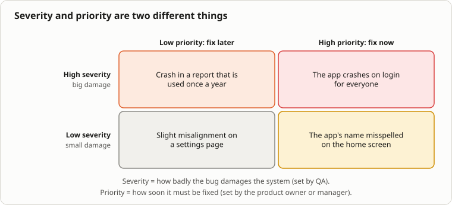
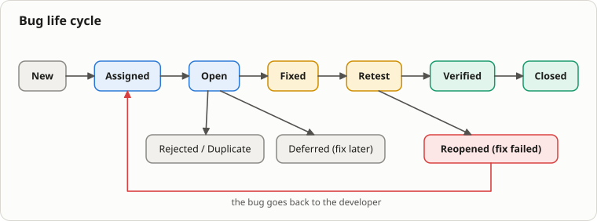
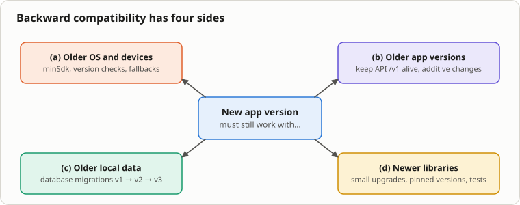

<div class="chapter-head">
<div class="chapter-kicker"><b>D2</b>Part D · Testing, Maintenance and Collaboration</div>

# Post-Deployment Support

</div>

> **The skill:** **Monitor** crash logs, **troubleshoot** bug reports, and **refactor** apps while keeping them **backward compatible**.

Four verbs: **monitor**, **troubleshoot**, **refactor**, **maintain backward compatibility**. This is the shortest chapter, but "what is refactoring?" and "severity vs priority" are easy short-question marks, and "backward compatibility" has three meanings you should be able to list.

---

## 1. Software maintenance

<div class="box def">

**Definition.** **Software maintenance** is all the work done on an app **after** it is released: fixing it, keeping it working as phones change, and making it better.

</div>

<div class="box story">

**Example scenario.** Imagine you own a car.

1. A tyre goes flat and you repair it. *(**Corrective**: fix what broke.)*
2. A new law requires a different number plate, so you change it. *(**Adaptive**: the world around the car changed, for example a new Android version.)*
3. You add a better music system. *(**Perfective**: make it nicer or faster.)*
4. You change the engine oil before anything goes wrong. *(**Preventive**: refactoring, updating packages.)*

</div>

<p class="label">Exam notes</p>

<mark>Most of an app's life and cost come **after** the first release.</mark>

| Type | Meaning | Mobile example |
|---|---|---|
| **Corrective** | <mark>Fixing bugs found in use</mark> | A crash when saving a form |
| **Adaptive** | <mark>Adjusting to a changed environment</mark> | Supporting a new Android/iOS version, a new store policy, a changed API |
| **Perfective** | <mark>Improving features or performance</mark> | Faster sync, a better screen |
| **Preventive** | <mark>Reducing future problems</mark> | Refactoring, updating packages, adding tests |

<div class="box rule">

**Remember.** Corrective = fix bugs. Adaptive = follow a changed environment. Perfective = improve. Preventive = avoid future problems.

</div>

## 2. Monitoring crash logs

<div class="box def">

**In simple words.** A **crash log** is the app's own report of an accident: what went wrong, on which line, on which phone. *Monitoring* means looking at these reports regularly, so you fix the biggest problems first.

</div>

<div class="box story">

**Example scenario.** Imagine you open Crashlytics on Monday and see this:

```
Null check operator used on a null value
#0  VisitForm._save        (visit_form.dart:88)
#1  _InkResponseState.handleTap   (ink_well.dart:1170)
Affected: 14 users · Android 9 · app 1.4.2
```

**How do you read it?**

1. **Top line:** the kind of error. Something was `null` where the code said "this is never null".
2. **The first line that is your own file:** `visit_form.dart`, line 88. Start there. The lines below it are Flutter's own code.
3. **The pattern:** only Android 9, only version 1.4.2. So it is something new in this version that old phones handle differently.

</div>

| Source | Shows |
|---|---|
| **Firebase Crashlytics / Sentry** | Crashes and non-fatal errors grouped into issues, with stack trace, device, OS, app version, logs (B4) |
| **Android vitals** (Play Console) | Crash rate, ANR rate, by device and OS |
| **Xcode Organizer / App Store Connect** | iOS crashes, hangs, energy |
| **Store reviews and ratings** | What users complain about |
| **Server logs, API error rates** | Failures the app causes or receives |
| **Support channel / helpdesk tickets** | Reports from field staff and branches |

**A daily/weekly routine:** check crash-free users for the newest version → look at **new** and **regressed** issues → sort by users affected → create tickets → set alerts so sudden spikes notify the team.

**Reading a stack trace:** <mark>read from the **top**: the exception type and message, then the first line that is **your own code**</mark> (not framework code). Check the app version, OS and device pattern, and the breadcrumbs before the crash. Release builds are obfuscated, so the symbol files must be uploaded (`flutter symbolize`, dSYM, R8 mapping).

**Common mobile crash causes**
| Cause | Typical fix |
|---|---|
| Null value used (`Null check operator used on a null value`) | Null-safe code, default values |
| `setState()` called after `dispose()` | Check `mounted` after `await` |
| Index out of range, bad cast | Validate list length and types |
| API response changed shape | Tolerant parsing, API versioning |
| Out of memory | Resize images, paginate (B3) |
| Database migration failed after an update | Test migrations from every old version |
| Missing permission or a changed OS rule | Handle denied permissions; check OS version |
| Main thread blocked (ANR) | Move work off the main thread |
| Platform or plugin exception | Catch `PlatformException`; update the plugin |

## 3. Bug reports

<div class="box def">

**In simple words.** A **bug report** is a message that says something is wrong. A good one lets the developer see the problem on his own phone. Two labels on a bug are often confused: **severity** and **priority**.

</div>

<div class="box story">

**Example scenario.** Imagine two bugs arrive on the same morning.

1. **Bug A:** the yearly summary report crashes the app. The report is used once, in June. Today is November.
2. **Bug B:** the home screen shows the organisation's name with one letter missing. Tomorrow the app will be shown to the Managing Director.

**Which is worse? Which do you fix first?** Bug A does more **damage** (a crash): high **severity**. But nobody needs it today: low **priority**. Bug B damages nothing (a spelling mistake): low severity. But it must be fixed today: high priority.

</div>

<p class="label">Exam notes</p>

**A good bug report contains:** title · steps to reproduce · expected result · actual result · app version and build · device model and OS version · network state (online/offline) · user role · screenshots, screen recording, logs · severity.

**Severity vs priority**
| | **Severity** | **Priority** |
|---|---|---|
| Means | <mark>How badly the bug **damages the system**</mark> | <mark>How **soon** it must be fixed</mark> |
| Set by | Tester / QA | Product owner / manager |
| Levels | <mark>Critical, Major, Minor, Trivial</mark> | High, Medium, Low |

| Example | Severity | Priority |
|---|---|---|
| App crashes on login for everyone | High | High |
| Crash in a report that is used once a year | High | Low |
| The app's name misspelled on the home screen | Low | High |
| Slight misalignment on a settings page | Low | Low |



**Bug life cycle**



<div class="box rule">

**Remember.** Severity = how much damage (set by QA). Priority = how soon to fix (set by the manager). They are independent.

</div>

## 4. Troubleshooting: a fixed method

<div class="box def">

**In simple words.** Troubleshooting is detective work with a fixed order. First **make the bug happen** on your own device. Only then look for the cause. A bug you cannot reproduce, you cannot be sure you fixed.

</div>

1. **Understand** the report; collect version, device, steps.
2. **Reproduce** it (same OS, same data, same network condition). If you cannot, add logging and get more details.
3. **Isolate** where it fails: UI, state logic, local DB, network, or server.
4. <mark>**Find the root cause**, not only the symptom. Use the **5 Whys**.</mark>
5. **Fix** with the smallest safe change.
6. <mark>**Write a regression test** that fails before the fix and passes after.</mark>
7. **Review, test and release** (hotfix if urgent), with a staged rollout.
8. **Monitor** to confirm the issue stops; close the ticket and note the cause.

**Debugging tools:** breakpoints and step-through in the IDE · logs (`debugPrint`, `adb logcat`, Xcode console) · Flutter DevTools (widget inspector, network, memory) · a proxy to inspect API traffic (Charles, Proxyman) · `git bisect` to find the commit that introduced a bug · Crashlytics custom keys and logs.

<mark>**SLA** (Service Level Agreement)</mark>: agreed response and fix times, for example "a critical issue gets a response within a few hours".

<div class="box q">

**What is the "5 Whys" method?**

You ask "why?" again and again until you reach the real cause. *The app crashed.* Why? A value was null. Why? The API did not send that field. Why? The backend renamed it. Why? Nobody told the mobile team. **Real cause:** no agreed API contract. Fixing only the null would hide the problem, not solve it.

</div>

## 5. Refactoring

<div class="box def">

**Definition.** **Refactoring** is cleaning up the inside of the code **without changing what it does**. The user sees no difference. The next developer sees code that is easier to read, test and change.

</div>

<div class="box story">

**Example scenario.** Imagine a storeroom where things have been thrown in for two years.

1. You need a file, and it takes twenty minutes to find it.
2. One weekend you sort everything onto labelled shelves.
3. **Nothing new** is in the room and **nothing is missing**. But now every job takes two minutes.

**That weekend is refactoring.** The mess you had before has a name too: **technical debt**. Like a loan, it grows. Every month you leave it, each new feature costs a little more time.

</div>

<p class="label">Exam notes</p>

> <mark>**Refactoring is improving the internal structure of existing code without changing its external behaviour.**</mark>

<mark>It is not adding features and not fixing bugs.</mark> Users see no difference; developers get code that is easier to read, test and change.

**Why:** remove <mark>**technical debt** (the future cost of quick, poor solutions)</mark> · make new features easier and safer · improve readability · enable testing · prepare for upgrades.

<mark>**Code smells (signs that code needs refactoring)**</mark>
| Smell | Refactoring |
|---|---|
| Long method; a huge `build()` | **Extract Method / Extract Widget** |
| Large "God" class doing everything | **Extract Class**; split by responsibility |
| Duplicate code | Extract a shared function or widget (DRY) |
| Magic numbers and strings | **Replace with named constants** |
| Long parameter list | **Introduce a parameter object** |
| Deeply nested `if`/`else` | Guard clauses (early return); polymorphism |
| Business logic inside widgets | Move to a BLoC / ViewModel / use case |
| Dead code, unused packages | Delete |
| Poor names | **Rename** |
| Tight coupling to a library | Wrap behind an interface |

**Rules for safe refactoring:** <mark>have tests first (they are the safety net)</mark> · take small steps and run tests after each · keep refactoring commits separate from feature commits · no behaviour change · code review · use the IDE's automatic refactoring tools.

**Refactoring a legacy app (a likely long question):** (1) understand it and write <mark>**characterisation tests**</mark> for current behaviour; (2) add crash monitoring; (3) upgrade the SDK and packages in small steps; (4) <mark>refactor **module by module** behind stable interfaces, not a big rewrite</mark> (the "strangler" approach: new code grows around the old until the old part is removed); (5) for example, move one feature at a time from GetX controllers to BLoC with a repository layer; (6) release in small increments with staged rollout.

<div class="box q">

**Why not throw the old app away and rewrite it?**

A full rewrite takes months with no releases, and the old code contains years of small fixes that nobody remembers. The new app would bring the old bugs back. It is safer to refactor one module at a time, behind tests, and release after each step.

</div>

<div class="box rule">

**Remember.** Refactoring = better structure, same behaviour. Have tests first. Small steps. Not a new feature and not a bug fix. Technical debt = the future cost of today's shortcuts.

</div>

<div class="box check">

**Quick check**

1. You rename a confusing function and split a 300-line method into five small ones. The app behaves the same. This is: (a) a bug fix (b) refactoring (c) a new feature
2. A 2,000-line class that does everything is which code smell?
3. What must exist **before** you refactor safely?

<details>
<summary>Show answers</summary>

1. **(b) refactoring.**
2. A **God class** (large class).
3. **Tests**, so you know the behaviour did not change.

</details>

</div>

## 6. Backward compatibility

<div class="box def">

**Definition.** **Backward compatibility** means the new version still works with the **old things** around it: old phones, old data already on the phone, and old versions of the app that some users still have.

</div>

<div class="box story">

**Example scenario.** Imagine you release version 2.0 on Monday. Now think of three users.

1. **Rahim has an old phone with Android 8.** Your new code calls a feature that only exists on Android 13. *His app crashes, unless you check the OS version first.*
2. **Karima updates the app. She has 12 unsynced visits in the old database.** Version 2.0 has a new table design. *Her visits are lost, unless you wrote a migration.*
3. **Selim does not update for six months.** His old app still calls the API the old way, but the backend has changed. *His app breaks, unless the old API (`/v1`) is kept alive.*

**What do all three have in common?** Something old met something new. Backward compatibility is the promise that this meeting does not break anything.

</div>

<p class="label">Exam notes</p>

> <mark>**Backward compatibility means a newer version of the software continues to work with older devices, older data and older versions of the systems it talks to.**</mark>

It has **four** sides in mobile:



<mark>**(a) Older OS versions and devices**</mark>
- `minSdkVersion` (Android) and the iOS deployment target define the oldest supported OS.
- Check the OS version before using a new API:
  ```kotlin
  if (Build.VERSION.SDK_INT >= Build.VERSION_CODES.TIRAMISU) { /* Android 13+ notification permission */ }
  ```
  ```swift
  if #available(iOS 16, *) { /* new API */ } else { /* fallback */ }
  ```
- Use **AndroidX / Jetpack** compatibility libraries, which bring new features to old versions.
- Handle **deprecated** APIs: replace them before they are removed.
- Follow yearly OS behaviour changes (runtime permissions, scoped storage, notification permission, background limits) while keeping old versions working.
- Test on the oldest supported OS and on low-end devices.

<mark>**(b) Older app versions against a newer backend**</mark>
Users do not all update. Old app versions keep calling the API.
- **Version the API** (`/v1`, `/v2`); keep old versions alive for a published period (**deprecation policy**).
- <mark>Make only **additive** changes inside a version</mark>: add optional fields; never remove or rename fields or change their type.
- <mark>The app is a **tolerant reader**</mark>: it ignores unknown fields and uses defaults for missing ones.
- When a breaking change is unavoidable, use a **force update** (minimum supported version check).

<mark>**(c) Older local data**</mark>
A user upgrades the app and already has a local database, cached files and saved settings in the old format.
- **Database migrations** from every earlier schema version; never lose unsynced records.
- Keep reading old preference keys and cached formats, or convert them once on first launch.

<mark>**(d) Older code depending on newer libraries**</mark>
- Upgrading Flutter or a package can break code. Read changelogs, upgrade in small steps, pin versions in `pubspec.lock`, and run the tests.
- Keep public interfaces of shared modules stable; mark old functions `@Deprecated` before removing them.

<mark>**Forward compatibility** is the opposite idea</mark>: old software tolerates data from a newer version (for example, ignoring unknown JSON fields).

<div class="box rule">

**Remember.** Four sides: old OS (check the version, give a fallback) · old app against a new API (version the API, only add) · old local data (migrations) · new libraries (small steps, tests).

</div>

<div class="box check">

**Quick check**

1. The backend wants to rename a JSON field. What is the backward-compatible way?
2. Which Android setting defines the oldest supported OS version? (a) targetSdk (b) minSdk (c) versionCode
3. An old app ignores a new field it does not know. This is called being a:

<details>
<summary>Show answers</summary>

1. Keep the old field and **add** the new one, or put the change in `/v2` and keep `/v1` running.
2. **(b) minSdk.**
3. A **tolerant reader**.

</details>

</div>

## 7. Release safety after deployment (links to C1)

<div class="box def">

**In simple words.** Things will go wrong after a release. These are the safety tools that keep a problem small.

</div>

Hotfix branch and patch version · staged rollout and halt · feature flags / Remote Config kill switch · force update for critical fixes · no store rollback, so ship a higher version · changelog and release notes · post-mortem after serious incidents (what happened, root cause, how to prevent it).

## Link it to your own projects

Interviews and written exams reward answers that use **your own work** as the example. Before you move on, answer these for yourself:

<div class="box you">

- Describe a bug you troubleshot from a report or a crash log: the steps, the cause, the fix.
- Have you refactored a large widget or class? What did you change, and how did you keep it safe?
- How do your apps handle old app versions and old local data after an update?

</div>

---

## Practice questions

**Short (2–3 marks each)**
1. Name the four types of software maintenance.
2. Severity vs priority, with one example where they differ.
3. Draw the bug life cycle.
4. What should a good bug report contain?
5. What is refactoring? How is it different from rewriting?
6. What is a code smell? Give four examples.
7. What is technical debt?
8. What is backward compatibility?
9. How do you use a new OS feature without breaking old devices?
10. What is a regression, and how do you prevent it?

**Long (8–10 marks each)**

11. A field app has existing users with unsynced offline data. You must release a new version that changes the local database and the API. Explain how you keep backward compatibility.
12. You inherit an old, poorly structured Flutter app that crashes often. Describe your plan to stabilise and refactor it.
13. Describe your process from the moment a crash appears in Crashlytics until the fix is confirmed in production.

---

## Model answers

<div class="box exam">

**How to read these answers.** They are written for **learning**, so they are fuller than what you would write in the exam hall. Every answer has the same parts:

- **In short** (green): the direct answer. In the exam, write this part first.
- **Table or points:** the details, laid out so you can compare and remember them.
- **Example** (yellow): a real situation, usually from a field app or from your own projects.
- Long answers end with **In the exam** (brown): how to shorten the answer on paper.

Write your own answer first. Then open the model answer and compare.

</div>

<details>
<summary>1. Name the four types of software maintenance.</summary>

<div class="box def">

**In short.** **Corrective** (fix defects), **adaptive** (adjust to a changed environment), **perfective** (improve features and performance) and **preventive** (reduce future problems).

</div>

| Type | Why it is done | Triggered by | Mobile example |
|---|---|---|---|
| **Corrective** | Something is broken | A bug report, a crash in Crashlytics | Fix a crash when the camera permission is denied |
| **Adaptive** | The world around the app changed | A new OS version, a new store policy, a changed API, a new device type | Raise `targetSdk` for Google Play; support Android 15; move to a new API version |
| **Perfective** | Users want it better | Feedback, new requirements | Add a search box; make the visit list load faster; improve a screen |
| **Preventive** | Avoid trouble later | The developer's own judgement | Refactor a 900-line widget; update old packages; add tests |

**How to remember:** **C**orrective = **c**orrect a bug. **A**daptive = **a**dapt to the environment. **P**erfective = make it more **p**erfect. **P**reventive = **p**revent future faults.

**Good to know:** in most studies, corrective work is the *smaller* part. Most maintenance effort goes into adaptive and perfective work. Maintenance is usually the longest and most expensive phase of the SDLC.

<div class="box story">

**Example from one year of a field app.** January: a crash on Android 9 is fixed (corrective). March: Google Play requires a newer target API level (adaptive). June: officers ask for a "duplicate last visit" button (perfective). September: the team upgrades Flutter and removes dead code (preventive).

</div>

<div class="ref">

**From the book:** [1. Software maintenance](#1-software-maintenance)

</div>

</details>

<details>
<summary>2. Severity vs priority, with one example where they differ.</summary>

<div class="box def">

**In short.** **Severity** is **how badly** the defect damages the system: a technical measure. **Priority** is **how soon** it must be fixed: a business decision. They are often the same, but not always.

</div>


| Point | Severity | Priority |
|---|---|---|
| **Means** | Impact on the system | Urgency of the fix |
| **Decided by** | The tester / QA | The product owner or manager |
| **Based on** | Technical effect: crash, data loss, wrong result | Business effect: users affected, deadlines, reputation |
| **Levels** | Critical, major, minor, trivial | High, medium, low (or P0–P3) |
| **Changes over time** | Rarely | Yes, with business needs |

**The four combinations**

| | High priority | Low priority |
|---|---|---|
| **High severity** | Login crashes for everyone | <mark>A crash in a yearly report that is used once a year</mark> |
| **Low severity** | <mark>The organisation's name is spelled wrong on the first screen</mark> | A slightly misaligned icon on the About page |

<div class="box story">

**The two examples to give.** (1) The organisation's name is misspelled on the splash screen: nothing is broken, so the severity is **low**. But every user sees it and it embarrasses the organisation, so the priority is **high**. (2) The yearly summary report crashes: a crash is **high** severity. But the report is needed only in June and it is now January, so the priority is **low** for the moment.

</div>

<div class="ref">

**From the book:** [3. Bug reports](#3-bug-reports)

</div>

</details>

<details>
<summary>3. Draw the bug life cycle.</summary>

<div class="box def">

**In short.** **New → Assigned → Open → Fixed → Retest → Verified → Closed.** There are side states for bugs that are **Rejected**, **Duplicate** or **Deferred**, and **Reopened** when the fix did not work.

</div>


| State | Who | Meaning |
|---|---|---|
| **New** | Tester | The bug is reported for the first time |
| **Assigned** | Lead / manager | Given to a developer |
| **Open** | Developer | The developer is analysing and fixing it |
| **Fixed** | Developer | The code is changed and the fix is in a new build |
| **Retest** | Tester | The tester checks the fix in the new build |
| **Verified** | Tester | The bug no longer appears |
| **Closed** | Tester / lead | Done |
| **Reopened** | Tester | The bug still appears. It goes back to the developer |
| **Rejected** | Developer / lead | Not a bug: it works as designed, or it cannot be reproduced |
| **Duplicate** | Developer / lead | The same bug was already reported |
| **Deferred** | Manager | A real bug, but it will be fixed in a later release |

**In text form, if you cannot draw the picture:**

```text
New → Assigned → Open → Fixed → Retest → Verified → Closed
                  │                │
                  │                └─ still fails → Reopened → Assigned
                  └─ Rejected / Duplicate / Deferred
```

<div class="box story">

**Example.** QA reports "GPS is empty on a saved visit" (New). The lead assigns it to you (Assigned). You find that the location permission was asked too late and fix it (Open → Fixed). QA installs the new build and saves five visits (Retest). All have GPS (Verified → Closed). If one visit still had no GPS, QA would set it to Reopened.

</div>

<div class="ref">

**From the book:** [3. Bug reports](#3-bug-reports)

</div>

</details>

<details>
<summary>4. What should a good bug report contain?</summary>

<div class="box def">

**In short.** Enough for a developer to **reproduce the bug without asking a single question**: a clear title, the steps to reproduce, the expected and actual results, the app version, the device and OS, and evidence.

</div>

| Field | Why it is needed | Example |
|---|---|---|
| **Title** | Says what and where in one line | "Visit form: Save crashes when the photo is larger than 10 MB" |
| **Steps to reproduce** | So that anyone can see it | 1. Log in as a field officer. 2. Open New Visit. 3. Attach a 12 MB photo. 4. Tap Save |
| **Expected result** | What should happen | The visit is saved and shows "Pending" |
| **Actual result** | What does happen | The app closes |
| **App version and build** | The bug may exist in one version only | 1.4.2 (37) |
| **Device and OS** | Many bugs are device-specific | Samsung Galaxy A12, Android 11 |
| **Network state** | Important for offline-first apps | Offline / 2G / Wi-Fi |
| **User role and test data** | Behaviour depends on the role | Field officer, Rangpur branch |
| **How often** | Always, or only sometimes | 5 out of 5 tries |
| **Evidence** | Saves hours | Screenshot, screen recording, logs, the Crashlytics link |
| **Severity** | For triage | Critical |

| A bad report | A good report |
|---|---|
| "The app is not working. Please fix urgently." | The table above |

**Rules:** one bug per report; facts, not guesses; search first to avoid duplicates.

<div class="box story">

**Example.** "Sync doesn't work" took two days of questions to understand. The real report was: "On version 1.4.2, on Android 9, with more than 50 pending visits, Sync stops at 50 and shows no error." With that, the developer found a page-size bug in ten minutes.

</div>

<div class="ref">

**From the book:** [3. Bug reports](#3-bug-reports)

</div>

</details>

<details>
<summary>5. What is refactoring? How is it different from rewriting?</summary>

<div class="box def">

**In short.** **Refactoring** improves the **internal structure** of code <mark>**without changing what it does**</mark>, in small steps that are each tested. **Rewriting** throws the code away and builds it again from zero.

</div>

| Point | Refactoring | Rewriting |
|---|---|---|
| **What changes** | Structure only | Everything |
| **Behaviour** | Stays the same | May change, often by accident |
| **Step size** | Small; the app works after every step | One big step |
| **Risk** | Low | High |
| **Releases during the work** | Continue as normal | Often stop for months |
| **Protected by** | Existing tests | New tests must be written |
| **Hidden knowledge in the old code** (old bug fixes, special cases) | Kept | Easily lost |
| **Use it when** | The code works but is hard to change | The technology is dead, or the design cannot be saved |

**Common refactorings**

| Refactoring | Meaning |
|---|---|
| **Extract method / widget** | Move part of a long function or `build()` into its own function or widget |
| **Rename** | Give a clear name to a variable, function or class |
| **Remove duplication** | Put repeated code in one place |
| **Replace magic number with constant** | `16.0` → `AppSpacing.medium` |
| **Move logic out of the UI** | From a widget into a Bloc, use case or repository |
| **Delete dead code** | Remove what is never used |

**The safe way:** make sure tests exist → make one small change → run the tests → commit → repeat.

<div class="box story">

**Example.** A `VisitFormPage` has 900 lines, with API calls inside `build()`. Refactoring: extract five small widgets, move the API calls into a repository and the logic into a Bloc. The user sees exactly the same screen, but the next feature takes one day and not one week.

</div>

<div class="ref">

**From the book:** [5. Refactoring](#5-refactoring)

</div>

</details>

<details>
<summary>6. What is a code smell? Give four examples.</summary>

<div class="box def">

**In short.** A code smell is a **surface sign that the code may have a deeper design problem**. The code still works, so it is not a bug, but it will be hard to understand, change or test. Four examples: **long method**, **large class**, **duplicate code** and **magic numbers**.

</div>

| Smell | What it looks like | Why it hurts | Fix |
|---|---|---|---|
| **Long method** | A function or `build()` of 200 lines | Hard to read and test | Extract methods or widgets |
| **Large class ("God class")** | One class does everything | Every change touches it | Split by responsibility |
| **Duplicate code** | The same block in five places | A fix must be made five times | Extract to one function |
| **Magic numbers and strings** | `if (status == 3)`, `padding: 13.5` | Nobody knows the meaning | Named constants, enums |
| **Long parameter list** | `save(a, b, c, d, e, f, g)` | Easy to mix up the order | Pass an object; named parameters |
| **Deep nesting** | `if` inside `if` inside `for` inside `if` | Hard to follow | Early return; extract |
| **Dead code** | Unused functions, commented-out blocks | Noise | Delete it (Git keeps the history) |
| **Poor names** | `data2`, `temp`, `doStuff()` | Slows every reader | Rename |
| **Logic in the UI** | An API call inside a widget | Cannot be tested | Move to a Bloc or repository |
| **Feature envy** | A method that uses another class's data more than its own | Wrong place | Move the method |

**Tools that find smells:** `flutter analyze` with lint rules (`flutter_lints`, `very_good_analysis`), code review, and static-analysis tools such as SonarQube.

<div class="box story">

**Example.** In an inherited app, `if (user.type == 2)` appears in 14 files. Nobody remembers what 2 means. Replacing it with `UserRole.branchManager` removes the smell, and the next role can be added without hunting through 14 files.

</div>

<div class="ref">

**From the book:** [5. Refactoring](#5-refactoring)

</div>

</details>

<details>
<summary>7. What is technical debt?</summary>

<div class="box def">

**In short.** Technical debt is the **extra work you will have to do later** because you chose a **quick solution now** over a better one. Like a money loan, it carries **interest**: every later change becomes slower and riskier until the debt is repaid by refactoring.

</div>

| Money debt | Technical debt |
|---|---|
| The loan | The shortcut: a hack, copied code, no tests |
| The interest | Extra time on every future change; more bugs |
| Repaying | Refactoring, adding tests, updating packages |
| Bankruptcy | The code is so hard to change that it must be rewritten |

| Kind | Example |
|---|---|
| **Deliberate** | "We skip tests to meet Thursday's deadline, and add them next sprint." Acceptable, **if it is written down and repaid** |
| **Accidental** | A design that seemed right but does not fit new requirements |
| **Bit rot** | Old Flutter and package versions, deprecated APIs, an outdated target SDK |

**The signs**

- Small changes take a long time.
- Fixing one bug creates two more.
- Developers are afraid to touch certain files.
- New team members need weeks to understand the code.

**How to manage it**

1. Make it visible: tickets or `TODO` notes with a reason.
2. Repay a little in every sprint (the "boy scout rule": leave the code cleaner than you found it).
3. Add tests before refactoring.
4. Keep the SDK and packages reasonably current.

<div class="box story">

**Example.** To meet a launch date, sync was written as one 600-line function with no tests. It worked. Six months later, adding photo upload to it took three weeks and broke retry twice. Those three weeks were the interest. Splitting it into tested parts was the repayment.

</div>

<div class="ref">

**From the book:** [5. Refactoring](#5-refactoring)

</div>

</details>

<details>
<summary>8. What is backward compatibility?</summary>

<div class="box def">

**In short.** Backward compatibility means that a **new version keeps working with older things**: older OS versions and devices, data created by older app versions, and older versions of the app or API that are still in use.

</div>


| Side | The question | How it is kept |
|---|---|---|
| **OS and devices** | Does the new app still run on Android 8 and on old, small phones? | A low `minSdk`; run-time version checks; fallbacks; testing on old devices |
| **Local data** | Can the new app open the database made by the old app? | Schema **migrations**; never lose unsynced rows |
| **API (old app, new server)** | Do apps that were not updated still work with the new backend? | **API versioning** (`/v1`, `/v2`); additive changes only |
| **API (new app, old server)** | Does the new app survive when the server has not been updated yet? | Tolerant parsing; feature flags |

**Why it matters more on mobile than on the web.** A website changes for everyone at the same moment. A mobile app does not: many users update weeks later, and some never. The backend must serve several app versions at the same time.

| Change | Backward compatible? |
|---|---|
| Add an optional field to an API response | Yes |
| Add a new table or a nullable column | Yes |
| Remove or rename a field | **No** |
| Raise `minSdk` | **No**: users on older phones lose updates |

<div class="box story">

**Example.** Many field officers use phones with Android 8 or 9. If a new version raises the minimum to Android 11, half of them can no longer update, right when a required fix is released. For the NGO's users, old-device support is not optional.

</div>

<div class="ref">

**From the book:** [6. Backward compatibility](#6-backward-compatibility)

</div>

</details>

<details>
<summary>9. How do you use a new OS feature without breaking old devices?</summary>

<div class="box def">

**In short.** Keep the minimum OS version low, **check the OS version at run time**, use the new API only where it exists, and give a **fallback** on older versions. Prefer compatibility libraries and plugins that already do this.

</div>

**The three version numbers on Android**

| Setting | Meaning |
|---|---|
| `minSdk` | The oldest Android version the app can be installed on |
| `targetSdk` | The version the app was tested against. Play requires a recent one |
| `compileSdk` | The SDK version used to compile. It lets you see new APIs |

A high `compileSdk` and `targetSdk` with a low `minSdk` is normal. It means new APIs are *visible* in the code, so **you** must guard them.

```kotlin
// Android (Kotlin)
if (Build.VERSION.SDK_INT >= Build.VERSION_CODES.TIRAMISU) {   // Android 13+
    requestPermissions(arrayOf(Manifest.permission.POST_NOTIFICATIONS), 1)
} else {
    // older versions: no run-time permission is needed
}
```

```swift
// iOS (Swift)
if #available(iOS 16.0, *) {
    // use the new API
} else {
    // fallback
}
```

```dart
// Flutter
if (Platform.isAndroid) {
  final info = await DeviceInfoPlugin().androidInfo;
  if (info.version.sdkInt >= 33) { /* new behaviour */ } else { /* fallback */ }
}
```

**The rules**

1. **Check, then use.** Never call a new API without a version check.
2. **Always give a fallback**, or hide the feature on old versions.
3. **Use compatibility libraries:** AndroidX (`ContextCompat`, `NotificationCompat`) and well-maintained Flutter plugins do the checks for you.
4. **Test on the oldest supported OS**, on an emulator or a real device.
5. **Check device features too**, not only the version: "does this phone have a fingerprint sensor?"

<div class="box story">

**Example.** You add the Android 13 photo picker, which needs no storage permission. On Android 12 and below it does not exist. With a version check, new phones get the new picker and old phones keep the old gallery picker with a permission. Nobody crashes.

</div>

<div class="ref">

**From the book:** [6. Backward compatibility](#6-backward-compatibility)

</div>

</details>

<details>
<summary>10. What is a regression, and how do you prevent it?</summary>

<div class="box def">

**In short.** <mark>A regression is a feature that **worked before** and **breaks after a change**</mark>, such as a bug fix, a new feature, a refactoring or a package update. You prevent it with automated tests in CI, a new test for every fixed bug, code review and staged rollouts.

</div>

| Cause of a regression | Example |
|---|---|
| A fix in shared code | Changing the date format for one screen breaks the report |
| A refactoring with no tests | Behaviour changed by accident |
| A package or SDK upgrade | A plugin's new version behaves differently |
| A wrong merge | Old code returns |
| A database migration | Old data is read wrongly |

| Prevention | How it helps |
|---|---|
| **Automated regression tests** (unit, widget, integration) | Old behaviour is checked on every change |
| **CI** | The tests run on every pull request; a failure blocks the merge |
| **A regression test for every fixed bug** | The same bug cannot come back unnoticed |
| **Code review** | A second person asks "what else uses this?" |
| **Small changes** | Easier to review and to find the cause |
| **A manual regression checklist** | For key flows before each release: login, save a visit, sync |
| **Staged rollout + crash monitoring** | Catches what the tests missed, while only a few users are affected |
| **Pinned package versions** | Updates happen on purpose |

<div class="box story">

**Example.** A developer fixes a rounding error in loan interest and, without noticing, changes the same helper that is used in the repayment schedule. A unit test for the schedule fails in CI five minutes later. The regression never reaches a user. Without that test, field officers would have found it in front of borrowers.

</div>

<div class="ref">

**From the book:** [4. Troubleshooting: a fixed method](#4-troubleshooting-a-fixed-method) [D1 · 14. General testing vocabulary (typical exam terms)](D1%20-%20Architecture%20Patterns%20and%20Testing.md#14-general-testing-vocabulary-typical-exam-terms)

</div>

</details>

<details>
<summary>11. A field app has existing users with unsynced offline data. You must release a new version that changes the local database and the API. Explain how you keep backward compatibility.</summary>

<div class="box def">

**In short.** I protect three things. **Local data:** a tested database **migration** that keeps every unsynced row. **API:** the old version (`/v1`) stays alive beside the new one (`/v2`). **Rollout:** staged, monitored, and with a forced update only at the end. The rule is that **no field officer loses a record because of an update**.

</div>


#### 1. The local database

| Rule | How |
|---|---|
| **Raise the schema version and write a migration** | `ALTER TABLE` to add columns or tables; convert existing values |
| **Migrate from every released version** | A user may jump from 1.2 straight to 1.5. Write the steps 1→2, 2→3, 3→4 and run them in order |
| **Never drop a table that holds `pending` rows** | Unsynced data exists only on that phone |
| **One transaction** | If the migration fails halfway, the database rolls back and nothing is lost |
| **Keep the outbox readable** | Old pending operations must still be understood and sent by the new app |
| **Test with real-looking data** | Upgrade tests from each old version, with pending visits and photos |

```dart
// Drift
@override
int get schemaVersion => 4;

@override
MigrationStrategy get migration => MigrationStrategy(
  onUpgrade: (m, from, to) async {
    if (from < 3) await m.addColumn(visits, visits.gpsAccuracy);
    if (from < 4) await m.createTable(visitPhotos);
  },
);
```

**Extra safety:** before the migration, the new version tries to **sync the pending data**. If the phone is offline, the migration still keeps those rows.

#### 2. The API

| Rule | How |
|---|---|
| **Version the API** | Keep `/v1` running; put the changed contract in `/v2` |
| **Prefer additive changes** | New optional fields do not break anyone |
| **Old apps keep working** | They continue on `/v1` until they update |
| **Old pending data, new server** | Old-format outbox items are sent to `/v1`, or the server accepts both formats |
| **Tolerant parsing in the app** | Ignore unknown fields; give defaults for missing ones |
| **Deprecation plan** | Announce a date for the end of `/v1`, and watch how many users are still on it |

#### 3. The rollout

1. Test the upgrade path in QA: install the old version, create pending data, update, sync.
2. **Staged rollout**: 5% first, with Crashlytics open.
3. A **feature flag** for the new behaviour, so it can be switched off without a new release.
4. Only when almost everyone has updated: a **minimum-version check** (force update), and then retire `/v1`.

#### 4. The devices

- Keep the same `minSdk`, so nobody is cut off by this update.
- Test on the oldest supported Android version.

<div class="box story">

**Link to your own work.** Close with one true sentence about your own projects, for example: "Every change to the data model needed a schema migration, so I tested upgrades from earlier versions with unsynced records, because that data existed nowhere else."

</div>

<div class="box exam">

**In the exam.** Three headings: Local data · API · Rollout. Four points under the first, three under each of the others. Write the words **migration**, **transaction**, **/v1 and /v2**, **staged rollout** and **force update last**. One line on your Drift experience.

</div>

<div class="ref">

**From the book:** [6. Backward compatibility](#6-backward-compatibility) [A3 · 3. Schema changes: migrations](A3%20-%20Offline%20Storage%20and%20Data%20Sync.md#3-schema-changes-migrations) [B1 · 6. API documentation and contract](B1%20-%20Backend%20API%20Integration.md#6-api-documentation-and-contract)

</div>

</details>

<details>
<summary>12. You inherit an old, poorly structured Flutter app that crashes often. Describe your plan to stabilise and refactor it.</summary>

<div class="box def">

**In short.** **Stabilise first, then refactor step by step. Do not rewrite.** I measure the problems, fix the top crashes, build a safety net of tests, update the tools, and then improve the structure one module at a time while the app keeps shipping.

</div>

#### The plan

| # | Step | What I do | Why |
|---|---|---|---|
| 1 | **Understand and measure** | Read the code and the docs; talk to users and support. Add **Crashlytics** if it is missing. List the top crashes and the worst files | Fix what hurts the users most, not what annoys me most |
| 2 | **Stabilise** | Fix the top five crashes: null errors, `setState` after `dispose`, missing permission handling, out-of-memory from images. Release with a staged rollout | Users feel the improvement within two weeks; trust returns |
| 3 | **Safety net** | Write tests for the most important current behaviour: login, saving, sync | Refactoring without tests is gambling |
| 4 | **Update the tools** | Upgrade Flutter and the packages in small steps; switch on lints (`flutter analyze`) | Old versions cause crashes and block store updates |
| 5 | **Refactor module by module** | Move logic out of widgets into Blocs or use cases; add a repository layer; remove duplication; rename; delete dead code | The structure improves while the app stays releasable |
| 6 | **Keep behaviour and compatibility** | The same API contracts; database migrations for any data change | Existing users and their offline data stay safe |
| 7 | **Process** | Small pull requests, code review, CI, staged rollouts | Stops new debt from being created |
| 8 | **Document** | A README, a build setup guide and an architecture note | The next developer does not start from zero |

#### How I choose what to refactor first

- The modules with the **most crashes**.
- The modules that **change most often**.
- The module needed for the **next feature**.

Code that is ugly but stable and never touched can wait.

#### Why not a full rewrite?

| Rewrite | Step-by-step refactoring |
|---|---|
| Months with no releases | Users get fixes all the time |
| Old, hidden rules and bug fixes are lost | They are kept |
| High risk: the new app has new bugs | Low risk: small, tested steps |
| Two code bases to maintain meanwhile | One |

A rewrite is justified only when the technology is dead or the design cannot be saved.

#### How I know it worked

- The crash-free rate rises, for example from 94% to above 99%.
- Fewer bug reports, and less time needed to add a feature.

<div class="box story">

**Link to your own work.** Close with one true sentence about your own projects, for example: "I maintained several apps over time and kept the crash-free rate high by watching crash reports and fixing the top issues in each release." Quote your real number.

</div>

<div class="box exam">

**In the exam.** Eight numbered steps with one line each. Underline "stabilise first" and "tests before refactoring". Finish with three reasons against a full rewrite.

</div>

<div class="ref">

**From the book:** [5. Refactoring](#5-refactoring) [2. Monitoring crash logs](#2-monitoring-crash-logs)

</div>

</details>

<details>
<summary>13. Describe your process from the moment a crash appears in Crashlytics until the fix is confirmed in production.</summary>

<div class="box def">

**In short.** Alert → understand → triage → reproduce → find the root cause → fix with a regression test → review and CI → QA build → release with a staged rollout → confirm in Crashlytics → close and record the lesson.

</div>

#### The process

| # | Step | What happens |
|---|---|---|
| 1 | **Alert** | Crashlytics sends an email or Slack alert: a new issue, or a jump in an old one |
| 2 | **Understand** | Open the issue: how many **users affected**, which app **versions**, **devices**, **OS** versions, the **stack trace**, breadcrumbs and custom keys |
| 3 | **Triage** | Decide the severity and priority. Create a ticket. A crash at launch for 10% of users is fixed today; a rare crash on one device goes into the sprint |
| 4 | **Stop the spread** | If the cause is a new release: halt the staged rollout, or switch the feature off with Remote Config |
| 5 | **Reproduce** | The same OS, a similar device, the same steps (from the breadcrumbs) |
| 6 | **Root cause** | Start at the first line of **our own code** in the stack trace. Ask "why" until the real cause is found, not only the line that crashes |
| 7 | **Fix** | On a `hotfix/` branch from the release tag (or a normal branch for low priority) |
| 8 | **Regression test** | A test that fails before the fix and passes after it |
| 9 | **Review and CI** | A pull request, a code review, all tests green |
| 10 | **QA** | A build to the internal testing track; QA checks the fix and the related flows |
| 11 | **Release** | A higher version and build number; a staged rollout |
| 12 | **Confirm** | Watch the issue for the **new version**. No new events, and the crash-free rate recovers → mark it closed. Crashlytics reopens it by itself if it returns (a "regressed" issue) |
| 13 | **Learn** | Note the cause and what will prevent it: a lint rule, a test, a checklist item |

**What a Crashlytics issue tells you**

| Information | Use |
|---|---|
| Stack trace | Where it crashed |
| Users and events | How serious it is |
| App version | Whether it is new in this release |
| Device, OS, free memory | Device-specific or memory problems |
| Breadcrumbs / logs | What the user did before |
| Custom keys | Your own context: screen, branch, sync state |

For this to work, the **symbol files** must be uploaded, or the stack trace is unreadable.

<div class="box story">

**Example.** Monday 9 AM: an alert says "null check operator used on a null value in `VisitDetailPage`", 37 users, all on version 1.4.2. The breadcrumbs show they opened a visit from a notification. Root cause: the visit was not yet in the local database when the notification was tapped. Fix: fetch the visit first and show a loader. A test is added. Version 1.4.3 goes out at 3 PM to 10%, and by Tuesday the issue has zero events on 1.4.3.

</div>

<div class="box exam">

**In the exam.** Write it as a numbered flow of ten to twelve short steps, or as a chain of boxes with arrows. Name the data you read in Crashlytics (users, versions, devices, stack trace). End with "confirm in the new version, then close".

</div>

<div class="ref">

**From the book:** [2. Monitoring crash logs](#2-monitoring-crash-logs) [4. Troubleshooting: a fixed method](#4-troubleshooting-a-fixed-method) [7. Release safety after deployment (links to C1)](#7-release-safety-after-deployment-links-to-c1) [B4 · 12. Monitoring workflow](B4%20-%20Push%20Notifications%20and%20Crash%20Monitoring.md#12-monitoring-workflow)

</div>

</details>

<div class="book-nav"><span>← <a href="D1%20-%20Architecture%20Patterns%20and%20Testing.md">D1 - Architecture Patterns and Testing</a></span><span><a href="00%20-%20Contents%20and%20How%20to%20Use.md">Contents</a></span><span><a href="D3%20-%20Documentation%20and%20Agile%20Teamwork.md">D3 - Documentation and Agile Teamwork</a> →</span></div>
