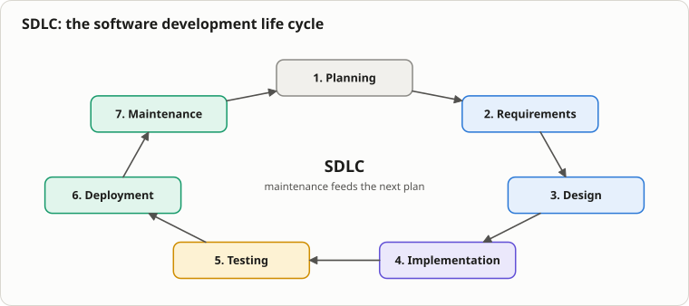
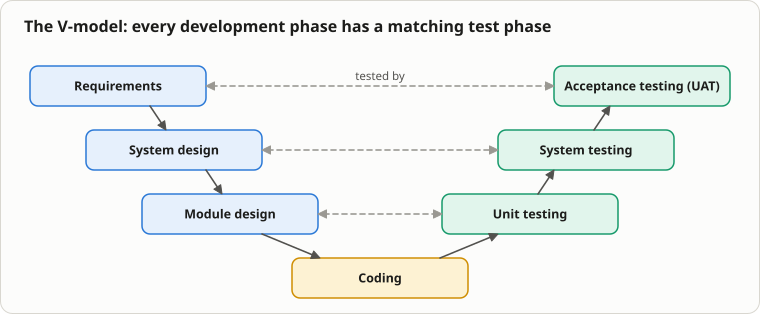
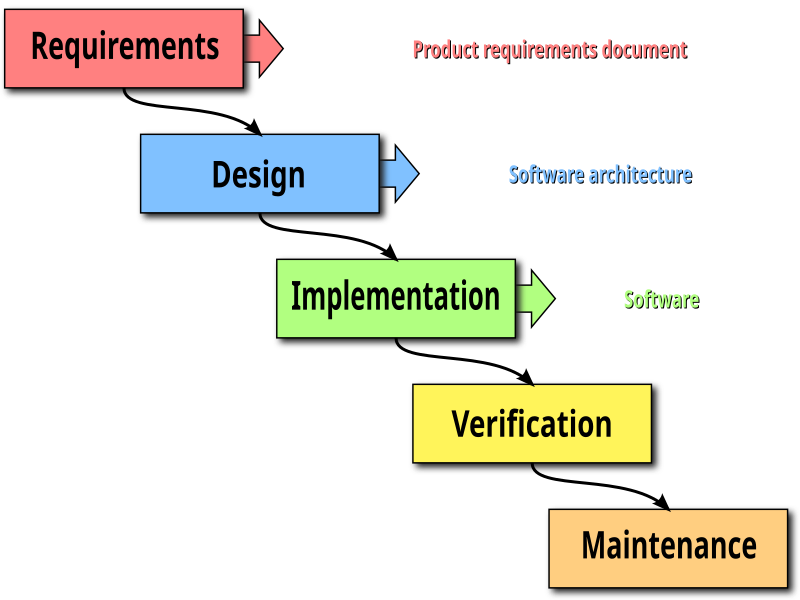
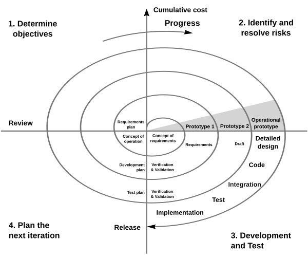
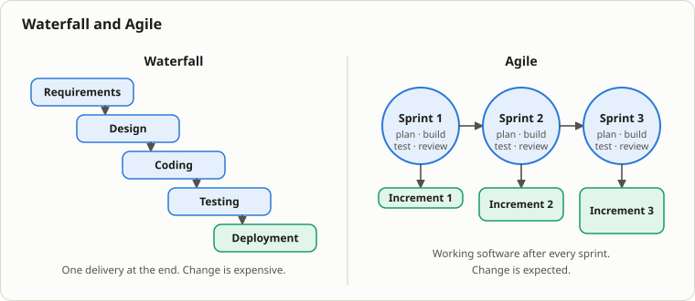
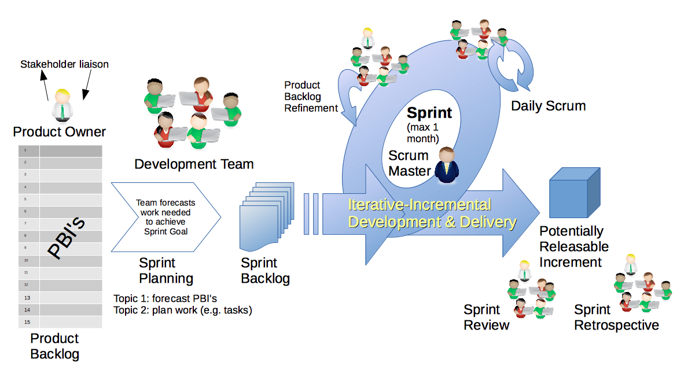
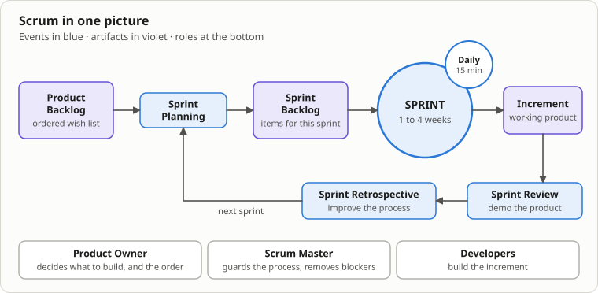
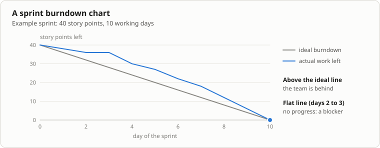
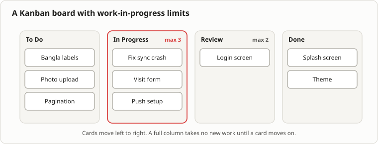
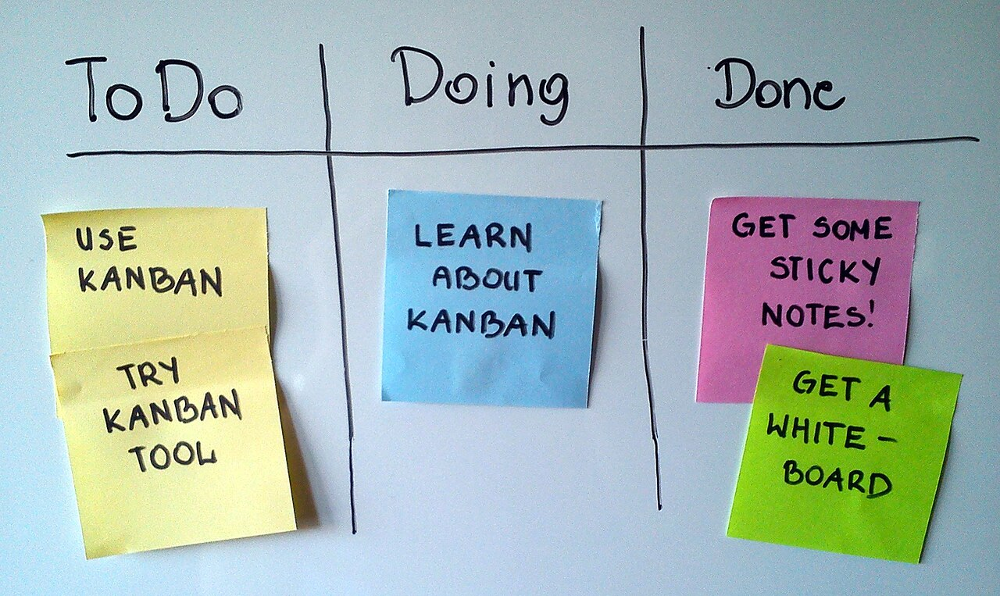

<div class="chapter-head">
<div class="chapter-kicker"><b>D3</b>Part D · Testing, Maintenance and Collaboration</div>

# Documentation and Agile Teamwork

</div>

> **The skill:** Keep clear **technical documentation** (API integration maps, build setup guides) and work well with designers, backend engineers, QA and DevOps in an **Agile** team.

This chapter also carries the **software engineering theory** that written exams and interviews like: SDLC models, Agile and Scrum, requirement documents (BRD, SRS), UML. Read sections 1–4 carefully.

---

## 1. SDLC (Software Development Life Cycle)

<div class="box def">

**Definition.** The **SDLC** (Software Development Life Cycle) is the list of steps every software project goes through, from the first idea to years of maintenance. An **SDLC model** is a way of arranging those steps.

</div>

<div class="box story">

**Example scenario.** Imagine building a house.

1. You decide the budget and the time. *(Planning)*
2. You ask the family how many rooms they need. *(Requirements)*
3. The architect draws the plan. *(Design)*
4. The workers build. *(Implementation)*
5. The engineer checks the walls, water and electricity. *(Testing)*
6. The family moves in. *(Deployment)*
7. For years after, you repair and repaint. *(Maintenance)*

**The Waterfall model** does these steps once, in this order, and never goes back. That is fine for a house, because you cannot move a wall cheaply. Software is easier to change, so other models repeat the steps in small rounds.

</div>

<p class="label">Exam notes</p>

<mark>**SDLC is the structured process for building software**</mark>, as a series of phases:



**SDLC models**
| Model | Idea | Good for | Weakness |
|---|---|---|---|
| **Waterfall** | <mark>Phases in strict order; each finishes before the next</mark> | Fixed, well-known requirements | Late testing; change is expensive |
| **V-Model** | Waterfall with a <mark>**test phase paired to each development phase**</mark> (requirements ↔ acceptance test, system design ↔ system test, module design ↔ unit test) | Safety-critical systems | Rigid |
| **Iterative / Incremental** | Build in repeated cycles, adding features each time | Large systems delivered in parts | Needs good planning |
| **Spiral** | <mark>Iterations with **risk analysis** in each loop</mark> | Large, high-risk projects | Costly, complex |
| **Prototype** | <mark>Build a quick model to clarify requirements</mark> | Unclear requirements, UI-heavy work | The prototype may be mistaken for the product |
| **Agile** | Short iterations, working software early, continuous feedback | Changing requirements | Needs an involved customer and a disciplined team |



<div class="pair">

<br>*Waterfall: each phase flows down into the next.*

<br>*Spiral: each loop plans, checks the risks, builds and reviews.*

</div>

*Pictures: Wikimedia Commons.*

<div class="box rule">

**Remember.** Planning → requirements → design → implementation → testing → deployment → maintenance. Waterfall = once, in order. V-model = a test phase for every development phase. Spiral = loops with risk analysis. Agile = short repeated cycles.

</div>

## 2. Agile

<div class="box def">

**Definition.** **Agile** is a way of working where the team builds the software in **small pieces**, shows each piece to the users, and changes direction when they learn something new.

</div>

<div class="box story">

**Example scenario.** Imagine the NGO asks for a field visit app.

- **The Waterfall team** spends three months writing a 200-page document, then nine months building. After one year they show the app. The field officers say: "We needed photo upload, and this form is too long." It is too late and too costly to change.
- **The Agile team** shows a small working app after **two weeks**: only login and one form. The officers try it and say the same thing. The team adds photo upload in the next two weeks.

**What is the difference?** Not the people or the tools. The Agile team heard the truth in week 2, not in month 12.

</div>

<p class="label">Exam notes</p>

<mark>**Agile is an iterative approach that delivers working software in small increments and welcomes changing requirements.**</mark>

**The four values of the Agile Manifesto (2001)**
1. <mark>**Individuals and interactions** over processes and tools</mark>
2. <mark>**Working software** over comprehensive documentation</mark>
3. <mark>**Customer collaboration** over contract negotiation</mark>
4. <mark>**Responding to change** over following a plan</mark>

(The items on the right still have value; the items on the left have more.)

| | Waterfall | Agile |
|---|---|---|
| Flow | Sequential | Iterative |
| Requirements | Fixed at the start | Evolve |
| Delivery | Once, at the end | Every sprint |
| Testing | After coding | Continuous |
| Customer | At the start and end | Throughout |
| Change | Hard | Expected |



<div class="box rule">

**Remember.** Agile values: **individuals and interactions**, **working software**, **customer collaboration**, **responding to change**. Waterfall delivers once at the end, Agile delivers every sprint.

</div>

## 3. Scrum (the most used Agile framework)

<div class="box def">

**Definition.** **Scrum** is the most common way to do Agile. The team works in fixed periods called **sprints** (usually two weeks). At the end of every sprint there is a working, usable piece of the product.

</div>

<div class="box story">

**Example scenario.** Imagine one two-week sprint of a mobile team.

1. **Monday morning, Sprint Planning.** The **Product Owner** shows the most important items in the product backlog. The team picks what it can finish in two weeks. This becomes the sprint backlog.
2. **Every morning, Daily Scrum (15 minutes).** Each person says: what I did yesterday, what I will do today, what is blocking me.
3. A developer says: "I am blocked, the API is not ready." The **Scrum Master** goes and solves it.
4. **Last Friday, Sprint Review.** The team shows the working app to the stakeholders on a real phone.
5. **After that, Sprint Retrospective.** Only the team. "What went well? What should we change next sprint?"

</div>

<br>*The Scrum framework: backlog items go through sprint planning into a sprint with a daily scrum, and come out as an increment that is reviewed. Source: Wikimedia Commons.*

<p class="label">Exam notes</p>

<mark>Remember **3 roles, 5 events, 3 artifacts**.</mark>



**Roles**
| Role | Responsibility |
|---|---|
| **Product Owner** | Owns the product backlog; <mark>decides **what** to build and in what order</mark>; represents the users and the business |
| **Scrum Master** | <mark>Guards the process; removes blockers; coaches the team. Not a boss</mark> |
| **Developers** | The cross-functional team (developers, QA, designers) that builds the increment |

**Events**
| Event | When | Purpose |
|---|---|---|
| **Sprint** | <mark>1–4 weeks, fixed length</mark> | The container in which a usable increment is built |
| **Sprint Planning** | Start of the sprint | Choose the sprint goal and the backlog items |
| **Daily Scrum** (stand-up) | <mark>Every day, **15 minutes**</mark> | What I did, what I will do, what blocks me |
| **Sprint Review** | End of the sprint | <mark>**Demo the product** to stakeholders</mark>; get feedback |
| **Sprint Retrospective** | After the review | <mark>The team improves its **process**</mark>: what went well, what to change |

**Artifacts:** <mark>**Product Backlog** (ordered list of everything wanted) · **Sprint Backlog** (items chosen for this sprint, plus the plan) · **Increment** (the working product at the end of a sprint)</mark>.

**More terms**
- **User story:** <mark>"As a *field officer*, I want *to save a visit offline* so that *I can work without network*."</mark>
- **Acceptance criteria:** the conditions that make a story complete (often Given–When–Then).
- **Story points:** relative size estimates. <mark>**Velocity:** points a team completes per sprint.</mark>
- <mark>**Definition of Done (DoD):**</mark> the shared checklist for "finished" (coded, reviewed, tested, documented, merged).
- **Burndown chart:** remaining work against time.
- **Epic:** a large story split into smaller ones. **Backlog refinement (grooming):** preparing upcoming stories.



**Kanban:** a board (To Do → In Progress → Review → Done) with <mark>**work-in-progress (WIP) limits**</mark> and continuous flow; no fixed sprints. Good for maintenance and support work.



<br>*A real Kanban board can be this simple: three columns and sticky notes. Source: Wikimedia Commons.*

| | Scrum | Kanban |
|---|---|---|
| Rhythm | Fixed sprints | Continuous flow |
| Roles | Defined | None required |
| Change during work | Not inside a sprint | Any time |
| Limit | Sprint capacity | WIP limits |

<div class="box q">

**Sprint Review and Sprint Retrospective sound the same. What is the difference?**

The **Review** looks at the **product**: "here is what we built", shown to people outside the team. The **Retrospective** looks at the **process**: "how did we work together?", only inside the team.

</div>

<div class="box rule">

**Remember.** 3 roles: Product Owner, Scrum Master, Developers. 5 events: Sprint, Planning, Daily Scrum, Review, Retrospective. 3 artifacts: Product Backlog, Sprint Backlog, Increment.

</div>

<div class="box check">

**Quick check**

1. Who decides the order of items in the product backlog? (a) Scrum Master (b) Product Owner (c) Developers
2. How long is a Daily Scrum?
3. Which board method has no fixed sprints but limits work in progress?

<details>
<summary>Show answers</summary>

1. **(b) the Product Owner.**
2. **15 minutes.**
3. **Kanban.**

</details>

</div>

## 4. Requirement and project documents (software engineering vocabulary)

<div class="box def">

**In simple words.** Before code, there are documents. They go from general to detailed: first **what the organisation needs**, then **what the software must do**.

</div>

<div class="box story">

**Example scenario.** Imagine the NGO wants field officers to report visits from their phones.

1. The **BRD** (Business Requirements Document) says, in plain words: *"Field officers must be able to report visits from remote areas, so that management sees activity the same day."*
2. The **SRS** (Software Requirements Specification) turns that into exact rules:
   - *Functional:* "The user can save a visit while offline."
   - *Non-functional:* "Saved visits sync within 30 seconds after the network returns."

**The difference in one line:** a **functional** requirement says **what** the system does. A **non-functional** requirement says **how well** it does it.

</div>

<p class="label">Exam notes</p>

| Document | Full form | Content |
|---|---|---|
| **BRD** | <mark>Business Requirements Document</mark> | **What the business needs** and why. Non-technical |
| **SRS** | <mark>Software Requirements Specification</mark> | **What the software must do**: functional and non-functional requirements in detail |
| **FR / NFR** | <mark>Functional / Non-Functional Requirement</mark> | FR: a behaviour ("the user can save a visit offline"). NFR: a quality ("sync completes within 30 s", security, availability, usability) |
| **RTM** | <mark>Requirements Traceability Matrix</mark> | A table linking each requirement → design → code → test case |
| **MVP** | <mark>Minimum Viable Product</mark> | The smallest version that delivers real value, released to learn from users. <mark>*(Not Model–View–Presenter, which shares the abbreviation.)*</mark> |
| **UAT** | <mark>User Acceptance Testing</mark> | Final testing by real users |
| **WBS, Gantt chart** | <mark>Work Breakdown Structure</mark> | The project split into tasks; a timeline of them |
| **Risk register** | — | Risks with likelihood, impact and response |

Order: <mark>**BRD → SRS → design/architecture → development → testing → UAT → deployment.**</mark>

<div class="box rule">

**Remember.** BRD = what the business needs. SRS = what the software must do. FR = what. NFR = how well. MVP here = Minimum Viable Product. UAT = final test by real users.

</div>

## 5. UML and diagrams

<div class="box def">

**In simple words.** **UML** (Unified Modeling Language) is a set of standard pictures for explaining software. For a written exam, two matter most: the **use case diagram** (who can do what) and the **sequence diagram** (who sends what to whom, in time order).

</div>

<mark>**UML** (Unified Modeling Language)</mark> is a standard set of diagrams for describing software.

| Diagram | Group | Shows |
|---|---|---|
| **Use case** | Behavioural | <mark>**Actors** (stick figures) and what they can do with the system (ovals)</mark> |
| **Class** | Structural | Classes with attributes and methods, and relations (inheritance, association, aggregation, composition) |
| **Sequence** | Behavioural | <mark>Messages between objects **in time order**, top to bottom</mark> |
| **Activity** | Behavioural | Workflow steps and decisions, like a flowchart |
| **State** | Behavioural | The states of one object and the transitions between them |
| **Component / Deployment** | Structural | Modules; where software runs |

Also: <mark>**ERD** (database tables and relations)</mark>, **flowchart**, <mark>**DFD** (data flow diagram)</mark>, **BPMN** and **swimlane** diagrams (business processes by role), **wireframes**.

**Sequence diagram to practise (login):**
```
 User        App           Keycloak          API
  │  tap Login │               │              │
  │───────────►│  open /auth   │              │
  │            │──────────────►│              │
  │       enter password       │              │
  │───────────────────────────►│              │
  │            │◄── code ──────│              │
  │            │── code+verifier►             │
  │            │◄── tokens ────│              │
  │            │── GET /me (Bearer token) ───►│
  │            │◄──────── profile ────────────│
  │◄─ home ────│               │              │
```

## 6. Technical documentation

<div class="box def">

**Definition.** **Technical documentation** is the written knowledge about the app that lives next to the code: how to build it, how it is structured and how it talks to the backend.

</div>

<div class="box story">

**Example scenario.** Imagine a new developer joins the team on Sunday. The only person who knows the app is on leave.

- **With no documentation,** she spends four days guessing. Which Flutter version? Where is the Firebase config file? Which API does this screen call? Why does the release build fail?
- **With a build setup guide and an API integration map,** she follows eight steps and the app runs on her machine before lunch. By Monday she has fixed her first bug.

**That is why teams ask for these two documents.** An organisation where staff change needs knowledge that is written down, not kept in one person's head.

</div>

<p class="label">Exam notes</p>

**Why:** new team members start faster · knowledge does not leave with one person · fewer repeated questions · faster debugging · required for handover, audits and maintenance. Staff change, so written knowledge matters.

**Rule:** <mark>documentation lives **with the code** (in the repository), is updated in the **same pull request** as the change</mark>, and is short enough to be kept current.

| Document | Content |
|---|---|
| **README** | What the app is, how to run it, where things are |
| **Build setup guide** | See below |
| **API integration map** | See below |
| **Architecture document** | Layers, modules, data flow diagram, state management, key decisions (<mark>**ADR** = Architecture Decision Record</mark>) |
| **Database schema doc** | Tables, relations (ERD), migration history |
| **Code comments / dartdoc** | <mark>*Why*, not *what*</mark>; `///` doc comments on public APIs |
| **CHANGELOG / release notes** | What changed in each version |
| **Runbook / release checklist** | Step-by-step release and incident procedures |
| **User manual / training guide** | For field staff, in Bangla |
| **API docs** | OpenAPI/Swagger (owned by backend, used by mobile) |

### Build setup guide
A document that lets a new developer <mark>**build and run the app from a clean machine**</mark>:
1. **Prerequisites:** Flutter and Dart versions, Android Studio/Xcode versions, JDK, CocoaPods.
2. **Get the code:** repository URL, branches.
3. **Configuration:** environment files, flavors (`dev`/`staging`/`prod`), API base URLs, Firebase config files (`google-services.json`, `GoogleService-Info.plist`).
4. **Secrets and signing:** where to obtain the keystore and certificates (never in the repo), who approves access.
5. **Commands:** `flutter pub get`, code generation (`dart run build_runner build`), `flutter run --flavor dev`.
6. **Tests:** how to run them.
7. **Release build:** commands, version bump, CI pipeline and Fastlane lanes.
8. **Troubleshooting:** common errors and fixes.

### API integration map
A table that shows <mark>**which screen or feature calls which endpoint**</mark>, and how.

| Feature / screen | Endpoint | Method | Auth / role | Request → response | Offline behaviour | Errors handled |
|---|---|---|---|---|---|---|
| Login | Keycloak `/token` | POST | Public (PKCE) | code + verifier → tokens | Not available offline | 400, 401 |
| Visit list | `/api/v1/visits?cursor=` | GET | Field officer | → paged visits | Read from local DB | 401, 5xx |
| Save visit | `/api/v1/visits` | POST | Field officer | Visit JSON → 201 + id | Outbox queue, idempotency key | 409, 422 |
| Upload photo | `/api/v1/visits/{id}/photos` | POST multipart | Field officer | file → URL | Queued; Wi-Fi preferred | 413, timeout |

Uses: impact analysis when the backend changes an endpoint, onboarding, test planning, and security review.

<div class="box rule">

**Remember.** Build setup guide = how to build and run the app from a clean machine. API integration map = which screen calls which endpoint. Documentation lives in the repository and changes in the same pull request as the code.

</div>

## 7. Collaboration with the four teams

<div class="box def">

**In simple words.** A mobile developer stands in the middle of four teams. From each team you **receive** something, and to each team you **give** something back.

</div>

<div class="box story">

**Example scenario.** Imagine one feature, "upload a visit photo", moving through the teams.

1. The **designer** gives you the Figma screen. You notice there is no design for "upload failed" and ask for one.
2. With the **backend engineer** you agree on the endpoint and the maximum file size before either of you writes code.
3. You build the screen. **DevOps** has a pipeline that builds it and sends it to the testers.
4. **QA** tests it on a slow network and reports that the progress bar stops at 99%. You fix it.
5. The feature is released. All four teams did their part in the right order.

</div>

| Team | What you get | What you give | Shared tools |
|---|---|---|---|
| **UI/UX designers** | Wireframes, Figma designs, design system, assets | Feasibility feedback (platform limits, effort), built screens for design review, edge states they missed (empty, error, offline) | Figma, Zeplin |
| **Backend engineers** | API contract, Swagger docs, test environments | Mobile needs: pagination, delta sync, idempotency, error format, payload size; early integration feedback; bug reports with request/response | OpenAPI, Postman, mock servers |
| **QA** | Test cases, bug reports, regression results | Test builds (Firebase App Distribution, TestFlight), release notes, what changed and what to test, quick fixes | Jira, TestRail |
| **DevOps** | CI/CD pipelines, environments, secrets management, monitoring | Build scripts, Fastlane lanes, signing requirements, environment needs | GitHub/GitLab, Docker, dashboards |

**Practices that make collaboration work:** <mark>agree the **API contract first**</mark> so mobile and backend build in parallel (use mocks) · small **pull requests** with **code review** · daily stand-up · one issue tracker as the source of truth · written decisions · demos at sprint review · clear, respectful communication; raise blockers early.

**Code review checklist:** correct and meets the requirement · readable names and small functions · follows the architecture · errors and edge cases handled · no secrets or sensitive logs · tests included · no performance problems · documentation updated.

**Tools:** Git + GitHub/GitLab (code, pull requests) · Jira/Trello/Azure Boards (tasks) · Figma (design) · Postman/Swagger (APIs) · Slack/Teams (communication) · Confluence/Notion/wiki (documents).

<div class="box check">

**Quick check**

1. Which document tells a new developer which Flutter version and config files are needed? (a) API integration map (b) build setup guide (c) BRD
2. "The app must start within 3 seconds" is a: (a) functional requirement (b) non-functional requirement
3. Which team gives you the API contract?

<details>
<summary>Show answers</summary>

1. **(b) the build setup guide.**
2. **(b) non-functional.** It says how well, not what.
3. The **backend engineers**, usually as OpenAPI (Swagger) documentation.

</details>

</div>

## Link it to your own projects

Interviews and written exams reward answers that use **your own work** as the example. Before you move on, answer these for yourself:

<div class="box you">

- Which documents have you written (README, API notes, a setup guide)?
- Describe how your team works: sprints, stand-ups, code review, the hand-over to QA.
- How do you work with designers and backend developers when an API is not ready yet?

</div>

---

## Practice questions

**Short (2–3 marks each)**
1. List the phases of the SDLC.
2. Waterfall vs Agile (four points).
3. State the four values of the Agile Manifesto.
4. Name the three Scrum roles and the responsibility of each.
5. What happens in a daily scrum? How long is it?
6. Sprint review vs sprint retrospective.
7. BRD vs SRS.
8. Functional vs non-functional requirement, with a mobile example of each.
9. What is an MVP in product development?
10. What is a sequence diagram? What is a use case diagram?
11. What is an API integration map?
12. What does a build setup guide contain?

**Long (8–10 marks each)**

13. Explain the Scrum framework: roles, events and artifacts. How would a mobile developer work in a two-week sprint?
14. Why is technical documentation important? Describe the documents you would maintain for an NGO mobile app, with the contents of an API integration map and a build setup guide.
15. Describe how a mobile developer collaborates with UI/UX designers, backend engineers, QA and DevOps teams during one feature, from idea to release.
16. Compare the Waterfall, V-model, Spiral and Agile SDLC models. Which fits the NGO's mobile apps and why?

---

## Model answers

<div class="box exam">

**How to read these answers.** They are written for **learning**, so they are fuller than what you would write in the exam hall. Every answer has the same parts:

- **In short** (green): the direct answer. In the exam, write this part first.
- **Table or points:** the details, laid out so you can compare and remember them.
- **Example** (yellow): a real situation, usually from a field app or from your own projects.
- Long answers end with **In the exam** (brown): how to shorten the answer on paper.

Write your own answer first. Then open the model answer and compare.

</div>

<details>
<summary>1. List the phases of the SDLC.</summary>

<div class="box def">

**In short.** <mark>**SDLC = Software Development Life Cycle.**</mark> Its phases are: **Planning → Requirements analysis → Design → Implementation (coding) → Testing → Deployment → Maintenance.**

</div>


| # | Phase | The question it answers | Output | For a field app |
|---|---|---|---|---|
| 1 | **Planning** | Should we build it? With what budget, time and people? | Project plan, feasibility study | Decide to build a field visit app; team and timeline |
| 2 | **Requirements analysis** | What exactly must it do? | BRD, **SRS**, user stories | "An officer can save a visit offline, with a photo and GPS" |
| 3 | **Design** | How will it be built? | Architecture, database design, UI wireframes and mockups, API contract | Clean Architecture, the Drift schema, Figma screens |
| 4 | **Implementation** | Build it | Source code | Flutter code, with code review |
| 5 | **Testing** | Does it work correctly? | Test reports, bug list | Unit and widget tests, QA, UAT with field officers |
| 6 | **Deployment** | Give it to the users | The released app | Play Store and App Store, with a staged rollout |
| 7 | **Maintenance** | Keep it working and improve it | Updates and fixes | Crash fixes, OS updates, new features |

**A way to remember the order:** **P**lease **R**ead **D**ocuments, **I**t **T**akes **D**ays, **M**aybe (Planning, Requirements, Design, Implementation, Testing, Deployment, Maintenance).

**Good to know:** maintenance is usually the **longest and most expensive** phase. In Agile, the same phases are repeated in every sprint, in small pieces.

<div class="ref">

**From the book:** [1. SDLC (Software Development Life Cycle)](#1-sdlc-software-development-life-cycle)

</div>

</details>

<details>
<summary>2. Waterfall vs Agile (four points).</summary>

<div class="box def">

**In short.** **Waterfall** is **sequential**: each phase is finished once, in order, and the product is delivered at the end. **Agile** is **iterative**: the product is built in small pieces (sprints), each one planned, built, tested and shown to the customer.

</div>


| Point | Waterfall | Agile |
|---|---|---|
| **1. Approach** | Sequential: one phase after another | Iterative and incremental: short cycles |
| **2. Requirements** | Fixed at the start; change is hard and costly | Expected to change; welcomed even late |
| **3. Delivery** | Once, at the end | Working software every sprint (1 to 4 weeks) |
| **4. Testing** | After coding is finished | Continuously, in every sprint |
| **Customer involvement** | At the start and at the end | Throughout |
| **Documentation** | Heavy, written up front | Just enough |
| **Risk** | Problems are found late | Problems are found early |
| **Progress measured by** | Finished phases and documents | Working software |
| **Best for** | Small projects with clear, stable requirements; fixed contracts | Projects where requirements evolve: most apps |

<div class="box story">

**Example.** With Waterfall, the NGO's field officers would first see the app after ten months, and might then say "we cannot type this much in the field". With Agile, they try a simple visit form after two weeks, the team learns that they need voice notes and bigger buttons, and the next sprint adds them.

</div>

<div class="ref">

**From the book:** [1. SDLC (Software Development Life Cycle)](#1-sdlc-software-development-life-cycle) [2. Agile](#2-agile)

</div>

</details>

<details>
<summary>3. State the four values of the Agile Manifesto.</summary>

<div class="box def">

**In short.**

1. **Individuals and interactions** over processes and tools.
2. **Working software** over comprehensive documentation.
3. **Customer collaboration** over contract negotiation.
4. **Responding to change** over following a plan.

</div>

| We value more... | ...over | What it means in practice |
|---|---|---|
| **Individuals and interactions** | Processes and tools | A five-minute talk with the backend developer beats a long ticket thread |
| **Working software** | Comprehensive documentation | A demo on a real phone proves more than a 100-page specification |
| **Customer collaboration** | Contract negotiation | Field officers give feedback every sprint, not only at sign-off |
| **Responding to change** | Following a plan | If a new rule arrives from management, the backlog is re-ordered |

**The sentence people forget:** the Manifesto says there is value in the items on the right, but it values the items on the left **more**. Agile does not mean "no documentation" or "no plan".

**Facts**

- Written in **2001** by 17 software developers.
- It has **4 values** and **12 principles**.
- Scrum, Kanban and XP (Extreme Programming) are ways of working that follow it.

<div class="box story">

**Example.** A public organisation such as the NGO still needs documents: requirements, UAT sign-off, audit records. An Agile team there writes those documents, but it also shows working software every two weeks and does not wait for the documents to be "complete" first.

</div>

<div class="ref">

**From the book:** [2. Agile](#2-agile)

</div>

</details>

<details>
<summary>4. Name the three Scrum roles and the responsibility of each.</summary>

<div class="box def">

**In short.** **Product Owner:** decides **what** to build and in what order. **Scrum Master:** makes sure Scrum works and **removes obstacles**. **Developers:** **build** the product increment in each sprint.

</div>

| Role | Main responsibility | Typical tasks | Is not |
|---|---|---|---|
| **Product Owner** | Maximise the **value** of the product | Owns and orders the **product backlog**; writes or accepts user stories and acceptance criteria; speaks for users and stakeholders; accepts or rejects finished work | A project manager who assigns tasks |
| **Scrum Master** | Make the team **effective** with Scrum | Runs and coaches the Scrum events; **removes impediments**; protects the team from interruptions | The team's boss |
| **Developers** | Create a usable **increment** every sprint | Plan the sprint; design, code, test; own the sprint backlog; keep to the Definition of Done | Only programmers. QA and designers working in the sprint are "Developers" too |

**More facts**

- A Scrum team is small: usually **10 people or fewer**.
- It is **self-managing** (the team decides who does what and how) and **cross-functional** (it has all the skills needed).
- There is one Product Owner and one Scrum Master per team.

<div class="box story">

**Example at the NGO.** The Product Owner could be an officer from the programme department who knows what field staff need. The Scrum Master could be the team lead. You, the backend developer, the designer and the QA engineer are the Developers.

</div>

<div class="ref">

**From the book:** [3. Scrum (the most used Agile framework)](#3-scrum-the-most-used-agile-framework)

</div>

</details>

<details>
<summary>5. What happens in a daily scrum? How long is it?</summary>

<div class="box def">

**In short.** The daily scrum is a <mark>**15-minute**</mark> meeting, held every day at the same time and place. The Developers **synchronise** and **plan the next 24 hours** towards the sprint goal.

</div>

**The three classic questions**

1. What did I do **yesterday** for the sprint goal?
2. What will I do **today**?
3. Is anything **blocking** me?

| Point | Daily scrum |
|---|---|
| **Length** | 15 minutes, fixed |
| **Who** | The Developers. The Scrum Master makes sure it happens. The Product Owner may listen |
| **Purpose** | Inspect progress towards the sprint goal; adapt the plan for the day |
| **Also called** | Stand-up (people often stand, to keep it short) |
| **What it is not** | A status report to a manager; a place to solve problems in detail |
| **After it** | People who need to talk longer meet separately |

<div class="box story">

**What a mobile developer says.** "Yesterday I finished the visit form validation and opened the pull request. Today I start the photo upload. I am blocked: the upload API returns 413 for photos over 5 MB, so I need ten minutes with the backend developer after this meeting." That takes thirty seconds, and it surfaces the blocker on day one, not on day five.

</div>

<div class="ref">

**From the book:** [3. Scrum (the most used Agile framework)](#3-scrum-the-most-used-agile-framework)

</div>

</details>

<details>
<summary>6. Sprint review vs sprint retrospective.</summary>

<div class="box def">

**In short.** <mark>The **sprint review** inspects the **product**</mark>: the team shows the finished work to stakeholders and gets feedback. <mark>The **sprint retrospective** inspects the **process**</mark>: the team looks at how it worked and agrees on improvements.

</div>

| Point | Sprint review | Sprint retrospective |
|---|---|---|
| **Looks at** | The **product** increment | The **team's way of working** |
| **Question** | "Did we build the right thing?" | "How can we work better?" |
| **Who attends** | The Scrum team **and stakeholders** | The Scrum team only |
| **What happens** | A demo of working software; feedback; the backlog is updated | What went well, what did not, what to change |
| **Output** | An adjusted product backlog | One or two concrete improvements for the next sprint |
| **When** | At the end of the sprint | After the review; the last event of the sprint |
| **Maximum length (two-week sprint)** | About 2 hours | About 1.5 hours |
| **Mood** | Open, to outsiders | Private and honest |

<div class="box story">

**Example.** In the **review**, you demo "save a visit offline" on a real phone to two branch managers. They ask for the borrower's phone number on the form, and that becomes a new backlog item. In the **retrospective**, the team notes that QA got builds too late in the sprint and agrees that every merged pull request will now send a build to QA automatically.

</div>

<div class="ref">

**From the book:** [3. Scrum (the most used Agile framework)](#3-scrum-the-most-used-agile-framework)

</div>

</details>

<details>
<summary>7. BRD vs SRS.</summary>

<div class="box def">

**In short.** The **BRD (Business Requirements Document)** says **what the business needs and why**. The **SRS (Software Requirements Specification)** says **what the software must do, in detail**. The SRS is derived from the BRD.

</div>

| Point | BRD | SRS |
|---|---|---|
| **Full form** | Business Requirements Document | Software Requirements Specification |
| **Answers** | *Why* do we need this, and *what* does the business want? | *What* exactly must the system do? |
| **Level** | High-level, business language | Detailed, technical language |
| **Written by** | Business analyst, with stakeholders | Business analyst or system analyst, with the technical team |
| **Read by** | Management, sponsors, stakeholders | Developers, testers, architects |
| **Contains** | Goals, scope, stakeholders, business rules, benefits, constraints | **Functional** and **non-functional** requirements, use cases, interfaces, data requirements |
| **Comes** | First | After the BRD |
| **Used for** | Approval and funding | Design, coding and test cases |

**The chain of documents:** BRD → SRS → design documents → code → test cases → UAT.

<div class="box story">

**Example.** **BRD:** "the NGO needs to see field visit data from branches on the same day, to monitor loan quality." **SRS:** "FR-12: The app shall let a field officer record a visit offline with a photo and GPS position. FR-13: Pending visits shall sync automatically when a network is available. NFR-4: The app shall start within 3 seconds on a phone with 2 GB of RAM."

</div>

<div class="ref">

**From the book:** [4. Requirement and project documents (software engineering vocabulary)](#4-requirement-and-project-documents-software-engineering-vocabulary)

</div>

</details>

<details>
<summary>8. Functional vs non-functional requirement, with a mobile example of each.</summary>

<div class="box def">

**In short.** A **functional requirement** says **what the system does**: a feature. A **non-functional requirement** says **how well it does it**: a quality such as speed, security or reliability.

</div>

| Point | Functional | Non-functional |
|---|---|---|
| **Describes** | Behaviour: features and functions | Qualities and limits |
| **Question** | "What should it do?" | "How well should it do it?" |
| **Tested by** | Functional tests: does the feature work? | Performance, security and usability tests |
| **If it is missing** | The feature does not exist | The feature exists, but the app is slow, unsafe or hard to use |
| **Mobile example** | "A field officer can save a visit with a photo while offline." | "The app starts within 3 seconds." |

**Kinds of non-functional requirement, with mobile examples**

| Kind | Example |
|---|---|
| **Performance** | Screens open in under 1 second; scrolling at 60 fps |
| **Security** | Local data is encrypted with AES-256; the session locks after 5 minutes |
| **Reliability** | Crash-free users above 99%; no data loss when the network drops |
| **Usability** | A new officer can record a visit without training; Bangla and English |
| **Compatibility** | Works on Android 8 and above, and on iOS 14 and above |
| **Scalability** | The backend serves 5,000 officers syncing at the same time |
| **Maintainability** | Unit-test coverage of the business logic above 70% |

<div class="box story">

**Example.** "Sync pending visits" is functional. "Sync must not use more than 5% of the battery per day and must resume after an interruption" is non-functional. An app can satisfy the first and still fail in the field because of the second.

</div>

<div class="ref">

**From the book:** [4. Requirement and project documents (software engineering vocabulary)](#4-requirement-and-project-documents-software-engineering-vocabulary)

</div>

</details>

<details>
<summary>9. What is an MVP in product development?</summary>

<div class="box def">

**In short.** <mark>**MVP = Minimum Viable Product.**</mark> It is the **smallest version of a product that real users can use**, released early to **learn from their feedback** before building the full product.

</div>

| The word | Meaning |
|---|---|
| **Minimum** | Only the core features. Everything else waits |
| **Viable** | It really works, and solves the main problem end to end |
| **Product** | Real users use it, not only a demo |

| | MVP | Prototype | Full product |
|---|---|---|---|
| **Works for real** | Yes | No, it is a model | Yes |
| **Users** | Real, a limited group | Testers, stakeholders | Everyone |
| **Purpose** | Learn what users need | Test an idea or a design | Serve all needs |
| **Features** | A few | Faked | Many |

**Why build one**

- Feedback comes after weeks, not after a year.
- Less money and time are lost if the idea is wrong.
- The next features are chosen from real use, not from guesses.

**Careful with the abbreviation:** in architecture, MVP also means **Model–View–Presenter**. In product and SDLC questions it means Minimum Viable Product.

<div class="box story">

**Example.** The MVP of a field app: login, record a visit (borrower, note, one photo, GPS), and sync. No reports, no dashboards, no chat. Twenty officers in one district use it for a month. Their feedback shows that offline search for borrowers matters much more than the planned dashboard, so that is built next.

</div>

<div class="ref">

**From the book:** [4. Requirement and project documents (software engineering vocabulary)](#4-requirement-and-project-documents-software-engineering-vocabulary)

</div>

</details>

<details>
<summary>10. What is a sequence diagram? What is a use case diagram?</summary>

<div class="box def">

**In short.** Both are **UML** diagrams. A **sequence diagram** shows **how objects exchange messages, in time order**. A **use case diagram** shows **who (the actors) can do what (the use cases)** with the system.

</div>

| Point | Sequence diagram | Use case diagram |
|---|---|---|
| **Shows** | Interaction over **time** | Functions and their users |
| **Kind of UML diagram** | Behavioural (interaction) | Behavioural |
| **Main parts** | Participants on top, **lifelines** going down, **messages** as arrows | **Actors** (stick figures), **use cases** (ovals), the **system boundary** (a box) |
| **Time** | Yes: top to bottom | No |
| **Answers** | "In what order do the parts talk?" | "What can each kind of user do?" |
| **Used in** | Design: login flow, sync, push delivery | Requirements: scope and roles |
| **Read by** | Developers | Stakeholders and developers |

**A sequence diagram: saving a visit**

```text
 Officer            App             Server
    |   tap Save     |                 |
    |--------------->|                 |
    |                |  POST /visits   |
    |                |---------------->|
    |                |   201 Created   |
    |                |<----------------|
    |    "Synced"    |                 |
    |<---------------|                 |
```

**A use case diagram: the field app**

```text
                  +----------------------------+
                  |        Field Visit App     |
  Field officer --|--( Record a visit )        |
        |         |                            |
        +---------|--( Sync data )             |
                  |                            |
  Branch manager -|--( Approve a report )      |
        |         |                            |
        +---------|--( View reports )          |
                  +----------------------------+
```

**Other UML diagrams worth naming:** class diagram (structure), activity diagram (a flowchart of steps), state diagram (the states of one object), ER diagram (database tables; not UML, but often asked together).

<div class="box story">

**Example.** In this book, the OAuth login with PKCE and the push notification flow are sequence diagrams. Drawing three vertical lines and numbered arrows in an exam answer takes one minute and shows that you understand the order of events.

</div>

<div class="ref">

**From the book:** [5. UML and diagrams](#5-uml-and-diagrams)

</div>

</details>

<details>
<summary>11. What is an API integration map?</summary>

<div class="box def">

**In short.** An API integration map is a document, usually a table, that **maps each screen or feature of the app to the backend endpoints it uses**. For each one it gives the method, the authentication, the request and response, the error handling and the offline behaviour.

</div>

**A sample**

| Screen / feature | Endpoint | Method | Auth | Request | Response | Errors handled | Offline behaviour |
|---|---|---|---|---|---|---|---|
| Login | Keycloak `/token` | POST | PKCE | Code + verifier | Access, refresh and ID tokens | 400, 401 | Not available offline |
| Visit list | `/v1/visits?since=` | GET | Bearer | Cursor | A page of visits | 401 → refresh | Read from the local database |
| Save visit | `/v1/visits` | POST | Bearer + idempotency key | Visit JSON | 201 + server version | 409 conflict, 422 validation | Queued in the outbox |
| Upload photo | `/v1/visits/{id}/photos` | POST (multipart) | Bearer | Image file | 201 + URL | 413 too large | Queued; Wi-Fi preferred |

**What it also records**

- The base URL for each environment (dev, staging, production).
- The API version and the owner of each service.
- Third-party services: FCM, maps, payment gateway.
- Which app version started using each endpoint.

| Who uses it | For what |
|---|---|
| **A new developer** | To understand the app in one hour |
| **The backend team** | To know which apps are affected before changing an endpoint |
| **QA** | To design test cases, including error cases |
| **Support and DevOps** | To trace a problem from a screen to a service |

<div class="box story">

**Example.** The backend team wants to change the response of `/v1/visits`. The map shows three screens that depend on it and that app versions 1.2 to 1.4 use it. They decide to add `/v2` and not change `/v1`. Without the map, the change would have broken old apps in the field.

</div>

<div class="ref">

**From the book:** [API integration map](#api-integration-map)

</div>

</details>

<details>
<summary>12. What does a build setup guide contain?</summary>

<div class="box def">

**In short.** A build setup guide tells a new developer how to go **from an empty computer to a running app and a release build**. It contains the tools and versions, the repository, the configuration, the secrets, and the commands to run, test and release.

</div>

| # | Section | What it contains | Example |
|---|---|---|---|
| 1 | **Prerequisites and tool versions** | The exact versions needed | Flutter 3.x (through FVM), Dart, Android Studio, Xcode, JDK 17, CocoaPods |
| 2 | **Repository and branches** | Where the code is and how branches are used | Clone URL; `main`, `develop`, `feature/*` |
| 3 | **Environments and flavors** | dev, staging and production settings | `--flavor dev --dart-define-from-file=env/dev.json` |
| 4 | **Secrets and signing files** | How to **obtain** them (never the secrets themselves) | "Ask the team lead for `key.properties`; `google-services.json` is in the vault" |
| 5 | **Install and run** | The commands | `flutter pub get`, `dart run build_runner build`, `flutter run` |
| 6 | **Tests** | How to run them | `flutter analyze`, `flutter test` |
| 7 | **Release build** | How to build and publish | `flutter build appbundle --release`; version rules; the CI pipeline |
| 8 | **Troubleshooting** | Known problems and their fixes | "Pod install fails → run `pod repo update`" |

**Where it lives:** in the repository, as `README.md` or `docs/SETUP.md`, so it is versioned together with the code.

**How to know that it is good:** a new team member follows it and has the app running on the first day, without asking anyone.

<div class="box story">

**Example.** A developer leaves the team, and the only copy of "how to build the iOS release" was in their head. The next release is delayed by a week. A one-page guide in the repository, updated in the same pull request that changes the build, prevents this.

</div>

<div class="ref">

**From the book:** [Build setup guide](#build-setup-guide)

</div>

</details>

<details>
<summary>13. Explain the Scrum framework: roles, events and artifacts. How would a mobile developer work in a two-week sprint?</summary>

<div class="box def">

**In short.** **Scrum** is a lightweight Agile framework in which a small team delivers working software in fixed-length cycles called **sprints** (1 to 4 weeks). It has <mark>**3 roles, 5 events and 3 artifacts**</mark>. In a two-week sprint, a mobile developer plans the stories, builds and tests them day by day, gets them reviewed and into QA's hands, demos them, and helps improve the process.

</div>


#### 1. The three roles

| Role | Responsibility |
|---|---|
| **Product Owner** | Owns and orders the product backlog; maximises value |
| **Scrum Master** | Makes sure Scrum is followed; removes impediments |
| **Developers** | Build a usable increment every sprint |

#### 2. The five events

| Event | Purpose | Length for a two-week sprint |
|---|---|---|
| **The Sprint** | The container for all the work | 2 weeks |
| **Sprint Planning** | Choose what to build and plan how | Up to about 4 hours |
| **Daily Scrum** | Synchronise; plan the next 24 hours | 15 minutes |
| **Sprint Review** | Demo the increment to stakeholders; collect feedback | Up to about 2 hours |
| **Sprint Retrospective** | Improve the way the team works | Up to about 1.5 hours |

#### 3. The three artifacts

| Artifact | What it is | Its commitment |
|---|---|---|
| **Product Backlog** | The ordered list of everything the product may need | Product Goal |
| **Sprint Backlog** | The items chosen for this sprint, plus the plan to deliver them | Sprint Goal |
| **Increment** | The working, usable product at the end of the sprint | **Definition of Done** |

<br>*The product backlog feeds the sprint backlog; the sprint, with its daily scrum, produces a working increment. Source: Wikipedia.*

#### 4. A mobile developer's two-week sprint

| When | What I do |
|---|---|
| **Before the sprint** (refinement) | Read the user stories; ask questions; check the designs and the API; **estimate** in story points |
| **Day 1: Sprint Planning** | Commit to stories that have clear **acceptance criteria**; break them into tasks (UI, Bloc, repository, tests) |
| **Every day** | Daily scrum (15 minutes) → code on a **feature branch** → unit and widget tests → **pull request** → code review → **CI** builds and sends the app to QA (Firebase App Distribution) → fix the bugs QA reports → move the ticket on the board |
| **During the sprint** | Talk to the designer about missing states and to the backend developer about the API contract; raise blockers early |
| **Last days** | Finish and stabilise; no half-done stories; update the documentation |
| **Day 10: Sprint Review** | Demo the feature **on a real device** to stakeholders |
| **Day 10: Retrospective** | Say what slowed me down; agree on one improvement |

#### 5. Words that go with Scrum

| Term | Meaning |
|---|---|
| **User story** | "As a field officer, I want to save a visit offline, so that I can work without network" |
| **Acceptance criteria** | The conditions under which the story is accepted |
| **Definition of Done** | The shared checklist: code reviewed, tests pass, QA approved, documented |
| **Story points** | A relative estimate of effort |
| **Velocity** | Story points finished per sprint; used for planning |
| **Burndown chart** | Remaining work against time in the sprint |


<div class="box story">

**Link to your own work.** Close with one true sentence about your own projects, for example: "I delivered features from Figma designs with designers, backend developers and QA, in this daily loop: branch, build, review, hand to QA, fix, demo."

</div>

<div class="box exam">

**In the exam.** Write "3 roles, 5 events, 3 artifacts" and list them in three small tables. Draw the sprint as a loop: Product Backlog → Sprint Planning → Sprint (with the Daily Scrum) → Increment → Review → Retrospective. Then six lines on the developer's two weeks.

</div>

<div class="ref">

**From the book:** [3. Scrum (the most used Agile framework)](#3-scrum-the-most-used-agile-framework)

</div>

</details>

<details>
<summary>14. Why is technical documentation important? Describe the documents you would maintain for an NGO mobile app, with the contents of an API integration map and a build setup guide.</summary>

<div class="box def">

**In short.** Documentation keeps the knowledge of a system **in the organisation and not in one person's head**. For a field app I would maintain a README, an architecture note, an **API integration map**, a **build setup guide**, a release checklist, a changelog and a short user guide, all stored in the repository and updated together with the code.

</div>

#### 1. Why it matters

| Reason | Explanation |
|---|---|
| **Onboarding** | A new developer is productive in days, not weeks |
| **Continuity** | The post is a contract post with a fixed tenure. When people change, the app must still be maintainable |
| **Faster debugging** | You know which screen calls which service |
| **Fewer mistakes** | A release checklist prevents forgotten steps |
| **Audit and handover** | A public organisation must show how its systems work |
| **Team communication** | Backend, QA and DevOps share one description |

#### 2. The documents I would maintain

| Document | Contents | For whom |
|---|---|---|
| **README** | What the app is; a quick start; links to the other documents | Everyone |
| **Architecture overview** | The layers, the folder structure, state management, one diagram | Developers |
| **API integration map** | Screen → endpoint table (below) | Developers, backend, QA |
| **Build setup guide** | From an empty computer to a release build (below) | Developers, DevOps |
| **Data and sync notes** | The local schema, migrations, sync and conflict rules | Developers |
| **Release checklist and changelog** | The steps for each release; what changed in each version | Developers, QA, managers |
| **Code comments and API docs** | The *why* behind tricky code (`///` doc comments) | Developers |
| **User guide / FAQ** | How to use the app, in Bangla | Field officers, support |

#### 3. The API integration map

Purpose: to show at a glance **which feature depends on which backend service**.

| Screen / feature | Endpoint | Method | Auth | Errors handled | Offline behaviour |
|---|---|---|---|---|---|
| Login | Keycloak `/token` | POST | PKCE | 400, 401 | Not available |
| Visit list | `/v1/visits?since=` | GET | Bearer | 401 → refresh | Read from the local database |
| Save visit | `/v1/visits` | POST | Bearer + idempotency key | 409, 422 | Queued in the outbox |

It also lists the base URLs per environment, the API version, the request and response models, and the third-party services (FCM, maps).

#### 4. The build setup guide

| # | Heading |
|---|---|
| 1 | Prerequisites and tool versions (Flutter, Xcode, JDK) |
| 2 | Repository and branches |
| 3 | Environments and flavors (dev, staging, production) |
| 4 | Secrets and signing files: how to obtain them |
| 5 | Install dependencies and run |
| 6 | Run the tests |
| 7 | Make a release build |
| 8 | Troubleshooting |

#### 5. The rules that keep documentation alive

- It lives **in the repository** (Markdown), next to the code.
- It is updated **in the same pull request** as the code change, and the reviewer checks it.
- It is **short and current**. A wrong document is worse than none.
- **No secrets** in it, only where to get them.
- Diagrams are kept as text (Mermaid) or simple images that are easy to update.

<div class="box story">

**Your own habit.** "For each app I maintain, I keep a README with the setup steps and a table of endpoints." Say this: it is a concrete, believable practice, and it is exactly what job adverts mean by "technical documentation".

</div>

<div class="box exam">

**In the exam.** Four reasons. A table of six documents. A three-row sample of the API integration map (draw the table, it earns marks). The eight headings of the build setup guide. Three rules.

</div>

<div class="ref">

**From the book:** [6. Technical documentation](#6-technical-documentation) [Build setup guide](#build-setup-guide) [API integration map](#api-integration-map)

</div>

</details>

<details>
<summary>15. Describe how a mobile developer collaborates with UI/UX designers, backend engineers, QA and DevOps teams during one feature, from idea to release.</summary>

<div class="box def">

**In short.** A feature passes through many hands. The mobile developer is in the middle: I take the **design** from UI/UX, agree the **API contract** with backend, build and test the feature, hand **builds** to QA, rely on DevOps for the **pipeline and release**, and report back to all of them from production.

</div>

#### 1. Who gives what

| Team | They give me | I give them | Tools |
|---|---|---|---|
| **Product Owner** | The user story, acceptance criteria, priority | Estimates, feasibility, a demo | Jira |
| **UI/UX designer** | Wireframes, Figma mockups, assets, the design system | Feedback on what is feasible; missing states (empty, error, offline, loading); platform conventions | Figma |
| **Backend engineer** | Endpoints, the API contract (OpenAPI), a test server | The data the screens need; pagination and sync needs; bug reports with request and response | Swagger, Postman |
| **QA** | Test cases, bug reports | Testable builds, release notes, what to focus on | Jira, Firebase App Distribution, TestFlight |
| **DevOps** | The CI/CD pipeline, environments, secrets, monitoring | Build scripts, signing needs, environment configuration | GitHub Actions / GitLab CI, Fastlane |

#### 2. One feature, step by step: "attach a photo to a visit"

| # | Stage | With whom | What happens |
|---|---|---|---|
| 1 | **Requirement** | Product Owner | The story and acceptance criteria: "an officer can attach up to 3 photos, offline" |
| 2 | **Design** | UI/UX | The designer shares the Figma screens. I point out the missing states: no camera permission, upload failed, offline |
| 3 | **API contract** | Backend | We agree on the endpoint, the maximum file size, the error format and how offline uploads are retried. Backend provides a mock, so both sides can work in parallel |
| 4 | **Build** | Other mobile developers | A feature branch, Bloc + repository, unit and widget tests, a pull request, code review |
| 5 | **Pipeline** | DevOps | CI runs the tests, builds and signs, and sends the app to QA. DevOps adds the new storage setting to the staging environment |
| 6 | **Test** | QA | QA runs the test cases on several devices and reports bugs. I fix them and QA re-tests. Then a regression test |
| 7 | **Design review** | UI/UX | The designer checks the real screens on a device against Figma |
| 8 | **Acceptance** | Product Owner, users | A demo in the sprint review; UAT with a few field officers |
| 9 | **Release** | DevOps, QA | A tag triggers the release pipeline; staged rollout; release notes |
| 10 | **Monitor** | Everyone | Crashlytics and user feedback. I share the findings with all teams |

#### 3. What makes the collaboration work

- **Agree the contract early**: the API and the designs are settled before coding.
- **Write things down**: decisions go in the ticket, not only in chat.
- **Raise blockers early**, in the daily scrum.
- **Small, frequent builds** to QA, not one big build at the end.
- **Respect each role**: I question a design with reasons, and the designer decides.
- **Shared Definition of Done**: reviewed, tested, QA-approved, documented.

<div class="box story">

**Link to your own work.** Close with one true sentence about your own projects, for example: "I worked with UI/UX designers, backend developers and QA through the full lifecycle, from design to production release."

</div>

<div class="box exam">

**In the exam.** A timeline of eight to ten boxes: Requirement → Design → API contract → Build → CI → QA → Design review → UAT → Release → Monitor, with the team's name under each. Then the "who gives what" table with four rows. Close with one line from your own work.

</div>

<div class="ref">

**From the book:** [7. Collaboration with the four teams](#7-collaboration-with-the-four-teams)

</div>

</details>

<details>
<summary>16. Compare the Waterfall, V-model, Spiral and Agile SDLC models. Which fits the NGO's mobile apps and why?</summary>

<div class="box def">

**In short.** **Waterfall** runs the phases once, in order. The **V-model** is Waterfall with a matching test phase for every development phase. **Spiral** repeats the cycle with a **risk analysis** in every loop. **Agile** delivers small working increments in short iterations with constant feedback. For the NGO's mobile apps I would choose **Agile (Scrum)**, with the fixed documents a public organisation needs.

</div>

<div class="pair">


</div>

*Waterfall (left): each phase flows into the next. Spiral (right): each loop passes through planning, risk analysis, building and evaluation. Source: Wikipedia.*

#### 1. The comparison

| Point | Waterfall | V-model | Spiral | Agile |
|---|---|---|---|---|
| **Approach** | Linear, sequential | Linear, with testing planned beside each phase | Iterative, **risk-driven** | Iterative and incremental |
| **Requirements** | Fixed at the start | Fixed at the start | Refined in every loop | Evolve all the time |
| **Testing** | After coding | Planned early; each phase has its own test level | In every loop | Continuous |
| **Delivery** | Once, at the end | Once, at the end | A prototype or version per loop | Every 1 to 4 weeks |
| **Customer involvement** | Low | Low | Medium | High |
| **Handling change** | Poor | Poor | Good | Very good |
| **Cost and management** | Low, simple | Medium | High; needs risk experts | Medium; needs a disciplined team |
| **Strength** | Simple, clear milestones, good documents | Strong verification and validation | The best risk control | Fast feedback, flexibility |
| **Weakness** | Errors are found late; no going back | Still rigid | Complex and expensive | Less predictable scope; lighter documents |
| **Best for** | Small projects with stable requirements | Safety-critical systems: medical, aviation | Large, high-risk projects | Products whose requirements evolve: apps |

#### 2. The V-model in one picture


| Development phase (left side) | Matching test (right side) |
|---|---|
| Requirements | **Acceptance** testing (UAT) |
| System design | **System** testing |
| Architecture (high-level) design | **Integration** testing |
| Module (low-level) design | **Unit** testing |

#### 3. My choice for the NGO: Agile (Scrum)

| Reason | Explanation |
|---|---|
| **Requirements will evolve** | The NGO's apps serve field officers, branches and managers. Their real needs become clear only when they use the app |
| **Early feedback from the field** | A working build every two weeks shows quickly what does not work in weak-network areas |
| **Mobile platforms keep changing** | New OS versions and store policies arrive every year. Short cycles absorb them |
| **Stores allow frequent releases** | Small updates with staged rollouts carry less risk than one big launch |
| **Risk is lower** | Problems appear in sprint 2, not in month 10 |

**The honest addition: a hybrid.** The NGO is a public organisation. It still needs a signed requirements document, a budget, **UAT sign-off** and audit records. So in practice it is Agile development **inside** a documented framework: fixed milestones and documents outside, sprints inside.

<div class="box exam">

**In the exam.** One line for each model. A table with four columns and five rows (approach, requirements, testing, strength, best for). A small V drawn with the four pairs. Then the choice with four reasons, and the sentence about the hybrid.

</div>

<div class="ref">

**From the book:** [1. SDLC (Software Development Life Cycle)](#1-sdlc-software-development-life-cycle) [2. Agile](#2-agile)

</div>

</details>

<div class="book-nav"><span>← <a href="D2%20-%20Post-Deployment%20Support.md">D2 - Post-Deployment Support</a></span><span><a href="00%20-%20Contents%20and%20How%20to%20Use.md">Contents</a></span><span><a href="E%20-%20Revision%20Sheet%20and%20Long-Answer%20Templates.md">E - Revision Sheet and Long-Answer Templates</a> →</span></div>
