<div class="chapter-head">
<div class="chapter-kicker"><b>E</b>Read this last</div>

# Revision Sheet and Long-Answer Templates

</div>

This is the **last thing to read before a written exam or a technical interview** for a mobile developer post. Everything here comes from the 12 chapters, cut down to what you write on paper.

<div class="box check">

**Importance tags used on this page**

- <span class="imp must">Must</span> **Very likely to be asked.** It is a core skill for any mobile developer post. Know it by heart, and be able to write it and draw it.
- <span class="imp likely">Likely</span> **Often asked**, or a part of a bigger answer. Know the main idea and one example.
- <span class="imp know">Good to know</span> **Less likely.** One line is enough. Skip it if time is short.

</div>

<div class="box exam">

**How to use this page on the day before an exam**

1. **Part 1, Must rows only.** Cover the right column and say each answer aloud (30 min).
2. **Part 3, ⭐ diagrams.** Look, close, draw it on paper in 2 minutes, then compare (40 min).
3. **The six model answers.** Read each "In short" box and the headings (30 min).
4. **The last 15 minutes before you leave:** the two boxes below, and nothing new.

</div>

<div class="box rule">

**The 13 lines to remember**

1. **Offline-first:** the local DB is the source of truth. Save + outbox row → **push then pull** → Idempotency-Key → backoff with jitter.
2. **WorkManager** periodic work: **minimum 15 minutes**, not exact. iOS: BGTaskScheduler (the system decides).
3. **Mobile login = OAuth 2.0 Authorization Code + PKCE**, in the **system browser**, with Keycloak (SSO).
4. **JWT** = `header.payload.signature`: **signed, NOT encrypted**. Sent as `Authorization: Bearer <token>`.
5. **401** = not logged in or token expired → refresh. **403** = logged in but not allowed → **RBAC on the server**.
6. **Tokens** in Keystore/Keychain (`flutter_secure_storage`). **DB** encrypted with **SQLCipher** (AES-256), key in Keystore.
7. **Biometrics:** the **OS** says yes or no and unlocks a key. The app never sees the fingerprint.
8. **60 fps = 16.67 ms per frame** (90 Hz = 11.1 ms, 120 Hz = 8.33 ms). A miss = jank.
9. **Crash-free users = (1 − crashed users ÷ total users) × 100.**
10. **Push:** app gets an FCM token → sends it to the backend → backend calls **FCM HTTP v1** → (APNs for iPhone) → phone.
11. **Clean Architecture:** Presentation → **Domain** ← Data. **BLoC:** events in, states out.
12. **Test pyramid:** **many unit** (base), some widget, **few integration** (top).
13. **Mobile = Continuous Delivery.** GitHub Actions decides *when*; Fastlane signs, builds, uploads. Staged rollout; **no rollback**, ship a higher version.

</div>

<div class="box you">

**Common mistakes: do not make them**

| Wrong | Correct |
|---|---|
| `onPause` = not visible | **`onStop`** = not visible. **P**ause = **P**artly visible, **S**top = **S**creen gone |
| Pyramid drawn upside down | **Unit tests = wide base**, integration = narrow top |
| AES with two keys | **AES = symmetric, ONE shared key.** RSA = public + private pair. Encoding = **Base64** |
| RBAC in the UI is enough | The APK can be changed, so the **server checks the role on every call → 403** |
| The server says "yes" to the fingerprint | The **OS / secure hardware** says yes, and the biometric **unlocks the key** (CryptoObject) |
| Platform channel = a plugin | A named **async message pipe** Dart ↔ native. Same name on both sides. `invokeMethod` → handler → `result.success` |
| JWT payload is encrypted | **Base64URL only, readable by anyone.** The signature makes it tamper-proof |
| A short sync answer | Use 4 headings: **Storage · Sync · Conflict · Security**, and draw the sync cycle |
| Answered extra questions | Answer **only the number asked** ("any 10"). Extra answers waste time and may not be marked |

</div>

**What is inside:** Part 1, one line per topic, tagged · Part 2, full forms · Part 3, all 66 diagrams with short explanations, then the **six long-answer templates with model answers** · Part 4, exam technique.

---

## Part 1 — One line per topic

Cover the right column and answer aloud. Do the <span class="imp must">Must</span> rows first.

### A. Feature development
| Ask | Answer |
|---|---|
| <span class="imp must">Must</span>Flutter in one line | Google's cross-platform UI toolkit; one Dart codebase; draws its own pixels (Impeller); AOT-compiled to native code |
| <span class="imp must">Must</span>JIT vs AOT | <mark>JIT in debug → hot reload. AOT in release → speed</mark> |
| <span class="imp likely">Likely</span>`final` vs `const` | <mark>Run-time once vs compile-time constant</mark> |
| <span class="imp must">Must</span>Future vs Stream | One later value vs many values over time |
| <span class="imp likely">Likely</span>Isolate | Own memory, message passing; for CPU-heavy work |
| <span class="imp likely">Likely</span>Event loop order | <mark>Sync code → microtasks → events</mark> |
| <span class="imp must">Must</span>State lifecycle | createState → initState → didChangeDependencies → build → didUpdateWidget → deactivate → dispose |
| <span class="imp likely">Likely</span>Three trees | Widget (config) · Element (instance) · RenderObject (layout, paint) |
| <span class="imp must">Must</span>Platform channel | MethodChannel (call/reply), EventChannel (stream), BasicMessageChannel |
| <span class="imp likely">Likely</span>Android components | Activity, Service, BroadcastReceiver, ContentProvider |
| <span class="imp must">Must</span>Activity lifecycle | onCreate → onStart → onResume → onPause → onStop → onDestroy (+ onRestart) |
| <span class="imp likely">Likely</span>Kotlin over Java | Null safety, concise, coroutines, extension functions |
| <span class="imp know">Good to know</span>Swift keys | Optionals, struct (value) vs class (reference), ARC, protocols |
| <span class="imp know">Good to know</span>UIKit vs SwiftUI | Imperative vs declarative |
| <span class="imp likely">Likely</span>Material vs HIG | Google vs Apple; FAB + 48 dp vs nav-bar actions + 44 pt; bottom nav vs tab bar |
| <span class="imp likely">Likely</span>Layout rule | <mark>Constraints down, sizes up, parent sets position</mark> |
| <span class="imp know">Good to know</span>Responsive tools | MediaQuery, LayoutBuilder, Expanded/Flexible, breakpoints 600 / 840 |
| <span class="imp likely">Likely</span>i18n | ARB files + `flutter gen-l10n` + `AppLocalizations` |
| <span class="imp must">Must</span>Offline-first | <mark>Local DB is the single source of truth; sync in the background</mark> |
| <span class="imp must">Must</span>SQLite / Room / Core Data / Hive / Realm | Relational file DB / Android layer over SQLite (Entity, DAO, Database) / iOS object-graph framework / Dart key-value boxes / cross-platform object DB |
| <span class="imp likely">Likely</span>Sync columns | UUID, updated_at, version, sync_status, is_deleted |
| <span class="imp must">Must</span>Sync cycle | <mark>Outbox → **push then pull** → delta by cursor → idempotency key → exponential backoff</mark> |
| <span class="imp must">Must</span>Conflict strategies | Last-write-wins, server-wins, client-wins, field merge, manual |
| <span class="imp must">Must</span>Background sync | Android WorkManager (constraints, 15-minute minimum period) · iOS BGTaskScheduler (system decides) |
| <span class="imp likely">Likely</span>Caching strategies | Cache-first, network-first, stale-while-revalidate; TTL, ETag/304 |

### B. API, security, performance
| Ask | Answer |
|---|---|
| <span class="imp must">Must</span>REST | Resources + HTTP methods; stateless; JSON |
| <span class="imp likely">Likely</span>Idempotent methods | <mark>GET, PUT, DELETE (not POST)</mark> |
| <span class="imp must">Must</span>401 vs 403 | <mark>Not authenticated vs not allowed</mark> |
| <span class="imp must">Must</span>200 201 204 304 400 404 409 422 429 500 503 | OK, Created, No Content, Not Modified, Bad Request, Not Found, Conflict, Unprocessable, Too Many Requests, Server Error, Unavailable |
| <span class="imp must">Must</span>JSON vs XML | Light key–value with types vs verbose tags with schemas (XSD); REST vs SOAP |
| <span class="imp likely">Likely</span>SDK vs API | Kit of code and tools vs the interface |
| <span class="imp must">Must</span>Encoding / hashing / encryption | <mark>Reversible by anyone / one-way / reversible with a key</mark> |
| <span class="imp likely">Likely</span>AES vs RSA | Symmetric, one key, fast vs asymmetric, key pair, slow |
| <span class="imp must">Must</span>JWT | <mark>header.payload.signature; signed, **not encrypted**</mark>; `Authorization: Bearer` |
| <span class="imp must">Must</span>Access vs refresh token | Short-lived for APIs vs long-lived for new access tokens |
| <span class="imp must">Must</span>OAuth2 | Authorization framework; <mark>mobile uses **Authorization Code + PKCE**</mark> |
| <span class="imp must">Must</span>PKCE | code_verifier + SHA-256 code_challenge; replaces the client secret |
| <span class="imp likely">Likely</span>OIDC | <mark>Identity layer on OAuth2; adds the ID token</mark> |
| <span class="imp must">Must</span>SSO | One login, many apps |
| <span class="imp must">Must</span>Keycloak | <mark>Open-source IAM: SSO, OIDC/OAuth2/SAML; realm, client, user, role</mark> |
| <span class="imp must">Must</span>Biometric | OS verifies (BiometricPrompt / LocalAuthentication / `local_auth`); unlocks a Keystore/Keychain secret |
| <span class="imp must">Must</span>Token storage | Keystore / Keychain via flutter_secure_storage; never SharedPreferences |
| <span class="imp likely">Likely</span>DB encryption | SQLCipher AES-256; key in Keystore/Keychain |
| <span class="imp must">Must</span>60 fps | <mark>16.67 ms per frame; a miss is jank</mark> |
| <span class="imp likely">Likely</span>Rendering fixes | const, small widgets, ListView.builder, selective rebuilds, isolates, RepaintBoundary |
| <span class="imp likely">Likely</span>Memory fixes | dispose controllers, cancel subscriptions, resize images, paginate |
| <span class="imp likely">Likely</span>Battery fixes | Batch network, WorkManager constraints, push not polling, careful GPS |
| <span class="imp know">Good to know</span>Tools | DevTools, Android Studio Profiler, Xcode Instruments, Firebase Performance |
| <span class="imp must">Must</span>FCM flow | App gets token → sends to server → server calls FCM → (APNs for iOS) → device |
| <span class="imp know">Good to know</span>APNs key | .p8 does not expire; .p12 certificate is yearly |
| <span class="imp likely">Likely</span>Notification vs data message | <mark>System shows it vs app code handles it</mark> |
| <span class="imp likely">Likely</span>App states for push | onMessage · onMessageOpenedApp / onBackgroundMessage · getInitialMessage |
| <span class="imp likely">Likely</span>Crashlytics vs Sentry | Google, free, mobile vs open-source, self-hostable, full-stack with tracing |
| <span class="imp must">Must</span>Crash-free users | <mark>(1 − crashed users ÷ active users) × 100</mark> |

### C. Deployment and DevOps
| Ask | Answer |
|---|---|
| <span class="imp must">Must</span>Why sign | <mark>Authenticity, integrity, trusted updates</mark> |
| <span class="imp must">Must</span>versionCode vs versionName | Increasing integer vs user-visible string |
| <span class="imp likely">Likely</span>Semantic version | MAJOR.MINOR.PATCH |
| <span class="imp must">Must</span>APK vs AAB | Installable vs publishing bundle (required for new Play apps) |
| <span class="imp likely">Likely</span>Upload vs app signing key | You sign the upload; Google signs for users |
| <span class="imp likely">Likely</span>iOS signing | <mark>Certificate (who) + App ID (what) + devices → provisioning profile</mark> |
| <span class="imp likely">Likely</span>Play tracks | Internal → closed → open → production (staged rollout) |
| <span class="imp know">Good to know</span>TestFlight | Apple beta: 100 internal, 10,000 external testers |
| <span class="imp know">Good to know</span>Fees | Play USD 25 once; Apple USD 99 per year |
| <span class="imp know">Good to know</span>ASO | Visibility + conversion in stores: title, keywords, visuals, ratings, quality |
| <span class="imp likely">Likely</span>No rollback | <mark>Halt rollout, ship a higher version</mark> |
| <span class="imp must">Must</span>CI / CD / CD | Auto build + test on each change / auto-prepare release, manual approval / auto-release |
| <span class="imp must">Must</span>Fastlane | <mark>Release automation (lanes; match, gym, pilot, supply); not a CI server</mark> |
| <span class="imp must">Must</span>GitHub Actions | YAML in `.github/workflows`; events → jobs → steps; runners; secrets |
| <span class="imp know">Good to know</span>GitLab CI | `.gitlab-ci.yml`; stages; self-hosted runners |
| <span class="imp know">Good to know</span>Bitrise | Mobile-first cloud CI/CD with ready steps |
| <span class="imp likely">Likely</span>merge vs rebase | Keeps history with a merge commit vs linear rewritten history |
| <span class="imp know">Good to know</span>IaaS / PaaS / SaaS / BaaS | EC2 / App Engine / Gmail / Firebase |

### D. Quality and teamwork
| Ask | Answer |
|---|---|
| <span class="imp must">Must</span>BLoC | Events in → States out, through streams; unidirectional |
| <span class="imp likely">Likely</span>Bloc vs Cubit | Event classes vs method calls |
| <span class="imp must">Must</span>MVP vs MVVM | <mark>Presenter commands the View (1:1, interface) vs View observes the ViewModel (1:many, binding)</mark> |
| <span class="imp must">Must</span>Clean Architecture | <mark>Presentation → Domain ← Data; dependencies point inward; domain is pure</mark> |
| <span class="imp likely">Likely</span>Dependency injection | Dependencies are passed in, so they can be mocked |
| <span class="imp must">Must</span>Test pyramid | Many unit, some widget, few integration |
| <span class="imp likely">Likely</span>AAA | Arrange, Act, Assert |
| <span class="imp likely">Likely</span>Widget test API | pumpWidget, find, tap, pump, expect |
| <span class="imp likely">Likely</span>Refactoring | <mark>Better internal structure, same external behaviour</mark> |
| <span class="imp likely">Likely</span>Severity vs priority | <mark>Impact vs urgency</mark> |
| <span class="imp likely">Likely</span>Backward compatibility | Old OS (version checks) · old app vs new API (versioning) · old data (migrations) · library upgrades |
| <span class="imp likely">Likely</span>Maintenance types | <mark>Corrective, adaptive, perfective, preventive</mark> |
| <span class="imp must">Must</span>SDLC phases | Plan, requirements, design, code, test, deploy, maintain |
| <span class="imp know">Good to know</span>Agile values | Individuals, working software, customer collaboration, responding to change |
| <span class="imp likely">Likely</span>Scrum | <mark>3 roles (PO, SM, Developers), 5 events, 3 artifacts</mark> |
| <span class="imp likely">Likely</span>BRD vs SRS | Business needs vs detailed software requirements |
| <span class="imp know">Good to know</span>API integration map | Screen → endpoint → method → auth → offline behaviour |
| <span class="imp know">Good to know</span>Build setup guide | Versions, config, secrets, run, test, release, troubleshooting |

---

## Part 2 — Full forms

The <mark>highlighted</mark> ones are the most likely to be asked ("write the full form of …").

| | | | |
|---|---|---|---|
| **AAB** Android App Bundle | <mark>**ACID** Atomicity, Consistency, Isolation, Durability</mark> | **AES** Advanced Encryption Standard | **ANR** Application Not Responding |
| <mark>**AOT** Ahead-Of-Time</mark> | **API** Application Programming Interface | **APK** Android Package Kit | <mark>**APNs** Apple Push Notification service</mark> |
| **ARB** Application Resource Bundle | **ARC** Automatic Reference Counting | **ASO** App Store Optimization | **BaaS** Backend as a Service |
| <mark>**BLoC** Business Logic Component</mark> | <mark>**BRD** Business Requirements Document</mark> | <mark>**CI/CD** Continuous Integration / Continuous Delivery (Deployment)</mark> | **CRUD** Create, Read, Update, Delete |
| **DAO** Data Access Object | **DFD** Data Flow Diagram | **DI** Dependency Injection | **DTO** Data Transfer Object |
| <mark>**FCM** Firebase Cloud Messaging</mark> | **FFI** Foreign Function Interface | **GCD** Grand Central Dispatch | <mark>**HIG** Human Interface Guidelines</mark> |
| **HTTP(S)** HyperText Transfer Protocol (Secure) | <mark>**IAM** Identity and Access Management</mark> | **IdP** Identity Provider | **IPA** iOS App Store Package |
| **IDE** Integrated Development Environment | <mark>**JIT** Just-In-Time</mark> | **JSON** JavaScript Object Notation | <mark>**JWT** JSON Web Token</mark> |
| **LWW** Last-Write-Wins | **MFA** Multi-Factor Authentication | **MITM** Man-In-The-Middle | <mark>**MQTT** Message Queuing Telemetry Transport</mark> |
| **MVC / MVP / MVVM** Model–View–Controller / Presenter / ViewModel | <mark>**MVP** (product) Minimum Viable Product</mark> | **NFR** Non-Functional Requirement | <mark>**OIDC** OpenID Connect</mark> |
| **ORM** Object-Relational Mapping | **OTP** One-Time Password | **VAPT** Vulnerability Assessment and Penetration Testing | <mark>**PKCE** Proof Key for Code Exchange</mark> |
| **NGO** Non-Governmental Organisation | **PO** Product Owner | **RBAC** Role-Based Access Control | <mark>**REST** Representational State Transfer</mark> |
| **RSA** Rivest–Shamir–Adleman | **RTM** Requirements Traceability Matrix | <mark>**SAML** Security Assertion Markup Language</mark> | **SDK** Software Development Kit |
| <mark>**SDLC** Software Development Life Cycle</mark> | **SLA** Service Level Agreement | <mark>**SOAP** Simple Object Access Protocol</mark> | **SOLID** Single responsibility, Open/closed, Liskov, Interface segregation, Dependency inversion |
| **SQL** Structured Query Language | <mark>**SRS** Software Requirements Specification</mark> | <mark>**SSO** Single Sign-On</mark> | **TDD** Test-Driven Development |
| <mark>**TEE** Trusted Execution Environment</mark> | **TLS** Transport Layer Security | **ToR** Terms of Reference | **TTL** Time To Live |
| <mark>**UAT** User Acceptance Testing</mark> | **UML** Unified Modeling Language | **UUID** Universally Unique Identifier | <mark>**VAPT** Vulnerability Assessment and Penetration Testing</mark> |
| **XML** eXtensible Markup Language | **XSD** XML Schema Definition | **YAML** YAML Ain't Markup Language | **WSDL** Web Services Description Language |

---

## Part 3 — All the diagrams, then six long-answer templates

**All the book's diagrams, chapter by chapter.** ⭐ = the 14 to redraw by hand before the exam: look at it, close the book, and draw it from memory in 2 minutes. Under each picture there is a short explanation.

### Diagrams · A1 · Flutter, Dart and Native

#### 1. Three ways to build an app

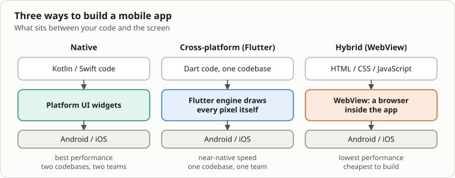

<span class="imp know">Good to know</span>**Native** (Kotlin / Swift) uses the platform's own widgets: best performance, but two codebases and two teams. **Flutter** uses one Dart codebase, and its engine **draws every pixel itself**: near-native speed, one team. **Hybrid** runs HTML/JS inside a **WebView**: cheapest, but slowest.

#### 2. Flutter's three layers

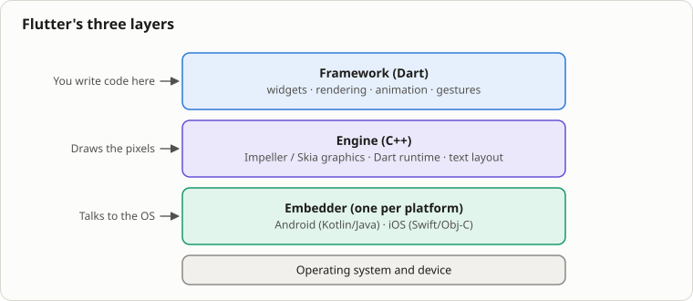

<span class="imp know">Good to know</span>**Framework** (Dart): widgets, animation, gestures. You write code here. **Engine** (C++): draws the pixels with Impeller/Skia and runs Dart. **Embedder**: a thin native part for each platform (Kotlin/Java, Swift/Obj-C) that talks to the OS.

#### 3. The three trees

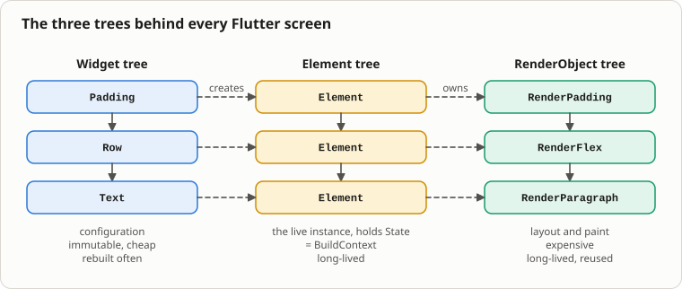

<span class="imp likely">Likely</span>**Widget** = a cheap, immutable description that is rebuilt often. **Element** = the live instance that holds the State; it *is* the `BuildContext`. **RenderObject** = does layout and paint; it is expensive, so it is reused. That is why a rebuild is cheap: only the widgets are new.

#### 4. StatefulWidget lifecycle

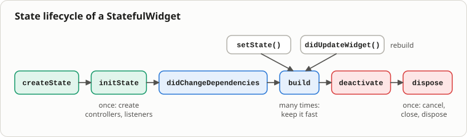

<span class="imp likely">Likely</span>`createState` → `initState` (once: create controllers and listeners) → `didChangeDependencies` → `build` (many times, after `setState` or `didUpdateWidget`, so keep it fast) → `deactivate` → `dispose` (once: cancel timers, close streams). If you forget `dispose`, you get a memory leak.

#### 5. Dart event loop and isolates

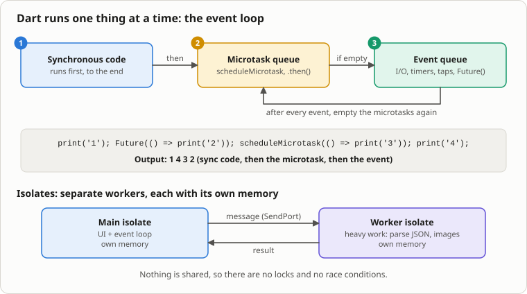

<span class="imp likely">Likely</span>Dart runs one thing at a time. First the **sync code**, then **all microtasks**, then **one event** (I/O, timer, tap), then all microtasks again. So the example prints **1 4 3 2**. For heavy work (big JSON, images), use an **isolate**: it has its own memory and talks by messages, so there are no locks.

#### 6. Platform channel

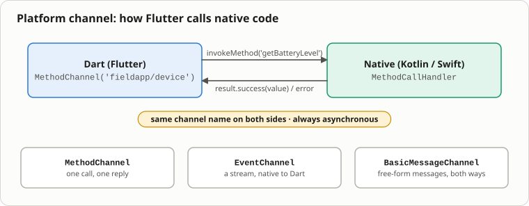

<span class="imp likely">Likely</span>Dart calls `invokeMethod('getBatteryLevel')` on `MethodChannel('fieldapp/device')`. The Kotlin/Swift handler runs the native code and replies with `result.success(value)` or an error. The name is the same on both sides, and the call is always **async**. **MethodChannel** = one call, one reply. **EventChannel** = a stream from native to Dart. **BasicMessageChannel** = free messages both ways.

#### 7. Activity lifecycle ⭐

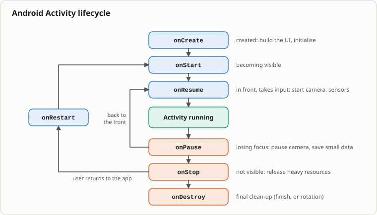

<span class="imp must">Must</span>`onCreate` (build the UI) → `onStart` (becoming visible) → `onResume` (in front, takes input). Then on the way out: `onPause` (losing focus, **partly visible**: pause the camera) → `onStop` (**not visible**: free heavy resources) → `onDestroy` (finish, or rotation). Coming back from `onStop`: `onRestart` → `onStart`.

### Diagrams · A2 · UI/UX Implementation

#### 8. Wireframe, mockup, prototype

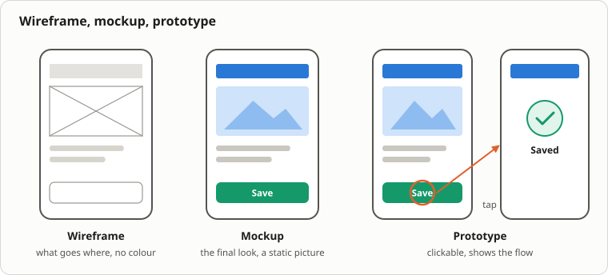

<span class="imp know">Good to know</span>**Wireframe** = boxes only: what goes where, no colour. **Mockup** = the final look, a still picture. **Prototype** = clickable: you tap *Save* and see *Saved*, so it shows the flow. They come in this order.

#### 9. Material vs iOS HIG

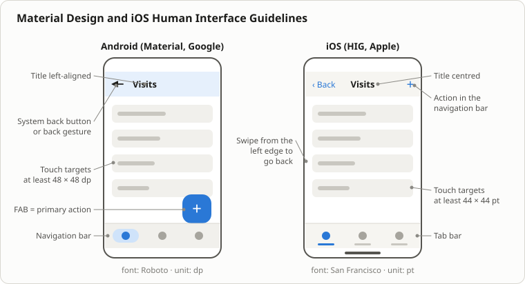

<span class="imp know">Good to know</span>**Android (Material):** left-aligned title, a **FAB** for the main action, the system back button, touch targets **≥ 48 × 48 dp**, Roboto. **iOS (HIG):** centred title, action in the navigation bar, **swipe from the left edge** to go back, a tab bar, touch targets **≥ 44 × 44 pt**, San Francisco.

#### 10. The Flutter layout rule

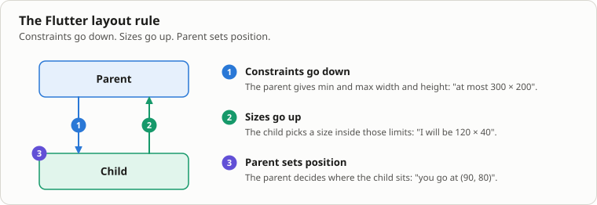

<span class="imp know">Good to know</span>**Constraints go down:** the parent gives a min and max size. **Sizes go up:** the child picks a size inside those limits. **The parent sets the position.** This rule explains most layout errors, such as "unbounded height".

#### 11. Expanded vs Flexible

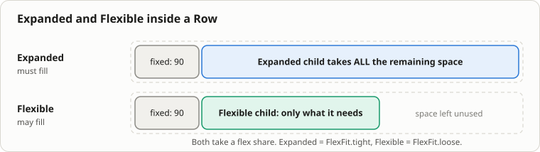

<span class="imp know">Good to know</span>Both share the free space in a Row or Column by `flex`. **Expanded** (`FlexFit.tight`) **must fill** its share. **Flexible** (`FlexFit.loose`) takes **only what it needs**, so some space can stay empty.

#### 12. Responsive breakpoints

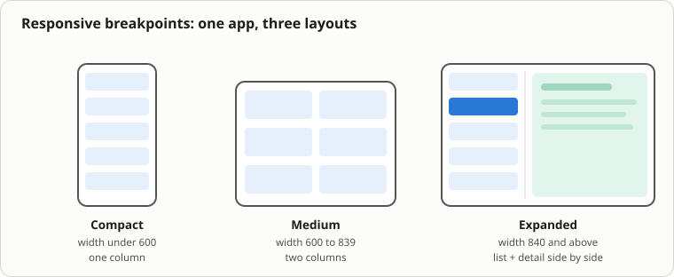

<span class="imp know">Good to know</span>**Compact** (width < 600): one column, for phones. **Medium** (600–839): two columns. **Expanded** (≥ 840): list and detail side by side, for tablets. Choose the layout with `LayoutBuilder` or `MediaQuery`.

### Diagrams · A3 · Offline Storage and Data Sync

#### 13. Offline-first ⭐

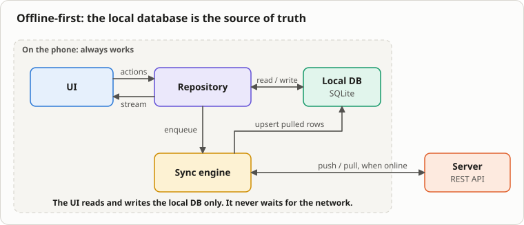

<span class="imp must">Must</span>The **local DB is the source of truth**. The UI talks to the **Repository**. The repository reads and writes **SQLite** and gives the UI a **stream**. It also puts each change in the outbox for the **sync engine**. When online, the sync engine pushes and pulls with the server and upserts the pulled rows. The UI **never waits for the network**.

#### 14. Three caching strategies

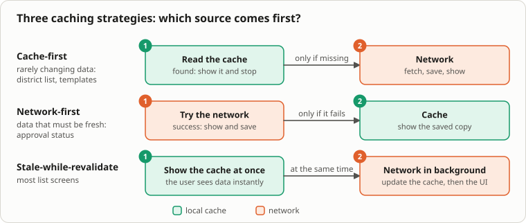

<span class="imp likely">Likely</span>**Cache-first:** read the cache and go to the network only if it is missing (district list). **Network-first:** try the network and fall back to the cache if it fails (approval status). **Stale-while-revalidate:** show the cache at once and refresh it in the background (most list screens).

#### 15. Sync cycle ⭐

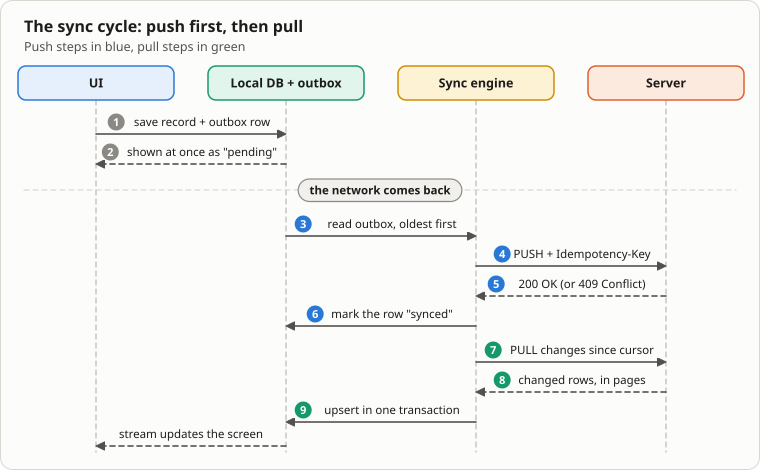

<span class="imp must">Must</span>**1–2:** save the record **and** an outbox row; the UI shows "pending" at once. When the network comes back, **push** first (**3–6**): read the outbox oldest first, send each item with an **Idempotency-Key**, get 200 (or 409), and mark it synced. Then **pull** (**7–9**): ask for changes since the cursor, receive them in pages, and upsert them in one transaction. The stream updates the screen.

#### 16. Exponential backoff

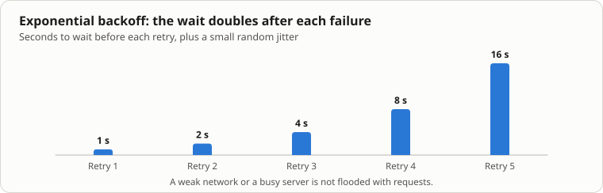

<span class="imp likely">Likely</span>After each failure the wait **doubles**: 1, 2, 4, 8, 16 s, up to a cap. A small random **jitter** is added so that thousands of phones do not retry in the same second. A weak network or a busy server is not flooded.

#### 17. How a conflict happens

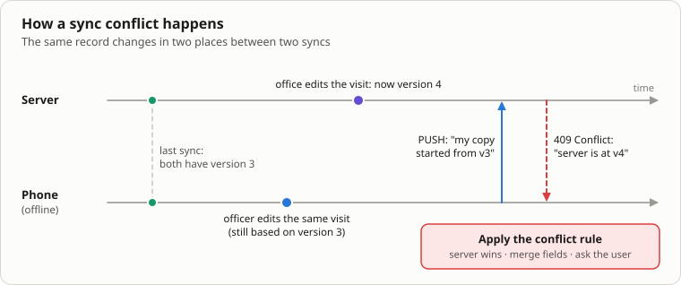

<span class="imp likely">Likely</span>Phone and server both have **v3**. The office edits the record, so the server is now **v4**. The offline officer edits the same record, still based on v3. On push the server sees "from v3" and returns **409 Conflict**. Then apply the rule: **server wins, merge the fields, or ask the user**. The version number is what detects the conflict (optimistic locking).

### Diagrams · B1 · Backend API Integration

#### 18. Anatomy of a REST request

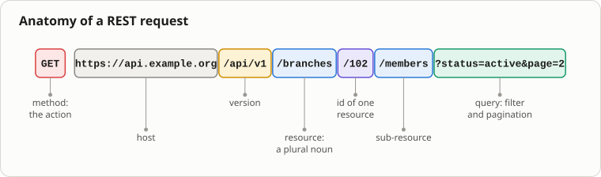

<span class="imp know">Good to know</span>`GET` (the method: the action) + `https://api.example.org` (host) + `/api/v1` (version) + `/branches` (resource: a plural noun) + `/102` (the id) + `/members` (sub-resource) + `?status=active&page=2` (query: filter and pagination).

#### 19. HTTP status codes

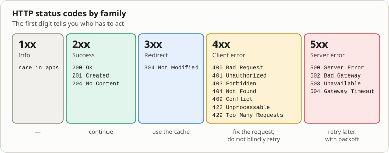

<span class="imp likely">Likely</span>The first digit says who must act. **2xx** success (200, 201 Created, 204). **3xx** redirect (304 = use the cache). **4xx** = your request is wrong, so fix it and do not blindly retry: 400, **401** not logged in or token expired, **403** no permission, 404, **409** conflict, 422, 429. **5xx** = server error: **retry later with backoff**.

#### 20. Where the API call lives

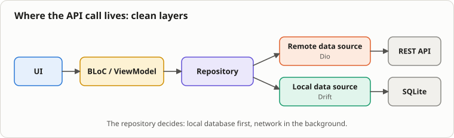

<span class="imp likely">Likely</span>UI → BLoC → **Repository** → remote data source (**Dio** → REST API) and local data source (**Drift** → SQLite). The repository decides: local DB first, network in the background. The UI never calls Dio directly.

#### 21. SDK vs API

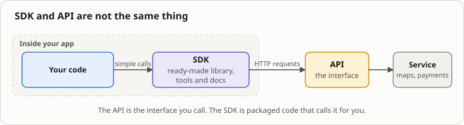

<span class="imp know">Good to know</span>The **API** is the interface you call (HTTP requests). The **SDK** is a ready-made library, with tools and docs, that sits **inside your app** and calls the API for you (for example, the Google Maps SDK).

### Diagrams · B2 · Mobile Security and Identity

#### 22. Encoding, hashing, encryption

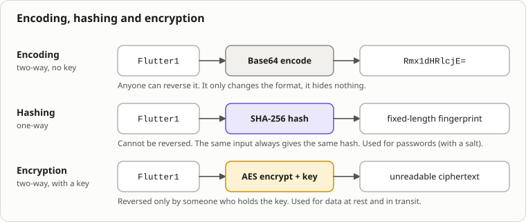

<span class="imp likely">Likely</span>**Encoding** (Base64): two-way, no key, **hides nothing**. **Hashing** (SHA-256): **one-way** fingerprint; the same input always gives the same hash; used for passwords, with a salt. **Encryption** (AES): two-way **with a key**; only the key holder can read it.

#### 23. Symmetric vs asymmetric

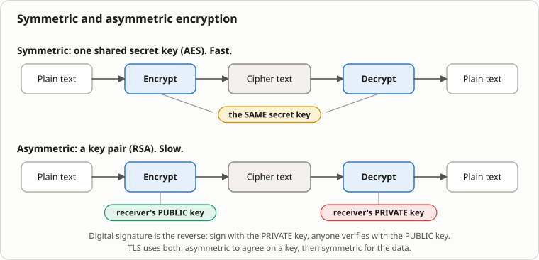

<span class="imp likely">Likely</span>**Symmetric (AES):** the **same secret key** locks and unlocks. It is fast. **Asymmetric (RSA):** lock with the receiver's **public** key and unlock with their **private** key. It is slow. A **signature** is the reverse: sign with the private key, and anyone verifies with the public key. **TLS uses both.**

#### 24. JWT ⭐

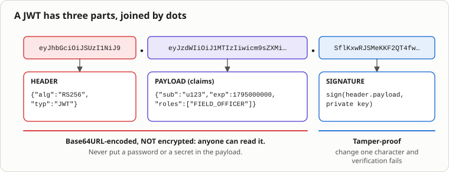

<span class="imp must">Must</span>`header.payload.signature`. **Header:** the algorithm (RS256). **Payload:** claims such as `sub`, `exp` and `roles`. **Signature:** header + payload signed with Keycloak's **private key**. It is Base64URL, **not encrypted**: anyone can read it, so never put secrets in it. It is **tamper-proof**: change one character and the check fails.

#### 25. Silent token refresh

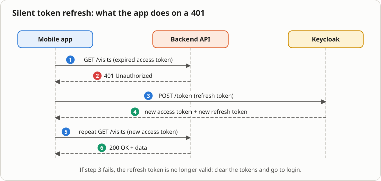

<span class="imp likely">Likely</span>**1** call with an expired token → **2** 401 → **3** `POST /token` with the **refresh token** to Keycloak → **4** new access and refresh tokens → **5** repeat the call → **6** 200 OK. A Dio interceptor does this, so the user sees nothing. If step 3 fails: clear the tokens and go to login.

#### 26. PKCE login ⭐

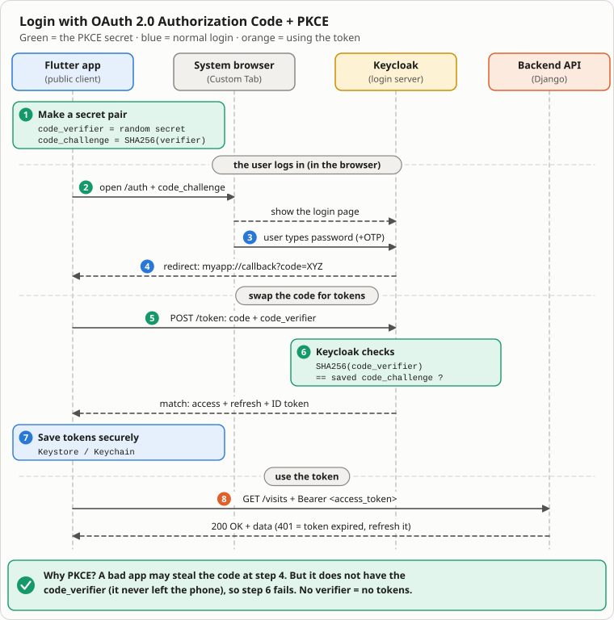

<span class="imp must">Must</span>

<div class="box def">

**In simple words.** The app never sees the password. The user types it on **Keycloak's page in the browser**. Keycloak gives the app a one-time **code**, and the app swaps the code for **tokens**. PKCE adds a **secret** so that only the app that started the login can do the swap.

</div>

**Read the picture in 4 parts:**

1. **Make a secret (step 1).** The app makes a random `code_verifier` and keeps it. It also makes `code_challenge` = SHA-256 hash of the verifier. A hash is one-way: from the challenge nobody can get the verifier back.
2. **Log in (steps 2–4).** The app opens the system browser at Keycloak and sends only the **challenge**. Keycloak saves it. The user types the password on Keycloak's page. Keycloak sends back a one-time **code** to `myapp://callback`.
3. **Swap the code for tokens (steps 5–7).** The app sends the **code + the verifier**. Keycloak hashes the verifier. If the hash equals the saved challenge, the app is the same one that started the login, so Keycloak returns the **access token**, **refresh token** and **ID token**. The app saves them in Keystore/Keychain.
4. **Use the token (step 8).** Every API call carries `Authorization: Bearer <access_token>`. If the API answers **401**, the token has expired: use the refresh token to get a new one.

<div class="box story">

**Example: a cloakroom.** You tear a banknote in two, show the attendant one half (**challenge**) and keep the other half (**verifier**). You get a ticket (**code**). A thief steals the ticket, but at the counter the attendant asks for the other half. The thief does not have it, so no coat (**no tokens**).

</div>

**What to draw in the exam (2 minutes):** 4 boxes (App · Browser · Keycloak · API), arrows 2, 4, 5, 8, and one line under them: *"verifier stays on the phone; Keycloak checks SHA256(verifier) == challenge."*

#### 27. Sign in with Google (OIDC)

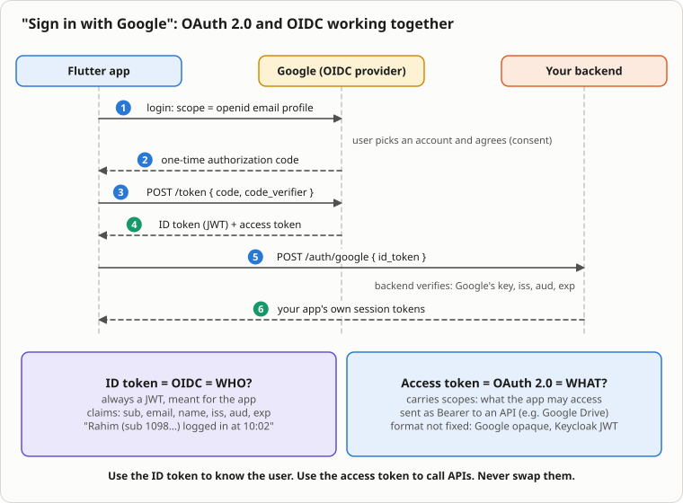

<span class="imp likely">Likely</span>**1** The app asks Google with `scope = openid email profile`; the user agrees. **2** Google sends a one-time **code**. **3** The app sends the code + verifier to `/token`. **4** Google returns an **ID token** (JWT) + an **access token**. **5** The app sends the ID token to **your backend**, which checks Google's key, `iss`, `aud` and `exp`. **6** The backend gives your own session tokens. **ID token = WHO** (OIDC). **Access token = WHAT the app may access** (OAuth).

#### 28. Single Sign-On

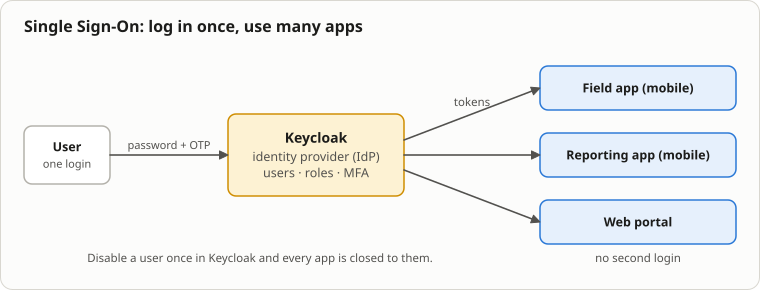

<span class="imp likely">Likely</span>The user logs in **once at Keycloak** (password + OTP). The field app, the reporting app and the web portal all get tokens **with no second login**. Disable the user once in Keycloak, and every app is closed to them.

#### 29. Biometric login ⭐

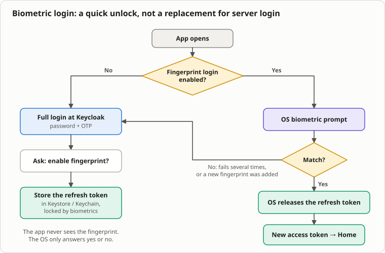

<span class="imp must">Must</span>**First time:** a full Keycloak login, then the app asks "enable fingerprint?" and stores the **refresh token in Keystore/Keychain, locked by biometrics**. **Next time:** the **OS** shows the prompt. If it matches, the OS releases the refresh token, the app gets a new access token, and the user goes to Home. After too many failures, or if a new fingerprint was added, the user must do a full login. **The app never sees the fingerprint**; the OS only says yes or no.

#### 30. Local database encryption

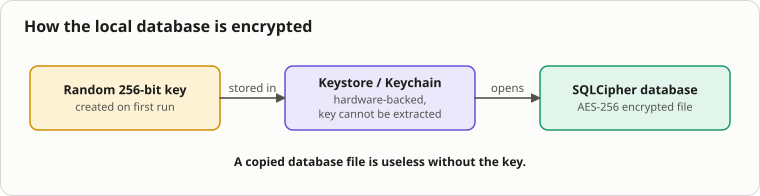

<span class="imp likely">Likely</span>On the first run the app makes a **random 256-bit key** and stores it in **Keystore/Keychain** (hardware-backed, the key cannot be extracted). The key opens the **SQLCipher** database (an AES-256 encrypted file). A copied DB file is useless without the key.

#### 31. Defence in depth

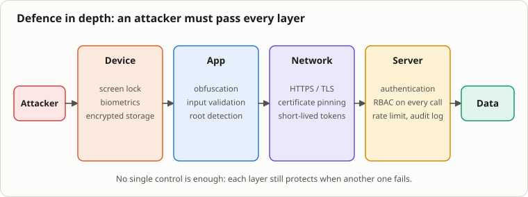

<span class="imp likely">Likely</span>An attacker must pass **every layer** to reach the data. **Device:** screen lock, biometrics, encrypted storage. **App:** obfuscation, input validation, root detection. **Network:** TLS, certificate pinning, short-lived tokens. **Server:** authentication, **RBAC on every call**, rate limits, audit log. If one layer fails, the others still protect.

### Diagrams · B3 · Performance Optimization

#### 32. Frame budget

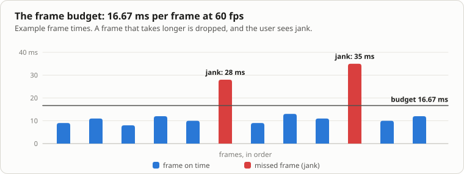

<span class="imp likely">Likely</span>At 60 fps each frame has **1000 ÷ 60 = 16.67 ms**. The bars above the line (28 ms, 35 ms) miss the frame, it is dropped, and the user sees **jank**. At 90 Hz the budget is 11.1 ms; at 120 Hz it is 8.33 ms.

#### 33. How Flutter renders a frame

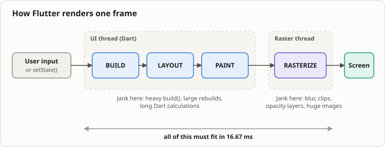

<span class="imp likely">Likely</span>Input or `setState` → **UI thread**: build → layout → paint → **raster thread**: rasterize → screen. All of it must fit in 16.67 ms. **UI jank** comes from heavy `build()`, big rebuilds and long Dart work. **Raster jank** comes from blur, clips, opacity layers and huge images.

#### 34. ListView vs ListView.builder

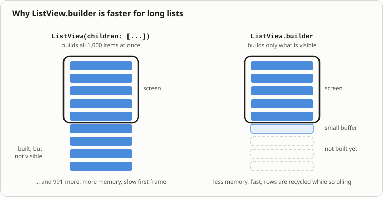

<span class="imp likely">Likely</span>`ListView(children: [...])` builds **all 1,000 items** at once: more memory and a slow first frame. `ListView.builder` builds **only the visible rows** plus a small buffer, and recycles them while you scroll.

#### 35. Memory leak

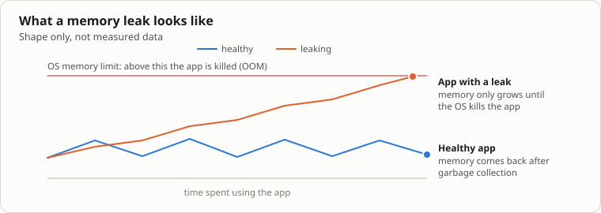

<span class="imp know">Good to know</span>**Healthy app:** memory goes up and **comes back down** after garbage collection (a saw-tooth). **Leak:** memory **only grows** until the OS kills the app (OOM). Common causes: controllers that are not disposed, and streams or timers that are not cancelled.

#### 36. Batching network calls

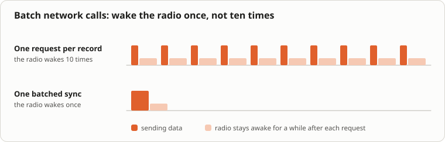

<span class="imp know">Good to know</span>Each request **wakes the radio**, and the radio stays awake for a while afterwards. Ten separate requests = ten wake-ups = a drained battery. **One batched sync** wakes it once.

### Diagrams · B4 · Push Notifications and Crash Monitoring

#### 37. Push notification flow ⭐

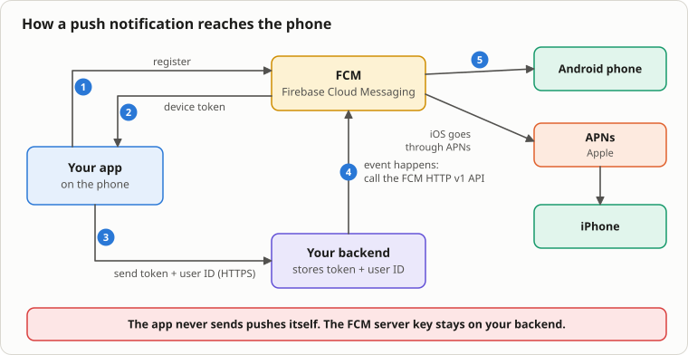

<span class="imp must">Must</span>**1** The app registers with **FCM** → **2** it gets a **device token** → **3** it sends the token + user ID to **your backend** (HTTPS) → **4** when an event happens, the backend calls the **FCM HTTP v1 API** → **5** FCM delivers to the Android phone, or to the iPhone **through APNs**. The app never sends pushes itself; the server key stays on the backend.

#### 38. Crash-free users

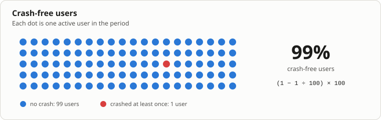

<span class="imp likely">Likely</span>**Crash-free users = (1 − crashed users ÷ total users) × 100.** 1 user crashed out of 100 → **99%**. It counts **users**, not sessions; a user who crashes 5 times still counts once.

#### 39. Monitoring loop after a release

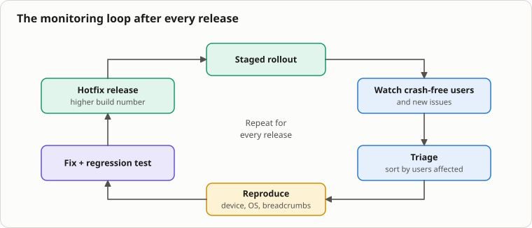

<span class="imp know">Good to know</span>Staged rollout → watch **crash-free users** and new issues → **triage** by users affected → **reproduce** (device, OS, breadcrumbs) → **fix + regression test** → **hotfix** with a higher build number → repeat for every release.

### Diagrams · C1 · Store Publishing and Code Signing

#### 40. Release path of one version

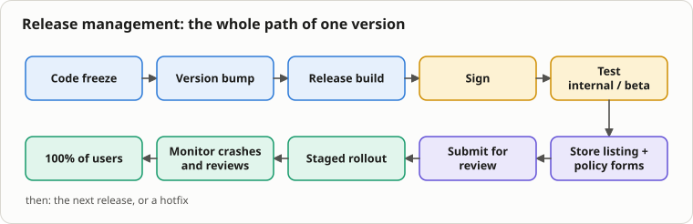

<span class="imp know">Good to know</span>Code freeze → version bump → release build → **sign** → test (internal / beta) → store listing + policy forms → **submit for review** → **staged rollout** → monitor crashes and reviews → 100% → the next release, or a hotfix.

#### 41. Reading a version number

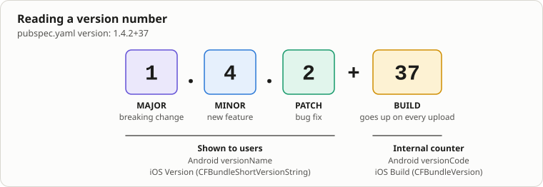

<span class="imp likely">Likely</span>`version: 1.4.2+37` = **MAJOR.MINOR.PATCH+BUILD**. 1 = breaking change, 4 = new feature, 2 = bug fix. Users see this part (Android `versionName`, iOS `CFBundleShortVersionString`). **37** is the build number; it **goes up on every upload** (Android `versionCode`, iOS `CFBundleVersion`).

#### 42. Android signing (Play App Signing) ⭐

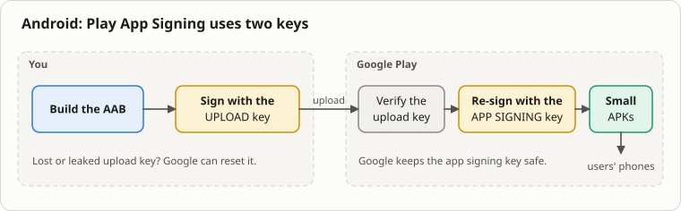

<span class="imp must">Must</span>**You** build the AAB and sign it with the **upload key**. **Google Play** checks the upload key, **re-signs with the app signing key** (which Google keeps safe), and sends small APKs to users' phones. If you lose the upload key, Google can reset it.

#### 43. iOS signing ⭐

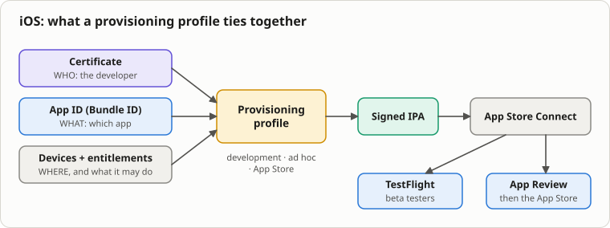

<span class="imp must">Must</span>A **provisioning profile** ties together the **certificate** (WHO: the developer), the **App ID / Bundle ID** (WHAT: which app) and the **devices + entitlements** (WHERE, and what the app may do). The signed IPA goes to **App Store Connect**, then to **TestFlight** testers, or through **App Review** to the App Store. Profile types: development, ad hoc, App Store.

#### 44. Staged rollout

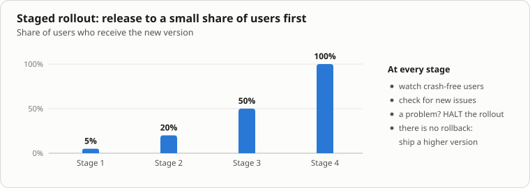

<span class="imp likely">Likely</span>**5% → 20% → 50% → 100%** of users. At every stage, watch crash-free users and new issues. If there is a problem, **halt** the rollout. There is no rollback: you ship a fix with a **higher version**.

### Diagrams · C2 · CI/CD and Build Automation

#### 45. CI vs Delivery vs Deployment

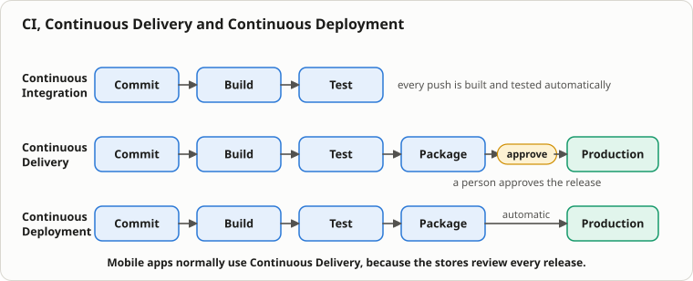

<span class="imp likely">Likely</span>**Continuous Integration:** every push is built and tested automatically. **Continuous Delivery:** the build is always ready, and **a person approves** the release. **Continuous Deployment:** it goes to production **automatically**. Mobile apps use **Delivery**, because the stores review every release.

#### 46. Mobile CI/CD pipeline ⭐

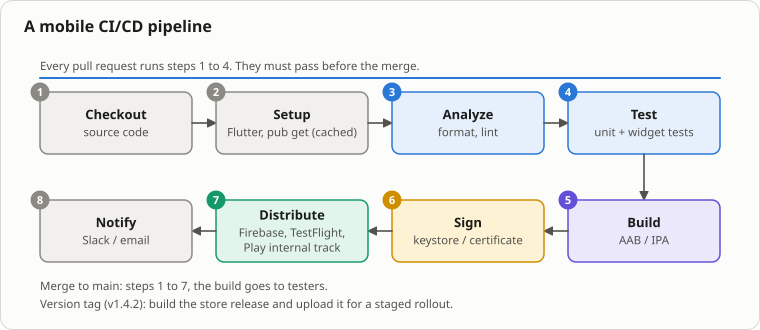

<span class="imp must">Must</span>**1** checkout → **2** setup (Flutter, `pub get`, cached) → **3** analyze → **4** test → **5** build AAB/IPA → **6** sign → **7** distribute (Firebase, TestFlight, Play internal track) → **8** notify. A **pull request** runs steps 1–4, which must pass before the merge. A **merge to main** runs 1–7. A **version tag** builds the store release.

#### 47. CI service vs Fastlane

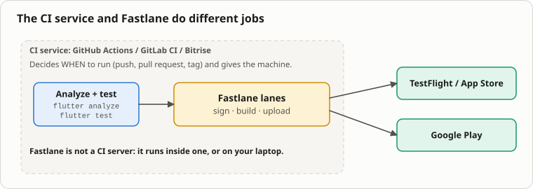

<span class="imp likely">Likely</span>The **CI service** (GitHub Actions, GitLab CI, Bitrise) decides **when** to run (push, PR, tag), gives the machine, and runs analyze + test. **Fastlane** lanes do the mobile jobs: **sign, build, upload** to the stores. Fastlane is not a CI server; it runs inside one, or on your laptop.

#### 48. Git Flow

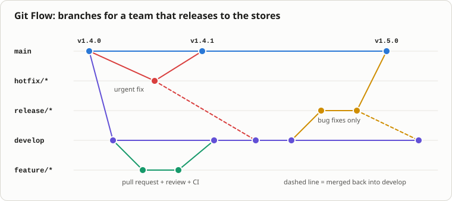

<span class="imp know">Good to know</span>**main** = released versions (v1.4.0 …). **develop** = where work joins. **feature/*** branches come from develop and go back through a **PR + review + CI**. A **release/*** branch takes bug fixes only, then merges to main with a tag. A **hotfix/*** branch comes from main for an urgent fix. Both are merged back into develop.

#### 49. Merge vs rebase

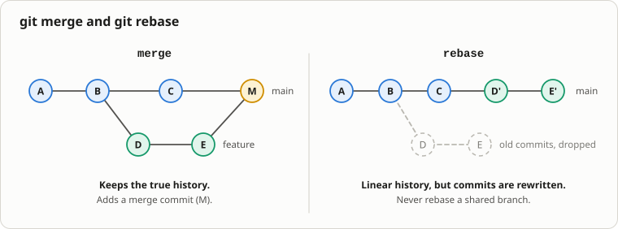

<span class="imp know">Good to know</span>**Merge** keeps the true history and adds a merge commit (M). **Rebase** replays your commits on top of main (D′, E′): the history is a straight line, but the commits are rewritten. **Never rebase a shared branch.**

#### 50. Cloud service models

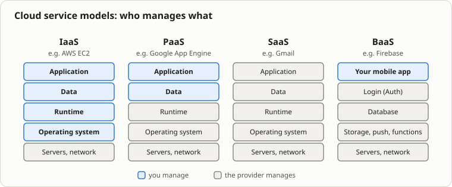

<span class="imp know">Good to know</span>**IaaS** (AWS EC2): you manage everything from the OS up. **PaaS** (App Engine): you manage only the app and the data. **SaaS** (Gmail): the provider manages everything. **BaaS** (Firebase): ready-made login, database, storage and push for your mobile app.

#### 51. VM vs container


<span class="imp know">Good to know</span>Each **VM** carries a **full guest OS** on a hypervisor: heavy, slow to start, strongly isolated. **Containers** (Docker) hold only the app + its libraries and **share the host kernel**: light, and they start in seconds.

### Diagrams · D1 · Architecture Patterns and Testing

#### 52. MVC, MVP, MVVM


<span class="imp likely">Likely</span>**MVC:** the Controller takes input and updates the Model; the View may read the Model directly. **MVP:** the View sends events to the Presenter, which calls `view.show()` through an interface (1 Presenter : 1 View). **MVVM:** the View calls the ViewModel and listens to its **state stream**; the ViewModel does not know the View. This fits Flutter: a Cubit is like a ViewModel.

#### 53. BLoC ⭐


<span class="imp must">Must</span>The UI sends **events** (`LoadVisits`, `SubmitVisit`) → the **BLoC** runs the logic and calls the repository (API, DB) → it emits **states** (`Loading`, `Loaded`, `Error`) → the UI rebuilds. **One direction only**: the UI never changes the state by itself. A **Cubit** uses methods instead of events.

#### 54. Clean Architecture ⭐


<span class="imp must">Must</span>**Presentation** (widgets, BLoC) → **Domain** (use cases, entities, repository **interfaces**; pure Dart) ← **Data** (repository impl, DTO models, Dio, Drift). **Dependencies point inward** to the domain; the data layer implements the domain's interfaces. Call flow: UI → BLoC → use case → repository interface → impl → remote/local. So each layer can be tested and replaced on its own.

#### 55. Test pyramid ⭐


<span class="imp must">Must</span>**Wide base: many unit tests** (milliseconds, one function or class). **Middle: some widget tests** (fast, no device). **Top: few integration/E2E tests** (slow, a real device). Going up, the tests are slower and costlier, but give more confidence. Draw it with the **unit tests at the bottom**.

#### 56. TDD cycle


<span class="imp know">Good to know</span>**Red:** write a test that fails. **Green:** write the minimum code to make it pass. **Refactor:** clean the code while the tests still pass. Then repeat for the next small behaviour.

### Diagrams · D2 · Post-Deployment Support

#### 57. Bug life cycle


<span class="imp know">Good to know</span>New → Assigned → Open → Fixed → Retest → Verified → Closed. Side exits: **Rejected / Duplicate**, **Deferred** (fix later), and **Reopened** if the retest fails, which sends the bug back to the developer.

#### 58. Severity vs priority


<span class="imp likely">Likely</span>**Severity** = how much damage the bug does (set by QA). **Priority** = how soon it must be fixed (set by the PO or manager). A crash on login for everyone = high + high. The app's name misspelled on the home screen = **low severity, high priority**. A crash in a report used once a year = **high severity, low priority**.

#### 59. Backward compatibility


<span class="imp know">Good to know</span>A new version must still work with: **(a)** older OS versions and devices (minSdk, version checks, fallbacks); **(b)** older app versions still in use (keep API `/v1` alive, make only additive changes); **(c)** older local data (DB migrations v1 → v2 → v3); **(d)** newer libraries (small upgrades, pinned versions, tests).

### Diagrams · D3 · Documentation and Agile Teamwork

#### 60. SDLC


<span class="imp likely">Likely</span>1 Planning → 2 Requirements → 3 Design → 4 Implementation → 5 Testing → 6 Deployment → 7 Maintenance. Maintenance feeds the next plan, so it is a cycle.

#### 61. Waterfall vs Agile


<span class="imp likely">Likely</span>**Waterfall:** the phases run once, in order, with one delivery at the end, so change is expensive. **Agile:** short **sprints**, each delivering a **working increment**, so change is expected.

#### 62. V-model


<span class="imp know">Good to know</span>Each phase on the left has a matching test on the right: **requirements ↔ acceptance testing (UAT)**, **system design ↔ system testing**, **module design ↔ unit testing**, with coding at the bottom. The tests are planned early.

#### 63. Scrum ⭐


<span class="imp must">Must</span>**Product Backlog** (ordered by the PO) → **Sprint Planning** → **Sprint Backlog** → the **Sprint** (1–4 weeks, with a 15-minute **Daily Scrum**) → the **Increment** → **Sprint Review** (demo the product) → **Retrospective** (improve the process) → the next sprint. Roles: **Product Owner** (what to build, and the order), **Scrum Master** (guards the process, removes blockers), **Developers** (build it).

#### 64. Burndown chart


<span class="imp know">Good to know</span>Y = story points left, X = days of the sprint. The **ideal** line goes straight from 40 to 0. If the actual line is **above** the ideal, the team is behind. A **flat** part means no progress: a blocker.

#### 65. Kanban board


<span class="imp know">Good to know</span>Cards move To Do → In Progress (**max 3**) → Review (**max 2**) → Done. The **WIP limit** means a full column takes no new work until a card moves on: finish work before you start new work.

### Diagrams · E · The whole system

#### 66. field app, end to end


<span class="imp likely">Likely</span>**On the phone:** UI → BLoC → use cases → repository → **Drift + SQLCipher** local DB; a **sync engine** (outbox, push then pull); **Keystore/Keychain** for the tokens and the DB key; **biometric unlock**. **Outside:** **Keycloak** (OAuth2 + PKCE), **FCM/APNs**, the backend **REST API** (HTTPS, JSON/XML), **Crashlytics/Sentry**, **CI/CD** (GitHub Actions + Fastlane), and the **stores** with staged rollout. Draw this for Template 1.

### The six long-answer templates

Each template has **headings to write** and a **model answer**. On paper, write each heading, add 2–4 points under it and draw the named diagram. With these six you can answer most 10–15 mark questions.

| # | Question type | Importance | Diagram to draw |
|---|---|---|---|
| 1 | Design a field app | <span class="imp must">Must</span> | System design (no. 66) |
| 2 | Explain secure login | <span class="imp must">Must</span> | PKCE login (no. 26) |
| 3 | How do you keep data secure? | <span class="imp likely">Likely</span> | Defence in depth (no. 31) |
| 4 | The app is slow / crashes / drains battery | <span class="imp likely">Likely</span> | Render pipeline (no. 33) |
| 5 | The release process / CI/CD | <span class="imp must">Must</span> | CI/CD pipeline (no. 46) |
| 6 | Which architecture, and why? | <span class="imp must">Must</span> | Clean Architecture (no. 54) + BLoC (no. 53) |

### Template 1 — "Design a mobile app for field officers" (system design)

<span class="imp must">Must</span> The most likely big question. It joins A3 + B1 + B2 + D1.

**Headings to write:** 1 Assumptions · 2 Architecture diagram · 3 Technology choices · 4 Offline storage and sync · 5 Conflicts · 6 Security · 7 Field features · 8 Quality · 9 Release and support · 10 Closing line.

<p class="label">Model answer</p>

<div class="box def">

**In short.** A **Flutter** app (one codebase for Android and iOS), built **offline-first**: every visit and collection is saved first in an **encrypted local database** and synced in the background when the network comes back. Login is **Keycloak SSO with PKCE**; roles come in the JWT, and the **server enforces them**. **Clean Architecture + BLoC** keeps it testable, and **CI/CD, a staged rollout and Crashlytics** keep releases safe.

</div>

**1. Assumptions.** Users are the field officers of a microfinance NGO, mostly on low-cost Android phones. They register members, collect installments and record visits with photo and GPS. The network is weak in rural areas. The data is financial, so it must be secure and correct. The app is needed on Android and iOS.

**2. Architecture.**


**3. Technology choices.**

| Need | Choice | Why |
|---|---|---|
| Android + iOS | **Flutter** | One codebase, one team, fast UI |
| Structure | **Clean Architecture + BLoC** | Testable, layers can be replaced, good for a team |
| Local data | **Drift (SQLite) + SQLCipher** | Relational queries, works offline, encrypted |
| Network | **Dio** + interceptors | Adds the token, refreshes on 401, retries |
| Background work | **WorkManager** / BGTaskScheduler | Sync even when the app is closed |
| Login | **Keycloak** (OAuth2 + PKCE) | SSO across all the NGO's apps |
| Notifications | **FCM** (APNs on iOS) | Tell the officer about approvals |
| Crashes | **Crashlytics** | Track crash-free users |

**4. Offline storage and sync.**
- Each record gets a **UUID on the phone**, so there are no ID clashes.
- Save the record **and an outbox row in one transaction**, and show it as "pending".
- When online: **push** the outbox, oldest first, each with an **Idempotency-Key**; then **pull** the changes since the last cursor.
- Retry with **exponential backoff + jitter**. Upload photos **separately**, compressed.
- Run it with **WorkManager** (network constraint), and also when the app opens.

**5. Conflicts.** Every row has a **version** number. If the server has a newer version, it returns **409**. The rule depends on the data: **money and approved loans → server wins**; profile fields → **merge the fields** (or last-write-wins); anything unclear → **ask the user**.

**6. Security.** PKCE login in the system browser · tokens in **Keystore/Keychain** · **biometric** quick unlock · **SQLCipher** DB with its key in Keystore · **HTTPS + certificate pinning** · **RBAC** checked by the server (403) · session timeout · wipe the data on logout · audit trail.

**7. Field features.** A camera with an image-quality check · a GPS tag on each visit · validation at entry · a **sync badge** on every record (pending / synced / failed) · **Bangla and English** (ARB files).

**8. Quality.** **Unit tests** for the sync logic and the calculations · `bloc_test` · **widget tests** for the forms · an integration test for offline → online · **CI on every pull request**.

**9. Release and support.** Build and sign with **Fastlane** · Play internal track and TestFlight · **staged rollout** 5% → 20% → 50% → 100% · watch **Crashlytics** · a force-update check for very old versions · documentation.

**10. Closing line.** One true sentence from your own work, for example: "I built an offline-first app with SQLite/Drift and automatic background sync, so I can apply this design directly."

<div class="box story">

**Example.** An officer in a char area records 25 installment collections with no network. Each is saved locally and shows "pending". At the upazila office the phone gets 4G, and WorkManager pushes the 25 outbox items. One loan was already changed by the branch, so the server returns 409. The rule for money is **server wins**, so the app keeps the server's copy and shows the officer a note.

</div>

<div class="box exam">

**In the exam (15 marks ≈ 25 minutes).** Draw the architecture first (5 min). Then write headings 3–9 with 2–3 points each. Use the **table** for the technology choices. End with the closing line.

</div>

### Template 2 — "Explain secure login" (authentication)

<span class="imp must">Must</span> Keycloak, OAuth2, JWT and biometrics appear in most mobile job adverts.

**Headings to write:** 1 Definitions · 2 PKCE sequence diagram · 3 Tokens and JWT · 4 Storage · 5 Refresh · 6 Biometric login · 7 Logout and a lost device · 8 Extra controls.

<p class="label">Model answer</p>

<div class="box def">

**In short.** **Authentication** = who you are; **authorization** = what you may do. The NGO's apps log in through **Keycloak** (one realm, **SSO**) with **OAuth 2.0 Authorization Code + PKCE** in the **system browser**, so the app never sees the password. The app gets a short **access token (JWT)**, a **refresh token** and an **ID token**, stores them in **Keystore/Keychain**, refreshes on **401**, and uses **biometrics** for a quick unlock. The **server checks the roles** on every call.

</div>

**1. Definitions.**

| Term | Meaning |
|---|---|
| Authentication | Proving who you are (password, OTP, fingerprint) |
| Authorization | What you are allowed to do (roles, scopes) |
| OAuth 2.0 | A framework for giving an app **access** without sharing the password |
| OIDC | A layer on OAuth 2.0 that adds the **ID token** (who the user is) |
| SSO | Log in once and use many apps |
| Keycloak | Open-source identity server: users, roles, MFA, SSO (OIDC / OAuth2 / SAML) |

**2. The flow.** Draw the **PKCE login** diagram (no. 26). Steps: (1) the app makes `code_verifier` and `code_challenge = SHA256(verifier)` → (2) it opens the browser at Keycloak with the challenge → (3) the user logs in → (4) Keycloak redirects back with a code → (5) the app sends the code + verifier → (6) Keycloak checks the hash and returns the tokens → (7) the app saves them → (8) the app calls the API with `Bearer <access_token>`.

**3. Tokens.**

| Token | Lifetime | Used for |
|---|---|---|
| Access token (JWT) | 5–15 minutes | Sent to the API as `Authorization: Bearer` |
| Refresh token | Hours to days | Getting a new access token without logging in again |
| ID token (JWT) | Short | Telling the app who the user is (name, ID) |

A JWT is `header.payload.signature`. The payload (`sub`, `exp`, `roles`) is **signed, not encrypted**, so it must not contain secrets.

**4. Storage.** `flutter_secure_storage` → **Android Keystore / iOS Keychain**. Never SharedPreferences, never in logs.

**5. Refresh.** A Dio interceptor: **401 → `POST /token` with the refresh token → retry the call**. If the refresh fails, clear the tokens and go to login.

**6. Biometric login.** After the first full login, ask "enable fingerprint?". The refresh token is stored **locked by biometrics**. Next time the **OS** checks the finger and releases it. A new fingerprint added to the phone, or too many failures, means a full login again.

**7. Logout and a lost device.** Revoke the refresh token at Keycloak, clear secure storage and the local DB. Use an idle timeout. If a phone is lost, the admin **disables the user in Keycloak**, and every app is closed to them.

**8. Extra controls.** MFA/OTP · TLS + certificate pinning · **RBAC on the server (403)** · rate limiting on login.

<div class="box story">

**Example.** Rahima logs in to the field app at 9 am with password + OTP. At 2 pm she opens the reporting app and is **not asked again** (SSO). Her access token expired at 9:15, but the app refreshed it silently, so she saw nothing.

</div>

<div class="box exam">

**In the exam.** Write the "In short" lines, draw the 4-lane PKCE diagram, then the **token table**. Underline **PKCE**, **JWT**, **Keystore/Keychain** and **403**.

</div>

### Template 3 — "How will you ensure data security in the app?"

<span class="imp likely">Likely</span> Use six headings: <mark>**Authentication · Data at rest · Data in transit · App hardening · Access control and audit · Process (VAPT, updates)**</mark>. End with "defence in depth".

<p class="label">Model answer</p>

<div class="box def">

**In short.** No single control is enough, so I use **defence in depth**: secure login, encrypted data on the phone, encrypted data on the network, a hardened app, roles checked by the server, and a security process. If one layer fails, the next one still protects the NGO's financial data.

</div>

| Layer | What I do |
|---|---|
| **Authentication** | Keycloak + PKCE, MFA/OTP, biometric unlock, session timeout |
| **Data at rest** | **SQLCipher** (AES-256), key in **Keystore/Keychain**; tokens in secure storage; nothing sensitive in SharedPreferences or logs; photos in app-private storage |
| **Data in transit** | **HTTPS / TLS 1.2+**, **certificate pinning**, no cleartext traffic (Android network security config, iOS ATS) |
| **App hardening** | Code obfuscation (`--obfuscate --split-debug-info`), root/jailbreak detection, `FLAG_SECURE` on sensitive screens, input validation, **no secrets in the app** |
| **Access control and audit** | Roles from the JWT shape the UI, but the **server enforces RBAC (403)**; least privilege; an audit log of who did what and when |
| **Process** | **VAPT** before release, the OWASP MASVS checklist, dependency updates, an incident plan, remote logout |


<div class="box story">

**Example: a lost phone.** The DB file is encrypted and its key sits in the hardware Keystore, so a copy is useless. The admin disables the user in Keycloak, and the refresh token stops working. No member's loan data leaks.

</div>

<div class="box exam">

**In the exam.** Write the six headings as a **table** (layer | controls), draw the defence-in-depth picture, and end with the lost-phone example.

</div>

### Template 4 — "The app is slow / crashes / drains battery"

<span class="imp likely">Likely</span> Present each part as a "problem → fix" table.

**Headings to write:** 1 Measure · 2 Rendering fixes · 3 Memory fixes · 4 Battery and network fixes · 5 Verify, then monitor.

<p class="label">Model answer</p>

<div class="box def">

**In short.** **Measure first, then fix.** Profile in **profile mode on a real low-cost phone** with DevTools and Crashlytics, find the cause, fix it by type (rendering, memory, crashes, battery), then **measure again** and **monitor** after release.

</div>

**1. Measure.** `flutter run --profile` · **DevTools** (Performance, Memory) · Android Studio Profiler / Xcode Instruments · **Crashlytics** and Android vitals (crash rate, ANR).

**2–4. Problem → fix.**

| Problem | Fix |
|---|---|
| Janky scrolling | `ListView.builder`, `const` widgets, smaller rebuilds (`buildWhen`, small widgets), `RepaintBoundary` |
| The UI freezes during heavy work | Move it to an **isolate** (`Isolate.run` / `compute`): big JSON, image work |
| Large images | Resize (`cacheWidth`), compress before upload |
| Memory keeps growing | **Dispose** controllers, **cancel** streams and timers, paginate lists |
| Crashes | Null safety, try/catch around I/O, Crashlytics breadcrumbs, a regression test for each crash |
| ANR (Android) | No heavy work on the main thread |
| Battery drain | **Batch** network calls, WorkManager with constraints, **push instead of polling**, GPS only when needed |
| Slow start-up | Initialise only what the first screen needs; load the rest later |

**5. Verify, then monitor.** Re-measure on the same phone: frames under **16.67 ms**, memory flat, crash-free users **≥ 99.5%**. Release with a **staged rollout** and watch Crashlytics and Firebase Performance.


<div class="box story">

**Example.** The member list jank on a low-cost phone. DevTools shows `ListView(children:)` building 2,000 rows and a large JSON decoded on the UI thread. Fix: `ListView.builder`, pagination, and `Isolate.run(() => jsonDecode(body))`. Frames drop from about 35 ms to under 16 ms.

</div>

<div class="box exam">

**In the exam.** One line on "measure first", then the **problem → fix table**, then one line on verifying and monitoring. Draw the frame budget or the render pipeline if there is room.

</div>

### Template 5 — "Describe the release process / CI/CD"

<span class="imp must">Must</span> Fastlane, GitHub Actions, Bitrise, signing and publishing appear in most mobile job adverts.

**Headings to write:** 1 Definitions · 2 Pipeline diagram · 3 Versioning · 4 Signing · 5 Testing tracks · 6 Store listing · 7 Rollout and hotfix · 8 Tools.

<p class="label">Model answer</p>

<div class="box def">

**In short.** **CI** builds and tests every change automatically. **Continuous Delivery** prepares a signed release that **a person approves**; mobile uses this because the stores review every release. I use **GitHub Actions** (when to run) + **Fastlane** (sign, build, upload), semantic versioning, beta tracks, a **staged rollout** and crash monitoring.

</div>

**1. Definitions.** **CI:** every push is built and tested. **Continuous Delivery:** always ready to release, with manual approval. **Continuous Deployment:** released automatically.

**2. Pipeline.**


```yaml
# .github/workflows/ci.yml : runs on every pull request
on: [pull_request]
jobs:
  test:
    runs-on: ubuntu-latest
    steps:
      - uses: actions/checkout@v4
      - uses: subosito/flutter-action@v2
      - run: flutter pub get
      - run: flutter analyze
      - run: flutter test
```

**3. Versioning.** `version: 1.4.2+37` = MAJOR.MINOR.PATCH + build. The build number (`versionCode` / `CFBundleVersion`) **goes up on every upload**.

**4. Signing.** **Android:** sign the AAB with the **upload key**; Google re-signs it with the **app signing key** (Play App Signing). The keystore lives in **CI secrets**, never in Git. **iOS:** certificate + App ID + provisioning profile (`fastlane match`).

**5. Testing tracks.** Play: internal → closed → open → production. Apple: **TestFlight** (internal, then external testers).

**6. Store listing.** Screenshots, description, privacy policy, the **Data safety** form, and a reason for each sensitive permission.

**7. Rollout and hotfix.** **5% → 20% → 50% → 100%**, watching crash-free users. If there is a problem, **halt**. There is no rollback, so ship a fix with a **higher build number**.

**8. Tools.** GitHub Actions / GitLab CI / Bitrise + **Fastlane** (`gym` builds, `pilot` → TestFlight, `supply` → Play, `match` → iOS certificates).

<div class="box story">

**Example.** A developer opens a pull request: CI runs analyze + tests in 6 minutes. After the merge, Fastlane sends a build to testers. A `v1.5.0` tag uploads the AAB to Play at 5%. Crash-free users stay at 99.8%, so it goes to 100%.

</div>

<div class="box exam">

**In the exam.** Definitions (3 lines) → draw the pipeline → one point each for versioning, signing, tracks and rollout. Name **GitHub Actions + Fastlane**.

</div>

### Template 6 — "Which architecture will you use and why?"

<span class="imp must">Must</span> BLoC, MVVM, MVP and Clean Architecture appear in most mobile job adverts.

**Headings to write:** 1 Why architecture matters · 2 Layer diagram · 3 BLoC · 4 Comparison · 5 Flow of one request · 6 Testing · 7 Folder structure · 8 Trade-off.

<p class="label">Model answer</p>

<div class="box def">

**In short.** I use **Clean Architecture with BLoC**. **Presentation** (widgets + BLoC) → **Domain** (entities, use cases, repository interfaces; pure Dart) ← **Data** (repository implementations, models, Dio, Drift). **Dependencies point inward**, so the business rules do not depend on Flutter, the API or the database. It is testable, easy to change, and good for a team working on a long-lived system.

</div>

**1. Why architecture matters.** Separation of concerns · testability · easier maintenance · several developers can work in parallel.

**2. Layers.**


**3. BLoC.** The UI sends **events**, the BLoC emits **states**, and the UI rebuilds. One direction only.


**4. Comparison.**

| Pattern | Idea | When |
|---|---|---|
| MVP | The Presenter commands the View through an interface (1 : 1) | Older Android apps |
| MVVM | The View observes the ViewModel's state | Android Jetpack, SwiftUI |
| **BLoC** | Events in, states out, through streams | **Large Flutter apps, teams** |
| Provider / GetX | Simple state holders | Small apps, quick work |

**5. Flow of one request ("Submit visit").** Page → `VisitBloc` receives `SubmitVisit` → `SubmitVisitUseCase` → `VisitRepository` (interface) → `VisitRepositoryImpl` saves to Drift + the outbox → the BLoC emits `VisitSaved` → the page shows "pending".

**6. Testing.**

| Layer | Test |
|---|---|
| Domain | Unit tests: use cases with a mocked repository |
| Data | Unit tests: the repository with a mocked API and an in-memory DB |
| Presentation | `bloc_test` for event → state; widget tests for the pages |

**7. Folder structure.**

```text
lib/
  core/              network, errors, DI
  features/visit/
    data/            models, datasources, repositories (impl)
    domain/          entities, repositories (interface), usecases
    presentation/    bloc, pages, widgets
```

**8. Trade-off.** More files and boilerplate. Worth it for a long-lived, multi-developer system like the NGO's; too much for a tiny app.

<div class="box story">

**Example.** If the NGO moves the local DB from Hive to Drift, or the API from REST to GraphQL, **only the data layer changes**. The use cases, BLoCs and screens stay the same, and their tests still pass. GetX and Provider are fine for small apps; for a large system with many developers, BLoC's clear, testable flow is the better choice.

</div>

<div class="box exam">

**In the exam.** Draw the 3 layers with arrows pointing to the domain, then the BLoC event → state picture. Write the comparison as a **table**. End with the trade-off line.

</div>


---

## Part 4 — Exam technique

<span class="imp must">Must</span> Read this once more just before you go in.

**Before writing (first 5–10 minutes)**
- Read the whole paper. Mark the questions you know best.
- Divide time by marks. Leave 10 minutes at the end to review.
- If there is a choice, pick by what you can **draw and structure**, not only what you know.

**While writing**
- Start with the easiest question to build speed and confidence.
- <mark>One-sentence definition first; then points; then example; then diagram or table.</mark>
- Underline key terms (JWT, PKCE, WorkManager). Examiners scan for them.
- <mark>"Differences" → always a table.</mark>
- Code by hand: write short, correct, well-indented code. Pseudocode is acceptable when the language is not specified; say which language you use.
- Never leave a question blank. A definition, two points and a small diagram earn part marks.
- When you do not know a named tool, write what category it belongs to and what problem it solves, then describe the general approach.

**Scenario lines to weave in (when the question or the employer has a context)**
- Use the organisation's own words: who the users are, where they work, and what data they handle.
- Financial or personal records → **security and reliability come first**.
- Field offices or rural users → **intermittent network**, so offline-first design is required.
- Low-cost phones → performance on weak devices matters.

**Your own lines (true, and the same as your CV)**
- Write three or four one-line facts about your own work before the exam: years of Flutter, apps published, one hard problem you solved, one number (crash-free rate, users, rating).
- Use one of them to close each long answer.

**Last check before handing in:** roll number written · every answer numbered correctly · diagrams labelled · no question skipped.

<div class="book-nav"><span>← <a href="D3%20-%20Documentation%20and%20Agile%20Teamwork.md">D3 - Documentation and Agile Teamwork</a></span><span><a href="00%20-%20Contents%20and%20How%20to%20Use.md">Contents</a></span><span><a href="F%20-%20Probability.md">F - Probability</a> →</span></div>
