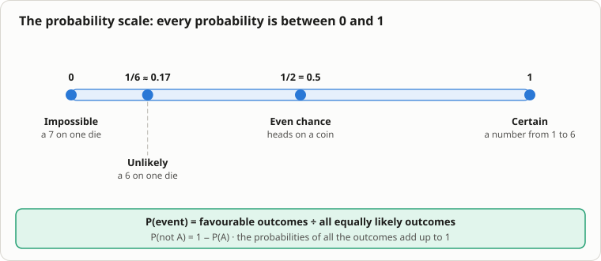
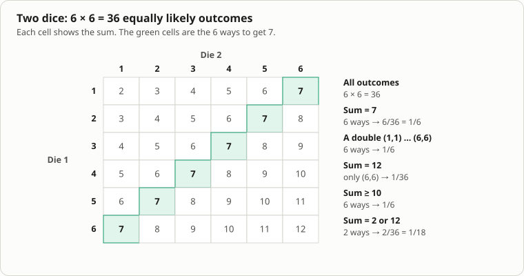
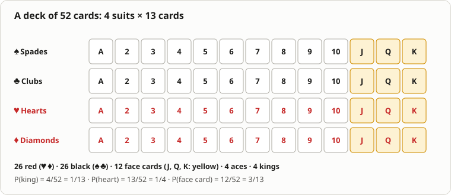
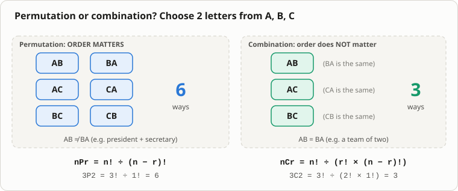
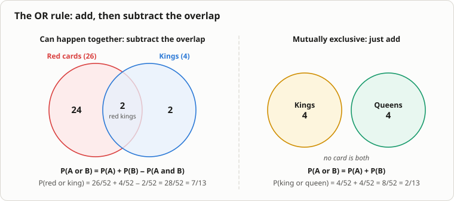
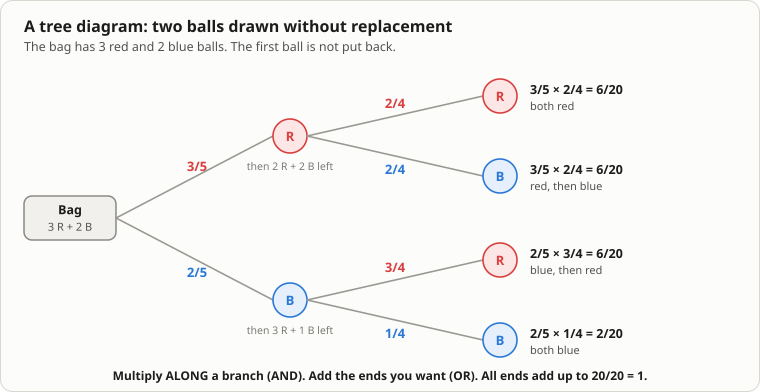
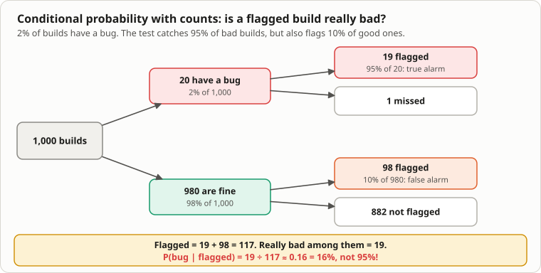
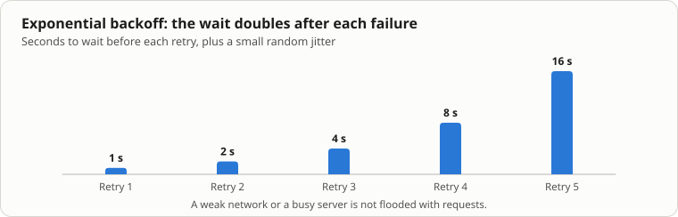

<b>F</b>Core maths

# Probability

> Many written exams for IT posts in Bangladesh, especially in the public sector, add a maths or aptitude question even when the job description does not mention it. Probability is one of the most common. This chapter teaches it from zero, with a basic calculator in mind.

Probability questions look scary, but almost all of them use **five ideas**: count the outcomes, the OR rule, the AND rule, "at least one = 1 − none", and choosing with combinations. Learn those five and draw a picture for every question.

---

## 1. What is probability

**Definition.** **Probability** is a number that says **how likely** something is to happen. It is always **between 0 and 1**: 0 means it can never happen, and 1 means it will surely happen.

**Example scenario.** Imagine you throw one normal die.

1. It can show 1, 2, 3, 4, 5 or 6. These are the **outcomes**. All six are equally likely.
2. You want an **even** number: 2, 4 or 6. That is the **event**, and it has 3 favourable outcomes.
3. **What happens?** P(even) = 3 favourable ÷ 6 total = **3/6 = 1/2**.

**What does "equally likely" mean, and why does it matter?**

Each outcome has the same chance, like the faces of a fair die or the cards of a well-shuffled deck. The simple formula "favourable ÷ total" works **only** when the outcomes are equally likely. A match result (win, draw, lose) is not 1/3 each.

Exam notes

| Word | Meaning | Die example |
|---|---|---|
| **Experiment** | An action with an uncertain result | Throwing a die |
| **Outcome** | One possible result | Getting a 4 |
| **Sample space (S)** | <mark>The set of **all** outcomes</mark> | {1, 2, 3, 4, 5, 6} |
| **Event (E)** | A set of outcomes we care about | "Even" = {2, 4, 6} |
| **Complement (not E)** | Everything in S that is not in E | "Odd" = {1, 3, 5} |

<mark>**P(E) = number of favourable outcomes ÷ total number of equally likely outcomes**</mark>

- 0 ≤ P(E) ≤ 1. A probability can be written as a fraction (1/4), a decimal (0.25) or a percentage (25%).
- <mark>**P(not E) = 1 − P(E)**</mark>. The probabilities of all the outcomes add up to 1.

**Remember.** Probability = favourable ÷ total. It is never below 0 or above 1. Not E = 1 − E.

**Quick check**

1. A probability of 1.2 is: (a) very likely (b) impossible to have (c) certain
2. P(rain) = 0.3. What is P(no rain)?
3. One die: what is P(a number greater than 4)?

Show answers

1. **(b)** A probability can never be more than 1.
2. 1 − 0.3 = **0.7**.
3. {5, 6} → **2/6 = 1/3**.

## 2. Tossing coins

**In simple words.** One coin has **2** outcomes: H (head) or T (tail). With **n** coins there are **2 × 2 × … = 2ⁿ** outcomes. List them in order and count.

**Example scenario.** Imagine you toss **3 coins**.

1. There are 2 × 2 × 2 = **8** outcomes: HHH, HHT, HTH, THH, HTT, THT, TTH, TTT.
2. **Exactly 2 heads:** HHT, HTH, THH → **3/8**.
3. **At least one head:** every outcome except TTT → 1 − 1/8 = **7/8**.

**What happens?** Listing all 8 outcomes makes every coin question easy. Write them in a neat order: 3 heads, then 2 heads, then 1, then 0.

Exam notes

| Coins | Outcomes | P(all heads) | P(at least one head) |
|---|---|---|---|
| 1 | 2 | 1/2 | 1/2 |
| 2 | 4 | 1/4 | 3/4 |
| 3 | 8 | 1/8 | 7/8 |
| 4 | 16 | 1/16 | 15/16 |
| n | 2ⁿ | 1/2ⁿ | <mark>1 − 1/2ⁿ</mark> |

**Exactly k heads from n coins** = nCk ÷ 2ⁿ (combinations: [section 5](#5-counting-factorial-permutation-and-combination)). Example: exactly 2 heads from 4 coins = 4C2 ÷ 16 = 6/16 = **3/8**.

**Remember.** n coins → 2ⁿ outcomes. "At least one head" = 1 − P(all tails).

**Quick check**

1. Two coins: what is P(one head and one tail)?
2. Four coins: what is P(no head)?

Show answers

1. HT, TH out of HH, HT, TH, TT → **2/4 = 1/2**.
2. Only TTTT → **1/16**.

## 3. Throwing dice

**In simple words.** One die has **6** outcomes. Two dice have **6 × 6 = 36** outcomes. For two dice, draw the 6 × 6 table of sums and count the cells you want.

**Example scenario.** Imagine two dice, one red and one blue.

1. (2, 6) and (6, 2) are **different** outcomes: red 2 + blue 6 is not the same as red 6 + blue 2. That is why there are 36 outcomes, not 21.
2. **Sum = 8:** (2,6), (3,5), (4,4), (5,3), (6,2) → **5/36**.
3. **What happens?** On the table, sums with the same value lie on a **diagonal**. 7 has the longest diagonal (6 cells), so 7 is the most likely sum.

Exam notes

| Sum | 2 | 3 | 4 | 5 | 6 | **7** | 8 | 9 | 10 | 11 | 12 |
|---|---|---|---|---|---|---|---|---|---|---|---|
| Ways | 1 | 2 | 3 | 4 | 5 | **6** | 5 | 4 | 3 | 2 | 1 |

- The ways go **up by one to 7, then down by one**. They add up to 36.
- **Doubles** (same number on both): 6 ways → 1/6.
- **Sum is even:** 18 ways → 1/2. **Sum is a prime** (2, 3, 5, 7, 11): 1 + 2 + 4 + 6 + 2 = 15 ways → 15/36 = 5/12.
- **Product is even:** 1 − P(both odd) = 1 − 9/36 = **27/36 = 3/4**.

**Remember.** Two dice = 36 outcomes. Ways for a sum: 1, 2, 3, 4, 5, **6**, 5, 4, 3, 2, 1 (sums 2 to 12).

**Quick check**

1. Two dice: what is P(sum = 10)?
2. Two dice: what is P(sum less than 5)?

Show answers

1. (4,6), (5,5), (6,4) → **3/36 = 1/12**.
2. Sums 2, 3, 4 → 1 + 2 + 3 = 6 ways → **6/36 = 1/6**.

## 4. Playing cards

**In simple words.** A normal deck has **52 cards**: **4 suits** of **13** cards each. Two suits are red, two are black. Most card questions are counting questions on this picture.

**Example scenario.** Imagine you draw one card from a shuffled deck.

1. **A king:** 4 kings → 4/52 = **1/13**.
2. **A red face card:** J, Q, K of hearts and of diamonds → 6/52 = **3/26**.
3. **What happens if you ask for "a king or a heart"?** There are 4 kings and 13 hearts, but the **king of hearts** is in both groups. Count it once: 4 + 13 − 1 = 16 → 16/52 = **4/13**.

Exam notes

| Group | Count | Probability |
|---|---|---|
| One suit (e.g. hearts) | 13 | 13/52 = 1/4 |
| Red cards (hearts + diamonds) | 26 | 1/2 |
| Face cards (J, Q, K) | <mark>12</mark> | 12/52 = 3/13 |
| One rank (e.g. aces, or kings) | 4 | 4/52 = 1/13 |
| Number cards 2–10 | 36 | 36/52 = 9/13 |

<mark>**Face cards are J, Q, K (12 cards).** The ace is **not** a face card</mark>, unless the question says so.

**Remember.** 52 = 4 suits × 13. 26 red, 26 black, 12 face cards, 4 of each rank. Count a card that is in two groups **once**.

**Quick check**

1. One card: what is P(a black ace)?
2. One card: what is P(not a heart)?

Show answers

1. Ace of spades, ace of clubs → **2/52 = 1/26**.
2. 1 − 13/52 = **39/52 = 3/4**.

## 5. Counting: factorial, permutation and combination

**Definition.**
- **Factorial:** n! = n × (n − 1) × … × 2 × 1. For example, 4! = 24. By rule, 0! = 1.
- **Permutation (nPr):** the number of ways to choose r things from n **when the order matters** (arrangements).
- **Combination (nCr):** the number of ways to choose r things from n **when the order does not matter** (selections).

**Example scenario.** Imagine 5 officers: A, B, C, D, E.

1. Choose a **president and a secretary**. A-president + B-secretary is different from B-president + A-secretary. Order matters: **5P2 = 5 × 4 = 20**.
2. Choose a **team of 2** to visit a branch. {A, B} is the same team as {B, A}. Order does not matter: **5C2 = (5 × 4) ÷ (2 × 1) = 10**.
3. **What happens?** Each team of 2 can be arranged in 2! = 2 ways, so permutations = combinations × 2! (20 = 10 × 2).

**How do I decide between permutation and combination?**

Ask: "If I swap two chosen items, do I get a **different** result?" **Yes** → permutation (ranks, positions, passwords, arrangements of letters, seating). **No** → combination (teams, committees, a hand of cards, picking balls from a bag).

Exam notes

| | Permutation | Combination |
|---|---|---|
| Order | <mark>Matters</mark> | <mark>Does not matter</mark> |
| Formula | **nPr = n! ÷ (n − r)!** | **nCr = n! ÷ (r! × (n − r)!)** |
| Quick way | Multiply r numbers going down from n: 5P2 = 5 × 4 | Same top, divide by r!: 5C2 = (5 × 4) ÷ (2 × 1) |
| Example | Arrange 3 of 5 books on a shelf: 5 × 4 × 3 = 60 | Choose 3 of 5 books to take: 60 ÷ 6 = 10 |

**Useful facts**
- Arrange **all n** different things: **n!**. The letters of "PLAN" → 4! = **24**.
- <mark>Letters with **repeats**: n! ÷ (a! × b! …)</mark>. "APPLE" (P twice) → 5! ÷ 2! = **60**. "BANANA" (A three times, N twice) → 6! ÷ (3! × 2!) = **60**.
- **nCr = nC(n − r)**. 10C8 = 10C2 = 45: use the smaller one, it is quicker.
- nC0 = nCn = 1, nC1 = n.

**On a basic calculator:** 10C3 = (10 × 9 × 8) ÷ (3 × 2 × 1) = 720 ÷ 6 = **120**. Do the top first, then divide. Factorials you should know: 3! = 6, 4! = 24, 5! = 120, 6! = 720, 7! = 5,040.

**Remember.** Order matters → **P** (position). Order does not matter → **C** (choose a group). nCr = nPr ÷ r!.

**Quick check**

1. In how many ways can 4 people sit in a row of 4 chairs?
2. How many ways are there to choose 3 members from 7 people?
3. 1st, 2nd and 3rd prizes among 6 students: how many ways?

Show answers

1. 4! = **24**.
2. 7C3 = (7 × 6 × 5) ÷ 6 = **35**.
3. Order matters: 6P3 = 6 × 5 × 4 = **120**.

## 6. Balls in a bag: with and without replacement

**In simple words.** When you draw twice, ask: **was the first ball put back?**
- **With replacement:** it is put back, so the bag is the same for the second draw. The draws are **independent**.
- **Without replacement:** it is kept out, so the second draw has **one ball fewer**. The draws are **dependent**.

**Example scenario.** Imagine a bag with **5 red and 3 green** balls (8 in all). You draw 2 balls.

1. **With replacement, both red:** 5/8 × 5/8 = **25/64**.
2. **Without replacement, both red:** 5/8 × 4/7 = 20/56 = **5/14**. After one red ball is taken, 4 red are left out of 7.
3. **The same answer with combinations:** ways to choose 2 red from 5 ÷ ways to choose any 2 from 8 = 5C2 ÷ 8C2 = 10 ÷ 28 = **5/14**.

**What happens?** Both methods give the same answer. Use the method that feels easier: multiply step by step, or count with nCr.

Exam notes

**The combination method for "draw several at once" questions:**

<mark>P = (ways to choose what you want) ÷ (ways to choose any)</mark>

| Bag: 5 red, 3 green. Draw 2. | Calculation | Answer |
|---|---|---|
| Both red | 5C2 ÷ 8C2 = 10 ÷ 28 | **5/14** |
| Both green | 3C2 ÷ 8C2 = 3 ÷ 28 | **3/28** |
| One of each | (5C1 × 3C1) ÷ 8C2 = 15 ÷ 28 | **15/28** |
| Check | 10 + 3 + 15 = 28 | adds up to 1 ✓ |

"Drawn **together**" or "drawn **at the same time**" = **without** replacement.

**Remember.** Without replacement: the total goes down by one after each draw. Drawn together = without replacement = use nCr.

**Quick check**

1. A bag has 4 white and 6 black balls. One ball is drawn. What is P(white)?
2. From the same bag, 2 balls are drawn together. What is P(both black)?

Show answers

1. 4/10 = **2/5**.
2. 6C2 ÷ 10C2 = 15 ÷ 45 = **1/3**.

## 7. The OR rule

**Definition.** **P(A or B)** is the chance that **at least one** of A and B happens.
- **P(A or B) = P(A) + P(B) − P(A and B).**
- If A and B **cannot happen together** (they are **mutually exclusive**), P(A and B) = 0, so **P(A or B) = P(A) + P(B)**.

**Example scenario.** Imagine a number is chosen from **1 to 100**. What is P(it is divisible by 3 or by 5)?

1. Divisible by 3: 100 ÷ 3 = 33 numbers (ignore the remainder).
2. Divisible by 5: 100 ÷ 5 = 20 numbers.
3. Divisible by **both** = divisible by 15: 100 ÷ 15 = 6 numbers. These were counted twice.

**What happens?** 33 + 20 − 6 = 47 → P = **47/100**. If you forget to subtract the overlap, you get 53/100: the most common mistake.

**What is the difference between "mutually exclusive" and "independent"?**

**Mutually exclusive:** the two events **cannot both happen** (a single card cannot be a king and a queen). **Independent:** one event **does not change the chance** of the other (two separate coin tosses). They are not the same. In fact, two mutually exclusive events (with non-zero chances) are **never** independent: if one happens, the other's chance drops to 0.

**Remember.** OR → **add**, then **subtract the overlap**. No overlap (mutually exclusive) → just add.

**Quick check**

1. One die: what is P(an even number or a number greater than 3)?
2. One card: what is P(a queen or a jack)?

Show answers

1. Even {2, 4, 6}, greater than 3 {4, 5, 6}, both {4, 6}: 3 + 3 − 2 = 4 → **4/6 = 2/3**.
2. Mutually exclusive: 4/52 + 4/52 = **8/52 = 2/13**.

## 8. The AND rule and tree diagrams

**Definition.** **P(A and B)** is the chance that **both** happen.
- If A and B are **independent**: **P(A and B) = P(A) × P(B)**.
- If they are **dependent**: **P(A and B) = P(A) × P(B given A)**. The second chance is worked out **after** A has happened.

**Example scenario.** Imagine the bag in the picture: 3 red and 2 blue. You draw two balls without putting the first one back.

1. **First draw:** P(red) = 3/5, P(blue) = 2/5. Draw two branches.
2. **Second draw:** after a red, the bag has 2 red + 2 blue. After a blue, it has 3 red + 1 blue. Draw two branches from each.
3. **Multiply along each path:** red-red = 3/5 × 2/4 = 6/20.

**What happens if you want "one of each"?** Two paths give it: red-blue (6/20) and blue-red (6/20). **Add** them: 12/20 = **3/5**.

Exam notes

- **Along** a branch = AND = **multiply**. **Across** the ends = OR = **add**.
- All the end results add up to **1**. Use this to check your tree.
- Independent examples: two coins, two dice, drawing **with** replacement, two separate servers.
- <mark>"Both sixes" with two dice = 1/6 × 1/6 = **1/36**. Three heads in a row = (1/2)³ = **1/8**.</mark>

**Remember.** AND → multiply. On a tree, multiply **along** the branches and add **across** the ends.

**Quick check**

1. A coin and a die are thrown. What is P(head and a 6)?
2. Two cards are drawn without replacement. What is P(both are aces)?

Show answers

1. Independent: 1/2 × 1/6 = **1/12**.
2. 4/52 × 3/51 = 12/2652 = **1/221**.

## 9. Conditional probability and Bayes

**Definition.** **P(A | B)**, said "A given B", is the chance of A **when we already know that B happened**. The sample space shrinks to B.

**P(A | B) = P(A and B) ÷ P(B)**

**Example scenario.** Imagine two dice are thrown, and someone tells you "the sum is 8". What is the chance that one die shows a 3?

1. **Shrink the sample space** to sum = 8: (2,6), (3,5), (4,4), (5,3), (6,2). That is 5 outcomes, not 36.
2. **Count inside it:** a 3 appears in (3,5) and (5,3). That is 2 outcomes.
3. **What happens?** P(a 3 | sum is 8) = **2/5**.

**A test is 95% accurate and it says "bug". Why is the chance of a real bug only 16%?**

Because real bugs are **rare** (2%). Among 1,000 builds, only 20 are bad and the test flags 19 of them. But it also wrongly flags 10% of the 980 good builds, which is 98. So 117 builds are flagged, and only 19 of them are really bad: 19 ÷ 117 ≈ **16%**. This is **Bayes' theorem** done with counts. It is the easiest way to solve it in an exam.

Exam notes

**Bayes' theorem:** <mark>P(A | B) = P(B | A) × P(A) ÷ P(B)</mark>

**The easy method: use 1,000 (or 10,000) imaginary cases.**
1. Split them by the first fact (has a bug / does not).
2. Split each group by the second fact (flagged / not flagged).
3. Answer = the count you want ÷ the total in the "given" group.

**Cards:** P(king | face card) = 4 kings ÷ 12 face cards = **1/3**.

**Remember.** "Given" = shrink the sample space. For Bayes questions, draw a tree of **counts** out of 1,000.

**Quick check**

1. One die shows an even number. What is P(it is a 6)?
2. In a class, 60% study Flutter, and 30% study both Flutter and Kotlin. What is P(Kotlin | Flutter)?

Show answers

1. Given {2, 4, 6}: **1/3**.
2. 0.30 ÷ 0.60 = **0.5**.

## 10. At least one, and probability in software

**In simple words.** "At least one" is hard to count directly, because there are many cases (one, two, three …). The opposite is just **one** case, "none". So:

<mark>**P(at least one) = 1 − P(none)**</mark>

**Example scenario.** Imagine a field app sends a sync request on a weak network. Each try **fails with probability 0.2**, and the tries are independent. The app tries up to 3 times.

1. P(one try fails) = 0.2.
2. P(all 3 fail) = 0.2 × 0.2 × 0.2 = **0.008**.
3. **What happens?** P(at least one try succeeds) = 1 − 0.008 = **0.992 = 99.2%**. Three tries turn an 80% success rate into 99.2%. That is why apps retry, with backoff so that they do not flood the server.

Exam notes: probability in a mobile developer's work

| Situation | Calculation | Result |
|---|---|---|
| Retries: each try fails with p = 0.2, 3 tries | 1 − 0.2³ | 99.2% succeed |
| Two servers, each up 99% of the time, **both needed** (in series) | 0.99 × 0.99 | 98.01% up |
| Two servers, each up 99%, **either one is enough** (in parallel) | 1 − 0.01 × 0.01 | 99.99% up |
| A crash in 10% of sessions: P(at least one crash in 3 sessions) | 1 − 0.9³ = 1 − 0.729 | 0.271 = 27.1% |
| Crash-free users (B4) | 1 − crashed users ÷ total users | e.g. 99% |
| Staged rollout to 5% of users (C1) | 5% of users see the new version | A bug reaches few people first |

**On a basic calculator:** 0.9³ = 0.9 × 0.9 × 0.9 = 0.729. Many basic calculators repeat the last operation when you press `=` again: 0.9 `×` `=` `=` gives 0.81, then 0.729.

**Remember.** At least one = 1 − none. Series (all needed) → multiply the "up" chances. Parallel (any one is enough) → 1 − (multiply the "down" chances).

**Quick check**

1. Three coins: what is P(at least one tail)?
2. A push notification is lost with probability 0.1. It is sent twice, independently. What is P(at least one arrives)?

Show answers

1. 1 − P(HHH) = 1 − 1/8 = **7/8**.
2. 1 − 0.1 × 0.1 = **0.99**.

## 11. Expected value and odds

**Definition.**
- **Expected value (E)** is the **long-run average** result: E = Σ (value × its probability).
- **Odds in favour** of an event = favourable : unfavourable. If the odds in favour are **a : b**, then **P = a ÷ (a + b)**.

**Example scenario.** Imagine a game: you pay **15 Tk** to throw a die. If it shows a 6, you win **60 Tk**.

1. P(6) = 1/6. Expected winnings = 60 × 1/6 = 10 Tk.
2. **What happens?** You pay 15 Tk to win 10 Tk on average, so the expected value is 10 − 15 = **−5 Tk** per game. In the long run, you lose 5 Tk per game.

Exam notes

- One fair die: E = (1 + 2 + 3 + 4 + 5 + 6) ÷ 6 = **3.5**. The expected value need not be a possible result.
- Odds in favour of a 6 = 1 : 5. Odds against = 5 : 1.
- Odds in favour 3 : 5 → P = 3 ÷ 8. <mark>Odds are not the same as probability.</mark>

**Remember.** E = Σ value × probability. Odds a : b in favour → P = a ÷ (a + b).

**Quick check**

1. The odds against an event are 7 : 3. What is its probability?
2. A coin: win 10 Tk for heads, lose 4 Tk for tails. What is the expected value?

Show answers

1. Odds in favour = 3 : 7 → P = 3 ÷ 10 = **0.3**.
2. 10 × 1/2 − 4 × 1/2 = **3 Tk**.

## 12. Classic exam puzzles

These appear again and again in Bangladeshi job exams. Learn the method once.

**1. What is the probability that a leap year has 53 Sundays?**

1. A leap year has 366 days = **52 weeks + 2 extra days**. 52 weeks already give 52 Sundays.
2. The 2 extra days can be: Sun-Mon, Mon-Tue, Tue-Wed, Wed-Thu, Thu-Fri, Fri-Sat, Sat-Sun. That is **7** pairs.
3. **What happens?** Two pairs contain a Sunday (Sun-Mon, Sat-Sun) → **2/7**.

For a **normal year** (365 days = 52 weeks + **1** day), the answer is **1/7**.

**2. The letters of "PLAN" are arranged at random. What is P(the word starts with P)?**

All arrangements: 4! = 24. With P fixed first, the other 3 letters: 3! = 6. → 6/24 = **1/4**. (Simple check: each of the 4 letters is equally likely to be first.)

**3. The birthday problem (good to know).** In a group of just **23 people**, the chance that **two share a birthday** is slightly **more than 50%**. Work it out as 1 − P(all birthdays are different). The same idea explains why random IDs must be long: a **UUID** has 122 random bits, so a clash is practically impossible.

**Remember.** Leap year → 2 extra days → 2/7. Normal year → 1 extra day → 1/7.

---

## Formula sheet

| Idea | Formula |
|---|---|
| Basic | P(E) = favourable ÷ total |
| Complement | P(not E) = 1 − P(E) |
| OR | P(A or B) = P(A) + P(B) − P(A and B) |
| OR, mutually exclusive | P(A or B) = P(A) + P(B) |
| AND, independent | P(A and B) = P(A) × P(B) |
| AND, dependent | P(A and B) = P(A) × P(B \| A) |
| Conditional | P(A \| B) = P(A and B) ÷ P(B) |
| Bayes | P(A \| B) = P(B \| A) × P(A) ÷ P(B) |
| At least one | 1 − P(none) |
| Permutation | nPr = n! ÷ (n − r)! |
| Combination | nCr = n! ÷ (r! × (n − r)!) |
| Repeated letters | n! ÷ (a! × b! × …) |
| Expected value | E = Σ value × probability |
| Odds a : b in favour | P = a ÷ (a + b) |

| Sample space | Size |
|---|---|
| n coins | 2ⁿ |
| One die / two dice / three dice | 6 / 36 / 216 |
| A deck of cards | 52 (4 suits × 13; 26 red; 12 face cards) |

---

## Practice questions

**Short (2–3 marks each)**
1. Define sample space and event. What is the difference between mutually exclusive and independent events?
2. Three coins are tossed. Find P(exactly 2 heads) and P(at least one head).
3. Two dice are thrown. Find P(sum = 8), P(the sum is even) and P(a double).
4. One card is drawn from a deck of 52. Find P(a king or a heart) and P(a red face card).
5. A bag has 5 red and 3 green balls. Two balls are drawn together. Find P(both red) and P(one of each colour).
6. A number is chosen from 1 to 100. Find P(it is divisible by 3 or 5).
7. What is the probability that a leap year has 53 Sundays?
8. In how many ways can the letters of "PLAN" be arranged? And the letters of "APPLE"?
9. A committee of 3 is chosen from 6 men and 4 women. Find P(exactly 2 women).
10. The odds in favour of an event are 3 : 5. Find its probability.
11. Two cards are drawn without replacement. Find P(both are aces).
12. Find the expected value of the score of a fair die.

**Long (8–10 marks each)**

13. A field app's sync request fails 20% of the time, independently on each try. (a) With up to 3 tries, what is P(the record syncs)? (b) Two servers are each up 99% of the time. Find the availability when both are needed and when either one is enough. (c) Why should retries use backoff?
14. 1% of field records contain an error. A validation rule flags 90% of the wrong records, and it also flags 5% of the correct ones. A record is flagged. What is the probability that it is really wrong? Explain with a diagram.
15. An auditor picks 4 loan files at random from 10, of which 3 have errors. Find P(no file has an error), P(at least one file has an error) and P(exactly one file has an error).

---

## Model answers

**How to read these answers.** They are written for **learning**, so they are fuller than what you would write in the exam hall. Every answer has the same parts:

- **In short** (green): the direct answer. In the exam, write this part first.
- **Table or steps:** the working, set out so that you can follow every number.
- **Example** (yellow): the same idea in a real situation.
- Long answers end with **In the exam** (brown): how to shorten the answer on paper.

Write your own answer first. Then open the model answer and compare.

1. Define sample space and event. What is the difference between mutually exclusive and independent events?

**In short.** The **sample space** is the set of all possible outcomes of an experiment. An **event** is a subset of it. **Mutually exclusive** events cannot happen together. **Independent** events do not change each other's probability.

| | Mutually exclusive | Independent |
|---|---|---|
| Meaning | Cannot both happen | One does not affect the other's chance |
| Rule | P(A and B) = 0 | P(A and B) = P(A) × P(B) |
| OR rule | P(A or B) = P(A) + P(B) | P(A or B) = P(A) + P(B) − P(A) × P(B) |
| Example | One card is a king **and** a queen | A head on coin 1 **and** a head on coin 2 |

Two mutually exclusive events with non-zero chances are **never** independent: if one happens, the other becomes impossible.

**Example.** One die: S = {1, 2, 3, 4, 5, 6}. The event "even" = {2, 4, 6}. "Even" and "odd" are mutually exclusive. Throwing the die twice gives independent results.

**From the book:** [1. What is probability](#1-what-is-probability) [7. The OR rule](#7-the-or-rule)

2. Three coins are tossed. Find P(exactly 2 heads) and P(at least one head).

**In short.** 8 outcomes. P(exactly 2 heads) = **3/8**. P(at least one head) = 1 − 1/8 = **7/8**.

1. S = {HHH, HHT, HTH, THH, HTT, THT, TTH, TTT}: 2³ = **8** outcomes.
2. Exactly 2 heads: HHT, HTH, THH → **3/8**. (Or 3C2 ÷ 8 = 3/8.)
3. At least one head: only TTT has no head → 1 − 1/8 = **7/8**.

**Example.** The same "1 − none" idea gives the chance that at least one of 3 independent retries succeeds (section 10).

**From the book:** [2. Tossing coins](#2-tossing-coins)

3. Two dice are thrown. Find P(sum = 8), P(the sum is even) and P(a double).

**In short.** 36 outcomes. P(sum = 8) = **5/36**. P(even sum) = **1/2**. P(double) = **1/6**.

| Event | Favourable outcomes | P |
|---|---|---|
| Sum = 8 | (2,6), (3,5), (4,4), (5,3), (6,2) = 5 | 5/36 |
| Sum is even | Both even (9) + both odd (9) = 18 | 18/36 = 1/2 |
| A double | (1,1) … (6,6) = 6 | 6/36 = 1/6 |

**Example.** Count in the table: the sum-8 cells lie on one diagonal. That is quicker than listing in your head.

**From the book:** [3. Throwing dice](#3-throwing-dice)

4. One card is drawn from a deck of 52. Find P(a king or a heart) and P(a red face card).

**In short.** P(king or heart) = (4 + 13 − 1) ÷ 52 = **4/13**. P(red face card) = 6/52 = **3/26**.

1. Kings = 4, hearts = 13. The **king of hearts** is in both, so subtract it once: 4 + 13 − 1 = **16** → 16/52 = **4/13**.
2. Red face cards: J, Q, K of hearts + J, Q, K of diamonds = **6** → 6/52 = **3/26**.

**Example.** Forgetting the overlap gives 17/52, which is wrong. The Venn picture in section 7 shows why the king of hearts must be counted once.

**From the book:** [4. Playing cards](#4-playing-cards) [7. The OR rule](#7-the-or-rule)

5. A bag has 5 red and 3 green balls. Two balls are drawn together. Find P(both red) and P(one of each colour).

**In short.** "Together" means without replacement. P(both red) = 5C2 ÷ 8C2 = **5/14**. P(one of each) = (5 × 3) ÷ 28 = **15/28**.

| Step | Working |
|---|---|
| All ways to choose 2 of 8 | 8C2 = (8 × 7) ÷ 2 = 28 |
| Both red | 5C2 = (5 × 4) ÷ 2 = 10 → 10/28 = **5/14** |
| One red and one green | 5C1 × 3C1 = 15 → **15/28** |
| Check with a tree | 5/8 × 4/7 = 20/56 = 5/14 ✓ |

**Example.** If the first ball **were put back**, both red would be 5/8 × 5/8 = 25/64. Read the question carefully: "together" or "without replacement" changes the answer.

**From the book:** [6. Balls in a bag: with and without replacement](#6-balls-in-a-bag-with-and-without-replacement) [5. Counting](#5-counting-factorial-permutation-and-combination)

6. A number is chosen from 1 to 100. Find P(it is divisible by 3 or 5).

**In short.** 33 + 20 − 6 = 47 → **47/100**.

1. Divisible by 3: ⌊100 ÷ 3⌋ = **33**.
2. Divisible by 5: ⌊100 ÷ 5⌋ = **20**.
3. Divisible by both = divisible by 15: ⌊100 ÷ 15⌋ = **6** (15, 30, 45, 60, 75, 90).
4. OR rule: 33 + 20 − 6 = **47** → P = **47/100 = 0.47**.

**Example.** On a basic calculator, 100 ÷ 3 = 33.33: take only the whole part, 33.

**From the book:** [7. The OR rule](#7-the-or-rule)

7. What is the probability that a leap year has 53 Sundays?

**In short.** 366 days = 52 weeks + 2 days. 2 of the 7 possible pairs of extra days contain a Sunday → **2/7**.

1. 366 = 52 × 7 + **2**, so there are always 52 Sundays plus 2 extra days.
2. The possible extra pairs: Sun-Mon, Mon-Tue, Tue-Wed, Wed-Thu, Thu-Fri, Fri-Sat, Sat-Sun (**7**).
3. With a Sunday: Sun-Mon and Sat-Sun (**2**) → **2/7**.

**Example.** A normal year has 365 = 52 × 7 + 1 days. The one extra day is a Sunday with chance **1/7**.

**From the book:** [12. Classic exam puzzles](#12-classic-exam-puzzles)

8. In how many ways can the letters of "PLAN" be arranged? And the letters of "APPLE"?

**In short.** PLAN: 4! = **24**. APPLE (P twice): 5! ÷ 2! = **60**.

| Word | Letters | Repeats | Ways |
|---|---|---|---|
| PLAN | 4, all different | none | 4! = 4 × 3 × 2 × 1 = **24** |
| APPLE | 5 | P × 2 | 5! ÷ 2! = 120 ÷ 2 = **60** |

We divide by 2! because swapping the two P's gives the same word.

**Example.** P(a random arrangement of PLAN starts with P) = 3! ÷ 4! = 6/24 = **1/4**.

**From the book:** [5. Counting: factorial, permutation and combination](#5-counting-factorial-permutation-and-combination)

9. A committee of 3 is chosen from 6 men and 4 women. Find P(exactly 2 women).

**In short.** (4C2 × 6C1) ÷ 10C3 = (6 × 6) ÷ 120 = **3/10**.

| Step | Working |
|---|---|
| All committees of 3 from 10 | 10C3 = (10 × 9 × 8) ÷ 6 = 120 |
| Choose 2 women from 4 | 4C2 = 6 |
| Choose 1 man from 6 | 6C1 = 6 |
| Favourable | 6 × 6 = 36 |
| P | 36 ÷ 120 = **3/10 = 0.3** |

A committee is a **group**, so the order does not matter: use combinations.

**Example.** The same method answers "choose 3 officers for a branch audit team, with exactly 2 from IT".

**From the book:** [5. Counting: factorial, permutation and combination](#5-counting-factorial-permutation-and-combination)

10. The odds in favour of an event are 3 : 5. Find its probability.

**In short.** P = 3 ÷ (3 + 5) = **3/8**.

- Odds in favour a : b means a favourable for every b unfavourable, out of a + b cases.
- P = 3/8 = 0.375. The probability that it does **not** happen = 5/8.

**Example.** "Odds against are 5 : 3" describes the same event: P = 3 ÷ 8.

**From the book:** [11. Expected value and odds](#11-expected-value-and-odds)

11. Two cards are drawn without replacement. Find P(both are aces).

**In short.** 4/52 × 3/51 = **1/221**.

| Method | Working |
|---|---|
| Step by step | First ace 4/52; then 3 aces in 51 cards: 3/51 → 12/2652 = **1/221** |
| Combinations | 4C2 ÷ 52C2 = 6 ÷ 1326 = **1/221** |

**Example.** With replacement, it would be 4/52 × 4/52 = 1/169. Without replacement it is smaller, because one ace has gone.

**From the book:** [8. The AND rule and tree diagrams](#8-the-and-rule-and-tree-diagrams)

12. Find the expected value of the score of a fair die.

**In short.** E = (1 + 2 + 3 + 4 + 5 + 6) × 1/6 = 21 ÷ 6 = **3.5**.

- Each face has probability 1/6. E = Σ value × probability.
- 3.5 cannot be thrown. It is the **long-run average** over many throws.

**Example.** Expected value is also how a product owner compares options: a 10% chance of saving 50 hours is worth 5 hours on average.

**From the book:** [11. Expected value and odds](#11-expected-value-and-odds)

13. Sync retries and server availability (long)

**In short.** (a) P(sync) = 1 − 0.2³ = **0.992**. (b) Both needed: 0.99 × 0.99 = **98.01%**. Either one is enough: 1 − 0.01² = **99.99%**. (c) Backoff spaces the retries, so a weak network or a busy server is not flooded, and the next try has a better chance.

#### (a) Retries

| Tries | P(all fail) | P(at least one succeeds) |
|---|---|---|
| 1 | 0.2 | 0.8 |
| 2 | 0.2 × 0.2 = 0.04 | 0.96 |
| 3 | 0.2³ = 0.008 | **0.992** |

The tries are independent, so P(all fail) = 0.2 × 0.2 × 0.2. "At least one success" = 1 − P(all fail).

#### (b) Two servers

| Setup | Meaning | Availability |
|---|---|---|
| **In series** | Both must be up (an API server and its database) | 0.99 × 0.99 = **0.9801 = 98.01%** |
| **In parallel** | Either one is enough (two API servers behind a load balancer) | 1 − (0.01 × 0.01) = **0.9999 = 99.99%** |

Series makes the system **weaker** than each part. Parallel (redundancy) makes it **stronger**.

#### (c) Why backoff

- If thousands of phones retry **at once**, the server gets even busier and more tries fail. Then the tries are no longer independent.
- **Exponential backoff** (1, 2, 4, 8 s …) with random **jitter** spreads the retries out and gives the network time to recover.
- An **Idempotency-Key** makes a repeated request safe, so a retry never creates a duplicate record.

**Example.** An officer in a char area syncs 25 records on a weak 2G signal. With 3 tries and backoff, about 99% of the requests get through. The few that fail stay in the outbox for the next WorkManager run, so nothing is lost.

**In the exam.** Write the three answers first (0.992; 98.01% and 99.99%; backoff). Show each step with ×. Draw a tiny series-vs-parallel sketch: two boxes in a line, and two boxes side by side.

**From the book:** [10. At least one, and probability in software](#10-at-least-one-and-probability-in-software) [8. The AND rule and tree diagrams](#8-the-and-rule-and-tree-diagrams) [A3 · Offline Storage and Data Sync](A3%20-%20Offline%20Storage%20and%20Data%20Sync.md)

14. A flagged record: is it really wrong? (Bayes, long)

**In short.** Out of 10,000 records: 100 are wrong and 90 of those are flagged; 9,900 are correct and 495 of those are flagged. P(really wrong | flagged) = 90 ÷ (90 + 495) = 90 ÷ 585 ≈ **0.154 = 15.4%**.

#### Step 1: a tree of counts (10,000 records)

| Group | Count | Flagged | Not flagged |
|---|---|---|---|
| Wrong (1%) | 100 | 90% → **90** | 10 |
| Correct (99%) | 9,900 | 5% → **495** | 9,405 |
| **Total** | 10,000 | **585** | 9,415 |

*The picture shows the same method with builds: change the numbers to 10,000 records, 1%, 90% and 5%.*

#### Step 2: shrink to the "given" group

We know the record **is flagged**, so only the 585 flagged records count. 90 of them are really wrong → 90 ÷ 585 ≈ **0.154**.

#### Step 3: the formula (Bayes' theorem)

P(wrong | flagged) = P(flagged | wrong) × P(wrong) ÷ P(flagged) = (0.9 × 0.01) ÷ (0.9 × 0.01 + 0.05 × 0.99) = 0.009 ÷ 0.0585 ≈ **0.154**.

#### Step 4: what it means

Wrong records are **rare** (1%), so even a good rule produces **more false alarms than true ones**. A flagged record should be **reviewed**, not rejected automatically. To improve it, lower the false-alarm rate (5%) or add a second check.

**Example.** A branch manager sees 585 flagged records a month. Without this calculation, they might think 90% are wrong. In fact about 85% are correct, so the app should say "please check", not "error".

**In the exam.** Draw the count tree (10,000 → 100 / 9,900 → flagged / not flagged). Write 90 ÷ 585 ≈ 15.4%. Add one line on the meaning: rare errors → most flags are false alarms.

**From the book:** [9. Conditional probability and Bayes](#9-conditional-probability-and-bayes)

15. An auditor picks 4 of 10 loan files, 3 of which have errors (long)

**In short.** 10C4 = 210 ways. P(no error) = 7C4 ÷ 210 = 35/210 = **1/6**. P(at least one error) = 1 − 1/6 = **5/6**. P(exactly one error) = (3C1 × 7C3) ÷ 210 = 105/210 = **1/2**.

#### The working

| Step | Working | Result |
|---|---|---|
| All ways to pick 4 files from 10 | 10C4 = (10 × 9 × 8 × 7) ÷ (4 × 3 × 2 × 1) = 5040 ÷ 24 | **210** |
| No error: all 4 from the 7 good files | 7C4 = 7C3 = (7 × 6 × 5) ÷ 6 | **35** |
| P(no error) | 35 ÷ 210 | **1/6 ≈ 0.167** |
| P(at least one error) | 1 − 1/6 | **5/6 ≈ 0.833** |
| Exactly one error: 1 of 3 bad × 3 of 7 good | 3C1 × 7C3 = 3 × 35 | **105** |
| P(exactly one error) | 105 ÷ 210 | **1/2** |

#### Check: all the cases add up to 210

| Errors picked | Ways |
|---|---|
| 0 | 7C4 = 35 |
| 1 | 3C1 × 7C3 = 105 |
| 2 | 3C2 × 7C2 = 3 × 21 = 63 |
| 3 | 3C3 × 7C1 = 7 |
| **Total** | 35 + 105 + 63 + 7 = **210** ✓ |

#### What it means

A random sample of 4 out of 10 finds **at least one** bad file 5 times out of 6. Sampling is a cheap way to discover that a branch has problems, but it can miss them (1 time in 6).

**Example.** An NGO's monitoring officer cannot check every file in a branch. Random sampling, worked out like this, tells them how likely a small check is to catch a problem.

**In the exam.** Write 10C4 = 210 first. Then each answer as "ways ÷ 210". Use "1 − none" for "at least one". The check table is optional, but it shows the examiner that you understand.

**From the book:** [5. Counting: factorial, permutation and combination](#5-counting-factorial-permutation-and-combination) [6. Balls in a bag: with and without replacement](#6-balls-in-a-bag-with-and-without-replacement) [10. At least one, and probability in software](#10-at-least-one-and-probability-in-software)

← <a href="E%20-%20Revision%20Sheet%20and%20Long-Answer%20Templates.md">E - Revision Sheet and Long-Answer Templates</a><a href="00%20-%20Contents%20and%20How%20to%20Use.md">Contents</a>End of the book

