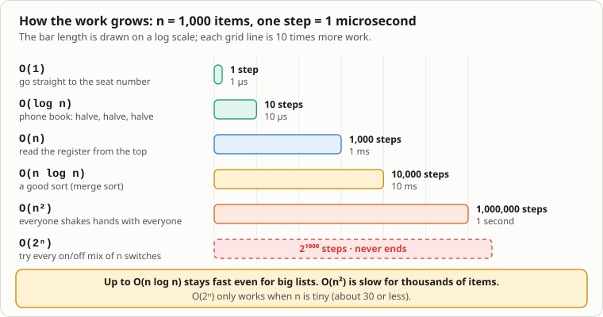
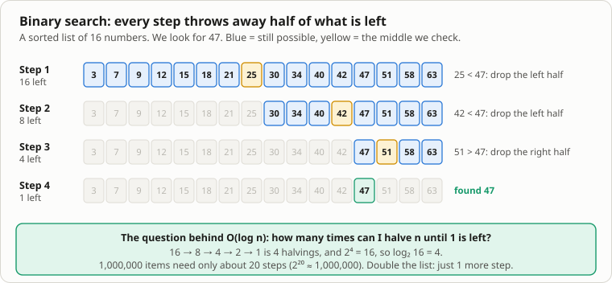

# Foundations 1 — OOP + Data Structures & Algorithms

Read Part 1, then Part 2, then do the **practice at the end** in writing. Examples are in Dart; in an exam, any language is usually accepted.

---

# Part 1 — Object-Oriented Programming (OOP)

## 1.1 Class and Object

<div class="box like">

**Like in daily life.**

| Daily life | In the app |
|---|---|
| The plan of a flat, drawn once | Class |
| Each real flat built from that plan | Object |
| The builder who hands over a ready flat | Constructor |

</div>
- **Class**: a **blueprint** that defines properties (fields) and behaviour (methods).
- **Object**: an **instance** of a class, a real thing in memory created from the blueprint.

```dart
class Student {              // class = blueprint
  String name;
  int roll;
  Student(this.name, this.roll);   // constructor
  void show() => print('$name - $roll');
}
final s = Student('Rahim', 10);   // object = instance
```

**Constructor**: a special method that runs when an object is created; it initializes fields. Types: default, parameterized, named (`Student.guest()`), copy.

## 1.2 The 4 Pillars of OOP (asked very often)

<div class="box like">

**Like in daily life.**

| Daily life | In the app |
|---|---|
| A medicine capsule: the powder is inside, you only swallow it | Encapsulation: hide the data, give safe methods |
| A car's steering wheel: you turn it without knowing the gears | Abstraction: show *what*, hide *how* |
| A child gets the family's surname and house | Inheritance |
| "Open" works on a door, a bottle and a book, each in its own way | Polymorphism |

</div>

| Pillar | One-line definition | Example |
|---|---|---|
| **Encapsulation** | Bundle data + methods in a class and **hide data** using access control | private `_balance` + `deposit()` |
| **Abstraction** | Show **what** an object does, hide **how** | abstract `Shape.area()` |
| **Inheritance** | A child class **acquires** properties/methods of a parent class (**IS-A** relation) | `Dog extends Animal` |
| **Polymorphism** | **One interface, many forms**: the same method call behaves differently | `shape.area()` works for Circle and Square |

```dart
// Encapsulation
class BankAccount {
  double _balance = 0;                  // private (Dart: underscore)
  double get balance => _balance;       // read-only access
  void deposit(double amt) { if (amt > 0) _balance += amt; }
}

// Abstraction + Inheritance + Polymorphism
abstract class Shape { double area(); }               // abstraction
class Circle extends Shape {                          // inheritance
  final double r; Circle(this.r);
  @override double area() => 3.1416 * r * r;          // overriding
}
class Square extends Shape {
  final double a; Square(this.a);
  @override double area() => a * a;
}
void main() {
  List<Shape> shapes = [Circle(2), Square(3)];
  for (final s in shapes) print(s.area());            // polymorphism
}
```

## 1.3 Types of Polymorphism

<div class="box like">

**Like in daily life.**

| Daily life | In the app |
|---|---|
| One shop counter that takes cash, card or mobile money: same name, different inputs | Overloading (compile time) |
| A son who cooks the family recipe his own way | Overriding (run time) |

</div>
| Compile-time (static) | Run-time (dynamic) |
|---|---|
| **Method overloading**: same name, **different parameters**, in the same class | **Method overriding**: child class **redefines** a parent method with the **same signature** |
| Decided by the compiler | Decided at runtime (dynamic dispatch) |
| Java/C++ support it; **Dart does not** (it uses optional/named params instead) | `@override` in Dart/Java |

## 1.4 Types of Inheritance

<div class="box like">

**Like in daily life.** Mother and father both learned grandmother's biryani recipe, and each changed it a little. Their child inherits from **both**: whose version should the child cook? That confusion is the **diamond problem**, so Java and Dart allow only one parent class (plus interfaces and mixins).

</div>
Single (A→B), Multilevel (A→B→C), Hierarchical (A→B, A→C), Multiple (A,B→C), Hybrid.
- **Java and Dart do not allow multiple inheritance of classes** (because of the **diamond problem**); they allow multiple **interfaces** (Dart: `implements`, plus **mixins** with `with`).

## 1.5 Abstract Class vs Interface

<div class="box like">

**Like in daily life.**

| Daily life | In the app |
|---|---|
| A half-built house: some rooms finished, some only drawn | Abstract class: some code, some empty methods |
| A job advert: "must be able to drive and cook" (no help given) | Interface: only the promise of what you can do |

</div>
| Abstract class | Interface |
|---|---|
| Can have **both** abstract and concrete methods | (Classic) only method **signatures** |
| Can have fields/constructor | No state (Java: only constants) |
| A class **extends one** | A class can **implement many** |
| Use for **IS-A** with shared code | Use for a **capability/contract** ("can-do") |

Dart: every class is an implicit interface; `implements` forces you to override everything.

## 1.6 Other OOP terms (short-question favourites)

<div class="box like">

**Like in daily life.**

| Daily life | In the app |
|---|---|
| A school's single notice board, shared by every class | Static member |
| A house and its rooms: knock down the house and the rooms go too | Composition (strong HAS-A) |
| A cricket team and its players: break up the team, the players still exist | Aggregation (weak HAS-A) |
| A plug that fits any socket vs wires soldered together | Low coupling vs high coupling |

</div>
- **Access modifiers** (Java): `public`, `private`, `protected`, default (package). Dart: `_name` = library-private.
- **Static member**: belongs to the **class**, not to an object (`Math.pi`).
- **`this`**: refers to the current object. **`super`**: refers to the parent class.
- **Association / Aggregation / Composition**: "HAS-A" relations. Aggregation is **weak** (Department has Teachers; teachers exist without it). Composition is **strong** (House has Rooms; rooms die with the house).
- **Coupling** (dependency between classes) should be **low**; **cohesion** (focus within a class) should be **high**.

## 1.7 SOLID Principles (very common in IT exams)

<div class="box like">

**Like in daily life.**

| Daily life | In the app |
|---|---|
| A tailor sews; he does not also cook | S: one reason to change |
| Add a new attachment to a drill without opening it up | O: open for extension, closed for change |
| A substitute teacher who can take any class of the teacher on leave | L: the child can stand in for the parent |
| A short form for each office, not one 20-page form for all | I: small interfaces |
| A lamp plugs into any socket, not wired to one generator | D: depend on abstractions |

</div>
| | Principle | Meaning |
|---|---|---|
| **S** | Single Responsibility | A class should have **one reason to change** |
| **O** | Open/Closed | **Open for extension, closed for modification** |
| **L** | Liskov Substitution | A child object must be usable **wherever the parent is** without breaking it |
| **I** | Interface Segregation | Many **small specific interfaces** rather than one fat interface |
| **D** | Dependency Inversion | Depend on **abstractions**, not concrete classes (inject dependencies) |

*Flutter link:* the Repository pattern + dependency injection (GetX `Get.put`, Provider) = **D**. Splitting UI / controller / repository = **S**.

---

# Part 2 — Data Structures & Algorithms

## 2.1 Big-O (time complexity)

<div class="box def">

**Definition.** **Time complexity** says how the number of steps **grows** when the input grows. **Big-O** writes it as O(…) of **n**, the input size (members in a list, records to sort). It shows the shape of the growth, not seconds, and usually the **worst case**.

</div>

<div class="box like">

**Like in daily life.** You must find Rahima among n members. How much work it takes depends on **how** you search:

| Daily life | Work for n people | Big-O |
|---|---|---|
| You know her seat number and walk straight there | 1 step, however many people | O(1) |
| A phone book: open the middle, throw away the wrong half, repeat | a few steps | O(log n) |
| An unsorted register: read names from the top until you find her | up to n steps | O(n) |
| Sort the whole register with a good method first | n × log n | O(n log n) |
| Everyone in the room shakes hands with everyone else | about n × n | O(n²) |
| Try every on/off mix of n light switches | 2 × 2 × … = 2ⁿ | O(2ⁿ) |

</div>



<div class="box story">

**Example scenario.** Imagine the field app was tested with 1,000 members. Two years later the NGO has **100,000** members, 100 times more.

1. Find a member by **scanning the list**, O(n): 100 times slower.
2. Find a member in a **Map by member ID**, O(1): exactly as fast as before.
3. **Binary search** on a sorted list, O(log n): 10 steps become 17.
4. Find duplicates by **comparing every member with every other**, O(n²): 100 × 100 = **10,000 times** slower. One second in testing becomes almost three hours in the field.

**What happens?** The same code that was fine in testing freezes the app in the field. Big-O warns you before the users do.

</div>

<div class="box q">

**Why is binary search O(log n)? What does "log" even mean here?**

Each step throws away **half** of what is left. So ask: *how many times can I halve n until only 1 is left?* That count is **log₂ n**. 16 → 8 → 4 → 2 → 1 is 4 halvings, and 2⁴ = 16. A million items need only about **20** steps, because 2²⁰ ≈ 1,000,000. Doubling the list adds just **one** more step. That is why log n grows so slowly.

</div>



<div class="box q">

**How do I find the Big-O of a piece of code?**

Ask: **how many times does the innermost line run when n grows?** Then use the shape of the loops:

| Code shape | The inner line runs | Big-O |
|---|---|---|
| No loop, a fixed number of steps | the same count for any n | O(1) |
| One loop from 0 to n | n times | O(n) |
| Two loops **one after the other** | n + n = 2n times | O(n) |
| A loop **inside** a loop, both to n | n × n times | O(n²) |
| `i` doubles or halves each turn (`i *= 2`, `i ~/= 2`) | log n times | O(log n) |
| A loop to n with a halving loop inside | n × log n times | O(n log n) |
| A function that calls itself **twice** (naive Fibonacci) | the calls double at each level | O(2ⁿ) |

Then **drop constants and small terms**: O(3n² + 5n + 7) = O(n²). The reason: at n = 1,000, 3n² is 3,000,000 and 5n is only 5,000. The biggest term decides everything.

</div>

<div class="box dev">

**What this means for a Flutter developer.**
- `list.contains(x)`, `indexOf`, `where`, `firstWhere` are **O(n)**: they scan. `map[key]` and `set.contains(x)` are **O(1)** on average. Looking things up by ID inside a loop? Build a `Map` first.
- Matching 5,000 visits to 2,000 members with a loop inside a loop is 5,000 × 2,000 = **10 million** checks. With a `Map` of members it is 5,000 + 2,000 = **7,000** steps.
- `list.sort()` is **O(n log n)**: fine. Never sort again inside a loop.
- `ListView.builder` builds only the rows on screen, so the cost of drawing does not grow with n.
- Heavy O(n²) work on the UI thread causes jank (Ch 6). Fix the algorithm first; move it to an isolate with `compute()` only if it is still heavy.

</div>

<p class="label">Exam notes</p>

| Big-O | Name | Typical example |
|---|---|---|
| O(1) | Constant | Array index access, hash map lookup (average) |
| O(log n) | Logarithmic | Binary search, balanced BST search |
| O(n) | Linear | Linear search, one loop |
| O(n log n) | Linearithmic | Merge sort, quick sort (average), heap sort |
| O(n²) | Quadratic | Bubble, selection, insertion sort; nested loops |
| O(2ⁿ) | Exponential | Naive recursive Fibonacci |

- Order: <mark>**1 < log n < n < n log n < n² < 2ⁿ < n!**</mark>. You do not need to memorise it: put n = 1,000 into each and compare the numbers.
- **Best, average, worst case:** linear search finds the item first time (best, O(1)) or last (worst, O(n)). Big-O normally means the **worst** case.
- **Space complexity** is the same idea for **extra memory**. Merge sort needs O(n) extra space; bubble sort needs O(1).
- **Time vs space trade-off:** a `Map` uses extra memory to make lookups O(1). A cache does the same.

<div class="box rule">

**Remember.** Double n and watch the work: it stays the same → O(1); it grows by one step → O(log n); it doubles → O(n); it becomes four times bigger → O(n²).

</div>

<div class="box check">

**Quick check: what is the Big-O, and why?**

1. `for (var i = 0; i < n; i++) { for (var j = 0; j < n; j++) { sum++; } }`
2. `for (var i = 1; i < n; i *= 2) { print(i); }`
3. `for (var i = 0; i < n; i++) { a++; }` followed by `for (var j = 0; j < n; j++) { b++; }`
4. `for (var i = 0; i < n; i++) { for (var j = 1; j < n; j *= 2) { c++; } }`
5. `print(list[5]);`

<details>
<summary>Show answers</summary>

1. **O(n²).** The inner line runs n times for each of the n outer turns: n × n.
2. **O(log n).** `i` goes 1, 2, 4, 8 …, so it reaches n after about log₂ n doublings.
3. **O(n).** n + n = 2n, and constants are dropped. One after the other is **added**, not multiplied.
4. **O(n log n).** n outer turns, each with a doubling loop of log n turns.
5. **O(1).** An index jumps straight to the item, whatever the length of the list.

</details>

</div>

### Real-life questions on Big-O

Think first, write your answer, then open the model answer.

<details>
<summary>1. The members screen has a search box. On every key press the app runs <code>members.where((m) => m.name.contains(text))</code> on 20,000 members. What is the Big-O per key press, and is it a problem?</summary>

**O(n) per key press**: one scan of 20,000 names. That is a few milliseconds, so it is fine. It becomes a problem only if you add something bigger, such as sorting the whole list again on every key press (O(n log n) each time) or a loop inside the loop (O(n²) = 400 million checks). A short **debounce** (wait 300 ms after the last key) also cuts the number of scans.

</details>

<details>
<summary>2. Sync gives you 5,000 visits and 2,000 members. For each visit you must find its member. A teammate wrote a loop inside a loop. What is the cost, and how would you fix it?</summary>

Loop inside loop = **O(v × m)** = 5,000 × 2,000 = **10,000,000** checks. Fix: put the members in a `Map<memberId, Member>` once (O(m)), then do one lookup per visit (O(1) each, O(v) in total). Total **O(v + m)** = about **7,000** steps.

Like in daily life: instead of walking through the whole village for every letter, the postman first sorts the letters by house number.

</details>

<details>
<summary>3. Why can you find a word quickly in a dictionary, but not a name in a novel? Answer with Big-O.</summary>

A dictionary is **sorted**, so you can open it in the middle and throw away half each time: **O(log n)**. A novel is not sorted by name, so you must read page after page: **O(n)**. Binary search needs **sorted** data and a way to jump to the middle (an index).

</details>

<details>
<summary>4. A library has 1,000,000 books sorted by number. At most how many checks does binary search need? What if the library grows to 2,000,000 books?</summary>

About **20** checks, because 2²⁰ ≈ 1,000,000. With 2,000,000 books it is about **21**: doubling the input adds only one halving. This is the whole point of O(log n).

</details>

<details>
<summary>5. A teacher wants to know if any two of 60 students share a birthday. She compares every student with every other. How many comparisons is that, and what is a faster way?</summary>

Every pair once: 60 × 59 ÷ 2 = **1,770** comparisons. This is **O(n²)**. Faster: draw 366 boxes, one per day of the year, and put a tick in each student's box. If a box already has a tick, you found a match. That is one pass, **O(n)**. In code, the boxes are a `Set`: if `seen.contains(day)` is true, you found a match; otherwise `seen.add(day)`.

</details>

<details>
<summary>6. You must sort 10,000 loan records. Bubble sort or merge sort? Show the numbers.</summary>

Bubble sort is O(n²): about 10,000 × 10,000 = **100,000,000** steps. Merge sort is O(n log n): about 10,000 × 14 = **140,000** steps (log₂ 10,000 ≈ 14). Merge sort is about 700 times less work. In Dart, simply call `list.sort()`: it is already O(n log n).

</details>

<details>
<summary>7. A recursive <code>fib(n)</code> works for n = 20 but hangs for n = 50. Why, and how do you fix it?</summary>

Each call makes **two** more calls, so the number of calls roughly doubles with each step of n: **O(2ⁿ)**. fib(50) needs billions of calls, and most of them recompute values it already knew. Fix: **memoization** (store each answer in a `Map` the first time) or a simple loop that keeps the last two numbers. Both are **O(n)**.

</details>

## 2.2 Linear Data Structures

### Array

<div class="box like">

**Like in daily life.** A row of **numbered lockers** at a railway station. You can open locker 57 directly (O(1)). But to add a locker in the middle, every locker after it must move one place (O(n)).

</div>
Fixed-size, **contiguous** memory, same type. Access by index **O(1)**; insert/delete in the middle **O(n)** (shifting).

### Linked List

<div class="box like">

**Like in daily life.** A **treasure hunt**: each clue tells you where the next clue is. Adding a clue is easy (change one pointer), but to reach clue 57 you must follow 56 clues first (O(n)).

</div>
Nodes, each with **data + pointer to next**. Types: singly, doubly (prev + next), circular.
| | Array | Linked List |
|---|---|---|
| Memory | Contiguous | Scattered (nodes) |
| Size | Fixed (static) | Dynamic |
| Access i-th | **O(1)** | **O(n)** |
| Insert/delete at front | O(n) | **O(1)** |
| Extra memory | None | Pointer per node |

### Stack: **LIFO** (Last In, First Out)

<div class="box like">

**Like in daily life.** A **pile of plates**: the last plate put on top is the first taken off. The Back button and the "undo" list work like this.

</div>
Operations: `push`, `pop`, `peek`, all **O(1)**.
Uses: function **call stack**, **undo**, expression evaluation, **bracket matching**, browser back button, **Flutter Navigator** (push/pop screens!).

### Queue: **FIFO** (First In, First Out)

<div class="box like">

**Like in daily life.** The **queue at a bank counter**: first come, first served. An upload outbox works like this.

</div>
Operations: `enqueue` (rear), `dequeue` (front), **O(1)**.
Types: circular queue, **priority queue** (served by priority, usually a heap), **deque** (both ends).
Uses: printer jobs, CPU scheduling, **BFS**, message queues, **an offline sync outbox**.

## 2.3 Hash Table (HashMap / Dart `Map`)

<div class="box like">

**Like in daily life.** A **post office with numbered pigeonholes**. A rule turns each name into a pigeonhole number (the hash function), so you go straight to the right box (O(1)). Two names that land in the same box are a collision; the box then holds a small list.

</div>
Stores **key → value**. A **hash function** converts the key into an array index. Average **O(1)** insert/search/delete; worst **O(n)** with many collisions.
**Collision** = two keys hash to the same index. Fixed by:
- **Chaining**: each bucket holds a linked list.
- **Open addressing**: probe for the next free slot (linear/quadratic probing).

## 2.4 Non-Linear: Trees

<div class="box like">

**Like in daily life.** A **family tree** or an **office chart**: one head at the top, each person has children below. In a BST, think of a number guessing game: "smaller? go left. bigger? go right". Each answer throws away one side.

</div>
- **Tree**: hierarchical; root, parent, child, leaf, height. (*The Flutter widget tree is a tree!*)
- **Binary tree**: each node has ≤ 2 children.
- **Binary Search Tree (BST)**: left < node < right. Search/insert **O(log n)** average, **O(n)** worst (skewed). Balanced versions: **AVL, Red-Black**.
- **Heap**: complete binary tree; **max-heap** (parent ≥ children) / **min-heap**. Used for priority queues and heap sort.
- **Traversals** (know these orders):
  - **Inorder** (Left, Root, Right): gives **sorted** order for a BST
  - **Preorder** (Root, Left, Right)
  - **Postorder** (Left, Right, Root)
  - **Level order** (BFS, with a queue)

```
        8
       / \
      3   10
     / \    \
    1   6    14
Inorder:   1 3 6 8 10 14
Preorder:  8 3 1 6 10 14
Postorder: 1 6 3 14 10 8
```

## 2.5 Graphs

<div class="box like">

**Like in daily life.**

| Daily life | In the app |
|---|---|
| Villages and the roads between them | Vertices and edges |
| Ask all your neighbours first, then their neighbours | BFS (a queue) |
| Follow one road as far as it goes, then come back | DFS (a stack) |
| Google Maps finding the shortest route | Dijkstra |

</div>
Vertices (nodes) + edges. Directed/undirected, weighted/unweighted.
Representation: **adjacency matrix** (V×V, O(V²) space) or **adjacency list** (O(V+E), better for sparse graphs).
- **BFS** (Breadth-First Search): level by level, uses a **queue**; finds the **shortest path in unweighted** graphs.
- **DFS** (Depth-First Search): goes deep first, uses a **stack/recursion**; for cycle detection and topological sort.
- **Dijkstra**: shortest path with **non-negative weights** (e.g. maps/routing).

## 2.6 Searching

<div class="box like">

**Like in daily life.**

| Daily life | In the app |
|---|---|
| Look for a name in an unsorted pile of forms, one by one | Linear search, O(n) |
| Look up a word in a dictionary by opening the middle | Binary search, O(log n): needs sorted data |

</div>
| Algorithm | Requirement | Time |
|---|---|---|
| Linear search | none | O(n) |
| Binary search | **sorted** + random access | **O(log n)** |

```dart
int binarySearch(List<int> a, int target) {
  int low = 0, high = a.length - 1;
  while (low <= high) {
    int mid = low + (high - low) ~/ 2;   // avoids overflow
    if (a[mid] == target) return mid;
    if (a[mid] < target) low = mid + 1; else high = mid - 1;
  }
  return -1;   // not found
}
```

## 2.7 Sorting

<div class="box like">

**Like in daily life.**

| Daily life | In the app |
|---|---|
| Sorting cards in your hand, one by one into place | Insertion sort: good for nearly sorted data |
| Swapping neighbours again and again until the line is in height order | Bubble sort, O(n²) |
| Two teachers sort half the papers each, then merge the two piles | Merge sort, O(n log n) |
| Pick one student; shorter ones go left, taller ones right; repeat | Quick sort |

You do not need to memorise the table below. The O(n²) sorts compare neighbours or scan the whole list for every item (a loop inside a loop). The O(n log n) sorts split the list in half again and again (log n levels), and do n work at each level.

</div>
| Algorithm | Best | Average | Worst | Space | Stable? | Idea |
|---|---|---|---|---|---|---|
| Bubble | O(n) | O(n²) | O(n²) | O(1) | Yes | Swap adjacent pairs; largest "bubbles" to the end |
| Selection | O(n²) | O(n²) | O(n²) | O(1) | No | Pick the minimum, put it in front |
| Insertion | O(n) | O(n²) | O(n²) | O(1) | Yes | Insert each item into the sorted left part (good for nearly sorted data) |
| **Merge** | O(n log n) | O(n log n) | O(n log n) | **O(n)** | Yes | **Divide & conquer**: split, sort halves, merge |
| **Quick** | O(n log n) | O(n log n) | **O(n²)** | O(log n) | No | Pick a **pivot**, partition, recurse |
| Heap | O(n log n) | O(n log n) | O(n log n) | O(1) | No | Build a max-heap, extract the max |

**Stable** = equal elements keep their original order.

```dart
// Bubble sort — most commonly asked to write by hand
void bubbleSort(List<int> a) {
  for (int i = 0; i < a.length - 1; i++) {
    bool swapped = false;
    for (int j = 0; j < a.length - 1 - i; j++) {
      if (a[j] > a[j + 1]) {
        final t = a[j]; a[j] = a[j + 1]; a[j + 1] = t;
        swapped = true;
      }
    }
    if (!swapped) break;          // already sorted → best case O(n)
  }
}
```

## 2.8 Recursion

<div class="box like">

**Like in daily life.** **Russian dolls**: open a doll, find a smaller doll, open it, and so on, until the smallest one, which does not open (the base case). With no smallest doll, you would never stop: a stack overflow.

</div>
A function that **calls itself**. Needs a **base case** (stop condition), or you get a **stack overflow**.
```dart
int factorial(int n) => n <= 1 ? 1 : n * factorial(n - 1);   // O(n)
int fib(int n) => n < 2 ? n : fib(n - 1) + fib(n - 2);       // O(2^n), slow
```
Fix slow recursion with **memoization / dynamic programming** (store results already computed).

## 2.9 Common "write code by hand" questions (practice these)
1. Reverse a string / check **palindrome**
2. **Factorial**, **Fibonacci** (loop and recursive)
3. Check **prime**; print primes up to N
4. **Largest / second largest** in an array
5. **Reverse an array** in place
6. **Bubble sort**, **binary search**
7. Count **vowels** / character frequency (use a Map)
8. **Swap two numbers** without a third variable (`a = a + b; b = a - b; a = a - b;`)
9. **Sum of digits**, reverse a number
10. Remove **duplicates** from a list
11. Check **balanced brackets** using a stack
12. **Reverse a linked list**

---

# Practice — Foundations 1 (answer in writing, then send)

**Section A: short (2 marks each)**
1. Define the four pillars of OOP with one real-life example each.
2. Method overloading vs method overriding.
3. Abstract class vs interface; when would you use each?
4. Why don't Java/Dart allow multiple inheritance of classes? How does Dart get similar reuse?
5. Explain the **S** and **D** of SOLID with an example from a Flutter app.
6. Array vs linked list (at least 3 differences).
7. Stack vs queue, with one real use of each in a mobile app.
8. What is a hash collision? Name two ways to handle it.

**Section B: trees & complexity (6 marks)**

9. Insert into an empty BST in this order: `50, 30, 70, 20, 40, 60, 80`.
   (a) Draw the tree. (b) Write the inorder, preorder and postorder traversals. (c) What's the search time complexity in a balanced vs a skewed BST?

**Section C: code on paper (4 marks each)**

10. Write a function to check whether a string is a **palindrome** (ignore case).
11. Write **binary search** (iterative) and state its time complexity.
12. Write a function that checks whether brackets `()[]{}` in a string are **balanced**, using a stack.

**Section D: sorting (4 marks)**

13. Show each pass of **bubble sort** on `[5, 2, 9, 1, 6]`. Give its best and worst time complexity and say when the best case happens.

Send answers as `1. ... 2. ...`. Partial answers are fine. Write what you know, even if it's just keywords.
